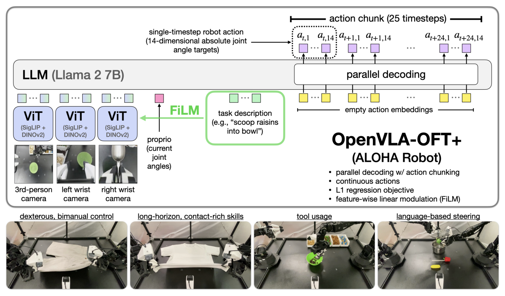
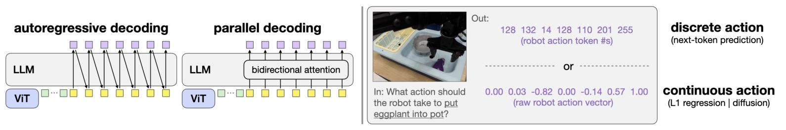

# Fine-Tuning Vision-Language-Action Models: Optimizing Speed and Success

> arXiv 2502.19645v2 · Stanford University（Moo Jin Kim, Chelsea Finn, Percy Liang）· RSS 2025 · 代码：https://github.com/moojink/openvla-oft · 项目页：https://openvla-oft.github.io
> 材料在本地 `C:\Users\24431\WorkBuddy\2026-10-21-23-14-57\papers\fine-tuning-vision-language-action-models-optimizing-speed-s\`（paper.pdf / paper.tex / paper.txt / figures/ / code/）

## 基本情况

- **一句话**：输入「多路相机图像 + 机器人本体状态 + 语言指令」→ 输出「未来 K 步的连续关节/末端位姿动作」，一次前向出整块动作（action chunk）。
- **开源**：代码开源（openvla-oft）/ 权重开（LIBERO 与 ALOHA 的 checkpoint）/ 数据不开（LIBERO 用公开仿真数据，ALOHA 是自采的 20–300 条演示）。
- **和读过的哪篇最像、差在哪**：基座是 OpenVLA（自回归 + 离散动作 token）；对标 π0（flow matching + action expert）与 RDT-1B（扩散）。差别在于这篇不谈新架构，只谈「微调配方」——同样的 7B VLA，换掉解码方式/动作表示/损失函数，速度 26–43×、LIBERO 97.1%。
- **一句话定位**：这是一篇**工程配方论文**，不是模型论文。它的贡献是「证明原来那套默认做法是可以被推翻的」，并且给出推翻之后的具体数字。

## 导读地图

行号指 paper.tex。

| 站 | 这一站讲清楚什么（一句话） | 图 | 原文位置 | 代码 |
|---|---|---|---|---|
| ① 动机 | VLA 微调没有配方；自回归太慢（3–5 Hz）、双臂任务上还做不好 | 图 1 | §1 L42–50 | — |
| ② 架构 | 三路图像走同一套 SigLIP+DINOv2 → 拼上状态与指令 → Llama-2 双向注意力 → MLP 头出 K×D 动作 | 图 1、图 2 | §4.2 L101–118 / 附录 A.1 L400 | `prismatic/extern/hf/modeling_prismatic.py` |
| ③ 训练 | L1 回归，不是交叉熵也不是扩散；LoRA 微调；无 FiLM(LIBERO) / 有 FiLM(ALOHA) | — | §4.2 L112 / 附录 A.2 L419–443 | `vla-scripts/finetune.py`、`models/action_heads.py` |
| ④ 数据 | 一条样本 = 3 张 224² 图 + 14 维关节角 + 一句指令 + 25×14 动作块；ALOHA 每任务 20–300 条演示 | 图 3 | §5.1 L153–157 / §6.1 L287–299 | `prismatic/vla/datasets/rlds/` |
| ⑤ 信息流 | 单次前向：3×256 patch + 1 状态 token + ~20 语言 token → 双向注意力 → 4 层 MLP → 25×14 | 图 1 | §4.2 L106–118 | `experiments/robot/openvla_utils.py`（predict_action） |
| ⑥ 例子 | 场景：ALOHA「scoop raisins into bowl」 | — | — | 同上 + `action_tokenizer.py` |
| ⑦ 实验 | LIBERO 76.5→97.1%（+26×）、ALOHA 超 π0/RDT-1B 最多 15 个点、25 Hz 实机 | 表 I、图 4 | §5.2 L207 / §6.3 L307 | — |

---

## ① 动机

### 1.1 任务是什么（具体到一句指令）

一条 ALOHA 流水线任务：**左臂把绿碗挪到桌子中间，右臂用金属勺把指令指定的配料舀进碗里**。指令可能是 `scoop raisins into bowl`，也可能是 `scoop almonds and green M&Ms into bowl` 或 `scoop pretzels into bowl`。

同一套场景、同一套动作，只有目标物不同——这正是语言必须起作用的地方。

任务共同点：**双臂**、**25 Hz 控制频率**、**3 个相机**（1 顶视 + 2 腕部）。而 OpenVLA 预训练时见的是**单臂 + 单相机 + 3–10 Hz + 相对末端位姿动作**。分布差得非常远。

### 1.2 照搬原配方会卡在哪

最省事的做法是照抄预训练配方：自回归解码 + 7 个离散动作 token + 交叉熵。问题全在速度和可扩展性上：

| 环节 | 数字 |
|---|---|
| 生成单步动作（7 维） | 7 次串行前向 = **0.33 s**（A100） |
| 实际控制频率 | **3–5 Hz** |
| 双臂高频机器人需要 | **25–50+ Hz** |

想「多看几步」（action chunking，一次预测未来 K 步）本来能提分，但自回归下要 **K×D 次**串行前向（K=25、D=14 → 350 次）——越想办法提速越慢。

### 1.3 已有两条路线都不够

| 路线 | 代表 | 效果 | 局限 |
|---|---|---|---|
| 改 tokenization | MiniVLA、FAST | 2–13× | 仍是自回归，逐 token 生成的天花板还在；FAST 块间延迟 **750 ms** |
| 生成式（扩散 / flow matching） | π0、RDT-1B | 一次出整块 | 训练收敛慢、推理要多步去噪（π0 是 10 步） |

750 ms 是什么概念：25 Hz 下一个控制周期是 40 ms，停 750 ms 等于机器人每秒卡住四分之三秒。

### 1.4 作者的押注

> **微调配方比模型架构、比预训练数据覆盖更重要。**
> 把「怎么解码、怎么表示动作、用什么损失」这三件事选对，一个只在单臂数据上预训练过的 7B VLA，能打赢专门为双臂预训练的 π0（8K 小时双臂数据）和 RDT-1B（6K episodes）。

拆成三个层层递进的子结论：

1. **并行解码 + action chunking**：既提速又提分（+14 点）；
2. **连续动作表示**：比离散再 +5 点；
3. **L1 回归**：与扩散打平（95.3 vs 95.4），但训练收敛快、推理只要 1 步（扩散 50 步）。

---

## ② 架构

这一站按「原版 → OFT 改成什么 → 为什么」对照讲。




### 2.0 先把原版讲清楚（后面所有改动都从这里出发）

**原版 OpenVLA 的输入输出**：

```
输入：1 张 224×224 第三人称图 + 一句指令（如 "put eggplant into pot"）
输出：7 维动作 [Δx, Δy, Δz, Δroll, Δpitch, Δyaw, 夹爪]（相对末端位姿增量）
```

**前向流程**：

```
图像 → 切成 256 个 patch → 每个 patch 一个向量（token）
指令 → ~20 个文本 token
两者拼起来（≈276 token）→ Llama-2 7B → 吐出 7 个「动作词」
每个词 = 256 个格子里的一个编号 → 反查成 [-1, 1] 的数值
```

**视觉骨干是「融合」的**：同一张图同时喂 **SigLIP**（擅长语义、图文对齐）和 **DINOv2**（擅长空间、纹理细节）两个 ViT，各出 256 个 patch 向量，**在隐藏维上拼接**——token 数仍是 256，只是每个 token 变长。代码里 `pixel_values` 是 **6 通道**：前 3 通道给 SigLIP、后 3 给 DINOv2。

之后过 3 层 MLP projector 投到 Llama 的 4096 维空间。

> **关键结构**：语言模型天生只会「看前文猜下一个词」，所以 7 个动作词是**一个接一个**生成的，每个都要把 7B 模型跑一遍。**这一点解释了后面所有改动。**

### 2.1 六处改动总表

前五处合起来叫 **OFT**（Optimized Fine-Tuning），第六处加上之后叫 **OFT+**。

| # | OpenVLA 原版 | OFT | 为什么 | 出处 |
|---|---|---|---|---|
| 1 | 1 张第三人称图 | 1–3 张（ALOHA 顶视+双腕），共享 SigLIP+DINOv2，每张 256 patch | 双臂任务必须看腕部近景 | §4.2 L116；`modeling_prismatic.py:196-210` |
| 2 | 无本体状态 | 14 维关节角 → 2 层 MLP → **1 个** token，拼在视觉 patch 之后 | 高频控制要知道自己关节在哪 | §4.2 L116；`modeling_prismatic.py:449-459` |
| 3 | 因果注意力，逐 token 生成 | 双向注意力：塞 K×D 个空占位 embedding，一次前向全填满，末尾加 stop token | 把 D 次串行变 1 次 | 附录 A.2.1 L422-425；`modeling_prismatic.py:734-755` |
| 4 | 离散 256 bins + 交叉熵 | 拆掉动作 token 输出层，换 4 层 MLP 动作头，连续值 | 去量化损失，精度更高 | §4.2 L110-112；`action_heads.py:84-107` |
| 5 | 单步 7 维动作 | 动作块 K：LIBERO 8、ALOHA 25、Bridge 5 | 摊薄单次前向成本 + 减少复合误差 | `vla/constants.py` |
| 6 | — | FiLM：语言嵌入 → γ,β 调制两个 ViT 每一块的视觉特征（(1+γ)⊙F+β） | 防模型只看图像忽略指令 | §4.3 L120-133；`film_vit_wrapper.py` |

六处**互相咬合**，不是六个独立小改进：没有 3，5 跑不动；没有 5，1 和 2 增加的计算量吃不下；没有 4，3 和 5 只能停在 90.2%。

---

### 改动 1：一张图 → 多张图

**改法**：`num_images_in_input` 从 1 改成 3。每张图**依次走同一套**编码器和 projector，各出 256 token，沿**序列维**拼起来：

```
顶视图   → 256 个 token ┐
左腕图   → 256 个 token ├→ 768 个 token 一起送进 Llama
右腕图   → 256 个 token ┘
```

**为什么需要**：叠衣服时两条机械臂自己就挡住一半桌面；「布料卡在哪个指缝里」「夹爪离袖口几厘米」只在腕部相机里。

**为什么共享权重而不是三套编码器**：数据量。ALOHA 每任务只有 20–300 条示教，从零训三套视觉编码器必然过拟合。共享等于把「怎么看图」的数据量乘 3，而且三个视角成像特性相同，没必要分开学。

**代价与收益**：序列 256 → 768，注意力计算按平方涨。但因为有并行解码，这点代价吃得下：LIBERO 加 1 张腕部图后，吞吐 109.7 → **71.4 Hz**，成功率 95.3 → **97.1%**。

---

### 改动 2：本体状态（proprioception）

**是什么**：本体感觉——人闭眼也知道自己手举在哪。机器人的版本就是关节角读数。ALOHA 双臂 6+1×2 = **14 维**。

**为什么必须有**：

1. 图像有遮挡和延迟（相机 30 Hz、控制器 25 Hz，图总是「过去」的），关节角是即时精确的；
2. ALOHA 的动作是**绝对关节角目标**，不给当前角度等于盲猜起点（原版预训练用的是**相对**末端位姿，不需要起点）；
3. 顶视图里两条臂长得一样，光看图容易搞混左右。

**改法**：

```
14 个归一化数 → 2 层 MLP(GELU) → 4096 维 → 1 个 token，append 在 768 个视觉 token 之后
```

**为什么压成 1 个 token**：① 这 14 个数没有空间结构（不像图像 patch 需要各自位置）；② 彼此没有前后文关系（不需要互相注意）；③ 信息量小（4096 维塞 14 个标量绰绰有余）。

**归一化必须做**：关节量纲差异巨大（±180° / ±0.05 m / 0~1），不归一化会被大数值关节主导。

| 平台 | 归一化 | 含义 |
|---|---|---|
| LIBERO | `BOUNDS_Q99` | 1%/99% 分位数当上下界，超出截断 |
| ALOHA | `BOUNDS` | 最小/最大值 |
| Bridge | `BOUNDS_Q99` | 同上 |

用分位数而不是最大最小值，是防止个别离谱示教（关节转到底）把量程拉爆。

---

### 改动 3：并行解码（提速核心）

**原版生成过程（7 次前向）**：

```
第 1 次：[BOS] + 256图token + 20指令token                → 第1个词 "128"
第 2 次：[BOS] + ... + "128"                             → 第2个词 "132"
第 3 次：[BOS] + ... + "132"                             → 第3个词 "14"
...
第 7 次：[BOS] + ...                                     → 第7个词 "255"
```

卡住它的是**因果 mask**（上三角遮罩：「第 i 个位置只能看到第 1..i 个位置」）——这是语言模型「不能偷看答案」的机制，也正因为如此，第 i 个词必须等第 i-1 个词生成完。

**改成并行要动两处**：

1. **输入侧**：不喂「已生成的词」，改喂 **K×D 个空 embedding**——值完全相同，**只有位置编码不同**（位置编码告诉模型「你是第几号位置」，否则一排一模一样的空格子分不清）。
2. **mask 侧**：因果 mask → **全 1（双向）**。每个动作位置能看到所有图像 token、指令 token、以及其他动作位置。

**为什么必须双向**：动作之间强相关（第 5 步抬 2cm、第 6 步继续抬 1cm 是同一条轨迹上的两点），互相可见才能保证整段连贯。因果 mask 下第 5 步看不到第 6 步，等于让模型「猜」。

**为什么不会变笨**：自回归理论表达力更强，但这里输出是**固定长度的动作向量**，没有「该说几个词」的不确定性。实验也证实：LIBERO 四个 suite 没有一个退化。

> **代价：KV cache 失效**。自回归时可以把前面算过的注意力缓存起来，第 2~7 个词更快。并行后每次全序列重算——但**只算一次**：0.2396 s → **0.0629 s**，仍快 3.8 倍。用「每次都全算」换「只算一次」，很划算。

> **代码里的一个坑（论文没写）**：占位符后面还跟着**一个 stop token**（`</s>`），因为双向注意力下训练时它也在序列里，推理时不带上会跟训练不一致。

---

### 改动 4：离散 → 连续（图 2 给了真实数字）

图 2 右半把**同一组动作的两种存法**并排画出来了：

```
离散（robot action token #s）：  128  132   14  128  110  201  255
连续（raw robot action vector）：0.00 0.03 -0.82 0.00 -0.14 0.57 1.00
```

把编号代回桶中心公式（第 k 号桶中心 ≈ 2k/255 − 1），几乎一一对应：

| 编号 | 代回得到 | 连续值 |
|---|---|---|
| 128 | ≈ 0.00 | 0.00 |
| 132 | ≈ 0.04 | 0.03 |
| 110 | ≈ −0.14 | −0.14 |
| 201 | ≈ 0.58 | 0.57 |
| 255 | ≈ 1.00 | 1.00 |

**结论**：离散和连续不是两种模型，是**同一个动作的两种存法**——「第几号抽屉」vs「抽屉里的实际数值」。

**离散的两个毛病**：

- **精度上限**：每格宽 2/256 ≈ **0.0078**。归一化后若对应 ±180°，就是 **±1.4°**——「捏拉链头」这种任务里够致命。
- **桶边界抖动**：0.0039 和 0.0040 落到相邻两个桶，同一个动作被标成两个不同的词，训练信号变噪。

**改法**：拆掉词表输出层（原来投到 32000 个词上，动作词占词表末尾一段，`ACTION_TOKEN_BEGIN_IDX = 31743`），换 4 层 MLP（ReLU）。

> **代码里才看得出的设计**：不是「一个 token 出一维动作」。代码把**同一时间步的 D 个 token 的隐状态拼起来**（14 × 4096 = 57344 维）再过 MLP，输出该步的 14 维。也就是**一步内的 14 个关节是一起商量出来的**（左右手腕必须协调）。
> 另外：论文说「4 层 MLP(ReLU)」，代码是 `MLPResNet(num_blocks=2)`——2 个残差块，等效 4 层，但带残差连接。

**为什么 L1 而不是 L2**：

| 损失 | 最优解 | 后果 |
|---|---|---|
| L2 / MSE | **平均值** | 同一画面有两条都对的路径（左绕/右绕）时，平均成「直着撞过去」——一条不存在的路 |
| L1 | **中位数** | 被拉向其中一条真实路径，不凭空造；梯度恒定 ±1，小误差也学得动 |

**收益（表 I，同为 PD+AC）**：离散 90.2% → 连续+L1 **95.3%**，与连续+扩散（95.4%）打平，但推理只要 1 步。

---

### 改动 5：一次出 K 步（action chunking）

**K 体现在占位符数量 K×D**：

| 平台 | K | D | 占位符数 | 时间跨度 |
|---|---|---|---|---|
| LIBERO（仿真） | 8 | 7 | 56 | ~0.8 s |
| ALOHA（真机双臂） | 25 | 14 | 350 | **正好 1 秒**（25 Hz × 25 步） |
| Bridge（真机单臂） | 5 | 7 | 35 | — |

ALOHA 的 K=25 不是随手定的：控制频率 25 Hz，一次预测 25 步 = 覆盖 1 秒。

**好处**：① 摊薄成本（出 1 步和 25 步都是一次前向）；② 动作连贯，减少每 40 ms 重决策的抖动；③ 减少复合误差（每步小偏差会累积，一次看 25 步可以往前多看一点来抵消）。

**代价：块内不能改主意**。一次算 25 步，执行到第 3 步发现碗被碰歪了，得等第 25 步跑完才能重新规划。

> **图 6 的反例**：RDT-1B 一次预测 64 步，在「舀料进碗」里碗没放到位仍**继续往空处倒**——它以为自己还在碗上方，块内没有纠正机制。而 π0 会重新尝试抓青椒，对视觉反馈更敏感。

**量化代价**：加 K=8 使延迟 0.0629 → 0.0735 s（**+17%**），吞吐涨 6.8 倍。**延迟几乎不变、吞吐线性增长**，这是并行解码给的。

---

### 改动 6：FiLM 语言调制（OFT 的「+」）

**问题长什么样**：训练数据里「舀葡萄干」和「舀椒盐卷饼」的画面几乎一样（同一个绿碗、同一把勺、同一位置），只有指令几个单词不同。模型会走捷径——**不看指令看画面猜**（虚假相关）。而且语言只在任务某一瞬间（决定去哪一堆）才关键，其余阶段（伸手、抓住、抬起）跟指令无关。

**做法**（一行公式）：

```
F_new = (1 + γ) ⊙ F + β
```

γ、β 来自**整句指令的平均语言嵌入**，各过一个小线性层。

> **三个必须做对的实现细节**
>
> **① 作用在哪个维度**：γ、β 是 **D_ViT 维**（如 1152），作用是「第 j 个元素缩放**全部 256 个 patch** 的第 j 维」——**空间无关**。改成「每个 patch 各有一套 γ、β」语言跟随会明显变差。这是从卷积 FiLM 搬来的直觉：卷积里 γ 按通道，作用于整张特征图。
>
> **② 插在哪**：`x = x + attn(norm1(x))` → `x = x*(1+γ)+β` → `x = x + mlp(norm2(x))`，即**注意力之后、前馈之前**，SigLIP 与 DINOv2 都插，每层一套投影器。
>
> **③ 为什么是 1+γ**：初始化时 γ≈0、β≈0，`1+γ≈1` 等于恒等变换，不破坏预训练视觉特征。若直接用 γ，初始化就把特征清零。

**收益（图 5，两个语言相关任务）**：无 FiLM **33%**（= 随机三选一，三个目标物）→ 有 FiLM **97%**。这是全篇最有说服力的消融。

**一个我看出来的隐患**：用整句嵌入的平均，词序信息丢了——「碗舀进葡萄干」和「葡萄干舀进碗」平均后一样。论文没讨论。

---

### 2.2 代码里看到的、论文没细写的

- 动作头不是「一个 token 回归一维」：第 i 步的 `ACTION_DIM` 个 token 隐状态拼成 `D×H` 向量，再进 MLPResNet 出该步的 14 维 → 块内每步独立，步内 14 维联合。
- 论文说动作头 4 层 MLP(ReLU)，代码是 `MLPResNet(num_blocks=2)`，2 个残差块 ≈ 4 层全连接（额外带残差）。
- 序列里除 K×D 个占位 token 外还多一个 stop token，因为双向注意力下训练时它也在，推理不带会跟训练不一致。
- FiLM 插入位置（`film_vit_wrapper.py:56-75`）：`x = x + attn(norm1(x))` → `x = x*(1+γ)+β` → `x = x + mlp(norm2(x))`。
- 视觉输入是 6 通道，`torch.split(pixel_values, [3,3], dim=1)`；多图时按 `[6]*N` 切。
- 训练时序列里放了**两段**动作（`current_action_mask | next_actions_mask`），论文没提，原因待查（可能是让模型学会块与块之间如何衔接）。
- 图 2 的离散/连续两组数字可以互相验算（见改动 4）。

### 2.3 接口一览

| 平台 | 图像 | 状态 | K | D | 动作 token 数 | 吞吐 | 延迟 |
|---|---|---|---|---|---|---|---|
| LIBERO | 1（可选 +腕部） | 8（可选） | 8 | 7 | 56 | 109.7 Hz（无额外输入）/ 71.4 Hz（有） | 0.073 / 0.112 s |
| ALOHA | 3 | 14 | 25 | 14 | 350 | 77.9 Hz | 0.321 s |

> ALOHA 那行的关键：**0.321 秒出 1 秒的动作**（25 步 ÷ 25 Hz）。能跑 25 Hz 不是因为算得比 40 ms 快，而是**算一次用一秒**——生成速度远大于消耗速度。

---

## ③ 训练

### 3.1 损失：L1 回归

```
L(θ) = (1/N) · Σ | a_pred − a_gt |,   a ∈ [-1, 1]^(K×D)
```

| 符号 | 是什么 | 形状 / 取值 |
|---|---|---|
| a_pred | 动作头 MLP 输出的归一化动作 | (K, D) = (25, 14) |
| a_gt | 示教数据的真实动作（同样归一化） | (25, 14) |
| N | 元素总数 | K×D = 350 |

代一组小数字（缩到 K=2、D=2 感受一下）：预测 `[[0.10, -0.20], [0.50, 0.00]]`，真值 `[[0.15, -0.10], [0.40, 0.30]]`，逐元素差 `[0.05, 0.10, 0.10, 0.30]`，平均 = **0.1375**。训练就是把 350 个这样的差值往下压。

论文的收敛判据就是这个数：**归一化 L1 损失降到 0.01 以下**（相当于平均每维偏差 1% 满量程）。

### 3.2 训练流程（没有多阶段，一次训完）

| 项 | LIBERO | ALOHA |
|---|---|---|
| 微调方式 | LoRA（r=32, α=16, dropout=0） | 同 |
| 步数 | 非扩散 50–150K / 扩散 100–250K | 50–150K |
| batch | 64–128 | 32 |
| 硬件 | 8× A100/H100 | 8× A100/H100-80GB |
| 学习率 | 5e-4 → 5e-5（100K 步后衰减） | 5e-4 → 5e-5（50K 步后衰减） |
| FiLM | 不用 | 用（OFT+） |
| 评测 | 每 50K 步存一次，报最好 | — |

> **为什么用 LoRA**：微调数据只有 500 条（LIBERO）到 300 条（ALOHA），相对预训练的 1M 条差三个数量级，全参数微调容易把预训练知识洗掉。LoRA 只在注意力/前馈的权重上加低秩旁路，r=32 意味着每个被适配的权重矩阵只学 32 维的增量。

### 3.3 训练和推理不一样的地方

| 环节 | 训练 | 推理 |
|---|---|---|
| 动作输入 | 空占位符（与推理一致） | 空占位符 |
| 步数 | 一次前向算完整个块，与真值比 | 同 |
| 去噪 | 无（L1 单步） | 无 |
| 输出 | 直接回归 | 直接回归 |

L1 版本训练和推理**完全对称**，这是它比扩散省事的地方——扩散训练时要随机采噪声和时间步、推理时要迭代去噪（50 步），两套流程。

---

## ④ 数据

### 4.1 一条训练样本长什么样（ALOHA，代码确认 + 示意值）

| 字段 | 形状 | 单位 / 取值 | 例子值（示意） |
|---|---|---|---|
| 顶视图像 | 224×224×3 | uint8 / [0,1] | — |
| 左腕图像 | 224×224×3 | 同上 | — |
| 右腕图像 | 224×224×3 | 同上 | — |
| 关节角 proprio | 14 | 归一化 [-1,1] | 6 个左臂 + 1 左夹爪 + 6 右臂 + 1 右夹爪 |
| 语言指令 | ~20 token | 文本 | `scoop raisins into bowl` |
| 动作块 | 25×14 | 归一化 [-1,1] | **绝对关节角目标**（不是增量） |
| 归一化统计量 | 每维 min/max | — | 存在 checkpoint 的 `dataset_statistics.json` |

> 动作的 14 维含义：左臂 6 个关节角 + 左夹爪开合 + 右臂 6 个关节角 + 右夹爪开合。**注意是绝对值**——这与 OpenVLA 预训练的相对末端位姿完全不同，是「分布偏移」的一部分。

### 4.2 怎么变成模型输入

1. 每张图缩到 224×224，归一化 → 复制成 6 通道（SigLIP 3 + DINOv2 3）。
2. 关节角与动作都用训练集的统计量归一化到 [-1,1]。
3. 动作块从当前时刻往后取 25 步（不足则截断/重复末尾）。
4. 多机器人维度不同怎么对齐：这篇不做跨本体统一——**每个平台一套常量**（`constants.py` 里按命令行参数自动选 LIBERO / ALOHA / BRIDGE）。

### 4.3 规模与来源

| 数据集 | 规模 | 机器人 | 采集方式 |
|---|---|---|---|
| LIBERO | 4 suite × 10 任务 × 500 条示教 | Franka Panda（仿真） | 仿真专家轨迹 |
| ALOHA | fold shorts 20 / fold shirt 30 / scoop 45 / put 300 条 | 双臂 ViperX 300（真机） | **遥操作示教** |
| BridgeData V2（附录扩展） | 50K+ 条 | 单臂 WidowX | 多机构采集 |

> **最值得注意的数字**：fold shorts 只用了 **20 条**示教。这就是「VLA 预训练有用」的实证——20 条数据从零训任何策略都不可能学会叠裤子。

---

## ⑤ 输入输出信息流

### 5.1 一次前向（推理，ALOHA）

```
3 张 224×224×6 图 ──SigLIP+DINOv2（共享）──▶ 3 × 256 = 768 个 patch token
14 维关节角 ──2 层 MLP──▶ 1 个 token
指令 "scoop raisins into bowl" ──tokenizer──▶ ~20 个 token
                    ↓ 沿序列拼接（≈789 个位置）
        Llama-2 7B（双向注意力，一次前向）
                    ↓ 取动作位置那 350 个隐状态
       action head（MLPResNet）──▶ 25 × 14 的归一化动作
                    ↓ 反归一化（乘回训练集统计量）
            25 步绝对关节角目标 → 以 25 Hz 依次下发给控制器
```

**关键点**：

- **只算一次**，没有循环、没有去噪迭代、没有 KV cache。
- 350 个动作 token 是**输入里就准备好的空位**，不是生成出来的。
- 输出是**整块**，执行完 1 秒（25 步）后再拍新图、重新推理一次。

### 5.2 与原版的对比

| | 原版 OpenVLA | OpenVLA-OFT |
|---|---|---|
| 前向次数 | 7 次（每维一次） | 1 次（整块） |
| 输出 | 7 个离散编号 | 350 个实数（25×14） |
| 循环 | 有（逐 token） | 无 |
| 单次耗时 | 0.24 s / 步 | 0.32 s / 块 |

---

## ⑥ 例子走一遍（结构流程，非真实样本）

> 说明：这一节是按代码结构推的流程，**没有加载真实数据集验证数值**。标「代码确定」的是从代码读出来的，标「示意」的是为了讲清楚编的数。

场景：ALOHA，指令 `scoop raisins into bowl`。

**t = 0**

1. 拍三张图，取当前 14 维关节角 → 组成一条样本。（代码确定）
2. 三张图 → 768 个视觉 token；关节角 → 1 个 token；指令 → ~20 个 token。（代码确定）
3. 在序列末尾加 **350 个空占位符 + 1 个 stop token** = 序列总长约 1140。（代码确定）
4. 一次前向，取占位符那 350 个位置的隐状态。（代码确定）
5. 每 14 个 token 拼成一个 57344 维向量，过 MLP → 该步的 14 维动作。25 步 → (25, 14)。（代码确定）
6. 反归一化 → 25 步绝对关节角目标，标为 a_0 … a_24。（代码确定）

**t = 0 ~ 1 s（执行）**

7. 控制循环每 40 ms 取一步下发，25 步正好 1 秒。期间**不再推理**。（论文：执行完整块再重规划）

**t = 1 s**

8. 重新拍图、取关节角 → 回到第 1 步。上一块的缓存全部丢弃，不跨块复用。

**多轮之后**：稳定在「推理 0.32 s（后台）→ 执行 1 s」的节奏，只要推理时间 < 块时长，机器人就连续。

---

## ⑦ 实验与地位

### 7.1 LIBERO（仿真，表 I）

| 方法 | 平均成功率 |
|---|---|
| Diffusion Policy（从零训） | 72.4 |
| Octo（微调） | 75.1 |
| DiT Policy | 82.4 |
| **OpenVLA 原配方** | **76.5** |
| + 并行解码 & chunk（离散） | 90.2 |
| + 连续 & 扩散 | 95.4 |
| **+ 连续 & L1（= OpenVLA-OFT）** | **95.3** |
| π0（大规模双臂预训练 + flow matching） | 94.2 |
| **OpenVLA-OFT + 腕部图/状态** | **97.1** |

三组对照读出的三件事：① 并行 + chunk：**+14 点**（提速技巧同时提分）；② 连续 vs 离散：**+5 点**；③ L1 ≈ 扩散（95.3 vs 95.4），但推理 1 步 vs 50 步。

### 7.2 效率（表 II / 表 III）

| 配置 | 吞吐 | 延迟 | LIBERO-Long |
|---|---|---|---|
| OpenVLA | 4.2 Hz | 0.2396 s | 53.7% |
| + PD | 15.9 Hz | **0.0629 s** | — |
| + PD&AC | 108.8 Hz | 0.0735 s | 86.5% |
| + PD&AC, Cont-L1 | **109.7 Hz** | 0.0729 s | 90.7% |
| + Cont-扩散（50 步） | 4.2 Hz | 1.9070 s | 91.1% |
| + Cont-扩散（10 步） | 19.3 Hz | 0.4145 s | 91.0% |
| + Cont-扩散（1 步） | 109.4 Hz | 0.0731 s | **0.0%** |

最后一行值得记住：扩散降到 1 步，速度追上了 L1，但成功率归零——说明扩散的「多步」不是可省的额外开销，是它工作的前提。

**ALOHA 真机（表 III）**：

| 方法 | 参数量 | 吞吐 | 延迟 |
|---|---|---|---|
| OpenVLA | 7.5B | 1.8 Hz | 0.543 s |
| **OpenVLA-OFT+** | 7.5B | **77.9 Hz** | 0.321 s |
| RDT-1B | 1.2B | 84.1 Hz | 0.297 s |
| π0 | 3.3B | 291.6 Hz | 0.086 s |
| ACT | 84M | 432.8 Hz | 0.058 s |

小模型吞吐高很正常（ACT 只有 84M）。有意义的是 **OpenVLA-OFT+ 追平了比它小 7 倍的 RDT-1B**——因为它单次前向出整块，而扩散类要多步去噪。

### 7.3 消融

- **去掉预训练**：跳过 OpenVLA 预训练、直接用 OFT 配方微调底层 VLM → 平均成功率掉 **5.2 点**。说明预训练表示仍然有价值。
- **FiLM 换到 LIBERO**：几乎没影响（表 XIV）——因为 LIBERO 不加 FiLM 语言跟随已经不错。这解释了为什么只在 ALOHA 用 FiLM。
- **单一策略训四个 suite**：与分开训练效果相当（表 XIV）。

### 7.4 局限（作者承认的）

1. **多模态示教**：实验数据每个任务只有一种做法。L1 学中位数，遇到「同一画面多种正确做法」时可能只学一种；扩散能表达多模态但可能过拟合到次优模式。
2. **只验证了微调**：OFT 是否适用于预训练、大规模训练是否仍需扩散，未知。
3. **语言接地不一致**：无 FiLM 时 ALOHA 崩到 33%，但 LIBERO 加 FiLM 几乎没影响——原因不明。

### 7.5 这篇的地位

它是「VLA 微调」这条线上的基准配方：后续很多工作（包括各种开源 VLA 的微调脚本）默认就带 parallel decoding + action chunking + L1。它证明了「不换模型也能大幅改进」，同时也把「扩散/flow matching 是不是必须」这个问题摆到台面上——至少在数据量不大（几十到几百条示教）的微调场景，答案是不必须。

---

## 问答

- **Q（开讲前）**：这个 skill 是这样用的吗？
  **A**：是。一站一站讲，讲完停下问要不要继续；可以随时插话、跳站。
- **Q（② 站）**：OFT 相比 OpenVLA 具体改进了哪些方面？
  **A**：六处，前三处是主干——并行解码（双向注意力 + 空占位符）、连续动作 + L1、动作块 K。其余三处是补丁：多相机输入、proprio 关节角、FiLM 语言调制。六处互相咬合，不是六个独立小改进。
- **Q（② 站）**：离散动作和连续动作是什么关系？
  **A**：同一组动作的两种存法。离散是「第几号抽屉」（256 个桶的编号），连续是「抽屉里的实际数值」。图 2 给了同一动作的两行数字，可以互相验算。

## 代码 ↔ 论文

| 论文里 | 代码位置 | 备注 |
|---|---|---|
| 双向注意力 + 空占位符 | `modeling_prismatic.py:734-755` | 占位符后还有 stop token，论文没写 |
| L1 动作头（4 层 MLP, ReLU） | `action_heads.py:84-107` | 实为 `MLPResNet(num_blocks=2)`，带残差 |
| 每步 D 维动作 | `action_heads.py:105` | 同一步的 D 个 token 隐状态拼接后联合回归 |
| K=8 / 25 / 5 | `prismatic/vla/constants.py` | 按命令行参数里的平台名自动选常量 |
| proprio 投影 | `modeling_prismatic.py:449-459` | 2 层 MLP(GELU) → 1 个 token，append 在视觉之后 |
| FiLM | `film_vit_wrapper.py:56-75` | attention 后、FFN 前；每层独立投影器 |
| LoRA 微调 | `vla-scripts/finetune.py:105-109` | rank 32、alpha 16、dropout 0 |
| 训练时两段动作 | `vla-scripts/finetune.py:344-345` | `current_action_mask \| next_actions_mask`，论文未提 |
| 多图 6 通道打包 | `modeling_prismatic.py:196-225` | `torch.split(pixel_values, [6]*N, dim=1)` |
