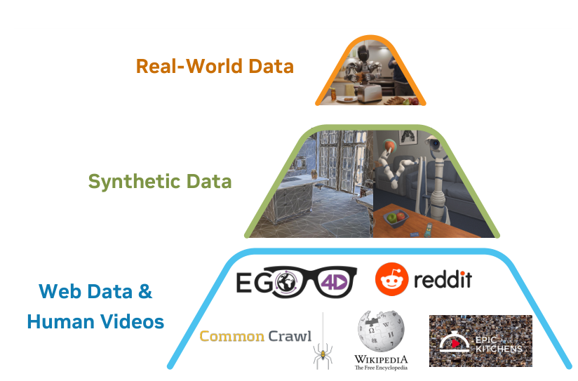
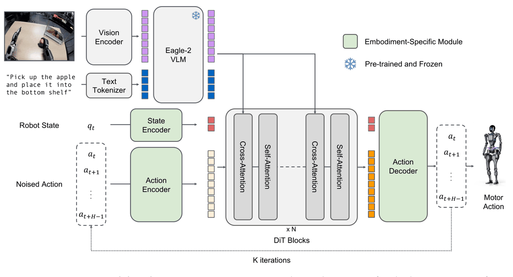
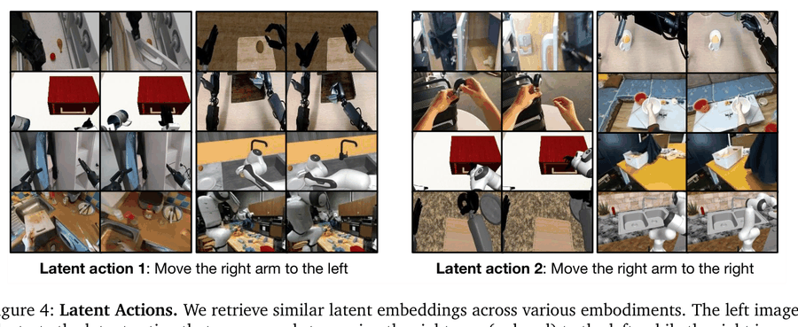
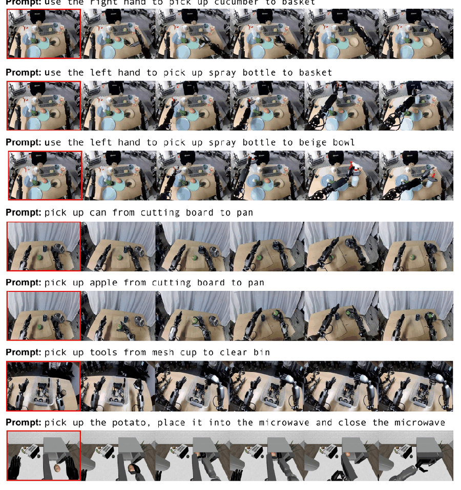
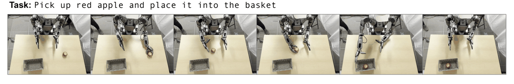
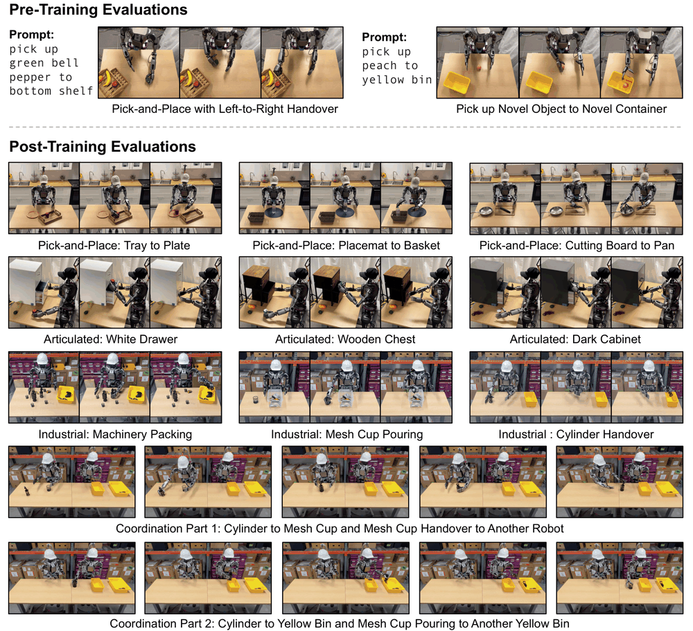

# 精读笔记 · GR00T N1: An Open Foundation Model for Generalist Humanoid Robots

> arXiv:2503.14734v2（2025-03-27；v1 在 2025-03-18 的 GTC 上同步放出）· NVIDIA（60 余人署名，研究负责人 Linxi "Jim" Fan 与 Yuke Zhu）· 代码 [Isaac-GR00T](https://github.com/NVIDIA/Isaac-GR00T) · 权重 GR00T-N1-2B 在 HuggingFace
> 本地材料：`C:\Users\24431\Zotero\storage\39KY96XQ\`（paper.pdf / code/ / 逐图讲解版 `gr00t-n1-xray/gr00t-n1.html`）
> ⚠️ 仓库现在是 N1.5 / N1.7：backbone 从 Eagle-2 换成 Cosmos-Reason2-2B，动作块从 16 改成 40。要对照本文得看早期 tag。

## 基本情况

- 一句话：输入 **多路相机图像 + 一句语言指令 + 本体状态** → 输出 **一段 16 步的连续动作块**（每台机器人维度不同，由各自的投影层还原）。
- 结构：Eagle-2 视觉语言模型（1.34B，文字部分冻结）+ 一个从零训的 DiT（16 层，动作头），靠**交叉注意力**连接。总 2.2B，L40 单卡跑 120 Hz。
- 开源：代码公开（已更新到 N1.7）；权重 GR00T-N1-2B 公开；训练数据**不直接发布**，但列出了全部来源（表 7），仿真环境与基准公开。
- 和读过的哪篇最像、差在哪：
  - 和 **π0** 同属「VLM + flow matching 动作头 + 动作块」这条路，**架构几乎没原创**。差别在接法：π0 是单塔双专家（两套 FFN 按 token 类型硬路由），GR00T 是独立 DiT + 交叉注意力。GR00T 自己说这样换任何 VLM 都能接。
  - 和 **SmolVLA** 比：都是 flow matching、都用动作块。SmolVLA 赌「小模型 + 冻结底座」，GR00T 赌「数据换算率」。
  - 和 **RT-2 / OpenVLA** 比：那两篇把动作离散成 token 自回归，GR00T 走连续生成。
  - **真正的差别不在模型，在数据**：它有三套把「没有动作标签的数据」变成「有动作标签的样本」的机器。这是全文的核心，也是标题那句话的来源。

## 导读地图

| 站 | 这一站讲清楚什么（一句话） | 图 | 原文位置 | 代码 |
|---|---|---|---|---|
| ① 动机 | 真机遥操作只有 88.4 小时，撑不起基座模型，所以要把别的数据折进来 | 图 1 | §1 / §2.2 | — |
| ② 架构 | VLM 第 12 层 → 交叉注意力 → DiT ×16 → 动作解码器，唯一按本体分开的是三个 MLP | 图 3 | §2.1 | `gr00t/model/modules/dit.py` |
| ③ 训练 | 直线路径上的速度回归；论文式 (1) 的符号写反了，代码是对的 | 式 1 | §2.1 / 附录 D | `gr00t_n1d7.py:277-278, 518` |
| ④ 数据 | 一条样本长什么样；四类数据 8375.7 小时怎么拼出来的 | 表 7 | §2.2 / §3.1 | `configs/data/embodiment_configs.py` |
| ⑤ 信息流 | 训练一次前向 vs 推理 4 步去噪的形状变化 | 图 2 | §2.1 | `gr00t_n1d7.py:400-520` |
| ⑥ 例子 | 场景：`pick up red apple and place it into the basket`（苹果故意放在左手左边） | 图 11 | §4.5 | 同 ⑤ |
| ⑦ 实验 | 三个仿真基准 + 21 个真机任务；预训练增益随数据量收缩 | 表 2/3/4 | §4 | — |
| 审读 | 缺同架构对照、基线太老、10 次试验的噪声 | — | §4.3 | — |

---

## ① 动机

**任务**：一个模型驱动单臂、双臂、人形三类本体，做桌面级的抓取放置、开抽屉、拧水龙头、零件装筐。

**以前卡在哪**：VLA 这条路（RT-2 → OpenVLA → π0）都在拼数据规模。π0 用了 10000 小时自采机器人数据。GR00T 自己的真机遥操作只有 **88.4 小时**——按 20 Hz 录制、每天 8 小时算，是十一天的人力。用十一天去支撑「foundation model」这个词，说不通。

**作者的押注**：数据不够，不是去采更多，而是把**三类本来不能训的数据换算成能训的样本**。三种换算手段对应论文 §2.2 的三小节，也是全篇真正的贡献：

| 搬运方向 | 手段 | 代价 |
|---|---|---|
| 人类视频 → 有动作标签 | VQ-VAE 学隐动作码本，把相邻两帧的差编码成向量，当作「动作」 | 这个动作不对应任何真实关节 |
| 88 小时真机 → 827 小时视频 | 微调图生视频模型，换提示词生成反事实轨迹 | 105000 个 L40 GPU 小时 |
| 几十条示教 → 78 万条轨迹 | DexMimicGen 在仿真里把示教片段重组到新位姿 | 仿真与现实的物理差 |



图 1 的三层金字塔，论文配的话是「越往上数量越少、与本体的绑定越紧」。**这张图和它自己的表 7 对不上**：

| 类别 | 帧数 | 小时 | 相对 88.4 h |
|---|---|---|---|
| 真机机器人数据 | 262.3M | 3288.8 | 37× |
| 人类第一人称视频 | 181.3M | 2517.0 | 28× |
| 仿真轨迹 | 125.5M | 1742.6 | 20× |
| 视频模型生成 | 23.8M | 827.3 | 9.4× |
| 合计 | 592.9M | 8375.7 | 95× |

真机 3288.8 小时比人类视频 2517 小时还多，金字塔的底不宽。原因是 AgiBot-Alpha 一家就贡献了 1979.4 小时（214M 帧）。只算 GR00T 自己采的 88.4 小时，形状才成立。

> 所以这张图真正想说的不是「数量」，是「**标签可信度**」：越往上，动作标签越真。真机有精确关节角，仿真有精确关节角但物理是假的，生成视频没有指令，人类视频连机器人都没有。

**一个具体的问题**：人戴动捕手套在厨房里叠毛巾，录了 500 小时。视频里每一帧都能看到手在动、毛巾在变，但没有任何一处记录「当时手腕的六个自由度各是多少」。模仿学习要的正是这一对（画面 → 动作）。差的这一半，就是 ① 那台机器要补的。

---

## ② 架构



图 3 从左到右：图像 → Vision Encoder → Eagle-2（带雪花，表示冻结）→ 视觉语言 token；下方本体状态和加噪动作各走一个编码器；两路在中间那串灰色竖条（DiT）汇合；最后 Action Decoder 吐出 16 步动作。绿色框是**唯一按本体分开的参数**（状态编码器、动作编码器、动作解码器）。

**先摆接口**（这几个数不清楚，后面全乱）：

| 项 | 值 | 出处 |
|---|---|---|
| 图像 | 224×224，每帧 64 个 token | §2.1 |
| 动作块长度 H | **16 步** | §2.1「We set H=16」 |
| 执行频率 | 120 Hz（一步 8.3 ms） | §2.1 |
| 一块动作覆盖 | 16 × 8.3 = **133 ms** | 自己算 |
| 采样一块耗时 | **63.9 ms**（L40，bf16，K=4，batch=1） | §2.1 |
| 去噪步数 K | **4** | §2.1 |
| VLM 取第几层 | **第 12 层** | §2.1 |
| DiT 层数 | 16 层 / 32 头 | 代码 `diffusion_model_cfg` |
| 参数 | 2.2B（VLM 1.34B） | §2 |

| 模块 | 来源 / 初始化 | 参数量 | 训练时更新吗 | 作用 |
|---|---|---|---|---|
| 视觉编码器 | SigLIP-2（Eagle-2 的一部分） | 未给 | **更新** | 每帧 224² → 64 token |
| 语言模型 | SmolLM2 微调（Eagle-2） | 1.34B 总计 | **文字部分冻结** | 图文联合表示 |
| DiT 主干 | 从零训练 | 16 层 | **更新** | 预测速度场 |
| 状态 / 动作投影 | 从零训练 | 每本体一组（`CategorySpecificLinear`） | **更新** | 不同维度投到统一宽度 |
| 动作解码器 | 从零训练 | 每本体一组 | **更新** | 统一宽度还原成本体维度 |

**三个设计点**：

1. **交叉注意力 + 自注意力交替**。代码里 `idx % 2 == 1` 走自注意力，偶数层走交叉注意力。分工很清楚：自注意力管「这 16 步内部自洽」（第 1 步抓住，第 5 步才抬起），交叉注意力管「这块动作和眼前的场景对齐」（苹果在左边，第 1 步往左伸）。缺哪个都不行：只有交叉注意力，16 步各自独立查视觉 token 会互相打架；只有自注意力，模型看不见世界。

2. **取 VLM 第 12 层，不是最后一层**。最后一层是为「预测下一个词」训出来的，表示被挤压成词表分布，空间细节丢了大半；中间层更像「对画面的描述」。顺带把后 12 层不算，视觉语言侧算力砍一半，10 Hz 有一大半是从这里来的。

3. **不学 π0 的双专家**。π0 在同一个 Transformer 里放两套 FFN，按 token 类型硬路由。GR00T 用独立 DiT，理由是灵活性（换任何 VLM 都能接）。代价是 DiT 只能读视觉表示、不能写回去，**VLM 在训练中收不到动作任务的梯度**。

---

## ③ 训练

**一句话目标**：给网络一个「加了噪声的动作块」和当前观测，让它说出「往干净动作走的方向」；推理时从纯噪声出发，跟着这个方向走 4 步。

```
A^τ = τ·A + (1-τ)·ε                τ=0 是纯噪声，τ=1 是真动作
dA^τ/dτ = A - ε                     直线路径，速度是常数（与 τ 无关）
L(θ) = E ‖ V_θ(φ_t, A^τ, q_t) − (A − ε) ‖²
```

| 符号 | 是什么 | 形状 / 取值 |
|---|---|---|
| A | 示教里的干净动作块 | 16 × d_a |
| ε | 高斯噪声，同形状 | 16 × d_a |
| τ | 进度条 | 标量，Beta(1.5,1) 缩放后落在 (0.001, 1) |
| A^τ | 中间态 | 16 × d_a |
| φ_t | VLM 第 12 层的 token 表示 | 序列 × 隐藏维 |
| q_t | 本体状态 | d_s，各本体不同 |
| V_θ | DiT + 动作解码器的输出 | 16 × d_a |

**手算一遍**（一维，A = 1，ε = 0，K = 4）：起点 0，速度恒为 +1，每步走 0.25 → 0.25, 0.5, 0.75, 1.0。落在目标上。

**为什么是直线、为什么 4 步够**：欧拉积分用「当前点的速度」外推下一点。真速度在直线上恒定，用哪个点的速度外推都精确，步长再大也没有截断误差。误差只剩「网络估不准」这一项，而多走几步会把误差累积更多。扩散模型的路径是圆弧（系数平方和恒为 1），曲率不为零，所以必须小步多步——DDPM 要 1000 步，就是这个原因。

### ⚠️ 论文写错了一个符号

式 (1) 让网络拟合 **ε − A**（从动作指向噪声），但推理更新式是

```
A^(τ+1/K) = A^τ + (1/K)·V_θ
```

加号配 ε − A，从纯噪声出发会越走越远。代数验算：A=1、ε=0、K=4 → 0, −0.25, −0.5, −0.75, −1.0，终点离目标距离 2，起点只有 1，在发散。

**代码是对的**：

```python
# gr00t/model/gr00t_n1d7/gr00t_n1d7.py:277-278
noisy_trajectory = (1 - t) * noise + t * actions
velocity = actions - noise          # 注意：A − ε，不是 ε − A

# :518
actions = actions + dt * pred_velocity   # dt = 1/N > 0，t 从 0 递增
```

来源是文本继承：π0 的损失写成 u = ε − A，因为 π0 从 τ=1 **倒着**积分，减号配减号自洽。GR00T 把积分方向改成正向递增，没把减号翻过来。

> 对照 π0 那个坑：π0 是论文和代码的 τ 约定不一致（两边各自自洽）；GR00T 更麻烦，**它自己的两个公式互相矛盾**，照论文实现必然发散。

**采样分布**：p(τ) = Beta((s−τ)/s; 1.5, 1)，s = 0.999，和 π0 一字不差。Beta(1.5,1) 密度正比于 u^0.5，偏向 u→1，对应 τ→0（噪声端）。理由是推理从纯噪声出发，前几步错了后面只是在错误位置上继续外推。（论文没解释，与 K=4 的选择互相印证。）

**训练配置**（附录 D 表 6 + 代码）：

| 项 | 预训练 | 后训练 |
|---|---|---|
| 学习率 | 1e-4，cosine，warmup 5% | 同 |
| 优化器 | AdamW（β 0.95/0.999），wd 1e-5 | 同 |
| batch | 16384 | 128 或 1024 |
| 步数 | 200,000 | 20,000–60,000 |
| 冻结 | 文字 tokenizer；视觉编码器**不冻**；DiT 不冻 | 同 |
| 算力 | 约 50000 H100 小时 | 未给 |

> 200000 × 16384 = 3.3×10⁹ 个样本，语料 5.93×10⁸ 帧，约 **5.5 个 epoch**。这个倍数说明数据量仍然紧——真到了几十个 epoch，预训练就没有新东西可看了。

---

## ④ 数据

**一个时刻的样本长什么样**（维度按 GR-1，论文没给具体数字，取代码的通用设定）：

| 字段 | 形状 | 单位 / 取值 | 例子 |
|---|---|---|---|
| 图像 | 224×224×3，可多路 | 0–255 → 归一化 | 三路：头视、左腕、右腕 |
| 语言 | 变长 | 英文短句 | `pick up the red apple and place it into the basket` |
| 本体状态 q_t | R^d_s | 关节角(rad)、关节速度、末端位姿、夹爪开合 | 每台机器人不同，补零到统一宽度 |
| 动作块 A_t | R^(16×d_a) | **每步的绝对目标**，不是增量 | 16 步 × d_a |
| 时间戳 | 标量 | — | 训练时随机采 τ |

**旋转怎么表示**（附录 E.2，复现必踩）：

- 状态的末端朝向用 **6D 表示**（旋转矩阵前两列摊平）：连续，但同一个姿态有无穷多组对应，适合当输入。
- 动作的旋转用 **轴角表示**：紧凑、连续、长度直接等于转了多少，适合当输出。
- 两个都不用欧拉角：万向锁附近两个角同时跳变，网络被迫学一个不连续的目标。

**归一化**：论文写 min-max，代码默认 `use_percentiles=True`（百分位）。分布干净时几乎等价，有离群点时差别很大。**以代码为准。**

**四类数据怎么拼出来**：

| 来源 | 小时 | 获得方式 | 边际成本 |
|---|---|---|---|
| 真机遥操作 | 88.4（GR-1 自采） | 人戴动捕设备操作 | 约 11 个工作日 |
| 公开机器人数据集 | 3200.4 | 下载（DROID / RT-1 / Language Table / Bridge / AgiBot-Alpha …） | 0 |
| 人类第一人称视频 | 2517.0 | 下载（Ego4D 2144h、Ego-Exo4D、EPIC-KITCHENS 等七个） | 0 |
| 仿真轨迹 | 1742.6 | DexMimicGen 重组 | 约 11 小时机时（78 万条的总耗时） |
| 视频模型生成 | 827.3 | WAN2.1-I2V-14B 推理 | 105000 个 L40 小时 |

**三类数据的本质区别**（这个比数据集名字重要）：

| | 有画面 | 有动作标签 | 标签是什么 |
|---|---|---|---|
| 真机 | 有 | 有 | 关节角 / 末端位姿，精确 |
| 仿真 | 有 | 有 | 同上，但物理是假的 |
| 生成视频 | 有 | 无 | 靠 IDM 或隐动作补 |
| 人类视频 | 有 | 无 | 只能靠隐动作 |



**隐动作的三步**（§2.2，图 4）：

1. 取相隔 H 帧的两帧 x_t、x_t+H，一起进编码器 → z_t ∈ R^D
2. z_t 量化到码本里最近的 e_k
3. 解码器拿 e_k 和 x_t 去重建 x_t+H

训完**把解码器和码本都扔掉**，只留编码器，改名 IDM。给它任意两帧，吐出一个向量，这就是人类视频的「动作」。

**用作标签的是量化之前的连续向量**（论文原话：`we extract the continuous pre-quantized embedding`）。为什么扔掉码本（论文没解释，推断三条）：

1. **连续性**——flow matching 回归的是连续速度场，标签若只在几百个离散点取值，等于把回归变分类，直线路径就不成立了。
2. **信息量**——量化丢掉的正是「这次变化的细微之处」，而手的精细动作恰在这些地方。
3. **避开码本塌缩**——VQ-VAE 常见只有一小部分码字被用到，拿索引当标签会把大量不同动作合并成一个。

> **给人类视频贴标签之后，它就成了第 N 个「本体」**：动作维度是 D，那就配一对状态编码器和动作解码器，和一个真实的六轴机械臂在该空间里没有任何区别。同一个 DiT、同一套损失、同一个动作块长度照常训。这就是标题那句话的准确含义——不是「人类视频被当成机器人数据」，是「人类视频被映射进统一的动作空间，从模型的角度看它和别的本体长得一样」。

**图 4 的证据强度**（这张图是全文最弱的一处）：作者拿隐动作向量去检索最近的邻居，贴出左/右各六组跨本体的帧对，想说明「人类的手和机器人的手用同一个向量表示往左」。问题三条：只有两个向量；没报检索准确率也没负样本；**选的动作恰好是最容易被视觉编码的**（手臂左右移动在画面上是整片区域的大位移，任何学帧间变化的编码器都能抓住，不需要理解「手臂」）。要证明语义，该展示「抓 vs 推」「拧 vs 按压」这种像素差别小的。

---

### 第二台机器：生成视频

- 模型：WAN2.1-I2V-14B（140 亿参数），LoRA 微调，只训低秩旁路。数据是自己那 88 小时遥操作录像，每条下采样到 81 帧 / 480P，训 100 个 epoch。
- 数量：88.4 → 827.3 小时，9.4 倍。给一张起始帧 + 一句提示词，生成「同一场景下的另一种做法」：现实里你只演示了把苹果放进黄筐，它能生成放进棕筐、用左手而不是右手。
- 成本：**生成一秒视频要 2 分钟**。827 小时 = 2.98×10⁶ 秒 × 127 GPU 秒/秒 = 105000 L40 小时，3600 卡跑 1.5 天。（自己核过：105000×3600 ÷ 2.98×10⁶ = 127 秒，与「2 分钟一秒」吻合。）
- 过滤：从每段视频取 8 帧，连同原指令喂给一个商用多模态大模型，问它「有没有按指令做」；不合格的扔掉，剩下的重新写描述。
- 标签：两路。隐动作（同一个 VQ-VAE）+ IDM 预测的动作（拿真机数据单独训一个，架构复用 DiT，每本体 3–6 万步）。



图 5 七行生成结果，红框是输入的起始帧。值得看的是同一行内部的对比：前三行起始帧相同、提示词不同，生成出左右手不同、目标容器不同的轨迹；倒数第二行是网杯里的小螺丝，这种细碎物体在仿真里极难模拟。

> **两台机器的分工**：视频生成擅长**动作层面的反事实**（换手、换物体、换目标），但空间位置受起始帧约束、物理不保证正确；DexMimicGen 擅长**空间层面的多样性**（把同一段动作搬到新位置），但给不了新动作。互补关系是这套金字塔在工程上说得通的关键。

### 第三台机器：仿真重组（DexMimicGen）

四步：**切段**（一条示教切成「对象中心」的片段，比如接近杯子 / 闭爪 / 抬起 10 cm）→ **变换**（某段平移到新位置，末端与物体的相对位姿不变）→ **拼接**（从当前姿态插值到新片段起点）→ **验证**（在仿真里整条执行，每步检查子任务，不达成整条丢弃）。

规模：预训练 54 组源容器 × 目标容器，每组 10000 条 = 54 万；加后训练共 **78 万条轨迹**，折合 **6500 小时**示教，生成耗时 **11 小时**。

对照一下：同样 6500 小时的示教靠人遥操作，按每天 8 小时算是 **812 个工作日**。

> 便宜是有代价的：整条流水线建立在一个假设上——**同一段动作平移到新位置仍然有效**。所以它给得了一万个「从不同位置抓苹果放进不同筐」，给不了「用两只手交接」或「把杯子倒过来」。它扩的是**空间多样性**，不是**动作多样性**。这一条和上一节的视频生成刚好互补。

## ⑤ 输入输出信息流

**推理时**（一次调用，K=4 轮）：

```
3 路图像 224² ──SigLIP──▶ 3×64 = 192 token ┐
指令 "pick up ..." ──tokenizer──▶ ~20 token ┤─▶ Eagle-2 只算到第 12 层 ──▶ φ (序列×隐藏维)
                                            ┘        ↑ 这 12 层每 100 ms 才重算一次

q_t (d_s) ──State Enc.──▶ 1 个 state token ┐
ε ~ N(0,I) (16×d_a) ──Action Enc.+τ──▶ 16 token ┤─▶ concat ──▶ DiT ×16 ──▶ Action Dec. ──▶ v (16×d_a)
                                                ┘                    ↑
        A^τ ← A^τ + (1/4)·v     ←──── 循环 4 次（t = 0, 0.25, 0.5, 0.75）────┘
                    ↓
              A (16×d_a) ──▶ 执行 133 ms ──▶ 下一块
```

三个要点：

1. **VLM 只算一次，4 轮去噪共用**。视觉语言表示在 K 轮里不变，所以理论上可以缓存；状态和动作 token 每轮都要重算（τ 变了）。
2. **最后一轮前向在 τ = 0.75，不在 τ = 1**。网络从未见过 τ = 1 的输入，第 4 步只是外推。
3. **训练和推理的差别只有两处**：训练只跑 1 轮（随机采一个 τ，算一次 loss），推理跑 4 轮；训练用真动作 A 造 A^τ，推理从随机噪声开始。

**时间账**（这三个数的关系是全篇最容易讲错的地方）：

| 量 | 值 | 含义 |
|---|---|---|
| 一块动作覆盖 | 133 ms | 16 步 × 8.3 ms |
| 采样一块耗时 | 63.9 ms | 端到端（按上下文） |
| 余量 | 69 ms | 只有 2 倍 |
| VLM 刷新 | 100 ms | 10 Hz |

如果**每块执行完才开始生成下一块**：一圈 133 + 63.9 = 197 ms，有效频率掉到 16/0.197 ≈ **81 步/秒**，比标称的 120 低三分之一，动作会一块一块地顿。所以必须异步——上游代码后来加的 **RTC**（real-time chunking）就是干这个：上一块还在执行时，用它的尾部当下一块去噪的起点，把两块拼起来。

> 双系统这个名字要打个折。卡尼曼的 System 1/2 是「快直觉 vs 慢推理」，GR00T 里两个都是神经网络、都在做前向推理、都不「思考」。真正被分开的是**更新频率**：一个 100 ms 刷新一次的表示，被 133 ms 一块的动作生成反复读取。真正的瓶颈是那个 10 Hz，不是动作侧——这 133 ms 里苹果被碰走了，模型不会知道。

---

## ⑥ 例子走一遍

**场景**：GR-1 人形，指令 `pick up red apple and place it into the basket`。苹果**故意放在左手左边**：左手伸直刚好够到，右手完全够不到，目标篮子在身体右前方。这个布置逼出一个两阶段动作——左手抓、递到中线、右手接、放进篮子。



图 11 六帧：双手初始 → 左手伸向苹果 → 抓住 → 抬起并向中线移动 → 右手接手 → 苹果落篮。**这是预训练模型直接跑出来的，没有对这个任务做任何微调。**

| t (ms) | VLM 看到什么 | DiT 输出（16 步中的前几步） | 机器人 |
|---|---|---|---|
| 0 | 苹果在画面左边缘，篮子在中右 | 左臂向左下伸出，右手基本不动 | 左手接近，动作有轻微抖动 |
| 133 | 苹果在画面中央偏左，进入左手可及范围 | 闭爪，左臂抬起约 10 cm | 抓住，抬离桌面 |
| 266 | 苹果被握在左手，位置在中线左侧 | 左臂向右横移，右手同时向中线打开 | 两手靠近 |
| 399 | 两手在画面中央，苹果在两手之间 | 左手松开，右手闭合，右臂转向篮子 | 交接完成 |
| 532 | 苹果在右手，篮子在画面右前 | 右臂下放，松爪 | 落进篮子 |

> 表里的动作数值是**示意**（论文没公布轨迹），时间轴按 133 ms 一块铺开，模块和形状是真的。

**这个行为在任何一份机器人示教里都不存在**。GR-1 的 88 小时遥操作数据里没有双手交接，后训练的 21 个真机任务里也没有。模型是从人类第一人称视频和别的机器人数据里，把这个「换手」的组合凑出来的。

**然后论文报告了另一半：拿这个任务的示教微调之后，模型不会换手了。** 原话是「后训练数据里所有示范都用右手，没有任何一次手间传递」。

### 为什么微调会磨掉它

flow matching 能表达多峰，靠的是**采样过程有分叉的机会**：预训练阶段模型见过各种做法，速度场在「左手」和「右手」两个区域各有一套指向；从纯噪声出发，落进哪个区域取决于噪声的具体取值，所以同一场景多跑几次会得到不同做法。

微调阶段数据里只有右手，损失只看右手那条轨迹，**左边那个峰对应的速度场不再收到任何梯度**，被权重衰减和其他样本的梯度慢慢磨平。这不是「遗忘某个事实」，是那个区域的概率质量没有东西在支撑。

> 这条比论文承认的更严重：预训练的价值恰在于它能做微调数据里没有的事，而标准微调流程会把那些事一个个磨掉。预训练越有用，磨掉的损失越大。这是「基座 + 微调」范式的结构性特征，不是 bug。

---

## ⑦ 实验与地位

**三个仿真基准**（表 2，每任务 100 条示教，取最后 5 个 checkpoint 的最高分）：

| 方法 | RoboCasa(24) | DexMG(9) | GR-1(24) | 平均 |
|---|---|---|---|---|
| BC Transformer | 26.3 | 53.9 | 16.1 | 26.4 |
| Diffusion Policy | 25.6 | 56.1 | 32.7 | 33.4 |
| **GR00T-N1-2B** | **32.1** | **66.5** | **50.0** | **45.0** |

**21 个真机任务**（表 3）：10% 数据 42.6% vs DP 10.2%；全量数据 **76.8%** vs DP 46.4%。GR00T 用 10% 数据（42.6）几乎追平 DP 用全量（46.4）。



图 8 上半是预训练直接上机的两个任务（交接、新物体新容器），下半是四类后训练任务：取放 / 关节物体 / 工业件 / 双机协作。表 3 的四列就是这四类。

**差距随数据量收缩**（图 10 + 表 4，GR00T 减 DP 的百分点）：

| 基准 | 30 条 | 100 条 | 300 条 |
|---|---|---|---|
| GR-1 人形 | +21.9 | +17.3 | **+8.9** |
| DexMG 双臂 | +5.9 | +11.6 | +5.8 |
| RoboCasa 单臂 | +2.7 | +6.5 | +6.4 |

排序有意义：**同源的本体（GR-1）先验最值钱，数据多了就饱和；形态差最远的（RoboCasa 是 Franka 单臂）什么时候都不太占便宜。**

> 表 4 里 GR-1 在 300 条时是 49.3，比 100 条的 50.0 **低 0.7**——整张表唯一一处随数据增加而下降的平均值。100 次试验的标准误约 5 个点，统计上分不开，别过度解释。

**合成数据的消融**（图 9）：在 RoboCasa 上混入神经轨迹，30/100/300 条三个档分别 +4.2 / +8.8 / +6.8；GR-1 真机 +5.8。隐动作（LAPA）与 IDM 标签相比：低数据时隐动作略好，数据多了 IDM 反超——因为 IDM 是用真动作训的，数据越多它的伪标签越贴真实动作。

**资源需求**：预训练约 50000 H100 小时；生成 827 小时视频 105000 L40 小时（3600 卡跑 1.5 天）；推理 L40 单卡 63.9 ms 一块。**造数据的算力是训模型的 2 倍（按小时数），这是这篇最不像 AI 论文的一处。**

**地位**（2026-11-05 查）：这是第一个开源权重的人形机器人基座模型，Fourier GR-1 与 1X 这类人形平台从此有了一个公开的预训练起点。后续 N1.5 / N1.7 换了 Qwen3-VL backbone、动作块加到 40、加了 RTC。同期对手是 π0.5（同一团队，往长程与高层语义走）和世界模型那条线（不做动作，做数据生成）。

---

## 审读：把论文当审稿意见读

**结论有七成可以信，三成要保留，缺口集中在同一个地方。**

| 缺口 | 具体是什么 | 影响 |
|---|---|---|
| **没有同架构的从零对照** | 表 2 的「from-scratch baselines」是 BC-Trans 和 DP，但 **GR00T 自己没有从零版本** | 「预训练带来泛化」缺最直接的证据，现有证据是「架构更强 + 预训练更好 + 基线没调好」三者的混合 |
| **基线太老** | 两个基线都是 2021–2024 的单任务方法，不带视觉语言预训练 | π0 / Octo / OpenVLA 一个都没跑。Octo 完全开源、有 RoboCasa 公开数字，没理由不跑 |
| **取最大值** | 「最后 5 个 checkpoint 的最高分」 | 系统性抬高所有数字，且抬高幅度与训练稳定性有关，两个方法不同 |
| **10 次试验** | 真机每任务 10 次 | 成功率粒度 10%，单任务差距不显著；21 个任务平均后标准误才降到 3.5 点 |
| **表 5 的反常** | 10% 数据时 Dark Cabinet 86.6% > 全量 69.7%；Wooden Chest 72.9% > 63.2% | 在噪声内，但方向一致且集中在关节物体，论文没讨论 |

**图 4 的证据**单独说：见 ④ 末尾，三条理由（样本只有两个、没准确率、选的动作太容易被视觉编码）。

**「语义是预训练带来的」这个归因可疑**：论文用 Turn Sink Spout 举例（DP 11.8% vs GR00T 42.2%），说是 DP「搞不清语义」。但如果问题真是语义，给它更多数据应该能学会，差距应该缩小；实际是 30/100/300 条时差距 +15.8 / +30.4 / +29.4，**不收敛**。另一个解释是**精度**：拧水龙头嘴需要末端在小接触区内保持稳定力矩，DP 的 U-Net 对接触瞬间的高频调整建模弱，加数据也不改善。

**要分清两者，需要的实验**：把 RoboCasa 的指令换成随机字符串再跑一遍。GR00T 掉而 DP 不掉 → 语义解释成立；两边都不掉 → 语言在这些任务上根本没起作用。

---

## 问答

- **Q（① 后）**：88.4 小时怎么可能训出基座模型？
  **A**：靠三套换算。①人类视频用 VQ-VAE 学隐动作贴上标签，它就成了第 N 个「本体」；②88 小时真机用视频生成模型扩成 827 小时反事实轨迹（105k L40 小时）；③DexMimicGen 在仿真里把示教片段重组到新位姿，78 万条只用 11 小时机时。合起来 8375.7 小时、5.93 亿帧。

- **Q（② 后）**：为什么取 VLM 第 12 层而不是最后一层？
  **A**：最后一层是为「预测下一个词」训出来的，表示被压成词表分布，空间/位置/物体细节丢了大半；中间层更像「对画面的描述」，对要精确控制手往哪伸的策略信息量更大。顺带省掉后 12 层的计算，10 Hz 有一大半来自这里。

- **Q（③ 后）**：K=4 为什么够，扩散要 1000 步？
  **A**：路径形状不同。flow matching 的 A^τ = τA + (1−τ)ε 是直线，速度恒为 A−ε，欧拉积分在直线上没有截断误差，误差只剩「网络估不准」，多走反而累积。扩散的系数平方和恒为 1，路径是四分之一圆弧，曲率非零，切线外推必偏，只能小步多步。

- **Q（③ 后）**：论文式 (1) 和更新式是不是矛盾？
  **A**：是。式 (1) 让 V 拟合 ε−A，更新式用加号，代入后从噪声出发会发散（A=1,ε=0,K=4 走到 −1）。代码是 `velocity = actions - noise` 配 `actions + dt*vel`，自洽。根源是 π0 的写法（ε−A 配倒着积分）被继承过来，GR00T 改成正向积分却没改符号。

- **Q（④ 后）**：隐动作不对应任何真实关节，为什么还能训？
  **A**：因为它只需要满足一个条件——给定当前帧和这个向量，能重建未来帧。训完之后给它配一对状态/动作编码器，D 维隐动作在这个空间里和一台真实机械臂没有区别，同一个 DiT 照常训。代价是它编码的是「画面怎么变」，不是「关节怎么动」，所以它跨本体通用但抽象。

- **Q（⑥ 后）**：为什么微调之后就不会双手交接了？
  **A**：不是遗忘，是那个峰没有梯度在支撑。预训练时速度场在「左手」「右手」两个区域各有一套指向，采样落进哪个区取决于噪声；微调数据全用右手，左边那片收不到任何梯度，被权重衰减磨平。

---

## 代码 ↔ 论文

| 论文里 | 代码位置 | 备注（对不上的地方） |
|---|---|---|
| 损失拟合 ε − A（式 1） | `gr00t_n1d7.py:277-278` | **代码是 A − ε**。论文符号错，代码对 |
| A^(τ+1/K) = A^τ + (1/K)V | `gr00t_n1d7.py:518` | `actions = actions + dt * pred_velocity`，dt = 1/N，t 从 0 递增 |
| 动作块 H = 16 | `configs/model/gr00t_n1d7.py` | **新版 action_horizon = 40**，一块 333 ms |
| K = 4 | 同上 `num_inference_timesteps` | 一致 |
| 附录 E.2 写 min-max 归一化 | `use_percentiles = True` | **不一致**，代码用百分位 |
| DiT 层数未写 | `diffusion_model_cfg.num_layers = 16` | 32 头，interleave_self_attention = True（奇数层自注意力） |
| 正文说「冻结语言部分」 | `tune_llm=False, tune_visual=False`（N1.7） | 论文表 6 说 vision encoder **unfrozen**，与 N1.7 的默认值不同 |
| 未提 | `state_dropout_prob = 0.8` | **论文完全没写**：80% 的样本丢掉本体状态，模型被迫主要靠视觉 |
| 未提 | `attn_dropout = 0.2`，`dropout = 0.2` | 正则强度很高，小数据微调时影响大 |
| 每台机器人一组投影层 | `CategorySpecificLinear` | 真的是每本体一套权重，不是共享 MLP + embedding |

---

## 我自己的话

这篇的方法一节只有一页，数据生成占三页半，附录 F 又补了 IDM 和视频生成细节。**篇幅比例本身就是作者的判断：瓶颈在数据，不在结构。**

判断一篇 VLA 论文的贡献在哪，可以看这个比例。反过来，如果一篇论文方法五页、数据半页，它的贡献几乎一定在结构上，数据是借来的。

留下的四个可做的问题（按容易程度排）：同架构的从零对照（最容易、最有说服力）；微调时保住多峰的机制（混数据是最笨的办法）；隐动作空间到底编码了什么（一个 t-SNE + 人工标注探针就能回答大半）；10 Hz 的依据（把 VLM 频率从 5 扫到 30）。
