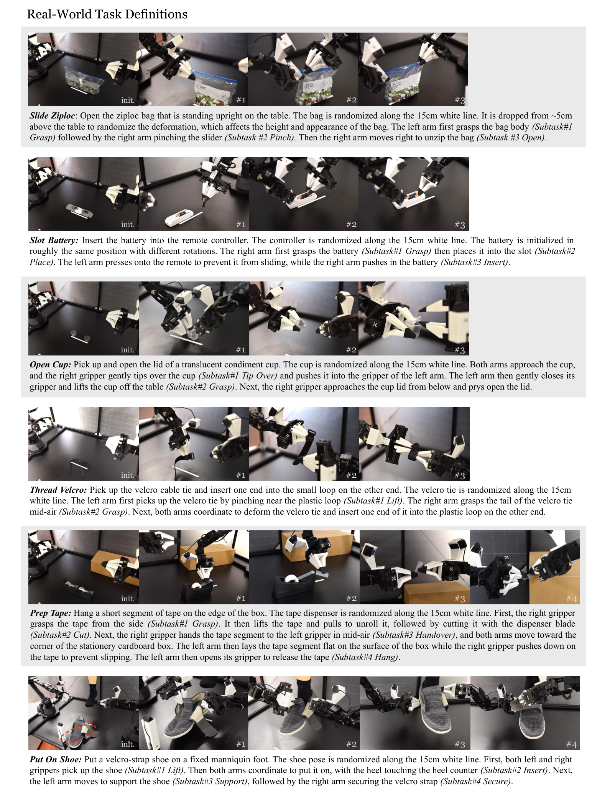
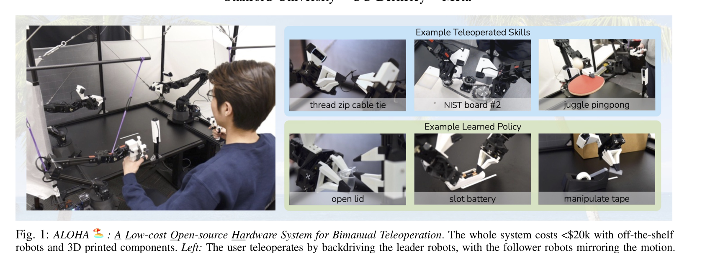
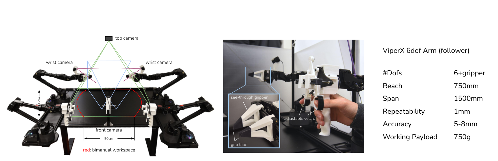
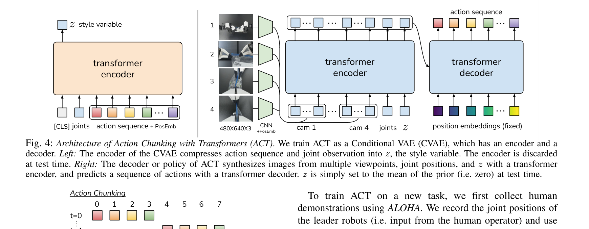
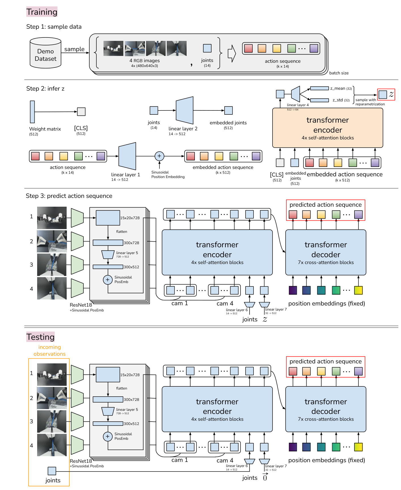
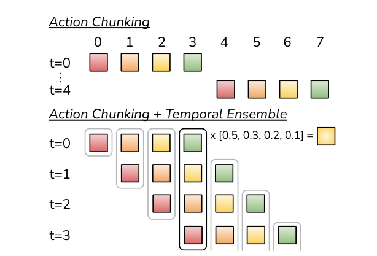
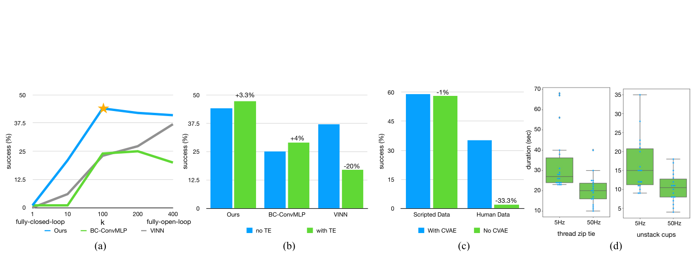

# Learning Fine-Grained Bimanual Manipulation with Low-Cost Hardware

> arXiv 2304.13705v1 · Stanford / UC Berkeley / Meta（Tony Z. Zhao, Vikash Kumar, Sergey Levine, Chelsea Finn）· RSS 2023
> 硬件+遥操作代码：https://github.com/tonyzhaozh/aloha ｜ 算法代码：https://github.com/tonyzhaozh/act ｜ 项目页：https://tonyzhaozh.github.io/aloha
> 材料在本地 `C:\Users\24431\WorkBuddy\2026-10-25-23-01-21\papers\learning-fine-grained-bimanual-manipulation\`（paper.pdf / paper.tex / figures/ / code/ / code_act/）

## 基本情况

- **一句话**：输入「4 路摄像头 RGB（480×640×3）+ 双臂 14 维关节角」→ 输出「未来 100 步 × 14 维的目标关节角」，一个任务训一个模型，**没有语言输入**。
- **两半贡献**：① **ALOHA** 硬件系统（2 万美元的双臂主从遥操作台，负责产数据）；② **ACT** 算法（Action Chunking with Transformers，负责学数据）。缺一个都不成立 —— 便宜的硬件精度不够，得靠算法补；而算法要的精细示教，只有这种硬件采得到。
- **开源**：硬件图纸/教程、遥操作代码、算法代码全开；**训练好的权重没放**，真实示教数据也没放（仿真数据可用 `record_sim_episodes.py` 自己采）。
- **和读过的哪篇的关系**：这是 OpenVLA、OFT、π0 那条线的**上游**。它定下的三件事后来全被继承：**action chunking**（一次出多步）、**ALOHA 平台 + 14 维双臂动作空间**、**用 50Hz 高频示教**。差别在于 ACT 没有预训练、没有语言、一个任务一个模型。

## 导读地图

| 站 | 讲什么 | 用哪张图 | 对应代码 |
|---|---|---|---|
| ① 动机 | 便宜硬件做精细活；模仿学习的两个坑 | 图 1 teaser | — |
| ② 架构 | ALOHA 五原则；ACT 的 CVAE encoder / decoder | 图 3、图 4、图 11 | `detr/models/detr_vae.py` |
| ③ 训练 | 损失 = L1 + β·KL，β=10 | 图 4 左半 | `policy.py:18-38` |
| ④ 数据 | 一条样本长什么样；50 条 = 10 分钟 | 图 6 | `utils.py:23-76` |
| ⑤ 信息流 | 张量从 480×640 到 100×14 | 图 5 | `detr/models/transformer.py:49-77` |
| ⑥ 例子走一遍 | 玩具尺寸走两轮 + temporal ensemble | 图 11 | `imitate_episodes.py:227-273` |
| ⑦ 实验与地位 | 表 I/II、消融、局限、后来怎么样了 | 图 8 | — |

---

## ① 动机

### 1.1 任务是什么（具体到动作）

两条 6 自由度机械臂 + 平行夹爪，做**毫米级**的操作。论文的 6 个真实任务：

| 任务 | 具体要干什么 | 精度要求 |
|---|---|---|
| **Slot Battery** | 把电池塞进遥控器电池槽；槽里有弹簧，推电池会把遥控器顶走，得另一只手按住 | 指尖顶电池边缘，毫米级 |
| **Open Cup** | 撕调料杯封盖；杯子太小侧面夹不住，得先用右手把杯子**拨倒**滑进左手张开的夹爪，抬起，再从下面挑盖 | 拨倒那一步是纯视觉闭环 |
| **Thread Velcro** | 扎带一端穿进另一端的卡扣 | 孔 3mm×25mm，扎带 2mm 宽 |
| **Slide Ziploc** | 右手捏住密封袋的滑块拉开，左手按住袋身 | 滑块很小 |
| **Prep Tape** | 胶带切一段 → 空中交给左手 → 贴到纸箱边缘 → 右手压住 | 空中交接 |
| **Put On Shoe** | 把鞋套到固定的人脚模型上，再翻起魔术贴压紧 | 鞋口和脚之间很紧 |

共同点：**不是「抓起来放下去」，是抠、撬、拨、撕**。而且物体本身难感知 —— 密封袋和胶带是透明的，调料杯盖半透明，黑色扎带贴在黑色桌面上对比度极低。论文专门用一段讲这个（L397-400）。



图 6 是 6 个任务的定义图：**每一行一个任务，左边是初始摆放的几种变体，右边是分解出的子步骤**。看的时候注意两点：① 每个任务都不是「一步」，而是 3–5 个子步骤串起来（所以表和消融里都是分阶段报成功率）；② 物体的初始位置在 15cm 白线范围内随机（真实）/ 2D 区域内均匀（仿真）—— 这是**唯一**的随机化，没有纹理、光照、背景的 domain randomization。

### 1.2 以前的路线卡在哪

**路线 A：堆硬件。** 以前的精细操作都用 da Vinci 手术机器人、ABB YuMi、Franka 这类平台，配高精度编码器和手眼标定。贵、难复现，一个实验室做不起。

**路线 B：便宜硬件 + 传统控制。** 便宜臂的官方精度只有 **5–8mm**（ViperX 参数，图 3 右），重复定位 1mm。光这个误差就够毁掉上面所有任务。而且精细操作常常要把手臂伸到接近**奇异位形**（关节快伸直、雅可比退化的姿态，末端稍动一点关节要转巨大角度），现成逆运动学在这里频繁解不出来。论文明确说这就是他们用**关节空间映射**而不是末端位姿映射做遥操作的原因之一（L164）。

**路线 C：那用学习补？** 端到端模仿学习在这些任务上会崩，崩法很具体：

> [!warning] compounding error（误差累积）
> 模型看到 s₀，预测动作差 3mm → 执行完到 s₁，s₁ 已经是**训练时没见过**的状态 → 模型在分布外继续预测，误差变 6mm → 几十步后机器人已在桌子外面。
>
> 一个具体数字（论文举的例子）：Thread Velcro 里第一次抓扎带偏了几毫米，到半空第二次抓就放大成 **10mm** 偏差，而卡扣孔只有 3mm —— 必然失败。

第二个坑：**人的示教是随机、多模态的**。同一场景人每次做法都不同 —— 论文举的例子是传递胶带时两只夹爪在空中交接的位置，每条示教都不一样，因为人自己也没有视觉或力的参照去重复同一个位置。这会让「直接回归一个动作」学到的是**多种做法的平均**，而平均往往是一个谁都不会做的动作。

### 1.3 作者的押注

一句话：**不追硬件精度，追「能学到人的灵巧」，让视觉闭环去补硬件的粗糙。**

拆成两半：

1. **硬件那半**：让人直接上手带。做一套主从遥操作 —— 人握着一条**更小的同款臂**（WidowX，$3300）拖着它动，大臂（ViperX，$5600）在**关节空间**一比一跟着动。采到的是真人操作，不是脚本生成的规整轨迹。全套连 4 个摄像头、铝架不到 **$20k**，约等于一台 Franka。
2. **算法那半**：既然误差累积源于「一步一预测」，那就**一次预测未来 100 步**，把有效时长缩到 1/100。这就是 action chunking。

> [!important] 这个押注的代价
> 硬件便宜 = 精度差 = 必须依赖视觉闭环；视觉闭环 = 需要高频反馈；高频反馈 = 数据量大（50Hz 采 10 分钟就是 3 万帧）。所以后面所有设计（chunk、CVAE、temporal ensemble）都是在**同一批不太干净的人手数据**上做文章。这也解释了为什么它不做语言、不做多任务 —— 先把单任务做扎实。

### 1.4 图 1 逐块解读



三块，横着看：

- **左边大照片**：人坐台子前，两只手各握一条小臂（leader）。他手上的动作被放大到对面两条大臂上（follower）。桌上黑色台面是工作区，四周架着摄像头。这就是「用两条小臂当手柄」的遥操作。
- **右上绿框 Example Teleoperated Skills**：人**亲自遥操作**能做到什么 —— 穿扎带、NIST 标准装配板装链条、用真球拍颠乒乓球。论文特意强调，这几种活在其他预算高 5–10 倍的系统上都没做出来。
- **右下蓝框 Example Learned Policy**：**学出来的策略**能做到什么 —— 开调料杯盖、插电池、贴胶带。这栏的机械臂是空的，**没人在握**。

这张图就是论点本身：上面证明硬件（加人的手）够灵巧，下面证明策略能接管。所以标题写的是 "Low-Cost Hardware"，但正文一半在讲算法。

---

## ② 架构

### 2.0 先讲硬件：ALOHA 的 5 条原则

论文把设计考虑写成 5 条（L132-139）：**低造价 / 通用 / 好用 / 可修 / 好装**。这 5 条直接决定了后面每个选择：

| 选择 | 为什么 | 代价 |
|---|---|---|
| ViperX 6-DoF ×2（各 $5600） | 模块化，电机坏了换 Dynamixel 电机就行 | 精度 5-8mm、负载 750g |
| 不用灵巧手，用平行夹爪 | 价格 + 维护 | 做不了多指操作（拧瓶盖、按儿童安全盖） |
| 自印「透明」手指 + 防滑胶带 | 精细操作要**看得见**夹爪和物体的接触 | — |
| **关节空间**映射（主从同构） | ① 近奇异位形时 IK 常失败，关节空间天然避开；② leader 的重量限制人手的移动速度、还能压掉抖动；③ 算得快、延迟低 | 两条臂必须同构、尺寸成比例，换机器人就不通用 |
| 3D 打印「手柄+剪刀」机构 + 橡皮筋配重 | 减少反向驱动电机所需的力；夹爪**连续**开合而不是开/关二值；能连续干 30 分钟以上 | — |

关键数字（图 3 右）：ViperX **6+gripper DoF / 臂展 750mm / 跨度 1500mm / 重复定位 1mm / 绝对精度 5-8mm / 负载 750g**。全套 **$20k**，遥操作与数据记录都是 **50Hz**。



左边是相机布局 —— 这是**理解后面所有张量形状的前提**：

- **4 个 Logitech C922x**，各出 480×640 RGB
- 两个装在**手腕**上（wrist camera，给夹爪特写），一个在**正前方**（front），一个在**正上方**（top）
- 中间红圈是双臂共同工作区，标了高度 20cm、宽度 50cm —— 这也是后面所有任务物体摆放的范围

> [!note] 论文没写、但代码里能看到的一个细节
> 4 个相机**共享同一个 ResNet18 权重**（`detr_vae.py:121` 写死了 `self.backbones[0]`，注释还留着 `# HARDCODED`）。也就是说它不是「4 个独立的视觉塔」，而是「一个视觉塔跑 4 遍」。参数量因此只有 1/4，这也是全模型只有 80M 的原因之一。

### 2.1 ACT 总览：为什么是两个网络



这张图要**分左右两半读**，而且两半的「寿命」不一样：

- **左半（黄框）= CVAE encoder**，只在**训练时**存在。它吃「动作序列 + 关节角」，输出一个 32 维的 **style variable z**。测试时**整个丢掉**。
- **右半（蓝框）= CVAE decoder**，也就是**真正的策略**。它吃「4 张图 + 关节角 + z」，吐「未来 k 步动作」。这个才是部署时跑的东西。

第一眼最容易卡住的问题：**为什么要有两个网络？直接一个网络吃观测吐动作不行吗？**

不行，原因就是 1.2 里说的「多模态」：

> 同一个观测（杯子在那儿），人可以往左拨倒它，也可以往右拨倒它。直接回归 → 网络输出「往左 1.5mm、往右 1.5mm」的**平均值 = 正中间**，而正中间恰好是把杯子推飞的方向。
>
> CVAE 的解法：训练时先把「这条示教到底怎么做的」编码成 z（这条往左），再让 decoder 在「知道怎么做」的前提下回归具体动作。这样每种做法都有自己的 z，不用互相平均。
>
> 到测试时不知道该往左还是往右？**z 直接取 0**（先验均值），让 decoder 走它认为最典型的那条路 —— 输出因此是**确定的**，便于评测。

这就是论文 §4.2（L272-289）和消融 §6.2 的全部内容。消融数字很能说明问题：**在 scripted（脚本生成、完全确定）数据上，去掉 CVAE 几乎没影响；换成人的数据，成功率从 35.3% 掉到 2%**（图 8c）。

### 2.2 CVAE encoder 里到底发生了什么

```
[CLS] → Linear(512)         ┐
joints(14) → Linear(14→512) ├─► 拼成 (k+2)×512 ─► transformer encoder ×4
actions(k×14) → Linear(14→512) ┘                        │
                                                        ▼ 只取 [CLS] 那一个位置的输出
                                          Linear(512→64) ─► mu(32), logvar(32)
                                                        │
                                              z = mu + σ·ε    ← 重参数化采样
```

三个要点：

1. **输入长度是 k+2**：`[CLS]` + 1 个关节角 token + k 个动作 token。为什么关节角只占 1 个 token？因为它是**当前时刻**的一个 14 维向量，投影一次就够；而动作有 k 步，每步一个 token。
2. **只取 [CLS] 的输出**（`detr_vae.py:105`：`encoder_output = encoder_output[0]`）。这是 BERT 的老套路：让 [CLS] 通过注意力把整段序列的信息汇总到自己身上。
3. **不用图像**。论文原话：为了训练快，encoder 只看本体状态和动作（L282）。这是一个纯粹的工程取舍 —— 加上图像会更准，但要多跑 4 次 ResNet，而它反正测试时要丢掉。

### 2.3 CVAE decoder（策略）的四段

```
4×RGB 480×640×3
   │ ResNet18（共享权重）+ 2D 正弦位置编码
   ▼
每相机 15×20×512 ──flatten──► 300 token/相机
   │ 4 个相机沿宽度拼成 (B, 512, 15, 80)
   ▼ flatten → 1200 token
   │ 前面拼上 z(512) 和 joints(512) 两个 token
   ▼
1202×512 ──► transformer encoder ×4（自注意力，让 4 个视角 + 状态互相看）
   ▼
memory ──► transformer decoder ×7（交叉注意力，query 是 100 个学习的 embedding）
   ▼
100×512 ──► Linear(512→14)
   ▼
100×14  ← 未来 100 步的目标关节角
```

四个「为什么必须这样」：

- **为什么 4 个相机拼接宽度而不是各走一套 transformer？** 拼完是一张 15×80 的「宽图」，位置编码仍然是 2D 正弦，transformer 自己学会「第几列到第几列属于第几个相机」。省事，且让跨视角注意力在 encoder 第一层就发生。
- **为什么 decoder 用交叉注意力而不是直接 MLP 输出 100×14？** 交叉注意力允许 100 个 query 之间互相看（decoder 的自注意力部分），保证输出的动作序列**连贯**，而不是 100 个独立猜测。
- **为什么输出 100 步？** 见 ⑤ 站。50Hz 下 100 步 = **2 秒**的动作。
- **为什么回归连续值不用离散 bin？** 精细操作要亚毫米精度，离散分桶会引入量化误差。论文还特别说：**用 L1 损失比 L2 好**（L306），用**绝对关节角**比 delta 好（L307）—— 都是试出来的。

### 2.4 模块表

| 模块 | 来源 / 初始化 | 参数量（估算） | 训练时更新 | 作用 |
|---|---|---|---|---|
| ResNet18 ×1（4 相机共用） | ImageNet 预训练 | ~11.7M | ✅（配 `lr_backbone=1e-5`，比主 lr 小） | 图像 → 15×20×512 特征图 |
| CVAE encoder（transformer ×4 层） | 随机 | ~12M | ✅ | 训练时从动作序列抽 z |
| CVAE 各种投影层 | 随机 | <1M | ✅ | 14→512、512→64 等 |
| transformer encoder（4 层，hidden 512，ff 3200） | 随机 | ~25M | ✅ | 融合 4 视角 + 状态 + z |
| transformer decoder（7 层，8 头） | 随机 | ~30M | ✅ | 100 个 query → 100 个动作 |
| action head `Linear(512,14)` | 随机 | 7K | ✅ | 投影到动作维度 |

合计 **~80M 参数**（论文 L310）。全部**从零训**，没有 VLM 预训练 —— 这是和 OpenVLA/π0 最大的代差。

### 2.5 附录图 11：一张图看完整条流水线



这张图（附录 §0.3）比图 4 详细得多，**建议以后回看就只看这张**。从上到下四段：

1. **Step 1: sample data** —— 从 demo 数据集里抽一条：(4×480×640×3 图, 14 维 joints, k×14 动作序列) 加 batch 维。
2. **Step 2: infer z** —— 就是 2.2 的流程。注意图中 `Linear 4`（512→64）分出 `z_mean(32)` 和 `z_std(32)`，再 `sample with reparametrization` 得到 z。
3. **Step 3: predict action sequence（训练）** —— 注意 ResNet 后面标的 **15×20×728 → flatten → 300×728 → Linear 5 → 300×512**。**这个 728 和代码对不上**：代码里 ResNet18 取 `layer4` 输出 512 通道，`input_proj` 是 `Conv2d(512, 512)`，也就是 **512→512 恒等投影**（`detr_vae.py:56`）。图上写 728 大概是画图时按另一版 DETR 配置算的，**以代码为准**。
4. **Testing（最下面一段）** —— 和图 4 最大的区别：**黄框（encoder）没了，z 的位置直接填 0**。你能清楚看到「z(512) → trainable linear 7 → 0(512)」那个箭头。

> [!warning] 论文与代码不一致的两处
> 1. **query embedding**：论文附录说「queries 是第一层的**固定正弦嵌入**」（L579），代码里是 `self.query_embed = nn.Embedding(num_queries, hidden_dim)` —— **可学习的**（`detr_vae.py:54`）。以代码为准。
> 2. **图 11 里的 728 通道**：代码实际是 512→512（`detr_vae.py:56`）。图只是示意图。

---

## ③ 训练

### 3.1 损失：一句话人话版

> 给模型看一段示教里的动作序列，让它重建出来；同时限制它抽出的 z 别离标准正态太远。

```
L = L1( â_{t:t+k} , a_{t:t+k} )  +  β · KL( q_φ(z | a_{t:t+k}, ō_t) ‖ N(0, I) )
```

| 符号 | 是什么 | 形状 / 取值 |
|---|---|---|
| `a_{t:t+k}` | 示教里 t 往后 k 步的真值动作 | 100×14 |
| `â_{t:t+k}` | decoder 预测的动作 | 100×14 |
| `ō_t` | t 时刻的**观测去掉图像**（只剩 14 维关节角） | 14 |
| `q_φ(z|·)` | CVAE encoder，输出对角高斯 | mu 32 + logvar 32 |
| `z` | style variable，重参数化采样得来 | 32 |
| `β` | KL 项权重 | **10**（表 III） |
| `KL(·‖N(0,I))` | z 的分布离标准正态多远 | 标量 |

**代一组数字**（示意，只看数量级）：假设 100 步 × 14 维的平均绝对误差是 0.03（归一化后的单位），KL 是 0.5。那么

```
L = 0.03 + 10 × 0.5 = 5.03
```

可以看到 **β=10 时 KL 项完全主导**。这是在有意压 z 的信息量 —— 论文引用 β-VAE（Higgins 2016）说得很直接：β 越大，z 传递的信息越少（L287）。信息越少越不容易「作弊」：如果 z 能塞下整条动作序列，decoder 只要照着抄就行，就学不到「从图像里看该怎么做」了。**z 只该编码「这一条示教选了哪种做法」这种粗粒度的风格，不该编码具体轨迹。**

> [!note] 损失和论文写法的一处差异
> 论文算法 1 里写 `L_reconst = MSE(â, a)`，但正文 L306 和**代码**都用 **L1**：
> ```python
> all_l1 = F.l1_loss(actions, a_hat, reduction='none')
> l1 = (all_l1 * ~is_pad.unsqueeze(-1)).mean()   # policy.py:30-31
> loss_dict['loss'] = loss_dict['l1'] + loss_dict['kl'] * self.kl_weight
> ```
> 那个 `~is_pad.unsqueeze(-1)` 是**掩掉补齐的步**：一条 episode 里最后几步可能不够 k 步，补齐的部分不参与 loss。论文正文没提这个掩码，代码里有。

### 3.2 训练流程：只有一阶段

和 OpenVLA/OFT 那种「先预训练再微调」不同，ACT **没有多阶段**：

1. 采数据（遥操作，50 条，见 ④ 站）
2. `get_norm_stats()` 遍历全部 episode 算 qpos / action 的 mean、std（`utils.py:79-108`）
3. 随机初始化全部参数（ResNet18 载入 ImageNet 权重）
4. 端到端训练，**encoder 和 decoder 一起**（因为 z 的采样用了重参数化，梯度能穿过采样回传到 encoder）
5. 每 epoch 存 val loss 最低的 checkpoint（80/20 划分 episode）

**关键 trick 只有三个**：

- `lr_backbone = 1e-5`，比主 lr 还小 10 倍（`imitate_episodes.py:51`）—— 预训练的 ResNet 别被冲掉
- **随机起点采样**：每条 episode 随机取一个 `start_ts`，从那儿往后取 k 步（`utils.py:35`）—— 相当于数据增强，一条 400 步的 episode 能出 400 个不同的训练样本
- **补齐 + 掩码**：episode 末尾不足 k 步就 zero-pad，用 `is_pad` 标记

**资源**：单张 **11G RTX 2080 Ti**，**5 小时**，batch 8（论文 L310；表 III 一致）。推理 **0.01 秒**。

### 3.3 训练 vs 推理：三处不一样

| | 训练 | 推理 |
|---|---|---|
| CVAE encoder | 跑，产出 mu/logvar | **整个不跑**（省 1/3 计算） |
| z 从哪来 | 从真值动作序列采样（重参数化） | **直接填 0**（先验均值） |
| 输出怎么用 | 和真值算 L1 | 进 buffer，和别的 chunk 加权平均（temporal ensemble） |
| 图像归一化 | ImageNet mean/std（`policy.py:20-22`，在 policy 外面做） | 同 |

`z=0` 这件事值得多想一层：它意味着**部署时模型是确定性的** —— 同样的观测永远给同样的动作。好处是评测可复现，坏处是**丢掉了多样性**：如果模型在某个状态真的应该随机选一条路（比如杯子卡住了，可以往左晃也可以往右晃），它会永远选同一条。论文没有讨论这个代价。

---

## ④ 数据

### 4.1 一条训练样本长什么样

数据存成 hdf5，一个 episode 一个文件（`episode_0.hdf5`）。`__getitem__` 取出的一个样本（`utils.py:23-76`）：

| 字段 | 形状 | 单位 / 取值 | 真实例子（示意） |
|---|---|---|---|
| `observations/images/{cam}` ×4 | 4×480×640×3，uint8 | 0–255 | 4 张图，相机名 `cam_high` / `cam_low` / `cam_left_wrist` / `cam_right_wrist` |
| `observations/qpos` | 14，float | **弧度** | `[-0.02, -0.95, 1.15, 0.001, -0.30, 0.02, 0.026, 0.03, -0.91, 1.12, 0.0, -0.28, 0.01, 0.022]` |
| `observations/qvel` | 14，float | 弧度/秒 | 存了但**模型不用** |
| `action` | k×14 → 补齐到 episode_len×14 | **绝对关节角，弧度** | 就是 leader 臂当时的关节角 |
| `is_pad` | episode_len，bool | 0/1 | 末尾补齐的步标 1 |

**14 维是怎么排的**（代码 `constants.py:37` 只有 6 个关节名，加上夹爪）：

```
[左臂 6 个关节, 左夹爪, 右臂 6 个关节, 右夹爪]
 waist, shoulder, elbow, forearm_roll, wrist_angle, wrist_rotate | gripper
```

> [!important] 三个反直觉的点（论文写了但很容易漏）
> 1. **动作记的是 leader（人握着的小臂）的关节角，不是 follower 的**。论文 L205-206 解释：因为「施加了多大力」是由 leader 和 follower 的**差值**通过底层 PID 隐式定义的 —— 记 leader 的角度等于把「人的意图（含力度）」记下来了。记 follower 就只剩结果。
> 2. **观测记的是 follower 的关节角**。一头一尾，别搞混。
> 3. **夹爪在 14 维里只占 1 维**（不是 2 维）。因为两个手指是机械耦合的，一个开合度就够。

### 4.2 怎么变成模型输入

`utils.py:63-74`，四步：

```python
image_data = torch.einsum('k h w c -> k c h w', image_data)   # 通道前置
image_data = image_data / 255.0                              # → [0,1]
action_data = (action_data - action_mean) / action_std        # z-score，std 至少 1e-2
qpos_data   = (qpos_data   - qpos_mean)   / qpos_std          # 同上
```

- 归一化统计量是**全局**的（跨所有 episode 算一次），存在 `dataset_stats.pkl`，**推理时必须加载同一个文件**，否则反归一化会错
- `std` 被 `clip(1e-2, inf)`（`utils.py:97`）—— 防止某个几乎不变的关节（比如一直被锁住的腰）除零炸出巨大值
- 一个「动作块」= 从随机 `start_ts` 起连续 **100 步**，50Hz 下 = **2 秒**
- **只用当前 1 帧图**，不用历史帧（这点和 BeT/RT-1 那种吃历史的不同）

### 4.3 规模与来源

| | 数量 |
|---|---|
| 真实任务 | 6 个，每个 **50 条**示教（Thread Velcro **100 条**，因为太难） |
| 单条长度 | 8–14 秒 → **400–700 步**（50Hz） |
| 总数据（可用） | 每任务 **10–20 分钟** |
| 总数据（含重试） | 实际要 **30–60 分钟**挂钟时间（要重置场景、操作者会失手） |
| 仿真任务 | 2 个，各 50 条，**脚本生成**和**人遥操作**两个版本 |
| 采集方式 | 全部**遥操作**（仿真也是用真 leader 臂驱动） |
| 人工标注 | **没有**（纯示教，无 reward、无分段标签） |

> [!note] 「10 分钟就够」这个卖点的真实含义
> 摘要里的 "only 10 minutes worth of demonstrations" 指的是**有效操作时长**，不含重置场景和失败重来。而且这 10 分钟是 **50Hz** 采的 —— 同样是「10 分钟」，如果按 RT-1 那种 3Hz 采，只有 1800 帧，学不出来。所以第 ⑦ 站的用户研究专门证明：**降频到 5Hz，人自己操作的时间就慢 62%**，遑论学。

---

## ⑤ 输入输出信息流

### 5.1 一次前向（推理，单任务，真实机器人）

```
4 张图 480×640×3 ──/255, ImageNet norm──► 4×(B,3,480,640)
        │ 各过 ResNet18（同一份权重，跑 4 遍）
        ▼
   4×(B,512,15,20) ──沿宽拼──► (B,512,15,80) ──flatten──► 1200 个 token ×512
                                                              │
joints(14) ──Linear(14→512)──► 1 个 token ───────────────────┤
z = 0(32) ──Linear(32→512)──► 1 个 token ────────────────────┤
                                                              ▼
                                                  1202×512  (transformer encoder ×4)
                                                              │  memory
                                                              ▼
        100 个学习的 query embedding ──► transformer decoder ×7（交叉注意力）
                                                              │
                                                              ▼
                                                    100×512 ──Linear──► 100×14
                                                              │
                                          ┌───────────────────┘
                                          ▼
                        denormalize: a * action_std + action_mean
                                          │
                                          ▼
                      写进 buffer → 【这一步该执行哪个？】
```

**最后那个问题就是 temporal ensemble 要解决的。** 见 5.2。

### 5.2 两种执行策略：这是 ACT 最容易讲错的地方



图 5 上下两块对比得很清楚：

**上半：裸 action chunking（naïve）**
```
t=0: 预测 [a₀ a₁ a₂ a₃]，执行 a₀ a₁ a₂ a₃
t=4: 预测 [a₄ a₅ a₆ a₇]，执行 a₄ a₅ a₆ a₇
```
问题：每到第 4 步，**观测会突然接入**，动作序列跳一下 → 机械臂**抖**。论文原话 "jerky robot motion"（L228）。

**下半：action chunking + temporal ensemble**
```
每个 t 都预测一次（query_frequency=1，不是 100！）：
t=0: 预测 [a₀ a₁ a₂ a₃]  → 存进 buffer 第 0~3 格
t=1: 预测 [a₁' a₂' a₃' a₄'] → 覆盖第 1~4 格
t=2: 预测 [a₂'' ... a₅'']   → 覆盖第 2~5 格
t=3: 预测 [a₃''' ... a₆'''] → 覆盖第 3~6 格

要执行 t=3 这一步时，buffer 里第 3 格上有 4 个预测：
  a₃(来自 t=0)、a₃'(来自 t=1)、a₃''(来自 t=2)、a₃'''(来自 t=3)
加权平均 → ×[0.5, 0.3, 0.2, 0.1] → 得到最终动作
```

图中那个 `×[0.5, 0.3, 0.2, 0.1]` 就是 `exp(-m·i)`，m=0.01… 等等，**0.5/0.3/0.2/0.1 对应的是 m≈0.7**。代码里 `k=0.01`：

```python
k = 0.01
exp_weights = np.exp(-k * np.arange(len(actions_for_curr_step)))   # imitate_episodes.py:255-259
```

`exp(-0.01·[0,1,2,3]) = [1, 0.99, 0.98, 0.97]`，归一化后 **≈[0.253, 0.251, 0.249, 0.247]** —— 几乎是**等权平均**。图和代码对不上：图里的 [0.5,0.3,0.2,0.1] 是示意（为了让你看清「越新权重越大」），代码里 m=0.01 时新旧几乎没区别。这是个值得记下来的细节：**ACT 的 temporal ensemble 实际上接近滑动平均，而不是指数遗忘。**

> [!important] 三个必须分清的点
> 1. **聚合的是「对同一个时刻的预测」，不是相邻时刻的动作**。论文专门强调（L233）：通常的平滑是把当前动作和相邻时刻动作混，那会引入偏差；这里是同一个 t 上多个预测的加权。
> 2. **只在推理时多花算力，训练不受影响**（L234）。代价是**推理次数从每 100 步 1 次变成每步 1 次 = 100 倍**。论文的 0.01s/次在 50Hz（20ms/步）下刚好够；如果推理慢 2 倍，这套就跑不动了 —— 这是 π0、OFT 后来猛攻推理速度的动机之一。
> 3. **有 temporal ensemble 时必须有「chunk 已经用掉多少」的概念**。代码用 `all_time_actions[t, t:t+num_queries] = all_actions` 这样一个二维表实现，第 t 行第 j 列 = 「在时刻 t 预测的、针对时刻 j 的动作」。

### 5.3 机器人上的时间账

| 量 | 值 |
|---|---|
| 控制频率 | 50Hz（每步 20ms） |
| chunk 长度 | 100 步 = **2 秒** |
| 一次推理耗时 | 0.01 秒（2080Ti） |
| 无 TE 时多久推一次 | 每 100 步（2 秒）推一次 |
| 有 TE 时多久推一次 | **每一步**（20ms）都推 |

有 TE 时意味着：模型必须在 20ms 内算完一次 1202 token 的前向。0.01s = 10ms，**只剩一半余量**。这就是为什么这篇的实时性其实是「刚好卡住」—— 后来所有工作都在这个数字上做文章。

---

## ⑥ 例子走一遍

> 场景：**给遥控器装电池（Slot Battery）**。指令：无（ACT 不用语言，任务靠「训了哪个模型」区分）。

### 6.1 先把尺寸缩到玩具大小

真实尺寸 / 玩具尺寸对照（结构完全一样，只是数字变小）：

| | 真实 | 玩具 |
|---|---|---|
| 相机数 | 4 | **2**（省一半，好跟踪） |
| 分辨率 | 480×640 | **64×96**（仍是 32 的整数倍，ResNet 才除得尽） |
| ResNet 输出 | 15×20×512 | **2×3×512** → 6 token/相机 |
| token 总数 | 1200 | 2 相机 × 6 = **12** |
| + z + joints | 1202 | **14** |
| chunk k | 100 | **3** |
| 动作维度 | 14 | **2**（左肩 1 关节 + 左夹爪） |

> 真实图 480×640 过 ResNet（总 stride 32）得 15×20，正好是「高度除 32、宽度除 32」。玩具选 64×96 同理得 2×3 —— **别随手写 4×6，那连一个 patch 都切不出来**。

### 6.2 t=0：第一次调用

**手里有什么**（结构是代码里的真结构，数值示意）：

```
img_left  = 64×96×3，归一化到 [0,1]
img_right = 64×96×3
qpos      = [-0.02, -0.95, 1.15, 0.00, -0.30, 0.02, 0.026,
              0.03, -0.91, 1.12, 0.00, -0.28, 0.01, 0.022]     ← 14 维
```

**第 1 步：归一化**（推理时必须用训练集那份 `dataset_stats.pkl`）

```
qpos_norm = (qpos - qpos_mean) / qpos_std
          = [-0.11, -0.02, 0.03, ...]     ← 现在都是「几个标准差」的单位
```

**第 2 步：图像进 ResNet（共享权重，跑 2 遍）**

```
(64,96,3) → ResNet18 → (512, 2, 3)     ← 2×3 的特征网格，每个位置 512 维
flatten  → 6 个 token/相机
```

**第 3 步：拼接 + 补两个 token**

```
[ z(2→512) ] [ joints(14→512) ] [ cam_left 6 个 ] [ cam_right 6 个 ]
      1              1                 6                 6          = 14 个 token
```

真实尺寸下是同一条式子：2 + 300×4 = **1202**。

**第 4 步：transformer encoder ×4** → 14 个 token ×512，每个 token 都「看过」其他 13 个。

**第 5 步：decoder，3 个 query**

```
query_embed(3, 512) → decoder ×7（交叉注意力到 encoder 输出）→ 3×512
→ Linear(512→2) → 3×2
```

**第 6 步：反归一化**

```
raw = [[0.31, -0.82],      ← 第 t+0 步
       [0.33, -0.79],      ← 第 t+1 步
       [0.35, -0.75]]      ← 第 t+2 步
action = raw * action_std + action_mean
       = [[-0.02, 0.030],   ← 左肩角几乎不动，夹爪开度 0.030（张开）
          [-0.017, 0.028],
          [-0.014, 0.012]]  ← 夹爪开始闭合
```

**第 7 步：执行哪一步？**

- **没有 TE**：直接取 `all_actions[:, t % query_frequency]` = 第 0 步 → 执行 `[-0.02, 0.030]`
- **有 TE**：先把这 3 个动作写进 buffer 的第 0/1/2 格，然后取第 0 格（此刻只有 1 个预测，权重 1.0）→ 还是 `[-0.02, 0.030]`

**执行，机械臂动了 20ms。**

### 6.3 t=1：第二轮，缓存里多了什么

```
上一次缓存：
  buffer[0] = [0.31, -0.82] ← 已经被用掉了
  buffer[1] = [0.33, -0.79]
  buffer[2] = [0.35, -0.75]

这一帧的新观测：
  qpos 变了（因为执行了上一步，且物理引擎/PID 有响应）
  → qpos = [-0.021, -0.95, 1.15, ..., 0.028]
  → 图像也变了（夹爪位置微移，画面有 1~2 像素差异）
```

**重新推理一次**（注意：有 TE 时 **每步都推**，不是等到第 3 步）：

```
新预测 = [[0.32, -0.81],    ← 针对 t+1 的（新）
          [0.34, -0.78],    ← 针对 t+2 的（新）
          [0.36, -0.74]]    ← 针对 t+3 的（新）
```

**写进 buffer，覆盖旧值：**

```
buffer[0] = [0.31, -0.82]   （旧的，已执行过，还在表里但不会被取）
buffer[1] = [0.33, -0.79] → 被 [0.32, -0.81] 覆盖
buffer[2] = [0.35, -0.75] → 被 [0.34, -0.78] 覆盖
buffer[3] = [0.36, -0.74]   ← 新增
```

**取 buffer[1] 那一列**（代码里是 `all_time_actions[:, t]`，取的是「所有时刻对 t=1 的预测」）：

```
候选 = [[0.33, -0.79](来自 t=0 的预测), [0.32, -0.81](来自 t=1 的预测)]
权重 = exp(-0.01·[0,1]) 归一化 = [0.5025, 0.4975]
最终 = 0.5025·[0.33,-0.79] + 0.4975·[0.32,-0.81]
     = [0.325, -0.800]
```

**这就是 temporal ensemble 真正在干的事**：两个不同时刻的模型对同一个时刻给出的预测，取平均。新预测的权重只比旧的高 0.5% —— 又是那个 `m=0.01` 太小的问题。

### 6.4 t≥3：稳态循环

到 t=3 之后，每一刻都有 **k=3 个**候选（来自 t、t-1、t-2 三次预测），直到 episode 结束。真实系统里这个数是 **100 个候选**（k=100）。

```
稳态下的账：
  每 20ms 推理一次 × 前向 10ms  →  占掉 50% 的时间预算
  buffer 是 700×800 的矩阵（episode_len × (episode_len+k) × 14）
  每一步算 100 个向量的加权和 —— 相对前向可以忽略
```

### 6.5 把整条链串起来

```
采数据（人拖 leader，50Hz 记 leader 角度）      ← ④
   ↓
训练（CVAE：encoder 抽 z，decoder 回归 100 步）  ← ③
   ↓
部署（丢 encoder，z=0）                          ← ②③
   ↓
每 20ms：4 图+14 关节 → ResNet×4 → 1202 token → enc×4 → dec×7 → 100×14
   ↓
写 buffer → 取「所有对当前 t 的预测」加权平均      ← ⑤
   ↓
denormalize → 发给 Dynamixel 电机（底层 PID 50Hz 追这个目标）
   ↓
物理世界动了 → 下一帧 → 回到「每 20ms」那一步
```

> [!note] 一轮走完才看得出来的一个事实
> 所谓「action chunking 降低累积误差」，在**有 temporal ensemble 时其实被削弱了**：因为还是每步都重新推理、每步都在看新观测，模型并没有真的「闭眼执行 100 步」。它真正省掉的是「**策略对单步噪声的敏感度**」—— 每一步的输出是多个预测的平均，单次预测的抖动被平掉了。
>
> 论文的消融也印证：**去掉 TE，性能只掉 3.3%**（图 8b）。真正撑起 44% 成功率的是 **chunking 本身**（k=1 时只有 1%，k=100 时 44%）。

---

## ⑦ 实验与地位

### 7.1 主要结果

仿真 2 任务 + 真实 4 任务（表 I），ACT 全面碾压：

| 任务 | 最好的 baseline | **ACT** |
|---|---|---|
| Transfer Cube（inst 数据 / 人数据） | BeT 27 \| 1 | **86 \| 50** |
| Bimanual Insertion | BeT 3 \| 0 | **32 \| 20** |
| Slide Ziploc（真实） | VINN 28 → 最终 0 | **88** |
| Slot Battery（真实） | BeT 4 → 最终 0 | **96** |

另外 3 个真实任务（表 II，只跟最强的 BeT 比）：

| 任务 | BeT | **ACT** |
|---|---|---|
| Open Cup | 12 → 0 | **84** |
| Thread Velcro | 24 → 0 | **20** |
| Prep Tape | 8 → 0 | **64** |
| Put On Shoe | 0 → 0 | **92** |

**读法**：那些 `→ 0` 很重要。baseline 不是「做得差」，是**第一个子步骤之后就彻底走不下去**（比如 Ziploc 能摸到袋子，但捏滑块这一步 0%）。ACT 的差距不是「好一点」，是「从做不到到做得到」。

**ACT 自己最差的是 Thread Velcro（20%）**，逐级掉一半：抓起来 92% → 空中抓住另一端 40% → 插进去 20%。论文归因：黑色扎带贴黑色桌面、对比度低、占画面比例太小（L445-447）。

### 7.2 消融：哪个部件真在干活



| 消融 | 结果 | 解读 |
|---|---|---|
| **(a) chunk size k** | k=1 → **1%**；k=100 → **44%**；k=200/400 略降 | **chunking 是核心**。k 太大（接近开环）反而掉，因为失去反应性 |
| **(a) 给 baseline 也加 chunking** | BC-ConvMLP、VINN 同样受益 | 说明这是**通用技巧**，不是 ACT 专属 |
| **(b) temporal ensemble** | BC-ConvMLP +4%，ACT **+3.3%**，**VINN 变差** | VINN 是非参数检索、拿到的是真值动作，不需要平滑，平滑反而糊掉 |
| **(c) CVAE** | scripted 数据：几乎无差别；**人数据：35.3% → 2%** | 多模态建模**只在人数据上才必要** |
| **(d) 50Hz vs 5Hz 用户研究** | 穿扎带 20s → 33s，分杯 10s → 16s，**慢 62%**（p<0.001） | 高频**对人**都是必需的，不只是对策略 |

> [!important] (c) 这个 2% 是全篇最有信息量的数字
> 去掉 CVAE 后在人数据上从 35.3% 崩到 2%。这说明**「人示教的多模态性」不是可选项而是一堵墙** —— 只要你的数据是人采的，就必须用生成式目标（CVAE / diffusion / flow matching）。这也直接解释了为什么 2024 年之后 diffusion policy 和 flow matching 全面取代了朴素回归。

### 7.3 局限（作者承认的）

**硬件**（附录 §0.6）：

- 需要**多指协作**的（按着推扣再拧瓶盖的儿童安全药瓶）做不了
- 需要**大力气**的（提重物、拧紧瓶盖、拔笔帽）做不了 —— 便宜电机扭矩不够
- 需要**指甲**的（抠起贴在自身上的胶带、开易拉罐）做不了

**算法**（只有两个任务彻底学不会，作者如实报告）：

- **剥糖纸**：抓起 10/10，拉两端 8/10，**剥开 0/10**
- **平放的密封袋**：能捡起来，后面 3 步空中操作做不了

作者归因：感知太难 + 抓取位置的微小差异会导致物体形变差异巨大。并指出方向：**预训练、更多数据、更好的感知** —— 这三条正是后来 VLA 路线走的路。

### 7.4 这篇的地位（2026-10 视角）

- **action chunking 成了默认设计**。现在几乎所有策略（ACT、diffusion policy、π0、OFT、RDT）都一次出多步，`chunk_size` 是标配超参。
- **ALOHA 成了标准实验平台**。后面 Mobile ALOHA（同组，2024，加移动底盘做家务）、Open-TeleVision、ALOHA 2 都建在它上面；大量双臂论文直接用 ALOHA 数据格式（`cam_high/cam_low/cam_left_wrist/cam_right_wrist` + 14 维）。
- **ACT 仍是 ALOHA 类任务的标准 baseline**，HuggingFace 的 LeRobot 里内置了 ACT 实现（我推测这也是它到今天还在被跑的原因：代码简单、单卡能训）。
- **被超越的地方**：架构上被 flow matching / diffusion 取代（z 的 32 维瓶颈太窄，CVAE 的表达力不如连续时间生成模型）；泛化上被 VLA 取代（ACT 没有语言、一个任务一个模型、换物体就要重采）。**但它的三个判断 —— 高频示教、动作块、生成式目标 —— 一次都没被推翻。**
- **资源需求**：单张 11G 2080Ti，5 小时/任务。这是它至今可复现性最好的原因。

---

## 延伸笔记（论文之外）

### 为什么是「关节空间」而不是「末端位姿」

这是一个看起来只是工程细节、实际上决定成败的选择。

| | 关节空间（ALOHA 用） | 末端位姿（多数 VR 遥操作） |
|---|---|---|
| 记什么 | 7 个关节角 | 末端 xyz + 姿态四元数（6-7 维） |
| 主从映射 | 1:1 直接抄，**不需要 IK** | 必须解 IK |
| 近奇异位形 | 天然没问题 | IK 频繁失败或无解 |
| 力反馈 | leader 和 follower 的角度差 → PID 出力，**力度被隐式记录** | 需要额外力传感器 |
| 缺点 | 两条臂必须**同构且尺寸成比例** | 可跨异构机器人 |

关键在于最后那个「力度被隐式记录」：因为动作记的是 leader 的角度，而 follower 落后于 leader 的那一点差值就代表施加的力。**所以 ACT 学的不只是「去哪儿」，还包括「用多大力」** —— 这对插电池、撬盖子这种接触密集的任务是决定性的。

### ACT 和 diffusion policy 是什么关系

两者解决的是**同一个问题**（人示教是多模态的，不能直接回归），只是用了不同的生成模型：

| | ACT (2023) | Diffusion Policy (2023) |
|---|---|---|
| 生成模型 | CVAE（隐变量 32 维） | DDPM / DDIM |
| 训练目标 | L1 重建 + β·KL | 预测噪声 ε |
| 推理 | **1 次前向**（z=0） | **10-100 次去噪**，每次一次前向 |
| 速度 | 快（10ms） | 慢（几十到几百 ms） |
| 表达力 | 受 z 的维度限制 | 强（连续时间） |

ACT 用 CVAE 换来了**单次前向**，代价是 z 只有 32 维、表达力受限。后来 π0 用 flow matching 是在这两者之间找平衡：**表达力接近 diffusion，推理只要 10 步**。所以这条演化线的主题一直是「**生成式目标 + 实时性**」，ACT 是这条线的起点。

### 「便宜硬件 + 学习」这个范式后来怎么了

ALOHA 的立论是「硬件不用好，学习来补」。这条线后来分叉了：

- **一条继续降本**：ALOHA 2、LeRobot 的 SO-100（几百美元的手臂），配合 ACT/diffusion 做简单任务。结论：**越简单的任务，便宜硬件越够用**。
- **一条转向「数据规模」**：Open X-Embodiment、RT-X、π0 —— 与其在单个便宜平台上死磕，不如**跨平台汇数据**。这条线承认了 ALOHA 的一个局限：**关节空间的 1:1 映射绑死了硬件**，换个机器人 14 维就对不上，也没法跨本体共享数据。
- **ACT 的定位因此很清楚**：它是「**单平台、单任务、高精度**」这条路的最优解之一，而不是通向通用机器人的那条路。读它主要是学**方法论**（chunking、生成式目标、高频数据），不是学它的架构。

---

## 白话版：四个概念讲到不用术语

> 这一节是为「讲给不懂的人听」准备的，不出现代码和符号，全部用数字和表格。

### 1. 端到端（pixel-to-action）是什么

**一句话**：从传感器原始数据直接映射到执行器指令，中间不插入任何人工设计的中间表示。

传统做法是 5 段流水线：

```
相机图 → ①物体位姿估计 → ②抓取点采样 → ③运动规划 → ④逆运动学 → ⑤PID跟踪
                ↑ 每一步都是人类可命名、可检查的中间量
```

端到端压成 1 段：

```
4 张图 + 14 维关节角 → 一个网络 → 100×14 关节角
                        ↑ 中间是 512 维向量，没有任何人类可命名的含义
```

**为什么这对精细操作特别合适**（论文 L56-59，是全篇的方法论根基）：

| | 建模（model-based） | 学策略（policy） |
|---|---|---|
| 要回答 | 「我推杯子一下，它倒成什么角度」 | 「此刻手该往哪动一点」 |
| 需要什么 | 摩擦系数、质量分布、盖子弹性形变、碰撞响应…… | 一张图 + 一个动作 |
| 换物体 | 参数**全部重测** | 重新采 50 条 |
| 本质 | **预测世界** | **反应世界** |

一句话：**预测世界很难，反应世界相对容易。**

> [!warning] 一个容易漏掉的前提
> 端到端必须配**闭环**。如果端到端但开环（看一眼输出整条轨迹），它被迫在脑子里隐式模拟物理，成本又回去了。ACT 的 chunk=100 看着像开环，但每 20ms 重推一次，实际是闭环。

### 2. 模仿学习是什么，为什么一定会崩

**定义**：从专家示教里学「在什么情况下做什么」。数据形状永远是 `(观测 o, 动作 a)` 对，数学上就是**监督学习**，只是标签是「此刻该往哪动」。

| | 模仿学习 | 强化学习 |
|---|---|---|
| 数据来源 | 专家示教 | 自己试错 |
| 要不要 reward | **不要** | 必须要 |
| 本质 | 监督学习（回归） | 试错优化 |
| 典型毛病 | 误差累积 | 样本效率极低、reward 难写 |

**为什么机器人偏爱它**：给「把电池插进遥控器」写 reward 基本不可能（奖励「离插槽近」会让它怼在边上蹭）。人做一遍只要 10 秒。

#### compounding error 的机制

```
训练时：模型只见过【专家走过】的状态，全在正常轨道上
测试时：第 1 步差 2mm → 第 2 步站在「专家从没到过的状态」上
        → 模型没有这个状态的训练数据 → 输出不可控 → 差更多 → 更偏
```

真实数字：Thread Velcro 第一次抓偏几毫米 → 半空第二次抓放大成 **10mm** → 卡扣孔只有 3mm → 必然失败。

**关键认知**：失败不是「模型学得差」，是**它被自己的小错带到了陌生地方**。所以解法的方向不是「提高精度」，而是「别让它走到陌生地方」—— 这就是 chunking 的出发点。

### 3. action chunking 的原理（三层，不含代码）

#### 一句话

| | 普通做法 | chunking |
|---|---|---|
| 每次输出 | **1 个数**（下一步） | **100 个数**（接下来 100 步） |
| 一次决定管多久 | 20ms | **2 秒** |
| 判断次数（400 步任务） | 400 次 | **4 次** |

#### 玩具例子（k=3，动作只有 1 维：往右推多少厘米）

```
普通做法：第0步看图→"推0.3" ｜ 第1步看图→"推0.3" ｜ 第2步看图→"推0.3" …（10 次判断）
chunk：  第0步看图→"三步：0.3, 0.3, 0.3" ｜ 第3步看图→"三步：0.3, 0.3, 0.15"（3 次判断）
```

**为什么有用**：模型在第 3 步时**已经把 3、4、5 步一起想好了**。这三步是一起想出来的，第 4 步不会因为第 3 步偏了 2mm 就立刻乱掉。

#### 三层实现

1. **数据层**：把示教切成滑动窗口。400 步的 episode 能产出 **400 个训练样本**（同一帧配 100 段不同的后续）→ 这是 50 条示教能撑起训练的原因。
2. **模型层**：输出从「1 个格子」变成「100×14 个格子」。没有新机制，只是出口变宽，且**一次性并行输出**（不是自回归），所以只要 10ms。
3. **执行层**：拿到 100 步，从第 1 个开始用。

#### temporal ensemble：为什么要它

一次定 100 步 = **闭眼走 2 秒**，中途出岔子改不了，用完突然看到新画面还会抖。

解法：**每一步都重新预测**，同一时刻于是有多个预测，取平均：

```
关于"第 2 步该做什么"：
  第 0 步时的预测说 0.30
  第 1 步时的预测说 0.32
  第 2 步时的预测说 0.31
  ──────────── 取平均 → 0.31
```

> [!warning] 聚合的是「同一个时刻」的多个预测
> **不是**「相邻时刻的动作」。后者是普通时间平滑，会把「现在该做的」和「待会儿才做的」搅在一起，导致动作迟钝。论文专门强调过这点。

#### 两个被问过很多次的问题

**Q1：预测会不会越积越多？**

不会，**恒等于 k**。一条预测只覆盖 k 步；能覆盖到时刻 T 的预测必须满足 `T-k+1 ≤ t ≤ T`，正好 k 个。旧的**自动过期**（够不到了），不是主动删除。

```
t=0 预测：[0][1][2][3][4]
t=1 预测：   [1][2][3][4][5]
t=2 预测：      [2][3][4][5][6]
...
到 t=6 执行时，覆盖它的只有 t=2..6 这 5 条；t=0/t=1 的最远只到 4 和 5，永远不会再用到
```

代码里数组一开始就固定大小（700×800×14 ≈ 31MB），不随时间增长。真要省可以用环形缓冲区（只留 100 行），但 31MB 在 GPU 上无所谓。

**Q2：每步都重推，太吃算力了吧？**

| | 不用 TE | 用 TE |
|---|---|---|
| 预测频率 | 每 100 步（0.5 次/秒） | 每 1 步（**50 次/秒**） |
| 占用时间预算（20ms） | 0.5% | **50%** |

**差 100 倍**（论文没写这个数，是从代码 `query_frequency` 推的）。而换来的只有 **3.3%** 成功率。

> [!important] 我的判断
> **TE 是 ACT 里性价比最低的设计。** 工程上更该把 `query_frequency` 设成 10（省 10 倍算力，平滑基本保留）—— 论文只对比了 1 和 100 两个极端，没做这个消融，是明显空白。
>
> 而且 20ms 预算里 10ms 已经被吃掉，只剩 2 倍富余 —— 这正是一切 VLA 工作都要先解决延迟的原因。

### 4. CVAE 和 KL：为什么必须用生成式目标

#### 从 AE → VAE → CVAE

| | 做法 | 解决的问题 / 留下的问题 |
|---|---|---|
| **AE**（自编码器） | 序列 → 压缩成 32 个数 → 还原 | 中间是孤立的点，没法插值、没法生成新的 |
| **VAE** | 压缩成「一团云」（均值 μ + 方差 σ²），采样一个 z 再还原 | 空间变连续了；但采到的 z 不知道对应哪种做法 |
| **CVAE** | 多一个「条件」：先看这条示教**怎么做的**，压成 z；再在知道 z 的条件下生成动作 | 见下 |

#### 为什么绕这么一圈：多模态的「平均问题」

同一画面，人有两种做法：

```
做法 A（往左拨倒杯子）：接下来 3 步 = [-2, -2, -1]
做法 B（往右拨倒杯子）：接下来 3 步 = [+2, +2, +1]
两种各占一半
```

**直接回归会学到什么？**

| 损失 | 学到的答案 | 结果 |
|---|---|---|
| L2（均方误差） | 两种做法的**均值** = `[0, 0, 0]` | **一动不动** → 任务失败 |
| L1（绝对值误差） | 两种做法的**中位数** | 同上，或偏向一边且不稳定 |

模型学得很「准」（它确实最小化了误差），但那个答案是**一个谁都不会做的动作**。

**CVAE 的解法**：

```
z = -1  → 输出 [-2, -2, -1]     （走 A）
z =  0  → 输出接近 0 的中间值    （看训练数据比例）
z = +1  → 输出 [+2, +2, +1]     （走 B）
```

z 相当于一张「路线票」。decoder 拿到票才知道走哪条路，就不会把两条路平均掉。

> [!warning] 代价：部署是确定性的
> 测试时 z 固定为 0，所以**同样的画面永远给同样的动作**。
> 好处：评测可复现。坏处：**丢掉多样性** —— 该随机选一条的状态（杯子卡住，往左晃或往右晃都行），它永远选同一条。论文没讨论这个代价。

#### KL 散度是什么

**一句话**：`KL(P ‖ Q)` 衡量「用分布 Q 去近似分布 P，要多付多少代价」，单位是 bit。

```
KL(P ‖ Q) = Σ P(x) · log( P(x) / Q(x) )
```

| 性质 | 含义 |
|---|---|
| **永远 ≥ 0** | 完全相同时为 0 |
| **不对称** | `KL(P‖Q) ≠ KL(Q‖P)` —— 它不是「距离」，是「代价」 |

#### 在这篇里，KL 在逼什么

逼 **z 的分布长得像标准正态 N(0,1)**。一维情况下（忽略常数）：

```
KL = (σ² + μ² - 1) / 2 - log σ
```

| μ | σ | KL | 说明 |
|---|---|---|---|
| 0 | 1 | **0** | 完美匹配 |
| 0 | 0.1 | **1.81** | 方差太小（云太紧） |
| 0 | 3 | **2.15** | 方差太大（云太散） |
| **2** | 1 | **2.0** | 位置偏了 |

所以 KL 同时管两件事：**把 z 拉回 0 附近**（μ→0）、**让离散程度保持 1**（σ→1）。

#### 为什么要这么做（三个理由，按重要性）

1. **测试时 z=0 才有效。** 如果训练时 z 都散落在离原点很远的地方，填 0 就等于落进「训练从没覆盖的空地」，decoder 输出垃圾。
2. **限制 z 的信息量 —— 论文最在意这条。** 如果 z 能装下整条动作序列，decoder 照着 z 抄就行，**就学不到「从图像看该怎么做」**。KL 越强，z 能装的信息越少，decoder 越被迫看图。
3. **让 z 空间连续。** 相近的 z 对应相近的做法，空间有结构而不是孤岛。

#### β = 10 是什么意思

```
L = 动作的 L1 误差 + 10 × KL
```

β 把 KL 放大 10 倍，等于在说：**宁可还原得糙一点，也要把 z 压扁在原点附近。**

示意数字：若 L1 = 0.03、KL = 0.05，
- β=1 → L = 0.08
- β=10 → L = 0.53（**KL 占 94%**）

所以 β=10 时 KL 完全主导。论文引 β-VAE：**β 越大，z 传递的信息越少**。

> [!note] 一个常见误解
> 别以为那 32 维里「第 3 维代表往左还是往右」。**没有任何一维有人类可解释的含义**，它是端到端学出来的，不可读。论文也没做这方面的分析。

#### 训练 / 测试流程（人话版）

**训练时**：

```
① 抽一条样本：4 张图 + 14 维关节角 + 未来 100 步动作（真值）
② 「关节角 + 100 步动作」→ encoder → μ(32) 和 log σ²(32)
③ 采样 z = μ + σ·ε        （ε 是标准正态随机数；这一步叫重参数化，
                            目的是让梯度能穿过采样传回 encoder）
④ 「4 张图 + 关节角 + z」→ decoder → 100 步预测
⑤ 损失 = L1(预测, 真值) + 10 × KL(z 的分布, N(0,1))
⑥ 反向传播，encoder 和 decoder 一起更新
```

**测试时**：

```
① 拿 4 张图 + 关节角
② z 直接填 32 个 0（跳过 ②③）
③ decoder → 100 步动作
```

**encoder 整个不用了** —— 这就是论文说的 "discarded at test time"。

#### 为什么它值 33 个百分点

| 训练数据 | 用 CVAE | 不用 CVAE |
|---|---|---|
| **脚本生成**（完全确定） | 高 | **几乎无差别** |
| **人的示教**（多模态） | **35.3%** | **2%** |

**脚本数据是单模态的，所以不需要 CVAE；人数据是多模态的，没有 CVAE 直接崩。** 这条反过来证明「平均问题」的解释是对的。

也正因如此，2024 年后 diffusion policy / flow matching 全面取代 CVAE —— 解决同一个问题，表达力更强。但**结论没变：人数据必须用生成式目标。**

---

## 2026-10 这条线怎么样了（外部调研）

> 数据是 2026-10-26 搜的，来自论文摘要和媒体报道；工业侧的「成功率」多为厂商口径，需要打折看。

### 触觉成为主线，而且被证伪过一次

**T-Rex**（UC Berkeley / NVIDIA / Stanford，arXiv 2606.17055，2026-06）

最关键的不是它的成绩（12 个接触密集任务 65%，比之前的 EgoScale 35% 高 30 点），而是它发现的一个反直觉事实：

> **把触觉信号直接接到 π0.5 上，成绩比纯视觉的 π0.5 还差。**

原因是**时间尺度不匹配** —— 视觉是 10-30Hz，触觉是 1000Hz，塞进同一个 transformer 会让慢的那路把快的那路糊掉。解法是**双时钟**：

```
action expert（慢）：出运动规划
        ↕ 实时修正
tactile expert（快 4 倍）：根据手上感觉，每秒修 4 次抓握
```

Trevor Darrell 的话：「人做灵巧操作大部分是闭着眼睛的。力、滑移、精确抓握，这些不是腕部相机能干的活。」

**这条印证并修正了「触觉 > 视觉」的判断**：不是「加个传感器」就行，触觉必须跑得比视觉快一个数量级，架构要为此改。

### 数据规模军备竞赛

| 项目 | 机构 | 规模 | 关键点 |
|---|---|---|---|
| **FTP-1** | 清华 | 3000+ 小时，**21 种传感器** | 统一映射到「模板手」，跨硬件零样本迁移；牵头 80 家机构做标准集 |
| **N0-Foundation** | 复旦 + NeoteAI | **30000+ 小时**，140 万 episodes，6 本体 | 不只反应触觉，还**预测**该感觉到什么，用偏差给自己打分 |
| **Daimon-Infinity** | 戴盟 | 百万小时级（1 万小时开源） | 把触觉转成**图像**格式，直接接现有视觉框架；提出 VTLA |

### 国内多模态主动感知：人大 ROMA

**ROMA**（人大高瓴 GeWu-Lab + 智源 + 燧行，arXiv 2610.06955，2026-10）

核心不是「把视觉听觉触觉拼起来」，而是让机器人**自己决定**：缺什么信息 → 该用哪种方式获取（摸？摇？捏？）→ 什么时候够了可以停。

例：磨砂杯子看不见里面，它会**拿起来摇一摇听声音**。

- 数据：ROMI-2K，近 2000 物体 × 6 种交互（举起/按压/碰撞/捏紧/摇晃/旋转），同步录视觉+听觉+触觉+力
- 模型：ROMA-7B（Qwen 2.5-Omni 微调）
- 成绩：基准 72.9%，真实场景 61.4%

同学院还有**胡迪**的 **Robo-ValueRL**（arXiv 2607.09866）—— RL + VLA 做**毫米级**插装（芯片插装、积木拆解）。

### ALOHA 这条血脉：两件事同时发生

**① 硬件被升级**：东京大学 JSK 的 **MEVION**（arXiv 2607.17970，全套 **1.4 万美元**），四个 6-DoF 臂，单臂 7kg / 60Nm，号称相对 ALOHA **3 倍扭矩、7 倍速度**，硬件全开源。

**② 采数据的方式被推翻了 —— 这条更重要**

| | ACT 论文（2023） | Sunday（2025-2026） |
|---|---|---|
| 数据来源 | 人**遥操作机器人** | 人戴**传感手套**做家务 |
| 规模 | 50 条 / 任务 | **1000 万 episodes**，500 个真实家庭 |
| 成本 | 2 万美元台子 + 一个人在台前 | 几百美元的手套 |
| 模型 | ACT，80M | **ACT-1 → ACT-2**（名字直接继承） |
| 成绩 | 96%（单任务） | 叠衣服 **99.1%**（785 次尝试成功 778 次） |

Tony Zhao（一作）2024 年从斯坦福退学创办 **Sunday**，2026-03 估值 11.5 亿美元。团队最初的核心硬件是 **Skill Capture Glove**（迭代近百次），而不是机器人。

**含义**：论文里那套「50 条遥操作示教」在产品化时不够用 —— 不是数量不够，是**采数据的人太贵**（一个人一台机器，一次一条）。手套方案把这个成本降低两个数量级。

### 产业落地（截至 2026-10）

| 场景 | 实际数据 |
|---|---|
| 邮政分拣（广州） | 单台 **1200 件/小时**，准确率 >95%，24 小时不间断 |
| 小米汽车工厂 | 抓取搬运 / 灵巧手操作 / 精细触觉装配，单一工站 **98%** |
| 优必选 | 2025 年销量 1079 台，**八成进工业**；柳州万台级工厂 2026-09 投产 |
| 智元 | 2026 上半年出货 **8600+ 台** |
| 整体 | 2026 上半年中国人形机器人出货 **超 4 万台**；产业营收半年 1655 亿，+24.5% |

政策：2026-06 工信部 + 国资委启动「实景实训专项行动」，目标年底形成**百个以上高价值场景、万台级落地**。全国已建成 70+ 具身智能训练场。

**冷水三条**：
1. 4 万台 vs 手机一年十几亿台，差三个数量级
2. 「98% 成功率」是单工站、特定任务、几十到几百次试验；工业要 99.9% 且连续跑几个月
3. 信通院自己的报告：「具身智能整体仍处于发展早期，『数据—模型—本体—场景』难以闭环」

**最值得记的一句**（清华 Yuan）：

> 到目前为止，触觉训练主要还是让机器人**对自己本来就能做的任务更省数据**。真正没有触觉就做不到的任务，可能还需要新算法，而不只是更多小时的触觉数据。

判断「触觉是否真的解锁了新能力」的标准：**「USB 插进去的成功率」要和「工厂的节拍时间」放在一起报**，而不是实验室里 16 次试验的平均。

---

## 问答记录

> 这些是读这篇时真实问出来的问题，本身就是最好的复习提纲。

**Q：端到端是什么意思？**
像素进、关节角出，中间不设人工中间量。好处不是「网络万能」，而是「不用建物理模型、只学一个闭环反应函数」，在透明物体、接触密集的任务上恰好省钱。

**Q：模仿学习是什么？**
从专家示教里学「什么情况做什么」，数学上是监督学习。和强化学习的区别是没有 reward、不试错。

**Q：action chunking 到底是什么？**
不是「每步都决定」，是「一次决定一小段」。输出从 1 个数变成一串数，判断次数从 400 降到 4。

**Q：预测会不会越积越多？**
不会，恒等于 k。旧预测自动过期，数组大小固定。

**Q：每步都重推不太吃算力吗？**
吃，差 100 倍。但换来只有 3.3%，这笔账不划算 —— 工程上应该用 `query_frequency=10`。

**Q：关节空间映射是什么？**
就是 leader→follower 的传动方式：直接把关节角度抄过去（乘比例），不解逆运动学。换来绕开奇异位形、低延迟，还顺带把「用了多大力」记下来（力藏在 leader 和 follower 的角度差里）。

**Q：这种设备做不了拼高达那种活吧？**
对，但根本原因是**看不见、摸不到**，不是手不够多。它绝对精度 5-8mm，靠视觉闭环补到毫米级；拼高达要 0.1mm，而 480×640 画面里 0.1mm 只有约 0.2 像素。

**Q：这算是 OpenVLA 的基础吗？**
不是架构基础，是**问题定义和方法论的上游**。两者路线对立（80M/50 条 vs 7B/97 万条）。而且 **OpenVLA 原版并没有用 chunking**，是后来的 OFT/π0 把 chunking 补回去的。

**Q：为什么 k=100？**
50Hz 下正好 2 秒 = 一个完整小动作的长度。太小省不了判断次数，太大等于闭眼走完（k=400 时掉点）。

**Q：50 条数据凭什么够？**
① 50Hz 高频，一条 400-700 步 ② 滑动窗口，同一帧配 100 段不同后续 → 2 万样本 ③ 单任务，不追求泛化。
