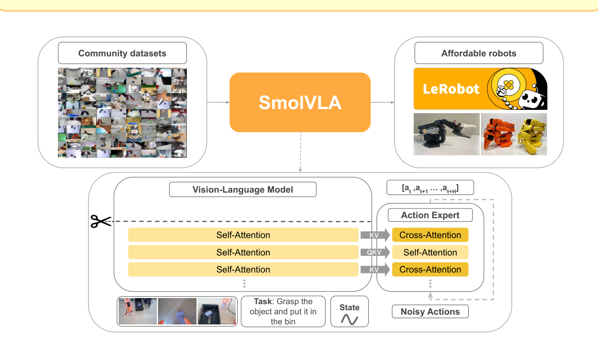
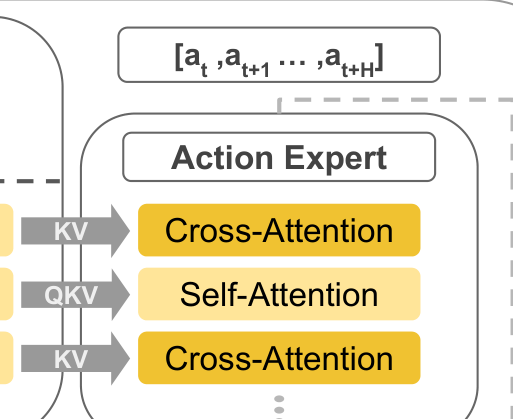
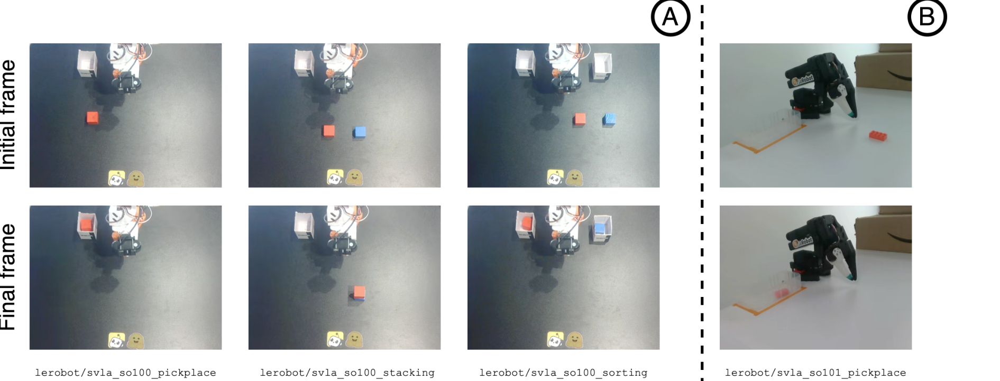
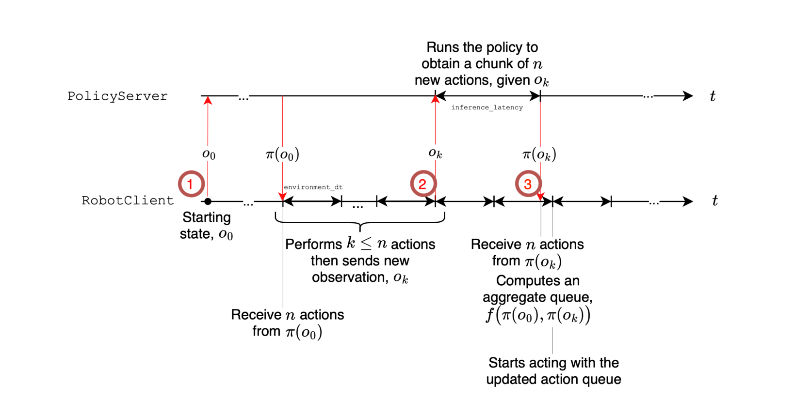
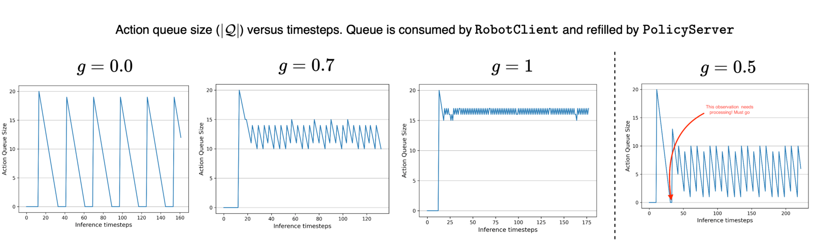
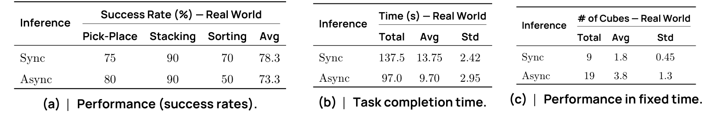

# SmolVLA: A Vision-Language-Action Model for Affordable and Efficient Robotics

> arXiv 2506.01844v1 · 2025-06-02 · 预印本（未注明会议）
> Hugging Face（主导）/ Sorbonne University / valeo.ai / ENS Paris-Saclay，14 人，4 人标 Core team（Shukor、Aubakirova、Capuano、Cadene）
> 代码 ✅ `huggingface/lerobot` → `src/lerobot/policies/smolvla/` · 权重 ✅ · 预训练数据 ✅（社区数据集清单）· 真机评测数据 ✅（4 个）
> 材料在本地 `C:\Users\24431\Zotero\storage\5XI296S6\`（PDF + 已解压代码 + 5 张图）
> 另有一份 HTML 深读长文：`C:\Users\24431\Zotero\storage\5XI296S6\smolvla-xray\smolvla.html`（标题《从 3.3B 到 0.45B，补回来的是控制频率》）

## 基本情况

- **一句话**：输入「1–3 路相机画面 + 一句人话 + 一组关节角」→ 输出「未来 50 步、每步 6 个关节目标」，用 flow matching 一次去噪出整块动作。
- **一句话定位**（沿用 HTML 长文的判断）：一个 0.45B 的 VLA 能追平 3.3B 的 π0，靠的不是更聪明的架构，是**把两件被当成工程杂事的事做对了**——数据集里被忽略的相机顺序，和部署时被忽略的观测更新频率。
- **它真正的贡献排序**（我的判断）：① 证明了「VLM 初始化 + 2 万条社区示教」这条路能打，不需要百万级机器人数据；② 异步推理（把预测和执行拆开），这一条在论文里被写成了效率优化，实际是性能项；③ 四个效率设计（截断 16 层、64 token/帧、0.75 倍宽度、冻结 VLM）。
- **和读过的哪篇最像**：骨架是 [[π0 - A Vision-Language-Action Flow Model for General Robot Control|π0]] 的（VLM 前缀 + action expert + flow matching），差别在四处：VLM **冻结**且只取前 16 层、专家宽度 0.75d、专家内 **CA/SA 交替**（π0 是动作 token 拼进长序列做全自注意力）、外加**异步推理栈**。和 [[RT-2 - Vision-Language-Action Models Transfer Web Knowledge to Robotic Control|RT-2]]、[[OpenVLA - An Open-Source Vision-Language-Action Model|OpenVLA]] 走的是相反路线：那两篇把动作离散成 token，这篇是连续回归 + 生成式去噪。

## 导读地图

| 站 | 这一站讲清楚什么 | 图 | 原文位置 |
|---|---|---|---|
| ① 动机 | 大 VLA 训不起、部署不起；数据都在学术/工业数据集里，社区采的没人用 | 图 1 | §1 |
| ② 架构 | 冻结的 16 层 SmolVLM2 + 100M 动作专家，四个效率设计各值多少 | 图 1 | §3.1 / 表 8、9 |
| ③ 训练 | flow matching 在逼模型学「速度场」；只训 100M，200k 步 | — | §3.1 / 表 10 / §4.3 |
| ④ 数据 | 481 个社区数据集、22.9K 条、98 小时；承重的是相机改名 + 任务重写 | 图 4 / 表 1 | §3.2 |
| ⑤ 信息流 | 241 个 token 进 16 层；10 步去噪复用 KV cache；CA/SA 交替 | 图 1b | §3.1 / 表 6、7、11 |
| ⑥ 例子 | 场景：「把方块放进盒子里」（SO100 Pick-Place） | — | §4.2 |
| ⑦ 实验 | LIBERO 87.3 > π0 86.0；真机 78.3；异步快 30% | 图 5 / 表 2、3、13 | §4.5–4.7 |
| ⑧ 审读 | 标准误 1.8 点；表 9 表注与数据打架；表 13 那条暗线 | 图 2、3 | §4.6–4.7 |

---

## ① 动机

### 1.1 要解决什么

场景是很具体的：一台 3D 打印的、总价几百美元的 SO100 舵机臂（6 自由度，位置指令控制），装在桌上，相机一顶一腕。人戴手套拖着它做几十遍「把方块放进盒子里」，然后希望这台东西能听懂「put the cube in the box」自己干。

问题是，2024–25 年的 VLA 都太大了：

| 当年的代表 | 参数 | 训练成本 |
|---|---|---|
| RT-2 | 5B / 55B | 闭源，TPU 农场 |
| OpenVLA | 7B | 64 张 A100 跑两周 |
| π0 | 3.3B | 1 万小时跨本体数据预训练 |

对一台几百美元的机械臂，配一个 7B 的模型，成本和收益完全不成比例。更麻烦的是**数据**：这些模型的预训练数据来自学术实验室和工业团队，用的是 Franka、ALOHA 这类几万美元的平台；而社区里真正在增长的是 SO100 这一类廉价臂的示教数据，散落在 Hugging Face 上，格式各异、没人整合。

### 1.2 以前卡在哪（具体到失败的样子）

- **卡在成本**：π0 那个量级，一个人/一个实验室复现不起。论文自己的说法是 SmolVLA 比 π0 **训练快约 40%、省 6 倍显存**（§4.5），整个项目 3 万 GPU 小时（§4.3）。
- **卡在部署**：动作块（action chunk）预测 50 步，传统做法是执行完这 50 步再看下一眼。1.67 秒盲走，物体一动就全错。想每步都看？那就要每 33 毫秒跑一次 3B 模型，消费级显卡跑不动。
- **卡在数据**：学术数据集有统一协议（同一批相机、同一套命名、同一份任务描述模板），社区数据没有。同一个键 `images.laptop`，在一个数据集里是俯视，在另一个里是腕视。

### 1.3 作者押了什么

三注一起押：

1. **VLM 不用训**。指令理解和物体识别预训练里已经有了，缺的只是「把 241 个 token 翻译成 50×6 个关节目标」的接口。这个接口 100M 参数够。
2. **数据不用多，要对齐**。2 万多条社区示教，只要把相机顺序和任务描述统一，就能撑起预训练。
3. **真正该改的是控制回路**。把预测和执行拆成两个进程跑，机器人不用等模型。

第 3 注在论文里被排在最后、写成了效率优化，但它是全文影响最大的那一注（见 ⑦ 的表 13）。



> **图 1（论文首页）怎么读**：三个大块。左边「Community datasets」是一堆社区数据集的画面缩略图拼贴；右边「Affordable robots」是 LeRobot + SO100/SO101 照片；中间是模型本身。
> 下方那张架构图从左到右：三路输入（图像、指令「Task: Grasp the object and put it in the bin」、State）→ Vision-Language Model 那一摞 Self-Attention → 右边 Action Expert 那一摞（橙黄相间的 Cross-Attention / Self-Attention 交替）→ 顶上吐出 `[a_t, a_{t+1} … a_{t+H}]`。
> 两个细节值得盯：① VLM 那一摞上面有一把**剪刀**和一条虚线，表示上半截被剪掉了（32 层只留 16 层）；② 专家那一列是**两种颜色条纹**，不是同一种颜色重复三次，这是全场唯一暗示「注意力在交替」的地方。

---

## ② 架构

### 2.1 先把接口数字摆出来

这些数在论文正文里散着，读的时候容易漏，但不知道它们后面每一节都卡：

| 项 | 值 | 出处 |
|---|---|---|
| 输入图像 | 1–3 路，resize 到 512×512（带 padding） | `configuration_smolvla.py:45` |
| 每帧视觉 token | **64**（1024 个 patch 经 4×4 pixel shuffle 压成 64） | SmolVLM2 的 connector config（`scale_factor=4`）；论文正文没写这个数 |
| 指令长度 | 最多 48 token | `configuration_smolvla.py:60` |
| 本体状态 | 6 维 → 补零到 32 维 → 投影成 **1 个 token** | `max_state_dim=32` |
| 输出动作块 | **50 × 6**（补零到 50×32，只取前 6 列执行） | `chunk_size=50` |
| 去噪步数 | **10** 步欧拉 | `num_steps=10` |
| VLM 层数 | 32 层里只用**前 16 层** | `num_vlm_layers=16` |
| 动作专家 | 16 层，宽度 0.75×VLM，SA/CA 每 2 层交替 | `expert_width_multiplier=0.75`、`self_attn_every_n_layers=2` |
| 总参数 / 可训 | 450M / 约 100M | §4.3 |

按论文 §3.3 给的真实帧率 30 fps、控制周期 Δt = 33 ms 算，50 步 = **1.67 秒**的动作。

### 2.2 四个效率设计，分量差得很远

论文在引言里把它们列成一行，读起来像四个同等重要的技术选择。实际上前两个承重、第三个是效率账、第四个是免费搭车。

**(1) 十六层之后不再算。** 不是训练时跳过，是把模型截短——后 16 层的参数根本不加载：

```python
# smolvlm_with_expert.py:104
self.get_vlm_model().text_model.layers = self.get_vlm_model().text_model.layers[:num_vlm_layers]
```

论文表 8 比较了三种砍法：截断到 16 层 78.5、每两层算一层 75.5、换成 256M 的小 VLM 75.8。**截断赢**，而且赢得不奇怪：截断保留了前 16 层完整的残差流，跳层把连续的信息流打断了。但注意——把 32 层全用上也就 80.3，比 16 层高 1.8 个点，**落在噪声里**（见 ⑧）。所以选 16 层的理由从头到尾只有算力。

**(2) 一帧六十四 token。** SmolVLM2 原本走 image tiling（大图切块 + 一张全局缩略图，token 数翻几倍），SmolVLA 关掉 tiling，只留全局图，再 pixel shuffle：

```
512×512 ──16×16 patch──▶ 32×32 = 1024 个
每 4×4 个相邻 patch 拼成一个（通道维 ×16）──▶ 1024/16 = 64
64 个 16 倍宽的向量过线性层投回原维度
```

信息没丢，只是从「1024 个位置各说一句」变成「64 个位置各说四句」。总序列长度：3×64 + 48 + 1 = **241**（3 路相机时；真机只用 2 路，对应 177）。不做 pixel shuffle 的话光图像就是 3072，整个序列 3121，长度差 13 倍，而注意力算力随长度平方涨。

**241 这个数解释了它为什么能实时**——不是模型小，是序列短。

代价写在论文自己的局限里但没连起来说：SO101 上那个 Lego 任务要在透明盒子里抓小积木，论文原话是 "requires more precision… together with advanced vision capabilities considering the box's transparency"。64 个 token 覆盖 512×512，每个 token 对应 64×64 像素见方；一块 2 厘米的乐高在这种分辨率下只有几个像素宽，透明盒子的边缘在 pixel shuffle 之后基本消失。这个任务分布内 90、分布外 50（表 4），是全文真实任务里最低的一组。

**(3) 零点七五倍宽度。** 表 9 扫了四档：1.00 → 82.3、0.75 → 77.5、0.50 → 80.3、0.25 → 73.8。0.75 比 0.50 还低 2.8 个点。表注却写着 "Larger capacities yield better success rates"——**这句话和表里的数对不上**，是论文内部唯一一处直接矛盾。0.75 不是从这张表选出的最优，是效率账：0.75 和 0.50 在性能上分不出来，0.75 更宽所以选它。

**(4) 只训一亿个参数。** 整个 VLM 冻结：

```python
# configuration_smolvla.py:69-70
freeze_vision_encoder: bool = True
train_expert_only: bool = True
```

450M 里可训约 100M（22%）。这个比例就是「3 万 GPU 小时」的由来；全训的话同一步数要多花四到五倍。

为什么冻结还能 work：VLM 缺的不是看懂，是动手。但这里有个真实的隐患——**顶视相机装在臂上方二十厘米，画面里一大片是机械臂自己的影子；腕视相机跟着手转，画面里一半是自己**。这两种视角在互联网图片里几乎不存在，而编码器没为此训练过。它在 SO100 上 work，很可能有相当一部分功劳在数据：481 个数据集绝大多数是同一类相机、同一种机械臂，分布偏移在训练中反复出现，专家层的投影把它吸收掉了。

### 2.3 模块表

| 模块 | 来源 / 初始化 | 参数量 | 训练时更新 | 作用 |
|---|---|---|---|---|
| VLM（SigLIP + 前 16 层 SmolLM2 + connector） | SmolVLM2-500M，截断 | 约 350M | ❌ 冻结 | 512×512 → 64 token/帧；三路输入融合成前缀表示 |
| state 投影 | 随机初始化 | 32×d | ✅ | 6 维状态 → 1 个 token |
| 动作专家 | 从 VLM 同构缩小（0.75d） | 约 100M（含投影） | ✅ 全部 | 50 个动作 token 的去噪 |
| 交叉注意力的 K/V 重投影 | 随机初始化 | 约 10M（估算） | ✅ | 把 VLM 的 K/V 搬进专家子空间（见 ⑤） |

> 参数量：论文只给了总数 450M 和「专家约 100M」两个数，350M 是减出来的。各模块的细分（SigLIP 约 93M、LLM 每层约 11M）是按 SmolVLM2-500M 的公开结构估的，不是论文数字。



> **图 1b（图 1 里动作专家那一列放大）**：三格从上到下 `Cross-Attention`（左标 KV）、`Self-Attention`（左标 QKV）、`Cross-Attention`（KV），颜色橙黄相间，底下有省略号表示继续。
> 灰标签读法：`KV` = 这一层的 key/value 来自观测（VLM 前缀），动作 token 只提供 query；`QKV` = 动作 token 自己也参与 key/value，即动作之间互相看。
> **一处对不上**：数据从下往上流，所以最底下那格是第 0 层——图里画的是 Cross-Attention，而代码里第 0 层是 **Self-Attention**（`layer_idx % 2 == 0` 时保留自注意力，见 `smolvlm_with_expert.py:134`）。差一个相位，8:8 的配比不变。

---

## ③ 训练

### 3.1 一句话说清目标

> 给一段加了噪声的动作，让模型预测「往干净动作走的方向」，然后推理时从纯噪声出发，跟着这个方向走 10 步。

网络输出的**不是动作，是速度**。这一点决定了它和 L1 回归的本质差别。

### 3.2 公式与手算

论文正文写 $A_t^\tau=\tau A_t+(1-\tau)\epsilon$（τ=1 是干净动作）；官方代码用的是 `FlowConvention.NOISE_AT_ONE`，方向**反过来**：

```
x_t = t·ε + (1−t)·A        t=1 是纯噪声，t=0 是干净动作
u_t = ε − A                 从噪声端指向动作端的速度（常数）
L(θ) = E ‖ v_θ(x_t, t, o_t) − u_t ‖²
```

| 符号 | 是什么 | 形状 / 取值 |
|---|---|---|
| A | 示教里的干净动作块 | 50×32（前 6 列有效） |
| ε | 高斯噪声，同形状 | 50×32 |
| t | 时间，Beta(1.5, 1.0) 采样后缩放到 (0.001, 1) | 标量 / 每条样本 |
| x_t | t 时刻的插值动作 | 50×32 |
| u_t | 目标速度，ε − A | 50×32 |
| o_t | 观测（前缀 241 token 的表示） | — |
| v_θ | 专家 + `action_out_proj` 的输出 | 50×32 |

一维手算（一个关节，A=0.5，ε=−0.5）：路径就是数轴上从 −0.5 到 0.5 的匀速直线，速度恒为 −1，与 t、与 x 都无关。

| 步 | t | x_t | v_θ | x ← x + v·Δt（Δt=−0.1） |
|---|---|---|---|---|
| 0 | 1.0 | −0.500 | −1.00 | −0.400 |
| 1 | 0.9 | −0.400 | −1.00 | −0.300 |
| 2 | 0.8 | −0.300 | −1.00 | −0.200 |
| ⋯ | ⋯ | ⋯ | −1.00 | ⋯ |
| 9 | 0.1 | 0.400 | −1.00 | 0.500 |

真实网络不可能输出精确的 −1，误差会被 10 步累加——这就是步数少会掉精度的原因。论文没有做步数消融，10 是 π0 的默认值沿用下来的。

### 3.3 为什么不用 L1 回归

因为**同一个场景有好几种对的做法**。设想抓取时手停在杯子正上方：往左偏 2 厘米能抓到，往右偏 2 厘米也能抓到，正中间反而抓不到。假设两种示教的目标角度是 0.2 和 0.8，各占一半：

- L1 回归输出条件均值 **0.5** ——这个值在数据里没出现过，而且正落在抓不到的那一片。
- Flow matching 输出的是**场**。训练时每对 (A, ε) 随机配，网络在某处看到的监督可能是往 0.2、也可能是往 0.8，早期步骤照样会塌陷；区别出现在后段：当 x_t 已经靠近数据端，两个模式附近的场分开了，一串采样落到哪一侧由起点和路径决定。

所以「建模多峰分布」的实际含义不是「网络表示了一个双峰分布」，而是**采样过程有分叉的机会**。第一步就把两个模式平均掉的方案，后面怎么迭代都救不回来。

要诚实的是：这个机制解释只在足够多的采样步数下成立。10 步欧拉在双峰玩具例子上能分开，在 32 维 × 50 步的动作空间里能不能，论文没验证。论文的原话是 "suggesting flow matching provides better inductive bias"——从结果倒推的说法。数据上：flow matching 80.25 vs L1 75.25（表 10），5 个点，约 2 倍标准误，`边缘`。

### 3.4 损失实现里的一个坑

```python
# modeling_smolvla.py:773 —— 6 自由度机械臂：真实 6 维在前，后 26 维恒为 0，损失对全部 32 维求和
losses = F.mse_loss(u_t, v_t, reduction="none")   # (B, 50, 32)，没有 mask
```

后果：报出来的 loss 大约是真实 loss 的 6/32 ≈ 0.19 倍，而且梯度有一大半花在「把那 26 个本来就该为 0 的维度维持成 0」。不会训不出来（那 26 维太容易），但你按 loss 判断收敛会完全失去尺度感，不同本体（6 轴/7 轴/12 轴）之间的 loss 也不可比。**自己接手这代码第一件事是加 mask。**

### 3.5 训练配置

| 阶段 | 步数 | batch | 数据 | 动什么 |
|---|---|---|---|---|
| 预训练 | 200,000 | 256（global） | 481 个社区数据集 | 只训专家 + 投影层 |
| 仿真微调（LIBERO / Meta-World） | 100,000 | 64 | 各基准训练集 | 同上 |
| 真机微调 | 200,000 | — | 每任务几十到上百条 | 同上 |

优化器 AdamW（β=0.9/0.95），cosine 从 1e-4 衰减到 2.5e-6，warmup 100 步，图像统一 512×512，bf16 + `torch.compile()`，4 张卡，总计**约 3 万 GPU 小时**。作者补了一句「模型小到单卡也能训」。

---

## ④ 数据

### 4.1 一条训练样本长什么样

| 字段 | 形状 | 单位 / 取值 | 一个真实的例子 |
|---|---|---|---|
| 图像 | 2–3 路 × 3×512×512 | uint8 → [−1,1] | 顶视看到桌面 + 臂影，腕视看到夹爪和方块 |
| 本体状态 state | 6 → 补零 32 | 弧度（关节角） | `[0.02, −0.41, 1.55, 0.03, −0.9, 0.62]`（示意，取自 SO100 量级） |
| 动作 action | 50 × 6 → 补零 32 | SO100 上是**目标关节角**（绝对位置）；LIBERO 的 Panda 是 7 维增量 | 同上一行六个数，逐帧变化 |
| 指令 task | ≤48 token | 英文短句、动词开头 | `Put the cube in the box` |
| 时间戳 / 帧率 | — | 数据集自带 | 论文 §3.3 按 30 fps 算 |

动作是**位置目标**而不是增量：SO100 是舵机臂，控制器直接收位置指令（论文 §4.2 原话 "controlled with position commands"）。6 维的每一维具体是什么，论文没列——按 SO100 的构型是 5 个关节角 + 1 个夹爪开合（这是我的推断，论文只写 "six degrees of freedom"）。LIBERO 里的 Panda 是 7 维（Δxyz + Δrpy + 夹爪，外部知识），靠**补零到 32 维**对齐，这就是 `max_state_dim=32 / max_action_dim=32` 存在的理由。

### 4.2 数据规模和来源

| 项 | SmolVLA | 对比 |
|---|---|---|
| 数据集条目 | 481 | — |
| 轨迹数 | 22.9K | OpenVLA 约 100 万条 |
| 帧数 | 10.6M | — |
| 折算时长 | **约 98 小时**（按 30 fps） | π0 约 10000 小时 |
| 机器人型号 | 基本只有 SO100 | π0 是跨本体 |
| 采集者 | 几百个互不相识的社区用户 | 专业遥操作团队 |

数据量差两个数量级。这是全文最反直觉的一点：**它没有在大规模机器人数据上泡过**，表 2 里 "VLA Pt" 那一列它全是 No。

### 4.3 承重的两处手工对齐

论文花两段讲这件事，两段都短得像例行公事，但它们是「481 个异构数据集 → 一个能训的数据集」的全部工作。

**相机改名。** 把每个数据集的相机手工映射到三种视角之一，按优先级**顶视、腕视、侧视**，重命名成 `OBS_IMAGE_1/2/3`；多余的视角丢掉。论文原话是 "a consistent camera ordering is rather beneficial for training in this data regime"——用了 rather 这个很轻的词，实际含义是：不做这件事，预训练基本不收敛。

**任务描述重写。** 用 Qwen2.5-VL-3B-Instruct 看图重写一句话，约束 30 字符以内、动词开头。完整提示词在附录 A.1：

```
Here is a current task description: {current_task}. Generate a very short, clear, and
complete one-sentence describing the action performed by the robot arm (max 30 characters).
Do not include unnecessary words. Be concise.
Here is some examples: Pick up the cube and place it in the box, open the drawer and so on.
Start directly with an action verb like "Pick", "Place", "Open", etc.
Similar to the provided examples, what is the main action done by the robot arm?
```

三个约束叠在一起才有效：长度上限压掉啰嗦，动词开头强制句式统一，两个例子锁定粒度。少任何一个，3B 模型都会生成「机器人在桌面上操作一个物体」这类废话。

为什么分量这么大：语言和视觉是两路输入，模型要学的是「这句话指向画面里哪个物体」。如果相机顺序在数据集之间随机变，同一个位置的 token 在不同样本里含义不同，模型学到的第一条规律会变成「第 3 路相机经常是侧视」这种巧合；如果任务描述一半是 `task desc`，模型会学到「这句话没有信息量」，然后**忽略语言通道**。

> ⚠️ 论文**没有做**这两件事的消融。这是全文最该补的一处：表 5 显示预训练本身值 26.6 个点（51.7 → 78.3），而这 26.6 里有多少来自清洗、多少来自规模，读者完全不知道。

### 4.4 481 这个数要打折

附录的数据集名单里有一个反复出现的模式：同一批数据被上传了多个版本。比如 `aractingi/push_cube_reward` 和 `aractingi/push_cube_reward_cropped_resized`、`1g0rrr/reward_pickplace1` 和它的 `_cropped_resized` 副本；`aractingi` 一个人贡献了二十多个 `push_cube_*` 变体。这些是同一批示教的裁剪/缩放副本。所以 481 是**数据集条目数**，不是任务多样性；10.6M 帧里有多少重复内容，论文没交代帧级去重。

### 4.5 真机评测的四个任务



> **图 4（第 9 页）**：四组「起始帧 / 结束帧」对照。左边 A 组三列是 SO100 的三个任务（`svla_so100_pickplace`、`_stacking`、`_sorting`），右侧 B 组一列是 SO101 的 Pick-Place-Lego（`svla_so101_pickplace`）。SO100 用顶视 + 腕视，SO101 用顶视 + 侧视。
> 注意 B 组桌上那根橙色胶带做的直角标——OOD 评测时积木会摆到训练时没出现过的位置。

任务协议（§4.2）：Pick-Place 的盒子小、位置固定，方块在 5 个起始位置变化；评分是细粒度的（抓住 0.5 + 放进 0.5）。Sorting 是长程任务，要求按颜色分（红放右盒、蓝放左盒），4 个 0.25 的检查点。**关键一句**：SmolVLA 没有在 SO101 上预训练过，SO101 是纯微调迁移。

---

## ⑤ 输入输出信息流

### 5.1 训练时

```
2–3 张 512×512×3 ──SigLIP+pixel shuffle──▶ 每帧 64 token ┐
指令 ≤48 token ──SmolLM2 embedding──▶ ≤48 token           ├─▶ 前缀 = 2×64+48+1 = 177
state 6 ──补零 32──▶ 线性层 ──▶ 1 token                   ┘   或 3×64+48+1 = 241
                                                                    │
                                                                            ▼
                                        16 层冻结的 SmolLM2（全序列一次前向，use_cache=False）
                                                                            │
A(50×32) + ε ──插值──▶ x_t(50×32)，拼上 t ──MLP──▶ 50 token ──▶ 8 层 SA / 8 层 CA 专家
                                                                            │
                                                                    v_θ(50×32)
                                                       L = ‖v_θ − (ε−A)‖²（32 维全求和，无 mask）
```

### 5.2 推理时

```
前缀 241 token ──▶ 16 层 VLM ──▶ 存下每层的 K/V（cache），只算一次
                                       │
      x_T ~ N(0,I)（50×32 纯噪声）      │
              │                        ▼
              ▼
  ┌── 重复 10 次（专家 16 层，CA 层查 cache 里的 K/V）────────────┐
      suffix 50 token（x_t + t 的 MLP）→ v_t(50×32)
      x ← x + v_t · (−0.1)
      ★ 把 cache 裁回前缀长度（241 / 177）
  └───────────────────────────────────────────────────────────┘
              │
        x_0 的前 6 列 = 50 步关节目标 ──▶ 入队 ──▶ 逐步弹出执行
```

三个容易漏的点：

1. **哪些只算一次**：前缀 241 token 只前向一次，10 步去噪复用它的 K/V。没有这个，10 步就是 10 倍单次前向的开销。
2. **必须裁缓存**：自注意力层会把后缀的 K/V 追加进 cache，每步结束要裁回去，否则第 2 步序列 291、第 3 步 341……一路涨，症状不是报错，是推理时间线性变慢。
3. **位置编码接着前缀编号**：后缀的 position id 是 `prefix_offsets + cumsum(suffix_mask) − 1`（`modeling_smolvla.py:846`），不是从 0 开始。写错不崩，只是掉几个点，极难定位。

### 5.3 两组 token 怎么互相看

| 方案 | 动作 token 之间 | Spatial | Object | Goal | Long | 平均 |
|---|---|---|---|---|---|---|
| 纯交叉注意力 | 互不相看 | 87 | 92 | 83 | 54 | 79.0 |
| 纯因果自注意力 | 能看前面 | 80 | 94 | 84 | 40 | 74.5 |
| **交替（主模型）** | 每 2 层换一次 | 86 | 99 | 90 | **67** | **85.5** |

（表 6）

差距几乎全部来自 **Long** 那一列：67 / 54 / 40，前三个子集三者差不多。长程任务在 LIBERO 里由多个子任务串起来，需要在 50 步的块内部保持一个连贯意图。纯交叉每步独立查观测，缺的正是「上一步在往哪走」；纯自注意力有这个记忆但看不到观测细节；交替两样都有，代价只是多算 8 层自注意力。

论文正文说纯交叉 "performs competitively"——79.0 vs 85.5 差 6.5 个点，Long 上差 13，这句话写得比数据乐观。

另外两个只在代码/消融里能看到的细节：

- **交叉层的 K/V 要重投影**。专家的 K/V 不是白拿 VLM 的，而是用专家自己的 `k_proj / v_proj`（0.75d × d）作用在 VLM 的 K/V 上（`smolvlm_with_expert.py:365/372`）。原因是 VLM 的输出宽度是 d，专家内部按 0.75d 工作，头维度对不上。论文没报这组投影的参数量，按 8 个交叉层估算约 1000 万，占 100M 可训参数的十分之一——不小的比例，任何消融表里都没单独出现。
- **state 放前缀还是后缀**（表 11）：交叉注意力下，前缀 80.3 vs 后缀 73.3，**前缀赢 7 个点**；但在纯自注意力下，前缀 53.3 vs 后缀 74.8，**前缀崩了 21.5 个点**。机制上说得通：纯自注意力时动作 token 看不到观测，state 又在观测那一侧，于是动作 token 连手在哪都不知道，只能输出训练集里的平均姿态。**state 能进前缀，前提是有交叉注意力把信息送回来**——这是一个很强的交互效应，也是主模型为什么是「state 进前缀」。

---

## ⑥ 拿一个例子走一遍

场景取论文自己的 Pick-Place（SO100，图 4 最左列），指令 `Put the cube in the box`。真实尺寸是 50 步 × 6 维、241 个前缀 token；为了让每个下标写得出来，下面缩到玩具尺寸：**2 帧 × 4 token、8 步 × 2 维、3 步去噪**。

### t=0：第一次调用

**手里有什么**（机器人刚就位）：

```
img_top  (1,3,512,512)   顶视：桌面、橙色方块在左、纸盒在右
img_wrist(1,3,512,512)   腕视：夹爪张开，下方是桌面
state    (1,6)           [0.02, -0.41, 1.55, 0.03, -0.90, 0.62]
task     "Put the cube in the box" → 8 个 token
```

| 步骤 | 现在有什么 | 做了什么 | 变成什么 |
|---|---|---|---|
| 1 | 两张图 | SigLIP + pixel shuffle | 2 × 4 = 8 token（真实 2×64 = 128） |
| 2 | 8 + 8 + 1 | 拼成前缀，加 block 掩码 | 17 token（真实：2 路 177 / 3 路 241） |
| 3 | 17 token | 16 层 VLM 前向一次，`use_cache=True` | 每层存下 K/V；拿走最后一层输出 |
| 4 | 噪声 x_1 ~ N(0,I) | 采样 8×2 的纯噪声 | `[[0.31,-0.77], …]` |
| 5 | x_1 + t=1.0 | 动作 MLP 投成 8 个 token | suffix 8 token |
| 6 | suffix + cache | 专家 16 层（SA、CA 交替），CA 层查前缀 K/V | 8 个输出向量 |
| 7 | 8 个向量 | `action_out_proj` | v = `[[-0.6,0.9], …]` |
| 8 | x ← x − 0.1·v（t: 1.0→0.7） | 重复第 5–7 步 | 3 步后得到 x_0 |
| 9 | x_0 的前 2 列 | 当作 8 步关节目标入队 | 队列长度 8 |

**这一刻发生了什么，用大白话说**：模型没有「想」出一条轨迹，它是在一团随机数上做了三次「按学到的手感拨一下」。每一次拨动的方向由当前这团数 + 时刻 t + 两张画面共同决定；三次之后，随机数被拨成了一串看起来像人手臂会走的位置。整个过程里，画面只被编码了一次（第 3 步），后面三次拨动都在复用那份编码。

### t=1：机器人执行了几步之后

队列从 8 掉到 5，剩余比例 5/8 = 0.625 < g（默认 0.7）→ 触发：

1. **抓一张新图**（此时手臂已向前挪了一点，腕视画面变了）。
2. **相似度过滤**：新图和上一张在关节空间里的距离 < ε？是就丢掉不发（避免算出几乎一样的块去覆盖队列）。这里距离够大，发。
3. **异步发出去，不等**。服务器在后台跑第 1–9 步那一整套。
4. **机器人继续从旧队列里弹动作**，一直弹到新块到达。
5. 新块到达后，和队列里剩下的按重叠时间步**合并**（`f(π(o_0), π(o_k))`，图 2 红圈 3）。

稳态就是这样：**队列永远不空，模型永远在后台算，观测每消耗掉 30% 队列就刷新一次**。

### 真实尺寸对照

| | 玩具 | 真实 |
|---|---|---|
| 图像 token | 2×4 | 2–3 × 64 |
| 前缀长度 | 9 | 241 |
| 动作块 | 8×2 | 50×6（补到 32） |
| 去噪步数 | 3 | 10 |
| 一次调用的开销 | — | 1 次 241-token 前缀 + 10 次 50-token 后缀 |
| 控制频率 | — | 约 30 Hz（每步 33 ms），50 步 ≈ 1.67 s |

---

## ⑦ 实验与地位

### 7.1 主结果

**LIBERO（表 2，40 个任务平均）**

| 模型 | 参数 | 机器人数据预训练 | 平均 |
|---|---|---|---|
| Diffusion Policy | — | No | 72.4 |
| Octo | 0.09B | Yes | 75.1 |
| OpenVLA | 7B | Yes | 76.5 |
| π0 (PaliGemma-3B) | 3B | No | 71.8 |
| π0 | 3.3B | **Yes** | 86.0 |
| SmolVLA | 0.24B | No | 82.75 |
| **SmolVLA** | **0.45B** | **No** | **87.3** |
| SmolVLA | 2.25B | No | 88.75 |

三件事同时成立，而它们不该同时成立：0.45B 比 3.3B 高 1.3 点；把自己放大五倍只多 1.45 点；参数量在这张表里几乎不预测性能（7B 的 OpenVLA 只比 0.09B 的 Octo 高 1.4）。

**真机（表 3 / 4 / 5）**

| 设置 | Pick-Place | Stacking | Sorting | 平均 |
|---|---|---|---|---|
| ACT（单任务） | 70 | 50 | 25 | 48.3 |
| π0 3.5B（多任务） | 100 | 40 | 45 | 61.7 |
| **SmolVLA（多任务）** | 75 | 90 | 70 | **78.3** |

SO101 的 Pick-Place-Lego（表 4）：SmolVLA 90 / 50（分布内 / OOD），ACT 70 / 40。
预训练的价值（表 5，SO100 三任务）：单任务 40 → 多任务 51.7 → 多任务 + 预训练 78.3。**预训练值 26.6 个点**。

### 7.2 表 13：全文最值得停下来看的一张表

| 执行几步之后才取新观测 | Spatial | Object | Goal | Long | 平均 |
|---|---|---|---|---|---|
| 1（每步都看） | 89 | 94 | 85 | 53 | **80.3** |
| 10 | 89 | 94 | 91 | 57 | **82.8** |
| 30 | 76 | 91 | 74 | 42 | 70.8 |
| 50（用完整个块） | 54 | 70 | 58 | 25 | **51.8** |

从 80.3 到 51.8，**28.5 个点**。这个落差比论文里任何一个架构改动的收益都大：CA 换 SA 差 11，flow matching 换回归差 5，砍一半层差 1.8。所有精细的架构消融加起来，不如「多久看一次世界」这一件事重要。

然后把这句和评测配置对上（§4.3，原文两句，隔了几行）：

> For real-world evaluation, we perform **synchronous** inference: the model samples new observations only after executing the full chunk of actions.
> In simulation, we perform inference by sampling new observations and predicting a new action after **each** executed action.

也就是：**仿真用表 13 的第一行，真实世界用表 13 的最后一行**。同一个模型，仿真 80.3 分，真机跑的是 51.8 那一格的配置。

这两个数字不能直接比（任务、度量、物体都不同），但方向上没有疑问：表 3 那个 78.3 是在每 1.67 秒才看一次世界的配置下拿到的。如果真机也按每步更新观测评测，成功率会明显更高——论文没做这个实验。

### 7.3 异步推理：把预测和执行拆开



> **图 2（第 5 页）**：上面一条线是服务器（`PolicyServer`），下面是机器人（`RobotClient`），横轴是时间。
> 红圈 1：客户端拿到第一个块 `π(o_0)` 开始执行。红圈 2：执行 k ≤ n 个动作后发出新观测 `o_k`，此时旧队列里还有货。红圈 3：新块 `π(o_k)` 到达，两个块按重叠时间步合并 `f(π(o_0), π(o_k))`。
> 关键在红圈 2 到 3 之间：**机器人一直在动，没有停**。上面那条线里的 `inference_latency` 就是这段时间。

控制回路（算法 1）去掉细节是四行：取一个动作执行 → 队列剩余比例 < g 就抓新图 → 与上一张在关节空间距离 < ε 就丢掉 → 否则异步发出，不等结果。

阈值 g 是唯一的旋钮：g=0 退化成同步；g=1 退化成每帧重算（π0/ACT 的做法）；默认 **0.7**。论文给的分析式（§3.3，S 是服务器推理延迟，n 是块长，Δt 是控制周期）：

```
g ≥ E[S] / (n · Δt)      队列不被掏空的下界
```

代入 n=50、Δt=33 ms、S 取 100 ms 量级：g ≥ 0.1/1.65 ≈ **0.06** —— 实际用的 0.7 比下界大一个数量级。所以 g=0.7 不是为了「队列不空」，是为了**看得更勤**：每消耗 30% 队列（15 步，约 0.5 秒）就触发一次新预测。对照表 13：观测间隔从 50 步压到 15 步，落在 82.8（10 步）和 70.8（30 步）之间，是整张表最好的一段。



> **图 3（第 7 页）**：四张子图，横轴是推理步，纵轴是队列里剩几个动作。
> 从左到右 g = 0.0 / 0.7 / 1 / 0.5。g=0 的锯齿每到 0 就平一段——那一段就是机器人在等服务器。g=0.7 锯齿变密、不再归零。g=1 几乎贴满格（每步都在算）。第四张 g=0.5 是加上相似度过滤之后的效果，红箭头那处是队列空了、绕过过滤强制处理的时刻。
> 注意 g=0.5 那张的锯齿比 g=0.7 还密——这正是「过滤 + 合并」构成的反馈回路：不过滤的话，服务器不停算出几乎一样的块覆盖回队列，队列反而永远被刚算的东西填满。



> **图 5（第 11 页）**：三张小表，sync vs async。
> (a) 成功率 78.3 vs 73.3（异步反而低 5 点，论文自己承认超参是在 Pick-Place 上调的，Sorting 那格 70→50 有超参不匹配的成分）。
> (b) 完成时间 13.75 s → 9.70 s，快约 30%。
> (c) 固定 60 秒内搬完的方块数 9 → 19。
>
> **只看 (a) 的结论是「没做出东西」，看 (b)(c) 才是论文真正的主张：单位时间里干成了更多活。** 对一条产线来说这是唯一重要的数字，对一篇论文的成功率表格来说它不在表里。

---

## ⑧ 审读：把论文当审稿意见读

### 8.1 先造一把尺子

LIBERO 每个任务 10 次试验、二值成功。若真实成功率 p=0.85，10 次试验的标准差是 √(p(1−p)/10) ≈ **11 个百分点**；40 个任务平均后标准误约 11.3/√40 ≈ **1.8 个点**（假设任务间独立、比较不配对；若是配对设计可能小到 0.5）。

| 比较 | 差距 | ≈ 几倍标准误 | 能不能信 |
|---|---|---|---|
| 交替 vs 纯自注意力（表 6） | +11.0 | 4.3 | 能 |
| 因果 vs 双向掩码（表 7） | +7.0 | 2.7 | 大致能 |
| state 前缀 vs 后缀（表 11，CA） | +7.0 | 2.7 | 大致能 |
| flow matching vs L1（表 10） | +5.0 | 2.0 | 边缘 |
| 专家宽度 1.00 vs 0.75（表 9） | +4.8 | 1.9 | 边缘 |
| 取前 16 层 vs 32 层（表 8） | −1.8 | 0.7 | 不能 |

最后一行不是「32 层没用」，而是「这张表证明不了 32 层有用」。这两个说法在论文里经常被混为一谈。

### 8.2 同一个模型，五个不同的分数

把五张表里配置完全相同的那个模型（0.45B / 16 层 / 0.75 宽 / chunk 50 / CA+SA 交替 / FM / state 前缀 / 每步更新观测）挑出来：

| 出处 | 该表在测什么 | 完整模型那一行 |
|---|---|---|
| 表 9 | 专家宽度 | **77.5** ← 离群 |
| 表 10 | 训练目标 | 80.25 |
| 表 11 | state 位置 | 80.3 |
| 表 12 | 动作块长度 | 80.3 |
| 表 13 | 观测更新间隔 | 80.3 |

五个 80 附近的值互相自洽，表 9 的 77.5 低 2.8 个点。这 2.8 落在 1.8 的标准误附近——要么是不同的随机初始化，要么就是单次运行的波动。**结论：表 9 的四档排序不可靠**，尤其 0.75 和 0.50 之间那 2.8 点，落在噪声里。

### 8.3 其他四处

- **表 12 的 chunk 长度**：10 步是 **84.0**，比主模型用的 50（80.3）高 3.7 点。只看这张表最优是 10，论文选 50 的理由是推理频率（块短就要更频繁跑模型），这个理由成立，但正文写 "both very small and very large values of n degrade performance" 把 10 说成「太小」那档，与数据不符。
- **抄来的基线**：表 2 表注写着 "Baselines scores from Kim et al. (2024); Wen et al. (2024)"——OpenVLA、Octo、Diffusion Policy、π0 的数字都是别人论文里搬来的，只有 SmolVLA 自己跑。这在 VLA 论文里是行业惯例（重跑 3.3B 的评测太贵），但后果是**评估协议的差异会直接变成结论**：SmolVLA 每任务 10 次，±1.8 的不确定性足以覆盖 87.3 和 86.0 之间的 1.3 个点。
- **2.25B 变体**：表 2 里出现，正文从未介绍它是换了更大的 VLM 还是别的什么。
- **Meta-World 的难度标签**：0.24B 和 0.45B 在 Very Hard 组（60）的成功率比 Hard 组（35 / 45）还高。说明这个分组不是按实测成功率定的，而是按示教长度/目标距离人为划的——Very Hard 多半是「要走很远但动作简单」，Hard 是「短程但对准要精」。别把这四列当能力的四个档位看。

---

## ⑨ 局限、缺口与后续

**论文自己列的 7 条**：预训练只有 SO100 一种本体、数据只有 2.3 万条（比 OpenVLA 少两个数量级）、模型不到 0.5B（能不能扩不清楚）、**底座 VLM 主要在文档阅读/OCR 上预训练，是否适合机器人交互不明**、没有机器人数据与多模态数据联合训练、只做短程任务、纯模仿学习（没有 RL）。

第四条的分量比看起来重：SmolVLM2 的训练数据以文档、图表、界面截图为主——高对比、文本密集、结构规整；而桌面场景是低对比、无文本、光照混乱。SmolVLA 冻结了这个编码器，等于接受了这个错配。换一个用机器人视频预训练的编码器，上限可能明显不同。这个实验论文没做，是最值得做的下一个。

**论文没列的三个缺口**（我的判断）：

1. **没有失败分析**。全文没有一处记录真机上怎么失败的：抓空？抓到放偏？中途松开？三种失效对应完全不同的修法（视觉分辨率、动作精度、时序一致性），而论文只给成功率。
2. **没有真机上的观测频率实验**。表 13 是在 LIBERO 上做的。真机曲线形状可能不同：推理延迟更大、相机帧率更低、物体动得更快。这是最容易补也最重要的一补。
3. **没有数据规模曲线**。22.9K 是从 481 个数据集里筛出来的，10K / 5K / 2K 时性能怎么变，决定了这条路线的扩展性。

**后续**：异步推理在 LeRobot 后来的实现里演化成了 **real-time chunking（RTC）**——这份代码里已经能看到 `rtc_processor`、`RTCActionSelectKwargs`、`inference_delay`、`prev_chunk_left_over`（`modeling_smolvla.py:776-825`）。它做的是同一件事，只是把「按时间步对齐合并重叠块」换成「在去噪过程里就把上一块的约束注入」。这条演进本身说明：本文里那个被写成效率优化的东西，后来长成了一个独立课题。

**带走的两个想法**：

- 在机器人学习里，**多久看一次世界**是一个和模型结构同等重要的自由度，而它通常不在论文的方法一节里，在部署代码里。SmolVLA 的架构四刀把参数从 3.3B 压到 0.45B、性能高 1.3 点；控制回路的一个阈值，在表 13 上值 28.5 点。两件事在论文里的篇幅比大约 6:1。
- 481 个数据集里，真正让预训练 work 的可能不是 481 这个数字，而是**所有相机的第三路都被改名成了 `OBS_IMAGE_3` 这个字符串**。这类工作在论文里占一句话，在复现里占两周。

---

## ⑩ 和读过的几篇怎么接上

| | 动作怎么出 | 底座 | 训练目标 | 数据 | 一句话差别 |
|---|---|---|---|---|---|
| [[RT-2 - Vision-Language-Action Models Transfer Web Knowledge to Robotic Control\|RT-2]] | 离散成 256 格、8 个 token | PaLI-X 55B | 下一 token 预测 | 网页 + 机器人（co-fine-tune） | 证明知识能迁移，但闭源、巨大 |
| [[OpenVLA - An Open-Source Vision-Language-Action Model\|OpenVLA]] | 离散 7 个 token、单步 | Llama-2-7B + DINOv2/SigLIP | 下一 token 预测 | 97 万条 Open X-Embodiment | 把 RT-2 开源化，仍是自回归 |
| [[π0 - A Vision-Language-Action Flow Model for General Robot Control\|π0]] | 连续、50 步块、10 步去噪 | PaliGemma-3B | flow matching | 1 万小时跨本体 | SmolVLA 的直接模板 |
| **SmolVLA** | 连续、50 步块、10 步去噪 | **SmolVLM2-500M，只用 16 层，冻结** | flow matching | **481 个社区数据集，98 小时** | 把 π0 的成本砍 7 倍，靠数据对齐 + 异步推理补回来 |
| [[Learning Fine-Grained Bimanual Manipulation with Low-Cost Hardware\|ACT/ALOHA]] | 连续、块、CVAE + L1 | ResNet + 从零训 | L1 回归 | 每条任务几十条示教 | 真机上的直接对手，被 78.3 vs 48.3 压过 |

SmolVLA 在这条线上的位置：**它不是新方法，是 π0 的「廉价复刻 + 两个工程修正」**。方法上的新东西只有 CA/SA 交替和异步推理两个，其余全是「怎么用更少的算力做到同样的事」。

---

## ⑪ 问答 / 核实记录

- **Q：为什么冻结 VLM 还能 work？**
  A：因为缺的不是看懂，是动手。100M 的旁路足以把 241 个 token 翻成 50×6 个目标。但这有个前提：视觉编码器面临的分布偏移被数据本身吸收了（481 个数据集几乎是同类相机、同类机械臂）。换一个视觉分布差异大的场景，这个结论未必成立。

- **Q：64 个 token 一帧，够吗？**
  A：桌面级抓取够，精细/透明物体不够。每个 token 对应 64×64 像素见方，2 cm 的乐高只有几个像素宽。证据是 SO101 的 Lego 任务：分布内 90、分布外 50，全文最低。

- **Q：表 13 到底在说什么？**
  A：观测更新越频繁越好，1 步（80.3）和 10 步（82.8）最好，用完整个块（51.8）最差。而论文真机评测用的正是「用完整个块」这一档。异步推理的作用就是把真机从 51.8 那一格搬回 80 分附近，且不需要重训。

- **Q：为什么真机不用「每步更新观测」来评测？**
  A：因为那要求每 33 ms 跑一次模型，开销是 10 倍。这正是论文要解决的问题本身。异步推理是折中：不每步跑，但也不等 1.67 秒。

- **Q：表 9 表注和数字矛盾，怎么解释？**
  A：0.75（77.5）比 0.50（80.3）低 2.8 点，落在 1.8 的标准误附近。合理解释是同一次消融的采样波动或不同随机初始化。所以「0.75 是好折中」的正确读法是「0.75 和 0.5 在性能上分不出来，0.75 更宽所以选它」，而不是表注那句 "Larger capacities yield better success rates"。

- **Q：正文说「10× larger」，对得上吗？**
  A：摘要写 "comparable to VLAs that are 10× larger"。π0 是 3.3B、SmolVLA 0.45B，比值 7.3；配上 Meta-World 里的 3.5B 也只有 7.8。10 这个数在表里找不到对应的比较。

- **核实记录**：① 作者 14 人（HTML 长文写 15 人，按 PDF 首页数应为 14）；② 表 2 有 0.24B 一行（82.75），HTML 长文的表漏了这一行，不影响「0.45B 87.3 > π0 86.0」的结论；③ 代码里第 0 层动作专家是自注意力，图 1 画的是交叉注意力，相位差一，8:8 配比不变。

---

## ⑫ 代码 ↔ 论文

| 论文里 | 代码位置 | 备注（对不上的地方写这里） |
|---|---|---|
| 只取前 16 层（图 1 的剪刀） | `smolvlm_with_expert.py:104` | 直接切片，后 16 层不加载 |
| 专家宽度 0.75d | `configuration_smolvla.py:99` → `smolvlm_with_expert.py:108` | 同时按比例改 `intermediate_size` |
| SA/CA 每 2 层交替 | `smolvlm_with_expert.py:134` | **第 0 层是 SA**，与图 1 相位相反 |
| 交叉层 K/V 重投影 | `smolvlm_with_expert.py:365/372` | 论文完全没提这组参数（约 10M） |
| 冻结 VLM、只训专家 | `configuration_smolvla.py:69-70`、`smolvlm_with_expert.py:161-170` | `train_expert_only=False` 时仍冻结最后两层与 `lm_head` |
| flow matching 损失 | `modeling_smolvla.py:751`（`NOISE_AT_ONE`）、`:773`（MSE） | 论文写 $\tau$ 从 1=干净，代码 t=1=噪声，**方向相反**；损失**没有对补零维度做 mask** |
| 10 步欧拉 | `configuration_smolvla.py:63`、`modeling_smolvla.py:811` | 步数没有消融 |
| 前缀 KV cache | `modeling_smolvla.py:802`（`use_cache=True`） | — |
| 每步裁缓存 | `modeling_smolvla.py:855-858` | 不裁则推理时间线性变慢 |
| 后缀位置编码接着前缀 | `modeling_smolvla.py:846` | 不是从 0 开始 |
| state 进前缀 | `modeling_smolvla.py:671`（`embed_prefix`） | `embed_suffix` 的 docstring 还写着 "Embed state"，实际已不处理 state |
| 异步推理 / RTC | `modeling_smolvla.py:776-825`（`rtc_processor`） | 论文只写了算法 1，RTC 是后来的实现 |
| chunk 50、state/action 32、512×512、图像 48 token | `configuration_smolvla.py:29/41/42/45` | 论文正文没写补零到 32 维这件事 |

---

## 相关

- 深读长文（HTML，更偏「临床诊断」写法）：`smolvla-xray/smolvla.html`
- 同一条线：[[π0 - A Vision-Language-Action Flow Model for General Robot Control|π0]] · [[OpenVLA - An Open-Source Vision-Language-Action Model|OpenVLA]] · [[RT-2 - Vision-Language-Action Models Transfer Web Knowledge to Robotic Control|RT-2]] · [[Learning Fine-Grained Bimanual Manipulation with Low-Cost Hardware|ACT-ALOHA]] · [[Fine-Tuning Vision-Language-Action Models - Optimizing Speed and Success|VLA 微调]]
- 仓库：`huggingface/lerobot`（`src/lerobot/policies/smolvla/`，本机已解压在 `5XI296S6/smolvla-xray/code/`）
