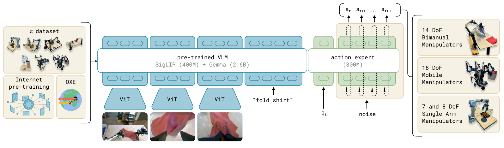

# 精读笔记 · π0: A Vision-Language-Action Flow Model for General Robot Control

> arXiv 2410.24164v4 · Physical Intelligence（PI）· 2024-10-31（v4 更新 2026-01-08）· 代码：[openpi](https://github.com/Physical-Intelligence/openpi) · 权重：openpi 开源（π0 base / π0-FAST / π0.5 等）
> 本地材料：`C:\Users\24431\Zotero\storage\papers\pi0-flow-model\`（paper.pdf / paper.tex / figures/ / code/）

## 基本情况

- 一句话：输入「2–3 路相机图像 + 语言指令 + 机器人本体状态 q_t」→ 输出「未来 50 步的连续动作块 A_t = [a_t … a_{t+H-1}]」。
- 结构：PaliGemma VLM（SigLIP 400M + Gemma 2B，共 3B）+ 一个从零训的 action expert（300M，width 1024），总 3.3B；单塔双专家（MoE 风格）。
- 开源：代码 openpi（2025-02 放出，含 π0 / π0-FAST / 后来 π0.5）；权重开放但需同意条款；数据不公开（OXE 公开，自采 10,000 小时不公开）。
- 和读过的哪篇最像、差在哪：和 RT-2 / OpenVLA 同为 VLA，但那两篇把动作**离散成 token 走自回归**，π0 把动作当**连续向量用 flow matching 回归**——这是全文最关键的一处改动。

## 导读地图

| 站 | 这一站讲清楚什么（一句话） | 图 | 原文位置 | 代码 |
|---|---|---|---|---|
| ① 动机 | 离散 token 的动作精度/频率上不去，要用连续生成 + 大规模跨本体预训练 | 图 1（teaser）、图 2 | §1 L88–113 | — |
| ② 架构 | VLM 塔 + action expert 塔，块状因果 mask，专家只在 attention 里交互 | 图 3 | §4 L139–162 · §A.2 L394–414 | `models/pi0.py:106` `embed_prefix` / `:140` `embed_suffix` |
| ③ 训练 | flow matching 损失：从噪声回归到动作的速度场；两阶段 pre/post-training | 式 1 L149 · 式 2 L155 | §4 / §5.1 | `models/pi0.py:189` `compute_loss` |
| ④ 数据 | 一个时刻的样本 = 3 图 + 语言 + q_t(18) + A_t(50×18)；10,000 小时 / 7 种机器人 / 68 任务 | 图 4、图 5 | §5.1–5.3 L168–217 | `transforms.py` / `training/config.py` |
| ⑤ 信息流 | prefix 只算一次进 KV cache，10 步 Euler 只跑 suffix | 表 I | §4 L153–157 · §A.4 L421–445 | `models/pi0.py:217` `sample_actions` |
| ⑥ 例子 | 场景：「把桌上的马克笔放进杯子里」 | — | — | `pi0.py:217–279` |
| ⑦ 实验 | 开箱即用碾压 OpenVLA/Octo；微调 1 小时数据就超 ACT/DP；能做叠衣服/装盒 | 图 7、图 11、图 13 | §6 L218–354 | — |

## ① 动机

**任务**：一个模型控制 7 种机器人（单臂 UR5e/Franka、双臂 Trossen/ARX/AgileX、移动双臂），做叠衣服、收桌、装箱等 5–20 分钟的长任务。

**以前卡在哪**（RT-2 / OpenVLA 路线）：把每维动作切成 256 格当 token 逐个吐——
1. 精度被量化吃掉；
2. 出 50 步要自回归 50 次，跟不上 50 Hz；
3. 分类能表达多峰，但仍然是"从有限集合里挑"。

**作者的三个赌注**：
- VLM 的常识能直接搬到动作（在 PaliGemma 上接动作输出）
- 动作该用连续分布建模（flow matching），不该用 token 分类 ← 全文核心改动
- 规模换泛化（1 万小时 / 7 本体 / 68 任务 + OXE）

**关键数字**：3.3B（PaliGemma 3B + expert 300M）；动作块 50×18；10 步去噪；机载推理 73 ms；50 Hz。

## ② 架构



图 3 三段：左数据（π dataset + Internet + OXE）→ 中模型 → 右机器人（14/18/7–8 DoF）。模型段：3 图 → 3 个 ViT → 3×256 token，拼上语言 token 进 PaliGemma；右侧单开一列 action expert，q_t 和 noise 从底部进，顶部出 50 步动作。

| 模块 | 来源 / 初始化 | 参数量 | 训练时更新吗 | 作用 |
|---|---|---|---|---|
| SigLIP | PaliGemma（网上预训练） | 400M | 是 | 每图 → 256 token |
| Gemma 2B | PaliGemma（网上预训练） | 2.6B | 是 | 语言理解 + 常识 |
| action expert | **从零** | 300M（width 1024） | 是 | 状态+噪声动作 → 速度场 |

**三个结构要点**（也是最容易问倒的三处）：

1. **单塔双专家**：attention 一套、FFN 两套。按 token 类型硬路由（图像/语言→VLM，状态/动作→expert）。两塔只能通过 attention 交换信息。为什么不全共享：动作会搅乱预训练表征、且 3B 全量跑太重；为什么不两个网络 + connector：connector 会压掉图像细节。
2. **三段块状因果 mask**：块① 图像+语言（块内双向，看不到后面）；块② 状态 q_t（能看块①，看不到动作）；块③ 动作 50 个（全看，且互相全通）。
   - 块①不能看后：保 PaliGemma 因果预训练分布（论文 "minimize distribution shift"）
   - 块②独立：q_t 在 10 次去噪里不变，不让它看动作 → K/V 可缓存
   - 块③互相全通：50 步动作要协调（第 1 步得看见第 30 步），这是与文本生成的本质差别
3. **KV cache 是 mask 的另一面**：图像+语言+状态在 10 次迭代中不变 → K/V 算一次（32 ms）；每次只算 50 个动作 token（2.7 ms × 10 = 27 ms）。若图像能看动作，cache 立刻作废。

**一次前向**：
```
3 图 ──SigLIP──▶ 3×256 ┐
指令 ──词表──▶ ~20     ┤─▶ 块① ┐ 算一次，K/V 入 cache
q_t(18) ──投影──▶ 1    ─▶ 块② ┤
noise(50×18)+τ ──MLP──▶ 50 ─▶ 块③ ┘
   循环 10 次：A^τ ← A^τ + 0.1·v
   → A (50×18) → 执行 25 步（0.5 s）→ 重新推理
```

## ③ 训练

（讲完补）

## ④ 数据

（讲完补）

## ⑤ 输入输出信息流

（讲完补）

## ⑥ 例子走一遍

（讲完补）

## ⑦ 实验与地位

（讲完补）

## 问答

- **Q（开讲前）**：这篇你读过/和 RT-2 的关系？
  **A**：他读过 RT-2 精读、OpenVLA 泛读。π0 和它们的核心分歧就在「动作怎么表示」。
- **Q（①后）**：flow matching 是什么、和扩散模型的区别？
  **A**：两者都在学「把噪声搬成数据」的速度场，区别只在**中间走哪条路**。扩散的路径由加噪公式决定（x_t = √ᾱ·x₀ + √(1−ᾱ)·ε，两个系数**平方和=1** → 路径是四分之一圆弧，曲率不为零）；flow matching 把路定成直线（x_τ = τx₁ + (1−τ)x₀，系数**和=1**，曲率为零）。Euler 积分误差 ∝ 曲率，所以圆弧必须走 1000 小步，直线 10 步就够。训练目标本质同一件事（回归某个线性组合的 MSE），不是两个物种。
- **Q（②前）**：π0 的结构是不是和前四篇都不太一样？要补什么？
  **A**：骨架没变（VLM 主干 + 动作块，从 RT-2 到 OFT 一路如此），真正新的只有两处：① 单 transformer 里两套权重；② 动作头从「回归」改成「生成」。注意 OFT 早就是连续 + chunk + 双向注意力，所以 π0 在「连续」上并不领先，新的是「生成式」。
- **Q（②）**：MoE / mask / KV cache 要补吗？
  **A**：三个都要。MoE：共享 attention、不共享 FFN，按 token 类型硬路由。mask：三段块状因果，块内双向块间单向。KV cache：图像+语言+状态在 10 次迭代中不变，K/V 算一次；mask 里「图像不能看动作」这个叉同时是缓存能成立的前提。
- **Q**：那篇「Fine-Tuning VLA」读过之后，π0 还有什么新东西？
  **A**：OFT 已经证明了「连续动作 + 动作块 + 双向注意力 + L1 回归」能到 25 Hz。π0 的增量是**生成式动作头**（flow matching，多峰）+ **两塔结构**（动作不污染 VLM）+ **跨 7 种本体**。别把它当成「连续动作」的首创。

## 代码 ↔ 论文

| 论文里 | 代码位置 | 备注（对不上的地方写这里） |
|---|---|---|
| τ=0 是噪声、τ=1 是干净动作 | `pi0.py:226-228` | **代码约定相反**：t=1 是噪声、t=0 是目标，`dt=-1/num_steps`，注释里作者自己写了 sorry |
| A^τ = τA + (1-τ)ε，u = A − ε | `pi0.py:199-200` | 代码：`x_t = t*noise + (1-t)*actions`，`u_t = noise - actions`——把 τ 换成 1−t 后完全等价 |
| 动作维度 18（最大机器人） | `pi0_config.py:25` | 代码默认 `action_dim=32`（留余量），horizon 50 一致 |
| 状态 q_t 是单独一个 block | `pi0.py:143-149` | 代码里 state 是 suffix 里**一个 token**，`ar_mask += [True]` 断在它后面 |
| β((s−τ)/s; 1.5, 1)，s=0.999 | `pi0.py:197` | `jax.random.beta(1.5,1)*0.999+0.001` |
