# 数据结构

> [!info] 本笔记范围
> - 依据课件《第1章 绪论》（35 页）、《第2章 线性表》（74 页）、《第3章 栈和队列》（51 页）、《第4章 串》（56 页）、《第5章 数组和广义表》（77 页）、《第6章 树和二叉树》（140 页）、《第7章 图》（130 页）、《第9章 查找》（131 页）整理，主讲：黄绍辉
> - 覆盖：第 1 章 1.1–1.4 全部；第 2 章 2.1–2.4 全部；第 3 章 3.1–3.4 全部（顺序栈、链栈、栈的应用、栈与递归、链队列、循环队列）；第 4 章 4.1–4.3.2（串类型定义、三种存储、Brute-Force 模式匹配、KMP 算法、next 与 nextval 数组）；第 5 章 5.1–5.7 全部（数组定义与顺序表示、特殊矩阵压缩、稀疏矩阵三元组与快速转置、十字链表、广义表定义与两种存储、m 元多项式、广义表递归算法），并补入录音稿的课堂讲解（十字链表的适用场景、广义表的考试易错点、union 与递归细节）；第 6 章整理到 6.6.2 赫夫曼编码（性质 4/5、两种存储结构、三种遍历与层次遍历、由遍历序列还原、线索树与头结点、树的三种存储、树 / 森林转换、赫夫曼树与编码）；第 7 章 7.1–7.6 全部（基本术语、四种存储、DFS/BFS、生成树与最小生成树、拓扑排序、关键路径、两种最短路径）；第 9 章 9.1–9.2.1（顺序、折半、次优查找树、分块、BST、AVL）
> - 未收：第 4 章 4.4 串操作应用举例（录音提到较简单，可自行看视频）；第 6 章 6.5 树与等价问题（课堂明确不考）、6.7 回溯法与树的遍历、6.8 树的计数 —— 录音与课堂笔记均未涉及；第 7 章 7.4.2 强连通分量、7.4.4 关节点（课堂明确不考，只在章末考点标注）；第 9 章 9.2.2 B-树与 B+树、9.2.3 键树、9.3 哈希表 —— 录音尚未讲到
> - 已删：章节封面与致谢页、重复过渡页、纯装饰的过渡页
> - 9/7 首版来自手写课堂笔记；9/14 按课件补全 2.2–2.4 并压缩 callout 用量；9/21 按课件补全第 3、4 章并配结构示意图、各章要点移至章末；9/22 按课件与录音稿新增 4.3.2 KMP，并补足 4.2 的课堂讲解与考点；9/29 按课件与录音稿补 nextval 数组、新增第 5 章数组和广义表；10/16 按录音稿补第 5 章课堂讲解，新增第 6 章树和二叉树（截至录音止点）；10/19 按录音稿补第 6 章性质 4/5、存储结构、遍历二叉树与线索二叉树；10/27 按课堂笔记补由遍历序列还原、线索树的找前驱后继与遍历、树和森林、赫夫曼树及其编码

## 课程信息

- **课程名称**：数据结构
- **教学形式**：线上 + 线下
- **学时**：14 周
- **教材**：清华大学《数据结构》
- **平台**：PTA 网站注册并绑定
- **作业要求**：每周一次作业，实验课上交，纸质版（手写）
- **网课要求**：自学网课时长需 **≥ 视频总时长的 60%**

### 评分标准

| 项目 | 占比 |
| --- | --- |
| 期末考 | 40% |
| **平时成绩** | **60%** |
| ├ 出勤 | 5% |
| ├ 平时作业 & 实验 | 10% |
| ├ 实验考试 | 25% |
| └ 期中考试 | 20% |

---

## 第1章 绪论

### 1.1 数据结构及其概念

《数据结构》是介于数学、计算机硬件、计算机软件三者之间的一门**核心课程**，不仅是一般程序设计的基础，也是设计和实现编译程序、操作系统、数据库系统及其他系统程序和大型应用程序的重要基础。

随着应用问题不断复杂，信息量剧增、信息范围拓宽，必须先分析待处理问题中**对象的特征**及**各对象之间存在的关系**——这正是数据结构这门课研究的问题。

**编写解决实际问题的程序的一般过程**：

1. 如何用数据形式描述问题——由问题抽象出一个适当的**数学模型**
2. 问题所涉及的数据量大小及数据之间的关系
3. 如何在计算机中存储数据及体现数据之间的关系
4. 处理问题时需要对数据作何种运算
5. 所编写的程序的性能是否良好

#### 1.1.1 数据结构的例子

| 例子 | 数据间关系 | 结构类型 |
| --- | --- | --- |
| 电话号码查询系统：$(a_1, b_1), (a_2, b_2), \ldots, (a_n, b_n)$（$a_i$ 姓名，$b_i$ 号码） | 一对一 | 线性结构（表格问题） |
| 磁盘目录文件系统：每个子目录只有一个父目录，可包含多个子目录和文件 | 一对多 | 树型结构 |
| 交通网络图：从一个地方到另一个地方可以有多条路径 | 多对多 | 网状结构 |

### 1.2 基本概念和术语

| 术语 | 定义 |
| --- | --- |
| **数据**（Data） | 客观事物的符号表示；在计算机科学中指所有能输入到计算机中并被计算机程序处理的符号的总称 |
| **数据元素**（Data Element） | 数据的**基本单位**，在程序中通常作为一个整体来考虑和处理 |
| **数据项**（Data Item） | 数据的**不可分割的最小单位**，是对客观事物某一方面特性的数据描述。一个数据元素可由若干数据项组成 |
| **数据对象**（Data Object） | 性质相同的数据元素的**集合**，是数据的一个子集，如字符集合 $C = \{'A', 'B', 'C', \ldots\}$ |
| **数据结构**（Data Structure） | 相互之间存在一定联系（关系）的数据元素的集合 |

#### 逻辑结构

元素之间的相互联系（关系）称为**逻辑结构**，有四种基本类型：

| 类型 | 关系 |
| --- | --- |
| ① 集合 | 结构中的数据元素除了"同属于一个集合"外，没有其它关系 |
| ② 线性结构 | 一对一 |
| ③ 树型结构 | 一对多 |
| ④ 图状 / 网状结构 | 多对多 |

> [!definition] 数据结构的形式定义
> 数据结构是一个**二元组**：
> $$\text{Data\_Structure} = (D, S)$$
> 其中 $D$ 是数据元素的有限集，$S$ 是 $D$ 上关系的有限集。

数据元素之间的关系可以是元素之间代表某种含义的**自然关系**，也可以是为处理问题方便而**人为定义**的关系。

**例（课件）**：设数据逻辑结构 $B = (K, R)$

$$K = \{k_1, k_2, \ldots, k_9\}$$

$$R = \{\langle k_1, k_3\rangle, \langle k_1, k_8\rangle, \langle k_2, k_3\rangle, \langle k_2, k_4\rangle, \langle k_2, k_5\rangle, \langle k_3, k_9\rangle, \langle k_5, k_6\rangle, \langle k_8, k_9\rangle, \langle k_9, k_7\rangle, \langle k_4, k_7\rangle, \langle k_4, k_6\rangle\}$$

根据以上描述可以画出逻辑结构 $B$ 的图示，并确定哪些是起点、哪些是终点。

#### 存储结构（物理结构）

数据结构在计算机内存中的存储包括**数据元素的存储**和**元素之间关系的表示**。元素之间的关系有两种不同的表示方法（顺序表示 / 非顺序表示），由此得到两种不同的存储结构：

| 存储方式 | 特点 |
| --- | --- |
| **顺序存储结构** | 用数据元素在存储器中的**相对位置**表示数据元素之间的逻辑结构；地址连续 |
| **链式存储结构** | 在每个数据元素中增加一个存放另一个元素地址的**指针**（pointer），用该指针表示逻辑结构；地址是否连续没有要求 |

**例**：设有数据集合 $A = \{3.0, 2.3, 5.0, -8.5, 11.0\}$，可以设计两种不同的存储结构——顺序结构（存放地址连续）与链式结构（对地址连续性无要求）。

**数据结构的三个组成部分**：

1. **逻辑结构**：数据元素之间逻辑关系的描述，$D\_S = (D, S)$
2. **存储结构**：数据元素在计算机中的存储及其逻辑关系的表现，又称**物理结构**
3. **数据操作**：对数据要进行的运算

> [!important] 逻辑结构与存储结构的对应关系
> 二者是**多对多**的：线性表和树既可采用顺序存储，也可采用链式存储；图采用复合存储结构。
>
> ```mermaid
> flowchart LR
>     A1[线性表] --> B1[顺序存储结构]
>     A1 --> B2[链式存储结构]
>     A2[树] --> B1
>     A2 --> B2
>     A3[图] --> B3[复合存储结构]
> ```
>
> **算法的设计取决于所选定的逻辑结构，而算法的实现依赖于所采用的存储结构。**

**在 C 语言中**：用一维数组表示顺序存储结构；用结构体类型表示链式存储结构。

#### 数据逻辑结构层次关系

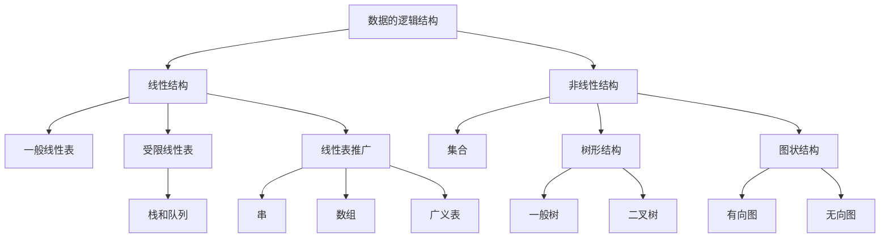

#### 数据类型

**数据类型**（Data Type）：一个值的集合和定义在该值集上的一组操作的总称。在 C 语言中有基本类型和构造类型。

数据结构不同于数据类型，也不同于数据对象：它不仅要描述数据类型的数据对象，而且要描述数据对象**各元素之间的相互关系**。

#### 数据结构的运算

数据结构的主要运算包括：

1. 建立（Create）一个数据结构
2. 消除（Destroy）一个数据结构
3. 从一个数据结构中删除（Delete）一个数据元素
4. 把一个数据元素插入（Insert）到一个数据结构中
5. 对一个数据结构进行访问（Access）
6. 对一个数据结构（中的数据元素）进行修改（Modify）
7. 对一个数据结构进行排序（Sort）
8. 对一个数据结构进行查找（Search）

### 1.3 抽象数据类型的表示与实现

**抽象数据类型**（Abstract Data Type，**ADT**）：一个数学模型以及定义在该模型上的一组操作。

ADT 的定义仅是一组**逻辑特性描述**，与其在计算机内的表示和实现无关。因此不论 ADT 的内部结构如何变化，只要其数学特性不变，都不影响其外部使用。

**ADT 的形式化定义是三元组**：

$$\text{ADT} = (D, S, P)$$

其中 $D$ 是数据对象，$S$ 是 $D$ 上的关系集，$P$ 是对 $D$ 的基本操作集。

**ADT 的一般定义形式**：

```text
ADT <抽象数据类型名> {
    数据对象：<数据对象的定义>
    数据关系：<数据关系的定义>
    基本操作：<基本操作的定义>
} ADT <抽象数据类型名>
```

其中数据对象和数据关系的定义用伪码描述。

**基本操作的定义格式**：

```text
<基本操作名>(<参数表>)
    初始条件：<初始条件描述>
    操作结果：<操作结果描述>
```

- **初始条件**：描述操作执行之前数据结构和参数应满足的条件；若不满足，则操作失败，返回相应的出错信息
- **操作结果**：描述操作正常完成之后，数据结构的变化状况和应返回的结果

### 1.4 算法和算法分析

#### 1.4.1 算法及其特性

**算法**（Algorithm）：对特定问题求解方法（步骤）的一种描述，是指令的有限序列，其中每一条指令表示一个或多个操作。

**算法的五个特性**：

1. **有穷性**：一个算法必须总是在执行有穷步之后结束，且每一步都在有穷时间内完成
2. **确定性**：算法中每一条指令必须有确切的含义，不存在二义性；且算法只有一个入口和一个出口
3. **可行性**：算法描述的操作都可以通过已经实现的基本运算执行有限次来实现
4. **输入**：有零个或多个输入，这些输入取自于某个特定的对象集合
5. **输出**：有一个或多个输出，这些输出是同输入有着某些特定关系的量

一个算法可以用自然语言、形式语言或计算机程序设计语言来描述。

**算法和程序是两个不同的概念**：一个计算机程序是对一个算法使用某种程序设计语言的具体实现。算法必须可终止，意味着**不是所有的计算机程序都是算法**。

本门课程的学习、作业练习、上机实践等环节，算法都用 **C 语言**来描述；上机实践时为了检查算法是否正确，应编写成完整的 **C++ 语言程序**（不是 C 语言）。

建议熟悉 **C++ 的标准模板库 STL**（包括 `vector`、`stack`、`queue`、`map` 等常用容器和 `sort` 等常用算法，会基本用法就行）。至于 C++ 输入输出和面向对象的部分，可以忽略。

#### 1.4.2 算法设计的要求

1. **正确性**（Correctness）：算法应满足具体问题的需求
2. **可读性**（Readability）：算法应容易供人阅读和交流，可读性好的算法有助于理解与修改
3. **健壮性**（Robustness）：算法应具有容错处理；当输入非法或错误数据时，应能适当地作出反应或进行处理，而不会产生莫名其妙的输出结果
4. **效率与存储量需求**：效率指算法执行的时间；存储量需求指算法执行过程中所需要的最大存储空间。一般地，这两者与问题的规模有关

#### 1.4.3 算法效率的度量

算法执行时间需通过依据该算法编制的程序在计算机上运行所消耗的时间来度量，通常有两种方法：

| 方法 | 说明 |
| --- | --- |
| **事后统计** | 计算机内部进行执行时间和实际占用空间的统计。缺陷：必须先运行依据算法编制的程序；依赖软硬件环境，容易掩盖算法本身的优劣；**没有实际价值** |
| **事前分析** | 求出该算法的一个时间界限函数（常用） |

与此相关的因素有：算法选用的策略、问题的规模、程序设计的语言、编译程序所产生的机器代码的质量、机器执行指令的速度。撇开软硬件等有关因素，可以认为一个特定算法"运行工作量"的大小只依赖于**问题的规模**（通常用 $n$ 表示），是问题规模的函数。

**时间复杂度**：算法中基本操作重复执行的次数是问题规模 $n$ 的某个函数，其时间量度记作

$$T(n) = O(f(n))$$

称作算法的**渐近时间复杂度**（Asymptotic Time Complexity），简称时间复杂度。一般地，常用**最深层循环内的语句**中的原操作的执行频度（重复执行的次数）来表示。

"$O$"的定义：若 $f(n)$ 是正整数 $n$ 的一个函数，则 $O(f(n))$ 表示存在 $M \geq 0$，使得当 $n \geq n_0$ 时，$|f(n)| \leq M|f(n_0)|$。

**表示时间复杂度的阶有**：

| 名称 | 复杂度 |
| --- | --- |
| 常量时间阶 | $O(1)$ |
| 对数时间阶 | $O(\log_2 n)$ |
| 线性时间阶 | $O(n)$ |
| 线性对数时间阶 | $O(n \log n)$ |
| k 次方时间阶（$k \geq 2$） | $O(n^k)$ |

**六种常用多项式的大小关系**：

$$O(1) < O(\log n) < O(n) < O(n \log n) < O(n^2) < O(n^3)$$

**指数时间的关系为**：

$$O(2^n) < O(n!) < O(n^n)$$

当 $n$ 取得很大时，指数时间算法和多项式时间算法在所需时间上非常悬殊。

> [!important] 定理：多项式的时间复杂度
> 若
> $$A(n) = a_m n^m + a_{m-1} n^{m-1} + \cdots + a_1 n + a_0$$
> 是一个 $m$ 次多项式，则
> $$A(n) = O(n^m)$$

##### 例 1：两个 n 阶方阵的乘法

```c
for (i = 1; i <= n; ++i)
    for (j = 1; j <= n; ++j)
    { c[i][j] = 0;
      for (k = 1; k <= n; ++k)
          c[i][j] += a[i][k] * b[k][j];
    }
```

三重循环，每个循环从 1 到 $n$，总次数为 $n \times n \times n = n^3$，时间复杂度 $T(n) = O(n^3)$。

##### 例 2：`{ ++x; s = 0; }`

将 `x` 自增看成基本操作，语句频度为 1，时间复杂度为 $O(1)$；如果将 `s = 0` 也看成基本操作，语句频度为 2，时间复杂度仍为 $O(1)$，即**常量阶**。

##### 例 3：`for (i = 1; i <= n; ++i) { ++x; s += x; }`

语句频度为 $2n$，时间复杂度为 $O(n)$，即**线性阶**。

##### 例 4：二重循环

```c
for (i = 1; i <= n; ++i)
    for (j = 1; j <= n; ++j)
    { ++x; s += x; }
```

语句频度为 $2n^2$，时间复杂度为 $O(n^2)$，即**平方阶**。

##### 例 5：嵌套循环

```c
for (i = 2; i <= n; ++i)
    for (j = 2; j <= i - 1; ++j)
        { ++x; a[i][j] = x; }
```

语句频度为：

$$1 + 2 + 3 + \cdots + (n-2) = \frac{(1 + n - 2)(n - 2)}{2} = \frac{(n-1)(n-2)}{2} = n^2 - 3n + 2$$

时间复杂度为 $O(n^2)$，即**平方阶**。

一个算法时间为 $O(1)$ 的算法，它的基本运算执行的次数是固定的，因此总的时间由一个常数（即零次多项式）来限界；而一个时间为 $O(n^2)$ 的算法则由一个二次多项式来限界。

##### 例 6：素数的判断算法

```c
void prime(int n)          /* n 是一个正整数 */
{   int i = 2;
    while ((n % i) != 0 && i * 1.0 < sqrt(n))  i++ ;
    if (i * 1.0 > sqrt(n))
        printf("%d 是一个素数\n", n);
    else
        printf("%d 不是一个素数\n", n);
}
```

嵌套的最深层语句是 `i++`；其频度由条件 `(n % i) != 0 && i * 1.0 < sqrt(n)` 决定，时间复杂度 $O(n^{1/2})$。

##### 例 7：冒泡排序法

```c
void bubble_sort(int a[], int n)
{
    for (i = n - 1; change = TURE; i > 1 && change; --i)
        change = FALSE;
        for (j = 0; j < i; ++j)
            if (a[j] > a[j + 1])
            { a[j] <-> a[j + 1]; change = TURE; }
}
```

- 最好情况：0 次
- 最坏情况：$1 + 2 + 3 + \cdots + (n-1) = \dfrac{n(n-1)}{2}$
- 平均时间复杂度为：$O(n^2)$

有的情况下，算法中基本操作重复执行的次数还随问题的**输入数据集**不同而不同。平均时间复杂度按各输入情况等概率加权平均求得，具体算法见 2.2 节顺序表插入 / 删除的分析（$E = \sum p_i \times \text{移动次数}$）。

#### 1.4.4 算法的存储空间需求

**空间复杂度**（Space Complexity）：算法编写成程序后，在计算机中运行时所需存储空间大小的度量，记作

$$S(n) = O(f(n))$$

其中 $n$ 为问题的规模（或大小）。

该存储空间一般包括三个方面：

1. 指令、常数、变量所占用的存储空间
2. 输入数据所占用的存储空间
3. **辅助（存储）空间**

一般地，算法的空间复杂度指的是**辅助空间**。

- 一维数组 `a[n]`：空间复杂度 $O(n)$
- 二维数组 `a[n][m]`：空间复杂度 $O(n \times m)$

### 第1章 要点

> [!summary] 本章要点
> - 数据结构研究**信息的表示与组织**，形式定义是二元组 $(D, S)$；逻辑结构分四类：集合、线性、树型、图状
> - 存储结构分**顺序**与**链式**两类，与逻辑结构是多对多对应；算法设计取决于逻辑结构，实现依赖于存储结构
> - ADT 是三元组 $(D, S, P)$，只描述逻辑特性，与实现无关
> - 时间复杂度 $T(n) = O(f(n))$，取**最深层循环内语句的频度**；$m$ 次多项式 $A(n) = O(n^m)$
> - 空间复杂度 $S(n) = O(f(n))$，一般指**辅助空间**

---

## 第2章 线性表

线性结构是最常用、最简单的一种数据结构，而线性表是一种典型的线性结构。其基本特点是线性表中的数据元素是**有序且有限**的。

### 2.1 线性表的类型定义

> [!definition] 线性表（Linear List）
> 由 $n$（$n \geq 0$）个数据元素（结点）$a_1, a_2, \ldots, a_n$ 组成的**有限序列**，序列中的所有结点具有相同的数据类型。数据元素的个数 $n$ 称为线性表的**长度**。

- $n = 0$ 时称为**空表**
- $n > 0$ 时，将非空的线性表记作 $(a_1, a_2, \ldots, a_n)$
- $a_1$ 称为线性表的第一个（首）结点，$a_n$ 称为最后一个（尾）结点
- $a_1, a_2, \ldots, a_{i-1}$ 都是 $a_i$（$2 \leq i \leq n$）的前驱，其中 $a_{i-1}$ 是**直接前驱**
- $a_{i+1}, a_{i+2}, \ldots, a_n$ 都是 $a_i$（$1 \leq i \leq n-1$）的后继，其中 $a_{i+1}$ 是**直接后继**

#### 线性表的特点

在这种结构中：

1. 存在一个唯一的被称为"**第一个**"的数据元素
2. 存在一个唯一的被称为"**最后一个**"的数据元素
3. 除第一个元素外，每个元素均有唯一一个**直接前驱**
4. 除最后一个元素外，每个元素均有唯一一个**直接后继**

#### 线性表的逻辑结构

线性表中的数据元素 $a_i$ 所代表的具体含义随具体应用的不同而不同，在线性表的定义中只不过是一个抽象的表示符号。

结点可以是**单值元素**（每个元素只有一个数据项）：

- 26 个英文字母组成的字母表：$(A, B, C, \ldots, Z)$
- 某校从 1978 年到 1983 年各种型号的计算机拥有量的变化情况：$(6, 17, 28, 50, 92, 188)$
- 一副扑克的点数：$(2, 3, 4, \ldots, J, Q, K, A)$

结点也可以是**记录型元素**——每个元素含有多个数据项，每个项称为结点的一个**域**；每个元素有一个可以唯一标识每个结点的数据项组，称为**关键字**：

- 某校 2001 级同学的基本情况：$\{('2001414101', '张三', '男', 06/24/1983), \ldots, ('2001414102', '李四', '女', 08/12/1984)\}$

若线性表中的结点是按值（或按关键字值）由小到大（或由大到小）排列的，称线性表是**有序的**。线性表长度可根据需要增长或缩短，对线性表的数据元素可以访问、插入和删除。

#### 线性表的抽象数据类型定义

```text
ADT List {
    数据对象：D = { a_i | a_i ∈ ElemSet, i = 1, 2, …, n, n ≥ 0 }
    数据关系：R = { <a_{i-1}, a_i> | a_{i-1}, a_i ∈ D, i = 2, 3, …, n }
    基本操作：
        InitList(&L)          // & 表示 C++ 的引用，见下节
            操作结果：构造一个空的线性表 L；
        ListLength(L)
            初始条件：线性表 L 已存在；
            操作结果：返回 L 中数据元素个数；
        GetElem(L, i, &e)
            初始条件：线性表 L 已存在，1 ≤ i ≤ ListLength(L)；
            操作结果：用 e 返回 L 中第 i 个数据元素的值；
        ListInsert(&L, i, e)
            初始条件：线性表 L 已存在，1 ≤ i ≤ ListLength(L)；
            操作结果：在 L 中第 i 个位置插入元素 e；
        …
} ADT List
```

#### C++ 的引用

C++ 的引用相当于**形参实参内存共享**，很适合用来改变实参的值。

```cpp
#include <stdio.h>

void f1(int i, int *q)
{   // 修改形参，实参不影响
    i++; q++;
}

void f2(int &i, int *&q)
{   // 修改形参，实参同时改变
    i++; q++;
}

int main()
{
    int a = 10, b[] = {20, 30};
    int *p = b;
    f1(a, p);
    printf("a = %d, *p = %d\n", a, *p);
    f2(a, p);
    printf("a = %d, *p = %d\n", a, *p);
    return 0;
}
```

运行结果：

```text
a=10, *p=20
a=11, *p=30
```

引用比 `return` 更方便传出结果。

#### 例 2-1：求集合并集 $A = A \cup B$

假设利用两个线性表 LA 和 LB 分别表示两个集合 A 和 B，求一个新集合 $A = A \cup B$。

```c
void union(List &La, List Lb) {          // La 变，Lb 不变
    // 将所有在 Lb 中但不在 La 中的元素插入 La
    La_len = ListLength(La);  Lb_len = ListLength(Lb);
    for (i = 1; i <= Lb_len; i++) {
        GetElem(Lb, i, e);               // 取 Lb 中第 i 个元素赋给 e
        if (!LocateElem(La, e, equal))   // La 中不存在和 e 相同的元素
            ListInsert(La, ++La_len, e); // 插入
    }
} // union
```

#### 例 2-2：归并两个有序线性表

线性表 LA 和 LB 的元素按值**非递减**有序排列，现要求将 La 和 Lb 归并为一个新的线性表 Lc，且 Lc 按值非递减有序排列。

```c
void MergeList(List La, List Lb, List &Lc) {
    InitList(Lc);  i = j = 1;  k = 0;
    La_len = ListLength(La);  Lb_len = ListLength(Lb);
    while ((i <= La_len) && (j <= Lb_len)) {      // La 和 Lb 均非空
        GetElem(La, i, ai);  GetElem(Lb, j, bj);
        if (ai <= bj) { ListInsert(Lc, ++k, ai); ++i; }
        else          { ListInsert(Lc, ++k, bj); ++j; }
    }
    while (i <= La_len) { GetElem(La, i++, ai); ListInsert(Lc, ++k, ai); }
    while (j <= Lb_len) { GetElem(Lb, j++, bj); ListInsert(Lc, ++k, bj); }
} // MergeList
```

### 2.2 线性表的顺序表示和实现

**顺序存储**：把线性表的结点按逻辑顺序依次存放在一组**地址连续**的存储单元里。用这种方法存储的线性表简称**顺序表**。

顺序存储的线性表的特点：

- 线性表的**逻辑顺序与物理顺序一致**
- 数据元素之间的关系是以元素在计算机内"**物理位置相邻**"来体现

#### 地址计算公式

设线性表的每个元素需占用 $L$ 个存储单元，以所占的第一个单元的存储地址作为数据元素的存储位置，则线性表中第 $i+1$ 个数据元素的存储位置 $\text{LOC}(a_{i+1})$ 和第 $i$ 个数据元素的存储位置 $\text{LOC}(a_i)$ 之间满足：

$$\text{LOC}(a_{i+1}) = \text{LOC}(a_i) + L$$

线性表的第 $i$ 个数据元素 $a_i$ 的存储位置为：

$$\text{LOC}(a_i) = \text{LOC}(a_1) + (i-1) \times L$$

在高级语言（如 C 语言）环境下，数组具有**随机存取**的特性，因此可以借助数组来描述顺序表。除了用数组来存储线性表的元素之外，顺序表还应该有表示线性表**长度**的属性。

#### 顺序表类型定义

```c
#define LIST_INIT_SIZE 100    // 空间初始分配量
#define LISTINCREMENT   10    // 空间分配增量

typedef struct
{   ElemType *elem;      // 存储空间基址
    int      length;     // 当前长度
    int      listsize;   // 当前分配容量
} SqList;
```

顺序存储结构中，很容易实现线性表的初始化、赋值、查找、修改、插入、删除、求长度等操作。

#### 顺序线性表初始化

```c
Status InitList_Sq(SqList &L)
{   L.elem = (ElemType *)malloc(LIST_INIT_SIZE * sizeof(ElemType));
    if (!L.elem)  exit(OVERFLOW);       // 存储分配失败
    L.length   = 0;                     // 空表长度为 0
    L.listsize = LIST_INIT_SIZE;        // 初始存储容量
    return OK;
}
```

#### 顺序线性表的插入

在线性表 $L = (a_1, \ldots, a_{i-1}, a_i, a_{i+1}, \ldots, a_n)$ 中的第 $i$（$1 \leq i \leq n$）个位置上插入一个新结点 $e$，使其成为：

$$L = (a_1, \ldots, a_{i-1}, e, a_i, a_{i+1}, \ldots, a_n)$$

**实现步骤**：

1. 将线性表 $L$ 中的第 $i$ 个至第 $n$ 个结点**后移一个位置**
2. 将结点 $e$ 插入到结点 $a_{i-1}$ 之后
3. 线性表长度加 1

```c
Status ListInsert_Sq(Sqlist &L, int i, ElemType e) {
    if (i < 1 || i > L.length + 1)  return ERROR;    // i 值不合法
    if (L.length >= L.listsize) {                    // 空间已满
        // 重新分配内存，代码参考课本
    }
    q = &(L.elem[i - 1]);                            // q 指示插入位置
    for (p = &(L.elem[L.length - 1]); p >= q; --p)
        *(p + 1) = *p;                               // 插入位置之后的元素右移
    *q = e;                                          // 插入 e
    ++L.length;                                      // 表长加 1
    return OK;
}
```

##### 插入的时间复杂度分析

时间主要耗费在**表中结点的移动**上，因此可用结点的移动次数来估计算法的时间复杂度。设在线性表 $L$ 中的第 $i$ 个元素之前插入结点的概率为 $p_i$，不失一般性，设各个位置插入是等概率，则 $p_i = \dfrac{1}{n+1}$，而插入时移动结点的次数为 $n - i + 1$。

总的平均移动次数：

$$E_{insert} = \sum_{i=1}^{n} p_i (n - i + 1) = \frac{1}{n+1}\bigl(n + (n-1) + \cdots + 1\bigr) = \frac{n}{2}$$

即在顺序表上做插入运算，平均要移动表上一半结点，算法的平均时间复杂度为 $O(n)$。

#### 顺序线性表的删除

在线性表 $L = (a_1, \ldots, a_{i-1}, a_i, a_{i+1}, \ldots, a_n)$ 中删除结点 $a_i$（$1 \leq i \leq n$），使其成为：

$$L = (a_1, \ldots, a_{i-1}, a_{i+1}, \ldots, a_n)$$

**实现步骤**：

1. 将线性表 $L$ 中的第 $i+1$ 个至第 $n$ 个结点**依次向前移动一个位置**
2. 线性表长度减 1

```c
Status ListDelete_Sq(Sqlist &L, int i, ElemType &e) {
    if (i < 1 || i > L.length)  return ERROR;   // i 值不合法
    p = &(L.elem[i - 1]);                       // p 为被删除元素的位置
    e = *p;                                     // 被删除元素的值赋给 e
    q = L.elem + L.length - 1;                  // 表尾元素的位置
    for (++p; p <= q; ++p)  *(p - 1) = *p;      // 被删元素之后的元素左移
    --L.length;                                 // 表长减 1
    return OK;
}
```

##### 删除的时间复杂度分析

设删除第 $i$ 个元素的概率为 $p_i$，不失一般性，设删除各个位置是等概率，则 $p_i = \dfrac{1}{n}$，删除时移动结点的次数为 $n - i$。

总的平均移动次数：

$$E_{delete} = \sum_{i=1}^{n} p_i (n - i) = \frac{1}{n}\bigl((n-1) + (n-2) + \cdots + 1\bigr) = \frac{n-1}{2}$$

即在顺序表上做删除运算，平均要移动表上一半结点，算法的平均时间复杂度为 $O(n)$。

> [!important] 顺序表插入 / 删除的代价
> 平均移动次数分别为 $E_{insert} = \dfrac{n}{2}$、$E_{delete} = \dfrac{n-1}{2}$，**时间复杂度均为 $O(n)$**。
> 当表长 $n$ 较大时效率相当低——这是链式存储要解决的问题。

#### 顺序线性表的查找定位

查找元素最简单的办法，就是让 $e$ 和 $L$ 中的数据元素逐个比较。`compare` 是**函数指针**，需传入用于比较两个元素的函数名。

```c
int LocateElem_Sq(Sqlist L, ElemType e,
                  Status (*compare)(ElemType, ElemType)) {
    i = 1;                  // i 的初值为第 1 个元素的位序
    p = L.elem;             // p 的初值为第 1 个元素的存储位置
    while (i <= L.length && !(*compare)(*p++, e))  ++i;
    if (i <= L.length)  return i;
    else                return 0;
}
```

#### 有序顺序表的合并

将顺序表 La 和 Lb 合并为一个新的顺序表 Lc：

```c
void MergeList_Sq(SqList La, SqList Lb, SqList &Lc) {
    pa = La.elem;  pb = Lb.elem;
    Lc.listsize = Lc.length = La.length + Lb.length;
    pc = Lc.elem = (ElemType *)malloc(Lc.listsize * sizeof(ElemType));
    if (!Lc.elem)  exit(OVERFLOW);
    pa_last = La.elem + La.length - 1;
    pb_last = Lb.elem + Lb.length - 1;
    while ((pa <= pa_last) && (pb <= pb_last)) {    // La 和 Lb 均非空
        if (*pa <= *pb)  *pc++ = *pa++;
        else             *pc++ = *pb++;
    }
    while (pa <= pa_last)  *pc++ = *pa++;           // 插入 La 的剩余元素
    while (pb <= pb_last)  *pc++ = *pb++;           // 插入 Lb 的剩余元素
} // MergeList_Sq
```

时间复杂度为 $O(\text{La.length} + \text{Lb.length})$。

以线性表表示集合并进行集合的各种运算，应**先对表中元素进行排序**。

### 2.3 线性表的链式表示和实现

**链式存储**：用一组**任意**的存储单元存储线性表中的数据元素。用这种方法存储的线性表简称**线性链表**。

存储链表中结点的一组任意的存储单元可以是连续的，也可以是不连续的，甚至是零散分布在内存中的任意位置上的。链表中结点的**逻辑顺序和物理顺序不一定相同**。

#### 2.3.1 单链表

为了正确表示结点间的逻辑关系，在存储每个结点值的同时，还必须存储指示其**直接后继结点的地址（或位置）**，称为**指针**（pointer）或**链**（link）。这两部分组成了链表中的结点结构：

```text
┌──────┬──────┐
│ data │ next │
└──────┴──────┘
  数据域   指针域
```

- `data`：数据域，存放结点的值
- `next`：指针域，存放结点的直接后继的地址
- 每一个结点只包含一个指针域的链表，称为**单链表**
- 为操作方便，总是在链表的第一个结点之前附设一个**头结点**（头指针 `head` 指向第一个结点）。头结点的数据域可以不存储任何信息（单纯占个位置），也可以存储链表长度等信息
- 单链表是由**表头**唯一确定的，因此可以用头指针的名字来命名

##### 结点的描述与实现

C 语言中用带指针的结构体类型来描述：

```c
typedef struct LNode
{   ElemType       data;    /* 数据域，保存结点的值 */
    struct LNode  *next;    /* 指针域 */
} LNode, *LinkList;         /* 结点和结点指针类型 */
```

结点是通过**动态分配和释放**来实现的：需要时分配，不需要时释放，分别使用 C 语言提供的标准函数 `malloc()`、`realloc()`、`sizeof()`、`free()`。

```c
p = (LNode *)malloc(sizeof(LNode));   // 动态分配：分配一个 LNode 结点，首地址放入 p
free(p);                              // 动态释放：系统回收 p 所指向的内存区
```

`free(p)` 中的 `p` 必须是最近一次调用 `malloc` 函数时的返回值。

##### 结点赋值与常见指针操作

**结点赋值**：

```c
LNode *p;
p = (LNode *)malloc(sizeof(LNode));
p->data = 20;  p->next = NULL;
```

**常见指针操作**：

| 操作 | 含义 | 示意图 |
| --- | --- | --- |
| `q = p` | q 指向 p 所指结点 | `p ⟶ a` ⇒ `p ⟶ a ⟵ q` |
| `q = p->next` | q 指向 p 的后继 | `p ⟶ a ⟶ b` ⇒ q 指向 b |
| `p = p->next` | p 后移一个结点 | `p ⟶ a ⟶ b` ⇒ p 指向 b |
| `q->next = p` | 把 p 所指结点接到 q 之后 | a ⟶ b 后接 p 链 |
| `q->next = p->next` | 把 p 的后继接到 q 之后 | 跳过中间结点 |

##### 建立单链表

假设线性表中结点的数据类型是整型，现在要创建有 $n$ 个结点的链表。动态地建立单链表的常用方法有两种：**头插法**与**尾插法**。

**头插法**：从一个空表开始，重复读入数据，生成新结点，将读入数据存放到新结点的数据域中，然后将新结点插入到当前链表的**表头**上，即每次插入的结点都作为链表的第一个结点。

```c
void CreateList_L(LinkList &L, int n) {      // 算法 2.11，逆序
    L = (LinkList)malloc(sizeof(LNode));
    L->next = NULL;                          // 先建立一个带头结点的单链表
    for (i = n; i > 0; i--) {
        p = (LinkList)malloc(sizeof(LNode)); // 生成新结点
        scanf(&p->data);                     // 输入元素值
        p->next = L->next;  // 注意不是 L，L 是头结点，不算链表
        L->next = p;                         // 插入到表头
    }
} // CreateList_L
```

**尾插法**：头插法生成的链表中结点的次序和输入的顺序**相反**，若希望二者次序一致，可采用尾插法——将新结点插入到当前链表的**表尾**，使其成为当前链表的尾结点。

```c
void CreateList2_L(LinkList &L, int n) {     // 顺序
    L = q = (LinkList)malloc(sizeof(LNode));
    L->next = NULL;
    for (i = n; i > 0; i--) {
        p = (LinkList)malloc(sizeof(LNode));
        scanf(&p->data);
        p->next = NULL;                      // p 是尾结点，后继始终是 NULL
        q->next = p;
        q = p;                               // q 始终在尾结点处
    }
} // CreateList2_L
```

无论哪种插入方法，如果要插入建立的单链表的结点是 $n$ 个，算法的时间复杂度均为 $O(n)$。

> [!warning] 钩链次序：先右后左
> 对于单链表，无论是哪种操作，只要涉及到**钩链（或重新钩链）**，如果没有明确给出直接后继，钩链的次序必须是"**先右后左**"——即先处理新结点右侧（后继方向）的指针，再改左侧。

##### 单链表的查找

**(1) 按序号查找**：取单链表中的第 $i$ 个元素。对于单链表，不能像顺序表中那样直接按序号 $i$ 访问结点，而只能从链表的头结点出发，沿链域 `next` 逐个结点往下搜索，直到搜索到第 $i$ 个结点为止。因此，**链表不是随机存取结构**。

```c
Status GetElem_L(LinkList L, int i, ElemType &e) {    // 算法 2.8
    p = L->next;  j = 1;                  // 初始化，p 指向第一个结点，j 为计数器
    while (p && j < i)                    // 顺指针向后查找，直到 p 指向第 i 个元素或 p 为空
    {   p = p->next;  ++j; }
    if (!p || j > i)  return ERROR;       // 第 i 个元素不存在
    e = p->data;                          // 取第 i 个元素
    return OK;
} // GetElem_L
```

移动指针 `p` 的频度：$i < 1$ 时为 0 次；$i \in [1, n]$ 时为 $i - 1$ 次；$i > n$ 时为 $n$ 次。时间复杂度为 $O(n)$。

**(2) 按值查找**：在链表中查找是否有结点值等于给定值 `key` 的结点，若有则返回首次找到的值为 `key` 的结点的存储位置，否则返回 `NULL`。查找时从开始结点出发，沿链表逐个将结点的值和给定值 `key` 作比较。

```c
Status LocateNode_L(LinkList L, ElemType key, LinkList &node) {
    p = L->next;
    while (p && p->data != key)  p = p->next;
    if (p && p->data == key)  { node = p;  return OK; }
    else                      return ERROR;
}
```

算法的执行与形参 `key` 有关，平均时间复杂度为 $O(n)$。

##### 单链表的插入

插入运算是将值为 $e$ 的新结点插入到表的第 $i$ 个结点的位置上，即插入到 $a_{i-1}$ 与 $a_i$ 之间。因此必须首先找到 $a_{i-1}$ 所在的结点 `p`，然后生成一个数据域为 $e$ 的新结点 `q`，`q` 结点作为 `p` 的直接后继结点。

```c
Status ListInsert_L(LinkList &L, int i, ElemType e) {   // 算法 2.9
    p = L;  j = 0;
    while (p && j < i - 1)  { p = p->next;  ++j; }      // 寻找第 i-1 个结点
    if (!p || j > i - 1)  return ERROR;                 // i 小于 1 或大于表长
    s = (LinkList)malloc(sizeof(LNode));                // 生成新结点
    s->data = e;  s->next = p->next;                    // 先右
    p->next = s;                                        // 后左
    return OK;
}
```

设链表的长度为 $n$，合法的插入位置是 $1 \leq i \leq n$。算法的时间主要耗费在移动指针 `p` 上，时间复杂度亦为 $O(n)$。

##### 单链表的删除

**(1) 按序号删除**：删除单链表中的第 $i$ 个结点。为了删除第 $i$ 个结点 $a_i$，必须找到结点的存储地址，该存储地址是在其直接前趋结点 $a_{i-1}$ 的 `next` 域中，因此必须首先找到 $a_{i-1}$ 的存储位置 `p`，然后令 `p->next` 指向 $a_i$ 的直接后继结点，即把 $a_i$ 从链上摘下，最后释放结点 $a_i$ 的空间，将其归还给"存储池"。

设单链表长度为 $n$，删去第 $i$ 个结点仅当 $1 \leq i \leq n$ 时是合法的。当 $i = n+1$ 时，虽然被删结点不存在，但其前趋结点却存在（终端结点），故判断条件之一是 `p->next != NULL`。

```c
Status ListDelete_L(LinkList &L, int i, ElemType &e) {  // 算法 2.10
    p = L;  j = 0;
    while (p->next && j < i - 1)                        // 寻找第 i 个结点，并令 p 指向其前趋
    {   p = p->next;  ++j; }
    if (!(p->next) || j > i - 1)  return ERROR;         // 删除位置不合理
    q = p->next;  p->next = q->next;                    // 删除并释放结点
    e = q->data;  free(q);
    return OK;
} // ListDelete_L
```

时间复杂度为 $O(n)$。

**(2) 按值删除**：删除单链表中值为 `key` 的第一个结点。与按值查找相类似，首先要查找值为 `key` 的结点是否存在？若存在，则删除；否则返回 `NULL`。

```c
Status ListDelete2_L(LinkList &L, ElemType key) {
    p = L;
    while (p->next && p->next->data != key)  { p = p->next; }
    if (!(p->next) || (p->next->data != key))  return ERROR;
    q = p->next;  p->next = q->next;
    free(q);
    return OK;
} // ListDelete2_L
```

**(3) 删除所有值为 `key` 的结点**：从单链表的第一个结点开始，对每个结点进行检查，若结点的值为 `key`，则删除之，然后检查下一个结点，直到所有的结点都检查完。

```c
void ListDelete3_L(LinkList &L, ElemType key) {
    LinkList p = L, q = L->next;
    while (q) {
        if (q->data == key)
        {   p->next = q->next;  free(q);  q = p->next; }
        else
        {   p = q;  q = q->next; }
    }
} // ListDelete3_L
```

> [!important] 链表插入 / 删除的代价
> 在链表上实现插入和删除运算，**无需移动结点，仅需修改指针**，解决了顺序表插入或删除需要移动大量元素的问题。
> 但查找第 $i$ 个结点仍需从头沿链搜索，时间复杂度 $O(n)$。

##### 单链表的合并

设有两个**有序**的单链表，它们的头指针分别是 La、Lb，将它们合并为以 Lc 为头指针的有序链表。算法中 `pa`、`pb` 分别是待考察的两个链表的当前结点，`pc` 是合并过程中合并链表的最后一个结点。

```c
void MergeList_L(LinkList &La, LinkList &Lb, LinkList &Lc) {   // 算法 2.12
    pa = La->next;  pb = Lb->next;
    Lc = pc = La;                        // 用 La 的头结点作为 Lc 的头结点
    while (pa && pb) {
        if (pa->data <= pb->data)
        {   pc->next = pa;  pc = pa;  pa = pa->next; }
        else
        {   pc->next = pb;  pc = pb;  pb = pb->next; }
    }
    pc->next = pa ? pa : pb;             // 插入剩余段
    free(Lb);                            // 释放 Lb 的头结点
} // MergeList_L
```

若 La、Lb 两个链表的长度分别是 $m$、$n$，则链表合并的时间复杂度为 $O(m + n)$。

### 静态链表

有些编程语言没有类似指针的类型，此时可以用**一维数组**来描述线性链表，这种链表叫**静态链表**。

```c
#define MAXSIZE 1000
typedef struct {
    ElemType data;
    int      cur;      // 指示下一元素的索引，相当于动态链表的 next
} component, SLinkList[MAXSIZE];
```

数组的一个分量相当于一个结点，`cur` 为 0 的结点表示尾结点。

**改进方案**：索引为 0 的结点改为**备用（空闲）链表的头结点**，而实际存储数据的链表头结点另设一个变量 `S` 来存储。初始时 `space[0].cur` 指向第一个空闲结点下标。

```c
void InitSpace_SL(SLinkList &space) {        // 算法 2.14，初始化
    for (i = 0; i < MAXSIZE - 1; ++i)  space[i].cur = i + 1;
    space[MAXSIZE - 1].cur = 0;              // 全部结点都是空闲结点
} // InitSpace_SL

int Malloc_SL(SLinkList &space) {            // 算法 2.15，返回第一个可用下标
    i = space[0].cur;                        // 第一个可用结点下标
    if (space[0].cur)  space[0].cur = space[i].cur;   // 指向下个可用下标
    return i;
} // Malloc_SL

void Free_SL(SLinkList &space) {             // 算法 2.16，回收索引为 k 的结点
    space[k].cur = space[0].cur;
    space[0].cur = k;                        // 设为可用的第一个结点
} // Free_SL
```

**例 2-3**：求集合运算 $(A - B) \cup (B - A)$。先输入集合 A（$m$ 个元素），再输入集合 B（$n$ 个元素）：对每个 B 中元素，若 A 中不存在则插入，若已存在则删除。

```c
void difference(SLinkList &space, int S) {   // 算法 2.17
    InitSpace_SL(space);
    S = Malloc_SL(space);                    // 生成 S 的头结点
    r = S;  scanf(m, n);
    for (j = 1; j <= m; ++j) {               // 建链表 A
        i = Malloc_SL(space);
        scanf(space[i].data);
        space[r].cur = i;  r = i;
    }
    space[r].cur = 0;                        // r 是链表 A 尾结点
    for (j = 1; j <= n; ++j) {
        scanf(b);  p = S;  k = space[S].cur;
        while (k != space[r].cur && space[k].data != b) {
            p = k;  k = space[k].cur;        // 元素查找，p 为 k 的前驱
        }
        if (k == space[r].cur) {             // 元素不存在，插入新元素
            i = Malloc_SL(space);
            space[i].data = b;
            space[i].cur = space[r].cur;
            space[r].cur = i;
        } else {                             // 元素已存在，需删除
            space[p].cur = space[k].cur;
            Free_SL(space, k);
            if (r == k)  r = p;
        }
    }
} // difference
```

### 2.3.2 循环链表

**循环链表**（Circular Linked List）：一种**头尾相接**的链表。其特点是最后一个结点的指针域指向链表的**头结点**，整个链表的指针域链接成一个环。

从循环链表的任意一个结点出发都可以找到链表中的其它结点，使得表处理更加方便灵活。

对于单循环链表，除链表的合并外，其它的操作和单线性链表基本上一致，仅仅需要在单线性链表操作算法基础上作以下简单修改：

1. 判断是否为空链表：`head->next == head`
2. 判断是否为表尾结点：`p->next == head`

### 2.3.3 双向链表

**双向链表**（Double Linked List）：构成链表的每个结点中设立两个指针域——一个指向其直接前趋的指针域 `prior`，一个指向其直接后继的指针域 `next`。这样形成的链表中有两个方向不同的链，故称为双向链表。

双向链表是为了**克服单链表的单向性的缺陷**而引入的。和单链表类似，双向链表一般增加**头指针**也能使双链表上的某些运算变得方便；将头结点和尾结点链接起来也能构成循环链表，称之为**双向循环链表**。

#### 结点及其类型定义

```c
typedef struct DuLNode
{   ElemType          data;
    struct DuLNode   *prior, *next;
} DuLNode, *DuLinkList;
```

```text
┌───────┬──────┬──────┐
│ prior │ data │ next │
└───────┴──────┴──────┘
```

> [!important] 双向链表的对称性
> 设 `p` 指向双向链表中的某一结点，则：
> $$(p \to prior) \to next = p = (p \to next) \to prior$$
> 即结点 `p` 的存储位置既存放在其直接前趋结点 `p->prior` 的直接后继指针域中，也存放在其直接后继结点 `p->next` 的直接前趋指针域中。

#### 双向链表的插入

将值为 $e$ 的结点插入双向链表中（插入到 `p` 所指结点之前）：

```c
Status ListInsert_DuL(DuLinkList &L, int i, ElemType e) {   // 算法 2.18
    if (!(p = GetElemP_DuL(L, i)))  return ERROR;   // 定位位置 i
    if (!(s = (DuLinkList)malloc(sizeof(DuLNode))))  return ERROR;
    s->data = e;
    // 修改指针的原则：先改新结点，后改原链表
    s->prior = p->prior;   p->prior->next = s;
    s->next  = p;          p->prior = s;
    return OK;
} // ListInsert_DuL
```

#### 双向链表的删除

```c
Status ListDelete_DuL(DuLinkList &L, int i, ElemType e) {   // 算法 2.19
    if (!(p = GetElemP_DuL(L, i)))  return ERROR;   // 定位位置 i
    e = p->data;
    p->prior->next = p->next;      // 删除结点的语句顺序随意
    p->next->prior = p->prior;
    free(p);
    return OK;
} // ListDelete_DuL
```

### 2.4 一元多项式的表示及相加

#### 一元多项式的表示

一元多项式

$$P_n(x) = p_0 + p_1 x + p_2 x^2 + \cdots + p_n x^n$$

由 $n+1$ 个系数唯一确定，在计算机中可用线性表 $(p_0, p_1, p_2, \ldots, p_n)$ 表示。

既然是线性表，就可以用**顺序表和链表**来实现；两种实现方式各有优缺点，实际应用中**以链式居多**。

多项式的项定义如下：

```c
typedef struct {
    float coef;      // 系数
    int   expn;      // 指数
} term, ElemType;

typedef LinkList polynomial;    // 用带表头结点的有序链表表示多项式
```

#### 一元多项式的相加

设有两个一元多项式：

$$P(x) = p_0 + p_1 x + p_2 x^2 + \cdots + p_n x^n$$

$$Q(x) = q_0 + q_1 x + q_2 x^2 + \cdots + q_m x^m \quad (m < n)$$

$$R(x) = P(x) + Q(x)$$

$R(x)$ 由线性表 $R\bigl((p_0 + q_0), (p_1 + q_1), (p_2 + q_2), \ldots, (p_m + q_m), \ldots, p_n\bigr)$ 唯一表示。

一元多项式相加的实质是：

- **指数不同**：是链表的合并
- **指数相同**：系数相加。和为 0，去掉结点；和不为 0，修改结点的系数域

```c
void CreatePolyn(polynomial &P, int n) {     // 算法 2.22，输入 n 项建立多项式
    InitList(P);  h = GetHead(P);
    e.coef = 0.0;  e.expn = -1;  SetCurElem(h, e);   // 设置头结点的数据元素
    for (i = 1; i <= n; ++i) {
        scanf(e.coef, e.expn);
        if (!LocateElem(P, e, q, (*cmp)()))          // 当前链表中不存在该指数项
            if (MakeNode(s, e))  InsFirst(q, s);      // 生成结点并插入链表
    }
} // CreatePolyn
```

```c
void AddPolyn(polynomial &Pa, polynomial &Pb) {      // 算法 2.23，Pa = Pa + Pb
    ha = GetHead(Pa);  hb = GetHead(Pb);
    qa = NextPos(Pa, ha);  qb = NextPos(Pb, hb);
    while (qa && qb) {
        a = GetCurElem(qa);  b = GetCurElem(qb);
        switch (*cmp(a, b)) {
            case -1:                                  // Pa 的当前结点指数小
                ha = qa;  qa = NextPos(Pa, qa);  break;
            case 0:                                   // 指数相等
                sum = a.coef + b.coef;
                if (sum != 0.0) { SetCurElem(qa, sum);  ha = qa; }
                else { DelFirst(ha, qa);  FreeNode(qa); }
                DelFirst(hb, qb);  FreeNode(qb);
                qb = NextPos(Pb, hb);  qa = NextPos(Pa, ha);
                break;
            case 1:                                   // Pb 的当前结点指数小
                DelFirst(hb, qb);  InsFirst(ha, qb);
                qb = NextPos(Pb, hb);  ha = NextPos(Pa, ha);
                break;
        }
    }
    if (!ListEmpty(Pb))  Append(Pa, qb);              // 链接 Pb 中剩余结点
    FreeNode(hb);                                     // 释放 Pb 的头结点
} // AddPolyn
```

### 第2章 要点

> [!summary] 本章要点
> - 线性表是 $n$ 个相同类型数据元素的有限序列，除首尾外每个元素有唯一直接前驱与直接后继
> - **顺序表**：随机存取，$\text{LOC}(a_i) = \text{LOC}(a_1) + (i-1)L$；插入 / 删除平均移动 $\dfrac{n}{2}$ / $\dfrac{n-1}{2}$ 个结点，均为 $O(n)$
> - **单链表**：非随机存取，插入 / 删除只需改指针，但查找第 $i$ 个结点为 $O(n)$；钩链次序**先右后左**
> - **静态链表**用数组 + `cur` 游标模拟指针；**循环链表**判空 `head->next == head`；**双向链表**满足 $(p \to prior) \to next = p = (p \to next) \to prior$
> - 一元多项式用有序链表表示，相加时指数不同则合并、指数相同则系数相加（和为 0 删结点）

---

## 第3章 栈和队列

栈和队列都是**操作受限的线性表**，都来自线性表。栈在计算机中有两种实现方式：**硬堆栈**利用 CPU 中的寄存器组或内存的特殊区域实现，容量有限但速度很快；**软堆栈**在内存中实现，容量可以很大，又分动态与静态两种。

### 3.1 栈

#### 栈的概念

- **栈（Stack）**：限制在表的一端进行插入和删除操作的线性表，又称**后进先出**（LIFO，Last In First Out）或**先进后出**（FILO）线性表
- **栈顶（Top）**：允许进行插入、删除操作的一端，又称表尾，用栈顶指针 `top` 指示
- **栈底（Bottom）**：固定端，又称表头
- **空栈**：表中没有元素

设栈 $S = (a_1, a_2, \ldots, a_n)$，则 $a_1$ 为栈底元素、$a_n$ 为栈顶元素。元素按 $a_1, a_2, \ldots, a_n$ 的次序进栈，退栈的第一个元素必是栈顶元素 $a_n$ —— 栈的修改按后进先出的原则进行。

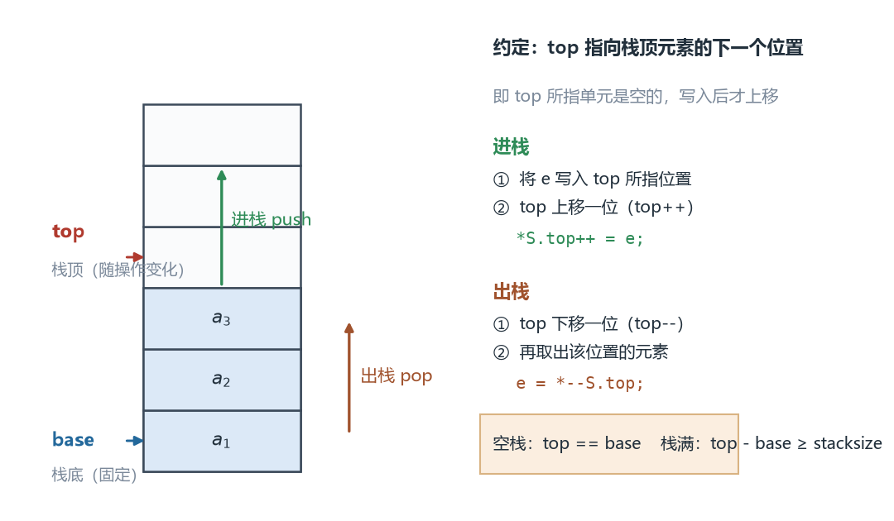

> [!warning] top 到底指向哪？
> 课本约定 **top 指向栈顶元素的下一个位置**（即 top 所指单元是空的），所以是 `*S.top++ = e` 先写入再上移、`e = *--S.top` 先下移再取出。若换用"top 指向栈顶元素"的约定，这两条语句都要改写，两种约定混用必错。

#### 栈的抽象数据类型定义

```text
ADT Stack {
数据对象：D = { ai | ai ∈ ElemSet, i = 1, 2, …, n, n ≥ 0 }
数据关系：R = { <ai-1, ai> | ai-1, ai ∈ D, i = 2, 3, …, n }
基本操作：初始化、进栈、出栈、取栈顶元素等
} ADT Stack
```

#### 栈的顺序存储表示

栈的顺序存储结构简称**顺序栈**，用一维数组存储栈。按数组能否根据需要增大，又分为：

- **静态顺序栈**：实现简单，但不能根据需要增大栈的存储空间
- **动态顺序栈**：可以根据需要增大存储空间，但实现稍为复杂

动态顺序栈用 `base` 表示栈底指针（固定不变），`top` 指示当前栈顶位置（随进栈退栈变化），以 `top = base` 作为栈空的标记，每次 `top` 指向栈顶数组中的下一个存储位置。

- **结点进栈**：先把数据元素保存到 `top` 所指的当前位置，然后执行 `top` 加 1，使其指向栈顶的下一个存储位置
- **结点出栈**：先执行 `top` 减 1，使其指向栈顶元素的存储位置，然后将栈顶元素取出

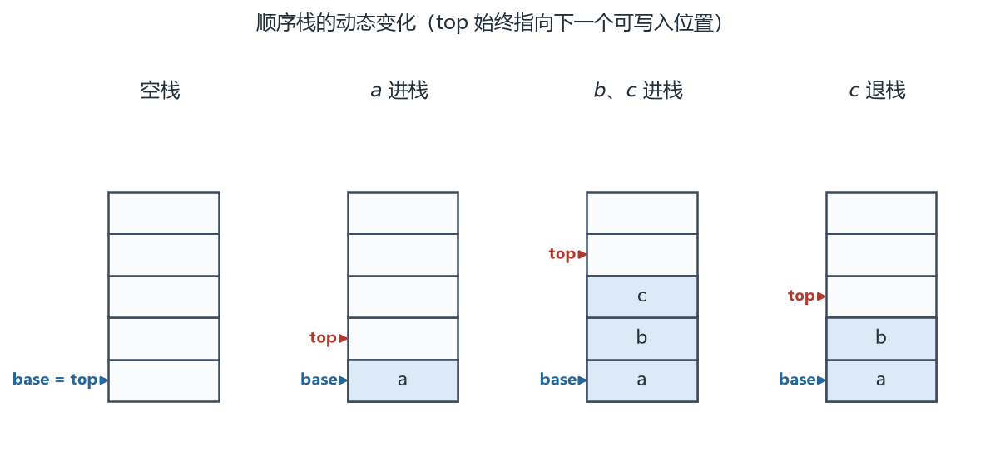

栈的类型定义：

```c
#define STACK_INIT_SIZE 100    /* 栈初始向量大小 */
#define STACKINCREMENT   10    /* 存储空间分配增量 */

typedef struct {
    SElemType *base;    /* 栈底指针，栈不存在时值为 NULL */
    SElemType *top;     /* 栈顶指针 */
    int stacksize;      /* 当前可使用的最大空间 */
} SqStack;
```

`stacksize` 的作用有二：限制下标的使用范围（容量为 100 时下标最多用到 99），以及判断是否需要执行二次空间分配。用数组实现栈时通常建议增加一个容量字段，而链栈一般不需要这个参数。

**初始化**：

```c
Status InitStack(SqStack &S) {
    S.base = (SElemType *)malloc(STACK_INIT_SIZE * sizeof(SElemType));
    if (!S.base) return ERROR;
    S.top = S.base;                        /* 栈空时栈顶和栈底指针相同 */
    S.stacksize = STACK_INIT_SIZE;
    return OK;
}
```

**压栈**：

```c
Status push(SqStack &S, SElemType e) {
    if (S.top - S.base >= S.stacksize) {          /* 栈满，追加存储空间 */
        S.base = (SElemType *)realloc(S.base,
                    (S.stacksize + STACKINCREMENT) * sizeof(SElemType));
        if (!S.base) return ERROR;
        S.top = S.base + S.stacksize;
        S.stacksize += STACKINCREMENT;
    }
    *S.top++ = e;                                 /* 先写入，再让 top 上移 */
    return OK;
}
```

**弹栈**：

```c
Status pop(SqStack &S, SElemType &e) {
    if (S.top == S.base) return ERROR;   /* 栈空，返回失败标志 */
    e = *--S.top;                        /* 先下移 top，再取出元素 */
    return OK;
}
```

参数 `S` 与 `e` 都必须使用**引用**，否则函数内的修改带不出去。压栈函数看起来较长，是在处理栈满与二次分配，真正核心的压栈操作只有 `*S.top++ = e` 一行。

栈常用数组而非链表实现，原因是 `top` 指针频繁移动，若用链表则每次进栈出栈都可能要分配/释放内存，严重影响效率；因此通常**一次性开辟一块连续的大空间**，在这块空间里来回移动 `top`。代价是容量有上限，解决办法有两种：把数组开得足够大，或空间不足时进行二次分配。

出栈时元素其实并没有被真正删除：通常只是把 `top` 下移，原来那个元素在物理上可能仍然存在，但由于 `top` 已经改变，下一次写入时会把它覆盖，所以在**逻辑上它已经不属于栈了**。

C 语言中常见的"栈溢出"也是同一个道理：程序运行时有一个固定的栈区，用来保存函数的返回地址等信息，函数每调用一次就要入栈一次；递归太深或调用层级太多就容易溢出。根源在于**运行栈的大小通常是不可动态改变的**，可以在启动时把默认的 1 MB 指定得更大，但依然存在上限。

#### 栈的链式存储表示

栈的链式存储结构称为**链栈**，是运算受限的单链表，其插入和删除操作只能在表头位置上进行。因此链栈没有必要像单链表那样附加头结点，**栈顶指针 `top` 就是链表的头指针**。

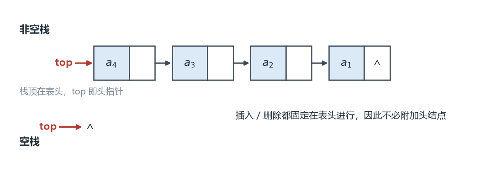

```c
typedef struct Stack_Node {
    ElemType data;
    struct Stack_Node *next;
} Stack_Node;
```

空栈时 `top = NULL`。链栈每次进栈、出栈都可能需要分配或释放一块内存，效率不如数组栈高，因此实际使用相对较少。

### 3.2 栈的应用举例

由于栈具有后进先出的固有特性，它成为程序设计中常用的工具和数据结构。

#### 3.2.1 数制转换

十进制整数 $n$ 向其它进制数 $d$（二、八、十六）的转换是计算机实现计算的基本问题，转换法则对应一个简单的算法原理：

$$n = (n \ \mathrm{div}\ d) \times d + n \ \mathrm{mod}\ d$$

其中 div 为整除运算、mod 为求余运算。注意到余数是**倒序输出**的 —— 最后得到的余数反而要放在最前面，这正是一个后进先出过程。

例如 $(1348)_{10} = (2504)_8$，运算过程如下：

| $n$ | $n \ \mathrm{div}\ 8$ | $n \ \mathrm{mod}\ 8$ |
| --- | --- | --- |
| 1348 | 168 | 4 |
| 168 | 21 | 0 |
| 21 | 2 | 5 |
| 2 | 0 | 2 |

```c
void conversion() {
    Init_Stack(S);
    scanf("%d", &n);
    while (n) { push(S, n % 8); n = n / 8; }        /* 余数依次入栈 */
    while (!StackEmpty(S)) { pop(S, e); printf("%d", e); }   /* 出栈即倒序 */
} //conversion
```

#### 3.2.2 括号匹配问题

在文字处理软件或编译程序设计中，常常需要检查一个字符串或表达式中的括号是否相匹配。**仅仅统计左右括号数量是否相等是不够的**：左右括号可能写反，也可能数量相同却不匹配。

匹配思想：从左至右扫描字符串（或表达式），将每个右括号与**最近遇到的那个左括号**相匹配。越早出现的左括号离得越远，越晚出现的左括号离得越近，这正是后进先出。

算法思想：设置一个栈，读到左括号时左括号进栈；读到右括号时，从栈中弹出一个左括号与读到的右括号进行匹配，若匹配成功则继续读入，否则匹配失败，返回 `FALSE`。

#### 3.2.3 行编辑程序

行编辑程序能接收用户的一行输入，由于光标不能回退，因此需要支持特殊字符 `#` 和 `@`，统一处理后再存入用户数据区：`#` 表示删除前一个字符（连续输入多个就连续删除前面的字符），`@` 表示删除之前的所有字符。

算法思想：逐行处理，从左至右扫描。设置一个栈，读到普通字符时直接进栈；读到 `#` 时从栈中弹出一个元素；读到 `@` 时清空栈。字符读取完毕后，将整个栈的内容传送到用户数据区。例如：

| 用户输入 | 处理后的结果 |
| --- | --- |
| `whli##ilr#e(s#*s)` | `while(*s)` |
| `outcha@putchar(*s=#++);` | `putchar(*s++);` |

如果完全使用数组，需要自己管理下标和边界；用栈则可以把思维集中在更高层次，不必过分关注下标移动。

#### 3.2.4 迷宫求解

迷宫通常包含可以通行的路径、不能通过的墙，以及入口坐标和出口坐标，目标是从入口出发找到一条通往出口的路径。走迷宫的关键特性是：**当某一步走不通时，总是退回到"最近的一步"**，这非常符合栈的后进先出特点。

思路：设当前探索位置 `curpos`（最开始是起点）。

1. 判断 `curpos` 是否可通：是则前进一步，并生成下一个探索位置；否则回退一步，尝试生成下一个探索方向
2. 回退后如果该位置 `di = 4`，说明四个方向都已探索完毕，标记该位置"没前途"（防止后续再次进入同一位置），然后继续回退，直到 `di < 4` 或者栈空
3. 如果 `di < 4`，就生成下一个探索位置，转回第 1 步继续判断；如果栈空则无解

**前进一步就是入栈，回退一步就是出栈。** `di` 取值 1~4 分别表示东、南、西、北四个方向（方向的顺序无所谓），探索顺序从 1 到 4；某个位置的 `di` 为 4 表示四个方向都已探索完毕。

```c
Status MazePath(MazeType maze, PosType start, PosType end) {
    InitStack(S); curpos = start; curstep = 1;
    do {
        if (Pass(curpos)) {                    /* 即将走入的位置可以通过 */
            FootPrint(curpos);
            e = (curstep, curpos, 1);
            Push(S, e);                        /* 保存最近一步的位置和方向，方便回退 */
            if (curpos == end) return TRUE;
            curpos = NextPos(curpos, 1);       /* 下一探索位置，注意还没走过去 */
            curstep++;
        } //if
        else {                                 /* 当前位置不可通过 */
            if (!StackEmpty(S)) {
                Pop(S, e);                     /* 出栈，尝试换方向 */
                while (e.di == 4 && !StackEmpty(S)) {   /* 无方向可换，必须回退 */
                    MarkPrint(e.seat); Pop(S, e); curstep--;
                } //while
                if (e.di < 4) {                /* 如果还有方向可以尝试，入栈 */
                    e.di++; Push(S, e); curpos = NextPos(e.seat, e.di);
                } //if
            } //if
        } //else
    } while (!StackEmpty(S));
    return FALSE;
} //MazePath
```

栈元素需要同时保存序号、位置和方向，回退以后才能在原方向上再加一、换一个新方向继续探索：

```c
typedef struct {
    int ord;        /* 序号 */
    PosType seat;   /* 位置 */
    int di;         /* 方向 */
} SElemType;
```

从迷宫的前几步可以理解这个算法：

1. 尝试走入初始位置 $(1,1)$，可通过，于是 $((1,1),1)$ 入栈，下一位置 $(1,2)$
2. 尝试走入位置 $(1,2)$，可通过，于是 $((1,2),1)$ 入栈，下一位置 $(1,3)$
3. 尝试走入位置 $(1,3)$，不可通过，于是 $((1,2),1)$ 出栈、下一方向 $((1,2),2)$ 入栈，下一位置 $(2,2)$
4. 尝试走入位置 $(2,2)$，可通过，于是 $((2,2),1)$ 入栈，下一位置 $(2,3)$
5. 尝试走入位置 $(2,3)$，不可通过，于是 $((2,2),1)$ 出栈、下一方向 $((2,2),2)$ 入栈，下一位置 $(3,2)$……

> [!warning] 回退时别忘了把步数减一
> 课件在此处特别标注：回退分支里的 `curstep--` 不能省。课本漏了这一句，会让最终输出的步数把走过的无效步也算进去。如果不标记"不可行位置"，还可能出现死循环 —— 从方向 A 进入某格子失败，之后又从方向 B 进入同一格子，反复打转。

> [!important] 用栈求解迷宫属于深度优先搜索
> 该算法本质上是一种**深度优先搜索（DFS）**，它能够找到一条路径，但**不一定是最短路径**。如果想找最短路径，通常应该使用队列实现**广度优先搜索（BFS）**。

#### 3.2.5 表达式求值

算法基本思想：使用两个工作栈，一个是 `OPTR`，用以存放运算符；另一个是 `OPND`，用于存数。

1. 首先置 `OPND` 为空栈，`OPTR` 存放 `#` 作为栈底元素
2. 依次读入表达式的每个字符：若是操作数，入栈 `OPND`；若是运算符，与 `OPTR` 的栈顶运算符比较优先级大小，然后根据比较结果执行相应操作，直到整个表达式求值完毕（`OPTR` 的栈顶和栈底元素都是 `#`）

```c
OperandType EvaluateExpression() {
    InitStack(OPTR); Push(OPTR, '#');       /* 运算符栈先压一个 # */
    InitStack(OPND); c = getchar();
    while (c != '#' || GetTop(OPTR) != '#') {
        if (!In(c, OP)) { Push(OPND, c); c = getchar(); }   /* 操作数直接入栈 */
        else {
            switch (Precede(GetTop(OPTR), c)) {
                case '<':                   /* 栈顶元素优先级低 */
                    Push(OPTR, c); c = getchar();
                    break;
                case '=':                   /* 脱括号并接收下一字符 */
                    Pop(OPTR, x); c = getchar();
                    break;
                case '>':                   /* 退栈并将运算结果入栈 */
                    Pop(OPTR, theta);
                    Pop(OPND, b); Pop(OPND, a);
                    Push(OPND, Operate(b, theta, a));
                    break;
            } //switch
        } //else
    } //while
    return GetTop(OPND);
} //EvaluateExpression
```

运算符之间的优先关系可以通过查表实现。以 $3 \times (7 - 2)$ 为例，两个栈的变化过程为：

| 步骤 | OPTR 栈 | OPND 栈 | 输入字符 | 主要操作 |
| --- | --- | --- | --- | --- |
| 1 | `#` | | `3*(7-2)#` | Push(OPND, '3') |
| 2 | `#` | 3 | `*(7-2)#` | Push(OPTR, '\*') |
| 3 | `# *` | 3 | `(7-2)#` | Push(OPTR, '(') |
| 4 | `# * (` | 3 | `7-2)#` | Push(OPND, '7') |
| 5 | `# * (` | 3 7 | `-2)#` | Push(OPTR, '-') |
| 6 | `# * ( -` | 3 7 | `2)#` | Push(OPND, '2') |
| 7 | `# * ( -` | 3 7 2 | `)#` | operate('7', '-', '2') → Push(OPND, '5') |
| 8 | `# * (` | 3 5 | `)#` | Pop(OPTR)，消去一对括号 |
| 9 | `# *` | 3 5 | `#` | operate('5', '\*', '3') → Push(OPND, '15') |
| 10 | `#` | 15 | `#` | return GetTop(OPND) |

#### 数组转置（课堂补充）

借助栈可以反转一个数组：准备一个空栈，把数组元素从头到尾依次压栈，再把元素依次弹出并填回原数组，后进先出自然完成反转。这种方法一般会浪费空间，因为需要额外开辟一个和原数组等大的辅助空间，虽然时间复杂度不错，但**空间利用率不高**。

#### 算法代码的学习建议

数据结构课程中会出现大量非常接近 C/C++ 的伪代码。对于重要或有趣的算法，建议自己用 C++ 把代码完整复现一遍：课本已经给出的核心逻辑尽量保留，辅助函数自己补全（判断栈是否为空、生成下一个探索位置、判断某个位置是否可通行、输出结果、栈的初始化/入栈/出栈等），也可以直接调用 C++ 标准库的栈。这样做的好处是核心算法逻辑基本不用修改，只需要替换语言相关的辅助实现。

### 3.3 栈与递归的实现

**递归调用**：一个函数（或过程）直接或间接地调用自己本身，简称递归。递归函数结构清晰、程序易读，正确性很容易得到证明。

为了使递归调用不至于无终止地进行下去，有效的递归调用函数应包括两部分：**递推规则**（方法）与**终止条件**。例如求 $n!$：

$$\mathrm{fact}(n) = \begin{cases} 1 & \text{当 } n = 0 \text{ 时（终止条件）} \\ n \times \mathrm{fact}(n-1) & \text{当 } n > 0 \text{ 时（递推规则）} \end{cases}$$

为保证递归调用正确执行，系统设立一个**递归工作栈**，作为整个递归调用过程期间使用的数据存储区。每一层递归包含的信息（参数、局部变量、上一层的返回地址）构成一个**工作记录**：每进入一层递归，就产生一条新的工作记录压入栈顶；每退出一层递归，就从栈顶弹出一条工作记录。

从被调函数返回调用函数的一般步骤：

1. 若栈为空，则执行正常返回
2. 从栈顶弹出一个工作记录
3. 将工作记录中的参数值、局部变量值赋给相应的变量，读取返回地址
4. 将函数值赋给相应的变量
5. 转移到返回地址

函数调用和递归调用的最大区别，就是后者的**入口地址始终是自己**。如果编程语言不支持递归，那就需要仿照上述步骤，自行维护一个递归工作栈来模拟递归。用栈模拟递归的核心是三件事：用**大循环**代替递归函数（循环条件通常是栈非空）、用**出栈**模拟函数返回、用**入栈**模拟函数调用。

```c
int fact1(int n) {          /* 直接递归 */
    if (n == 0) return 1;
    else return n * fact1(n - 1);
}

int fact2(int n) {          /* 用栈模拟递归 */
    stack<int> S;
    int f = 1;
    S.push(n);
    while (!S.empty()) {
        int curr = S.top();
        S.pop();
        if (curr == 0) f *= 1;
        else {              /* 递归调用模拟 */
            f *= curr;
            S.push(curr - 1);
        }
    }
    return f;
}
```

### 3.4 队列

#### 队列的基本概念

**队列（Queue）**：也是运算受限的线性表，是一种**先进先出**（FIFO，First In First Out）的线性表，只允许在表的一端进行插入，而在另一端进行删除。

- **队首（front）**：允许进行删除的一端
- **队尾（rear）**：允许进行插入的一端

例如排队购物、操作系统中的作业排队：先进入队列的成员总是先离开队列。在空队列中依次加入 $a_1, a_2, \ldots, a_n$ 之后，$a_1$ 是队首元素、$a_n$ 是队尾元素，退出队列的次序也只能是 $a_1, a_2, \ldots, a_n$。

与栈的一个重要区别在指针：栈的 `base` 基本不动，而队列的 `front` 和 `rear` 都会移动，并且**二者移动方向相同**（通常都是加一），这样才能体现先进先出的特点。

#### 队列的抽象数据类型定义

```text
ADT Queue {
数据对象：D = { ai | ai ∈ ElemSet, i = 1, 2, …, n, n ≥ 0 }
数据关系：R = { <ai-1, ai> | ai-1, ai ∈ D, i = 2, 3, …, n }
          约定 a1 端为队首，an 端为队尾。
基本操作：
    InitQueue(&Q)       创建一个空队列 Q
    DestroyQueue(&Q)    销毁队列 Q
    EnQueue(&Q, e)      向 Q 的队尾插入元素 e
    DeQueue(&Q, &e)     删除 Q 的队头元素 e
} ADT Queue
```

#### 3.4.1 队列的链式表示和实现

队列的链式存储结构简称为**链队列**，它是限制仅在表头进行删除操作和表尾进行插入操作的单链表。

需要两类不同的结点：数据元素结点，以及存放队头指针和队尾指针的指针结点。

```c
typedef struct QNode {          /* 数据元素结点 */
    QElemType data;
    struct QNode *next;
} QNode, *QueuePtr;

typedef struct {                /* 指针结点 */
    QueuePtr front;
    QueuePtr rear;
} LinkQueue;
```

链队列**使用带头结点的链表**，其操作实际上是单链表的操作，只不过是删除在表头进行、插入在表尾进行，插入和删除时分别修改不同的指针。

```c
Status InitQueue(LinkQueue &Q) {
    Q.front = Q.rear = (QueuePtr)malloc(sizeof(QNode));
    if (!Q.front) exit(OVERFLOW);
    Q.front->next = NULL;
    return OK;
}

Status EnQueue(LinkQueue &Q, QElemType e) {
    p = (QueuePtr)malloc(sizeof(QNode));
    if (!p) exit(OVERFLOW);
    p->data = e; p->next = NULL;
    Q.rear->next = p;
    Q.rear = p;
    return OK;
}

Status DeQueue(LinkQueue &Q, QElemType &e) {
    if (Q.front == Q.rear) return ERROR;
    p = Q.front->next;
    e = p->data;
    Q.front->next = p->next;
    if (Q.rear == p) Q.rear = Q.front;   /* 删的是最后一个结点，rear 要指回 front */
    free(p);
    return OK;
}

Status DestroyQueue(LinkQueue &Q) {
    while (Q.front) {
        Q.rear = Q.front->next;
        free(Q.front);
        Q.front = Q.rear;
    }
    return OK;
}
```

#### 3.4.2 队列的顺序表示和实现

利用一组连续的存储单元（一维数组）依次存放从队头到队尾的各个元素，称为**顺序队列**。

```c
#define MAXQSIZE 100
typedef struct {
    QElemType *base;
    int front;      /* 队首指针 */
    int rear;       /* 队尾指针 */
} SqQueue;
```

- **初始化**：`front = rear = 0`
- **入队**：将新元素插入 `rear` 所指的位置，然后 `rear` 加 1
- **出队**：删去 `front` 所指的元素，然后 `front` 加 1
- **队列为空**：`front == rear`

在非空队列里，队首指针始终指向队头元素，而队尾指针始终指向队尾元素的下一位置。这里的删除一般是**逻辑删除**：元素可能还存在于数组中，但已经不能被正常访问。

顺序队列中存在**假溢出**现象：在入队和出队操作中，头、尾指针只增加不减小，致使被删除元素的空间永远无法重新利用。尽管队列中实际元素个数可能远远小于数组大小，但可能由于尾指针已超出向量空间的上界而不能做入队操作。

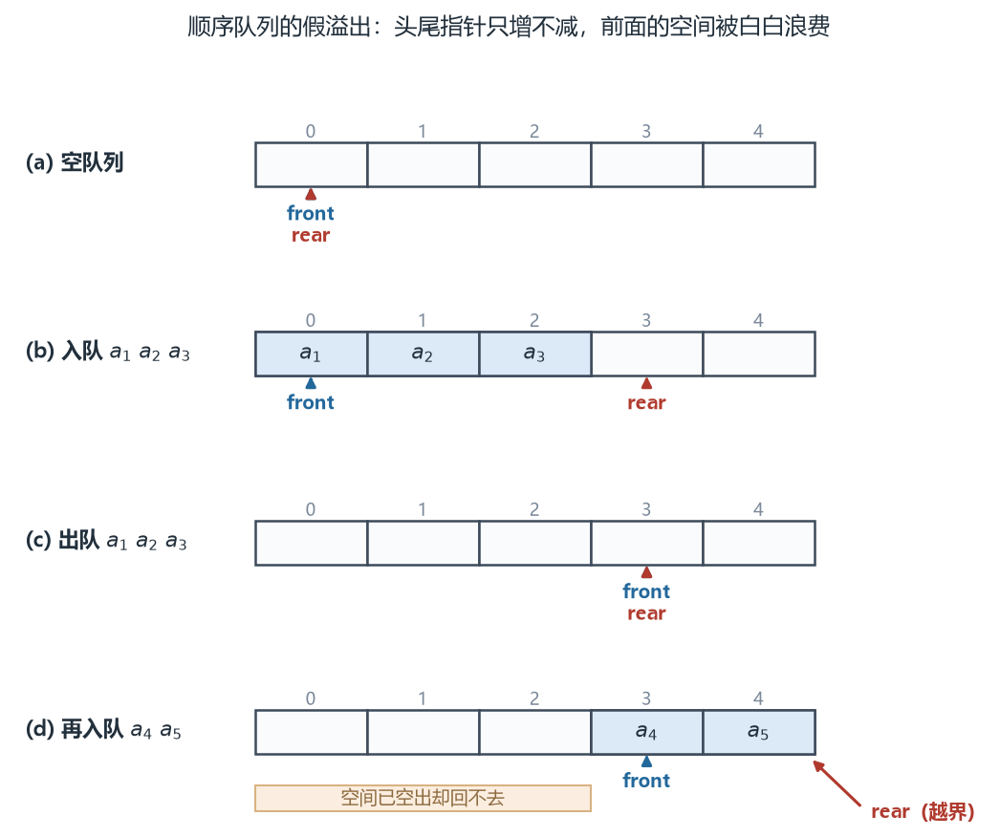

#### 3.4.3 循环队列

为充分利用向量空间、克服假溢出，把为队列分配的向量空间看成为一个首尾相接的圆环，这种队列称为**循环队列（Circular Queue）**。

在循环队列中进行出队、入队操作时，队首、队尾指针仍要加 1 朝前移动，只不过加 1 之后要对空间大小**取模**，避免下标溢出：

```c
Q.front = (Q.front + 1) % MAXQSIZE;
Q.rear  = (Q.rear + 1) % MAXQSIZE;
```

循环队列所分配的空间可以被充分利用，除非向量空间真的被队列元素全部占用，否则不会上溢，因此真正实用的顺序队列是循环队列。

但入队时尾指针向前追赶头指针、出队时头指针向前追赶尾指针，故**队空和队满时头尾指针均相等**，无法通过 `front == rear` 判断队列是"空"还是"满"。解决办法有两个：

1. 另设一个标志位，以区别队列是空还是满
2. 约定入队前测试尾指针在循环意义下加 1 后是否等于头指针，若相等则认为队满，即 `rear` 所指的单元始终为空（**特意空出该位置不存储数据**）

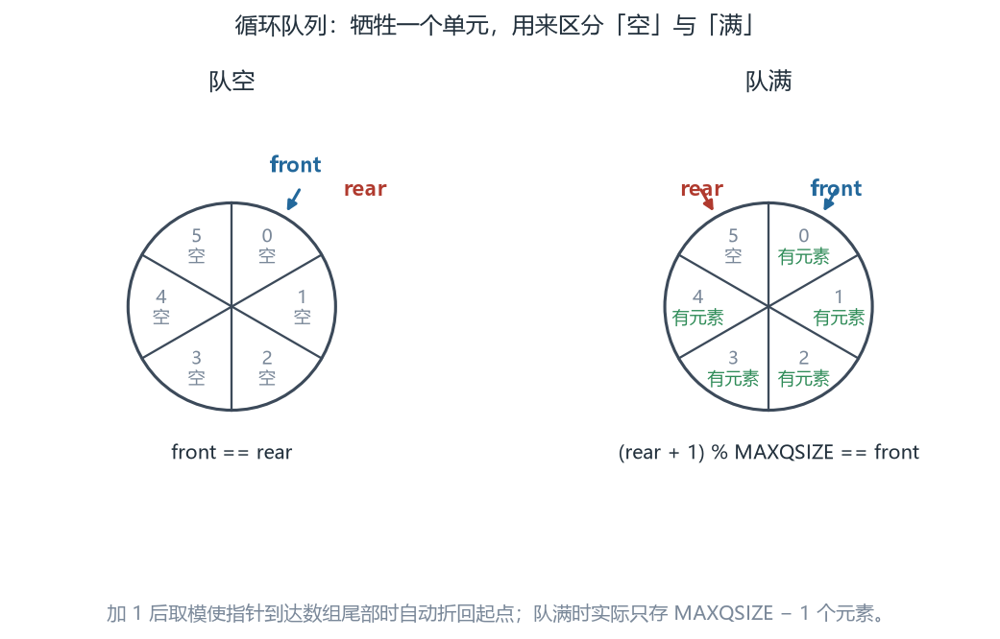

> [!important] 循环队列的空与满
> 队空：`front == rear`；队满：`(rear + 1) % MAXQSIZE == front`。
> 这套判断的前提是**牺牲一个存储单元**，因此容量为 `MAXQSIZE` 的循环队列最多只能存放 `MAXQSIZE - 1` 个元素。相比另设一个独立计数变量，用一个空位充当标志更为方便。

循环队列的几个关键函数：

```c
Status InitQueue(SqQueue &Q) {
    Q.base = (QElemType *)malloc(MAXQSIZE * sizeof(QElemType));
    if (!Q.base) exit(OVERFLOW);
    Q.front = Q.rear = 0;
    return OK;
}

Status EnQueue(SqQueue &Q, QElemType e) {
    if ((Q.rear + 1) % MAXQSIZE == Q.front)
        return ERROR;                       /* 队满，返回错误标志 */
    Q.base[Q.rear] = e;
    Q.rear = (Q.rear + 1) % MAXQSIZE;
    return OK;
}

Status DeQueue(SqQueue &Q, QElemType &e) {
    if (Q.front == Q.rear)
        return ERROR;                       /* 队空，返回错误标志 */
    e = Q.base[Q.front];
    Q.front = (Q.front + 1) % MAXQSIZE;
    return OK;
}
```

队列最典型的应用之一是实现**广度优先搜索（BFS）**：利用队列先进先出的特点逐层探索，可以找到最短路径。

### 第3章 要点

> [!summary] 本章要点
> - 栈与队列都是**操作受限的线性表**：栈后进先出（LIFO），只在栈顶插入 / 删除；队列先进先出（FIFO），队尾插入、队首删除
> - 顺序栈约定 **top 指向栈顶元素的下一个位置**，故 `*S.top++ = e` 先写后移、`e = *--S.top` 先移后取；空栈判据 `top == base`
> - 出栈只是下移 top，元素并未真正删除，下次入栈时即被覆盖
> - 链栈固定表头插入删除，**不必带头结点**；链队列删除在表头、插入在表尾，**需要头结点**，删到最后一个结点时要把 rear 指回 front
> - 顺序队列有**假溢出**；循环队列用取模解决，并以**牺牲一个单元**区分空满：空 `front == rear`，满 `(rear + 1) % MAXQSIZE == front`
> - 栈用于数制转换、括号匹配、行编辑、迷宫求解（DFS）、表达式求值；队列用于 BFS 求最短路径

---

## 第4章 串

在非数值处理、事务处理等问题中常涉及到一系列的字符操作。计算机的硬件结构主要是反映数值计算的要求，因此字符串的处理比具体数值处理复杂。本章讨论串的存储结构及几种基本的处理。

### 4.1 串类型的定义

- **串（字符串）**：零个或多个字符组成的有限序列，记作 $S = \text{"}a_1a_2a_3\ldots\text{"}$，其中 $S$ 是串名，$a_i$（$1 \le i \le n$）可以是字母、数字或其它字符
- **串值**：双引号括起来的字符序列是串值
- **串长**：串中所包含的字符个数
- **空串**：长度为零的串，它不包含任何字符
- **空格串（空白串）**：构成串的所有字符都是空格的串
- **子串**：串中任意个连续字符组成的子序列称为该串的子串，包含子串的串相应地称为**主串**。特别地，空串是任意串的子串，任意串是其自身的子串
- **子串的序号（位置）**：将子串在主串中首次出现时的该子串的首字符对应在主串中的序号，称为子串在主串中的序号
- **串相等**：如果两个串的串值相等，称这两个串相等；换言之，只有当两个串的长度相等、且各个对应位置的字符都相同时才相等

> [!warning] 空串 ≠ 空格串
> `""` 是长度为 0 的空串，`" "` 是长度为 1 的空白串（内容是一个空格）。两者都不含"可见字符"，判断时要分清。

例如设有串 $A = \text{"BEIJING"}$、$B = \text{"BEI"}$、$C = \text{"I"}$，则 $B$ 和 $C$ 都是 $A$ 的子串，$A$ 为主串。$B$ 在 $A$ 的序号为 1；$C$ 在 $A$ 中出现了两次，其中首次出现所对应的主串位置是 3，因此 $C$ 在 $A$ 中的序号为 3。

通常在程序中使用的串可分为两种：串常量和串变量。**串常量**和整常数、实常数一样，在程序中只能被引用但不能改变其值，即只能读不能写，通常由直接量来表示（例如语句 `("溢出")` 中 `"溢出"` 是直接量）；**串变量**和其它类型的变量一样，其值是可以改变的。判断两个串是否相等，比较的是内容而不是它们的存储位置，因此通常不能直接使用简单的等号比较，而要使用语言提供的专门比较函数。

串的抽象数据类型定义：

```text
ADT String {
数据对象：D = { ai | ai ∈ CharacterSet, i = 1, 2, …, n, n ≥ 0 }
数据关系：R = { <ai-1, ai> | ai-1, ai ∈ D, i = 2, 3, …, n }
基本操作：
    StrAssign(&T, chars)          生成一个值为 chars 的串 T
    Concat(&T, S1, S2)            用 T 返回由 S1 和 S2 联接而成的新串
    StrLength(S)                  返回串 S 中的元素个数，称为串长
    SubString(&Sub, S, pos, len)  用 Sub 返回串 S 的第 pos 个字符起长度为 len 的子串
    ……
} ADT String
```

由串的最小操作子集可以实现定位函数：

```c
int Index(String S, String T, int pos) {
    if (pos > 0) {
        n = StrLength(S); m = StrLength(T); i = pos;
        while (i <= n - m + 1) {
            SubString(sub, S, i, m);
            if (StrCompare(sub, T) != 0) ++i;
            else return i;
        } //while
    } //if
    return 0;
} //Index
```

### 4.2 串的存储表示和实现

串是一种特殊的线性表，其存储表示和线性表类似，但又不完全相同。**串的存储方式取决于将要对串所进行的操作**，串在计算机中有 3 种表示方式：

- **定长顺序存储表示**：将串定义成字符数组，利用串名可以直接访问串值；串的存储空间在编译时确定，其大小不能改变
- **堆分配存储方式**：用一组地址连续的存储单元来依次存储串中的字符序列，但串的存储空间是在程序运行时根据串的实际长度动态分配的
- **块链存储方式**：是一种链式存储结构表示

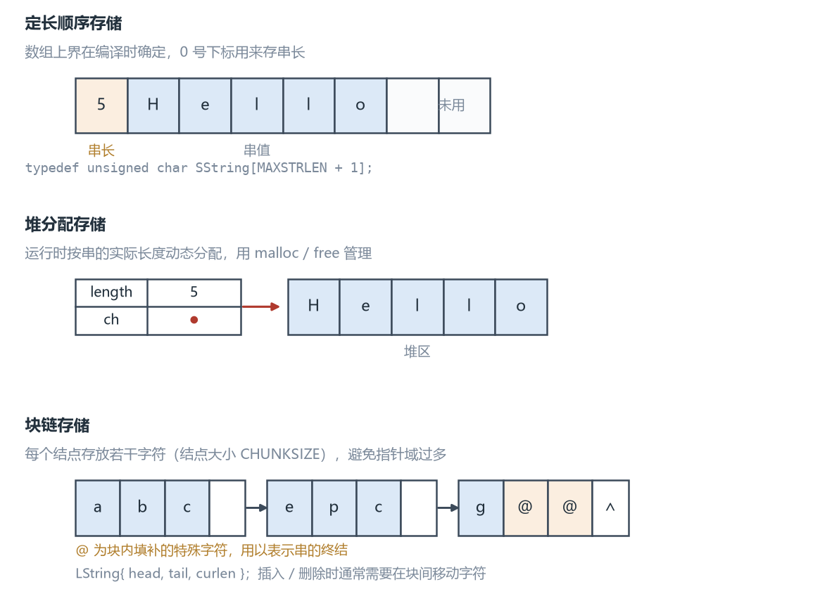

#### 4.2.1 定长顺序存储表示

这种存储结构又称为串的顺序存储结构，是用一组连续的存储单元来存放串中的字符序列。所谓定长顺序存储结构，是直接使用定长的字符数组来定义，数组的上界预先确定：

```c
#define MAXSTRLEN 255
typedef unsigned char SString[MAXSTRLEN + 1];
```

此时 **0 下标的值表示串长**，即 `SString[0]` 等于 `StrLength(SString)`。

为什么上限取 **255**？因为存储一个字符需要一个字节，而一个字节是 8 位；再留出一个字节来存串长，256 个值正好覆盖 0–255，所以 255 是这套表示法下串长的天然上界。相应地，用来存字符的空间要多留一个位置 —— **第一个字节留给串长**。

> [!warning] 内容从下标 1 开始，下标 0 是串长
> 在这种定义下，串的**真实内容是从下标 1 开始存**的，下标 0 不是第一个字符。**这与 C 语言的用法不一样** —— C 语言的串从下标 0 开始存字符。

所谓"定长"指的是长度**上界**固定，下界无所谓，因此它适合存放不太长的字符串（比如同学的名字、考卷上的姓名）。它的好处是长度固定，不存在"空间不够"引起的二次分配问题 —— 空间真不够时，它干脆不处理。

串的联结操作需要处理截断：

```c
Status Concat(SString &T, SString S1, SString S2) {
    if (S1[0] + S2[0] <= MAXSTRLEN) {               /* 未截断 */
        T[1..S1[0]] = S1[1..S1[0]];
        T[S1[0]+1 .. S1[0]+S2[0]] = S2[1..S2[0]];
        T[0] = S1[0] + S2[0]; uncut = TRUE;
    }
    else if (S1[0] < MAXSTRLEN) {                   /* S2 截断 */
        T[1..S1[0]] = S1[1..S1[0]];
        T[S1[0]+1 .. MAXSTRLEN] = S2[1..MAXSTRLEN-S1[0]];
        T[0] = MAXSTRLEN; uncut = FALSE;
    }
    else {                                          /* S1 正好填满数组，无法拼接 S2 */
        T[0..MAXSTRLEN] = S1[0..MAXSTRLEN];
        uncut = FALSE;
    }
    return uncut;
} //Concat
```

联结的三种情况正好对应代码里的三个分支：

1. **装得下**：$S_1[0] + S_2[0] \le \text{MAXSTRLEN}$，两个串原样拼入 T，`uncut = TRUE`
2. **S2 被截断**：$S_1$ 装得下，但拼上 $S_2$ 就超了。此时让操作"尽可能多地完成" —— 只把 $S_2$ 的一个前缀拼进去，T 取满 MAXSTRLEN，`uncut = FALSE`
3. **S1 已占满**：$S_2$ 一个字符也进不来，T 就只剩 $S_1$，`uncut = FALSE`

把下标 0 设计成串长，确实给代码书写带来了方便 —— 至少不用先调一次函数去算串有多长，这正是这个设计的本意。

求子串操作：

```c
Status SubString(SString &Sub, SString S, int pos, int len) {
    if (pos < 1 || pos > S[0] || len < 0 || len > S[0] - pos + 1)
        return ERROR;
    Sub[1..len] = S[pos .. pos+len-1];
    Sub[0] = len;
    return OK;
} //SubString
```

求子串是从一个串里截一段出来。截出来的一段**肯定不超过原串总长**，原串都存得下，截出来的一段自然也存得下 —— 所以这里**不需要判断空间够不够**，只需检查边界条件（`pos`、`len` 的取值是否合理）。这个判断与匹配逻辑无关，主要是**容错**；真正做事的只有 `Sub[1..len] = S[pos..pos+len-1]` 和 `Sub[0] = len` 两行。

#### 4.2.2 堆分配存储表示

实现方法：系统提供一个空间足够大且地址连续的存储空间（称为**堆**）供串使用，可使用 C 语言的动态存储分配函数 `malloc()` 和 `free()` 来管理。其特点是：仍然以一组地址连续的存储空间来存储字符串值，但所需的存储空间是在程序执行过程中动态分配的。

```c
typedef struct {
    char *ch;       /* 若非空，按长度分配，否则为 NULL */
    int length;     /* 串的长度 */
} HString;
```

`ch` 是 `malloc` 返回的内存起点，只表示"从哪里开始"；究竟存了多长，交给 `length` 记录。**`ch[0]` 只是第一个字符，取它没有特殊含义** —— 长度要去问 `length`，这一点与 SString 正好相反。

> [!warning] 先看用的是哪种存储，再动手
> 考试里一般只会出现 `SString` 和 `HString` 两种。拿到题目**先判断它用的是哪一种**：SString 的 `[0]` 是串长，HString 的长度存在 `length` 里。把 SString 的代码抄到 HString 上，必然出错。

几个基本（辅助）函数：

```c
Status StrInsert(HString &S, int pos, HString T) {     /* 字符串插入 */
    if (pos < 1 || pos > S.length + 1) return ERROR;
    if (T.length) {
        if (!(S.ch = (char *)realloc(S.ch, (S.length + T.length) * sizeof(char))))
            exit(OVERFLOW);
        for (i = S.length - 1; i >= pos - 1; --i)
            S.ch[i + T.length] = S.ch[i];              /* 从后往前腾出空位 */
        S.ch[pos-1 .. pos+T.length-2] = T.ch[0..T.length-1];
        S.length += T.length;
    }
    return OK;
}

Status StrAssign(HString &T, char *chars) {            /* 字符串赋值 */
    if (T.ch) free(T.ch);
    for (i = 0, c = chars; *c; ++i, ++c) ;
    if (!i) { T.ch = NULL; T.length = 0; }
    else {
        if (!(T.ch = (char *)malloc(i * sizeof(char)))) exit(OVERFLOW);
        T.ch[0..i-1] = chars[0..i-1]; T.length = i;
    }
    return OK;
} //StrAssign

Status Concat(HString &T, HString S1, HString S2) {    /* 字符串联接 */
    if (T.ch) free(T.ch);
    if (!(T.ch = (char *)malloc((S1.length + S2.length) * sizeof(char))))
        exit(OVERFLOW);
    T.ch[0..S1.length-1] = S1.ch[0..S1.length-1];
    T.length = S1.length + S2.length;
    T.ch[S1.length .. T.length-1] = S2.ch[0..S2.length-1];
    return OK;
} //Concat

Status SubString(HString &Sub, HString S, int pos, int len) {   /* 取子串 */
    if (pos < 1 || pos > S.length || len < 0 || len > S.length - pos + 1)
        return ERROR;
    if (Sub.ch) free(Sub.ch);
    if (!len) { Sub.ch = NULL; Sub.length = 0; }
    else {
        Sub.ch = (char *)malloc(len * sizeof(char));
        Sub.ch[0..len-1] = S.ch[pos-1 .. pos+len-2];
        Sub.length = len;
    }
    return OK;
} //SubString
```

这组操作的要点：

- **StrInsert**：因为空间可能不够，要先判断是否需要重新分配（`realloc`），再把 pos 之后的元素整体后移腾出空位 —— 本质就是线性表的插入
- **StrAssign**：同样先判断是否要重新分配；开头的 `if (T.ch) free(T.ch)` 是先把 T 原有的内容清空，再存入新值
- **Concat**：**不再区分三种情况** —— 只要分配得出来就行，按 `S1.length + S2.length` 重新分配，再把两个串一起复制过来
- **SubString**：不需要考虑长度够不够，但参数的合法性仍要检查

参数合法性的判断（`pos < 1 || pos > S.length` 之类）老师明确说过**一般不给分**，机考和期末考都不要求写 —— 它属于细节问题，不属于数据结构本身；平时写程序可以写一写，培养严谨的习惯。

#### 4.2.3 块链存储表示

串的链式存储结构和线性表的链式存储结构类似，采用单链表来存储串。结点由两部分构成：**data 域**存放字符，其可存放的字符个数称为**结点的大小**；**next 域**存放指向下一结点的指针。若每个结点仅存放一个字符，则结点的指针域就非常多，造成系统空间浪费；为节省存储空间，考虑串结构的特殊性，使**每个结点存放若干个字符**，这种结构称为**块链结构**。

```c
#define CHUNKSIZE 80
typedef struct Chunk {          /* 块结点的类型定义 */
    char data[CHUNKSIZE];
    struct Chunk *next;
} Chunk;

typedef struct {                /* 块链串的类型定义 */
    Chunk *head, *tail;
    int curlen;
} LString;
```

在这种存储结构下，结点的分配总是以完整的结点为单位，因此为使一个串能存放在整数个结点中，要在串的末尾填上**不属于串值的特殊字符**，以表示串的终结。当一个块（结点）内存放多个字符时，往往会使操作过程变得较为复杂，如在串中插入或删除字符时通常需要在块间移动字符。

块链存储的出现，是想把前两种方式做个结合：定长存储的长度上限卡死、长串搞不定；而堆分配虽然能存长串，但在大数组里插入删除很要命，要大量移动元素。块链的做法是先用一个小数组存小串，存不下再分配一个块……它像链表又不全是链表。好处是**插入删除时每次移动不会超过一个块的大小**，其他块可以不动；代价是处理起来比较麻烦，用得也不多，**了解即可**。

从串的三种存储方式可以看出一个普遍规律：**时间效率和空间效率往往是矛盾的** —— 想占用更少空间，可能需要更多运行时间；想提高运行速度，可能要适当牺牲空间。

### 4.3 串的模式匹配算法

**模式匹配**（串匹配）：子串在主串中的定位称为模式匹配。模式匹配成功是指在主串 $S$ 中能够找到模式串 $T$，否则称模式串 $T$ 在主串 $S$ 中不存在。

设 $S$ 为目标串、$T$ 为模式串，且不妨设：

$$S = \text{"}s_1s_2s_3\ldots s_n\text{"}, \qquad T = \text{"}t_1t_2t_3\ldots t_m\text{"}$$

串的匹配实际上是对合法的位置 $1 \le i \le n-m+1$，依次将目标串中的子串 $S[i..i+m-1]$ 和模式串 $T[1..m]$ 进行比较：

- 若 $S[i..i+m-1] = T[1..m]$，则称从位置 $i$ 开始的匹配成功，亦称模式 $T$ 在目标 $S$ 中出现
- 若 $S[i..i+m-1] \ne T[1..m]$，则从 $i$ 开始的匹配失败。位置 $i$ 称为**位移**：当匹配成功时 $i$ 称为**有效位移**，当匹配失败时 $i$ 称为**无效位移**

模式匹配的应用非常广泛。例如在文本编辑程序中，经常要查找某一特定单词在文本中出现的位置，解此问题的有效算法能极大地提高文本编辑程序的响应性能。

#### 4.3.1 Brute-Force 模式匹配算法

最直观的方法就是**暴力匹配**：在主串中取一段与子串等长的字符，比较这段字符是否与子串相等；如果不相等就换一个位置重新截取，重复这个过程直到找到匹配或遍历结束。

```c
int Index(SString S, SString T, int pos) {
    i = pos; j = 1;
    while (i <= S[0] && j <= T[0]) {
        if (S[i] == T[j]) { ++i; ++j; }        /* 继续比较后续字符 */
        else { i = i - j + 2; j = 1; }         /* i 回退到前一次比较起点的后一个位置 */
    }                                          /* j 回退到第一个字符处 */
    if (j > T[0]) return i - T[0];
    else return 0;
}
```

这个算法中，每次匹配失败时**两个下标都需要回退**，所以效率比较低。该算法简单、易于理解，在一些场合的应用里（如文字处理中的文本编辑）效率反而较高；其时间复杂度为 $O(n \times m)$，其中 $n$、$m$ 分别是主串和模式串的长度。通常情况下，实际运行过程中该算法的执行时间近似于 $O(n + m)$。

> [!important] 改进该算法的关键点
> 注意到当第一次 $s_i \ne t_j$ 时，其实已经有结论：$s_{i-1} = t_{j-1}, \ldots, s_{i-j+1} = t_2, s_{i-j} = t_1$。换句话说，**除了当前位置，之前的子串 $t_1t_2\ldots t_{j-1}$ 全部匹配成功**。如何利用这个"部分匹配"的结论（让主串指示器 $i$ 不再回溯、只把模式串指示器 $j$ 向右滑动），就是 KMP 算法的改进思路。

#### 4.3.2 KMP 算法

这种改进算法由 D. E. Knuth、J. H. Morris 和 V. R. Pratt 三人提出，取三人姓氏首字母简称 **KMP 算法**。它的改进在于：**每当一趟匹配出现字符不相等时，主串指示器 $i$ 不用回溯**，而是利用已经得到的"部分匹配"结果，把模式串的指示器 $j$ 向右"滑动"尽可能远的一段距离，然后继续比较。

##### 改进的思路

设主串 $s = \text{"abcbc"}$、模式串 $t = \text{"aba"}$，第一趟匹配如下：

```text
s =  a  b  c  b  c
t =  a  b  a
           ↑  i=3, j=3 处失配
```

在 $i=3$、$j=3$ 时失配。按暴力匹配，下一步要把 $i$ 退到 2、$j$ 回到 1 重新开始。但我们其实已经握着两条结论：

- **部分匹配的结果**：$s_1s_2 = t_1t_2 = \text{"ab"}$，也就是 $s_2 = t_2$
- **模式串自身的特性**：$t_2 \ne t_1$ —— 这是**先验**的，$t$ 是小串，它内部各字符的关系在匹配之前就能算好

由这两条推出 $s_2 \ne t_1$，也就是说 **$i=2$ 这一轮根本不用比**。而 $i=1$ 在第一轮就失败了，于是直接从 $i=3$ 继续 —— **失配时 $i$ 可以不动**。

那么 $j$ 怎么动？$i$ 不动，$j$ 就必须变，否则匹配就卡死了。暴力的做法是每次让 $j$ 回到 1（相当于把 $t$ 整体右移一位）；利用 $t$ 自身的信息，$j$ 可以退回一个**更大的值**，移动得更快，匹配也就更快。

不失一般性，设主串 $s=\text{"}s_1s_2\ldots s_n\text{"}$、模式串 $t=\text{"}t_1t_2\ldots t_m\text{"}$。当 $s_i \ne t_j$（$1 \le i \le n-m$，$1 \le j < m$，$m < n$）时，$i$ 不必回溯，$j$ 回溯到第 $k$（$k<j$）个字符继续比较，则 $t$ 的前 $k-1$ 个字符必须满足

$$t_1t_2\ldots t_{k-1} = s_{i-(k-1)}s_{i-(k-2)}\ldots s_{i-2}s_{i-1} \tag{4-2}$$

而且不存在 $k' > k$ 也满足此式，即 $k$ 取满足条件的**最大值**。另一方面，已经得到的"部分匹配"结果为

$$t_{j-(k-1)}t_{j-k}\ldots t_{j-1} = s_{i-(k-1)}s_{i-(k-2)}\ldots s_{i-2}s_{i-1} \tag{4-3}$$

由式 (4-2) 和式 (4-3) 得

$$t_1t_2\ldots t_{k-1} = t_{j-(k-1)}t_{j-k}\ldots t_{j-1} \tag{4-4}$$

式 (4-4) 说明：**$j$ 该取什么值只与模式串 $t$ 自身的构成有关，与主串 $s$ 无关** —— 它描述的正是模式串中存在相互重叠的子串的情形。

##### next 数组

既然失配后 $j$ 的取值与主串无关，就可以**预先**为模式串的每个位置算好一个值。用一个数组 $next$ 记录：一旦在位置 $j$ 失配，下一次 $j$ 就取 $next[j]$（以前固定取 1，现在改成取 $next[j]$）。

$next[j]$ 求的是：在 $j$ 前面的子串 $t_1t_2\ldots t_{j-1}$ 里找一个**前缀等于后缀**的子串，满足

1. 一个串必须从**串首**（$j=1$）开始
2. 另一个串必须以 **$j-1$ 的位置为串尾**
3. 两个串不能**完全**重叠

取满足这三条的**最长**子串，其长度就是 $k$，于是 $next[j] = k$。

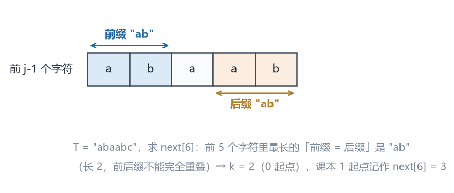

$next$ 函数的严格定义（下标从 1 开始）：

> [!definition] next 函数
> $$next[j] = \begin{cases} 0 & j = 1 \\[2pt] \max\{\,k \mid 1 < k < j,\ t_1t_2\ldots t_{k-1} = t_{j-(k-1)}t_{j-k}\ldots t_{j-1}\,\} & \text{该集合非空} \\[2pt] 1 & \text{其它情况} \end{cases} \tag{4-5}$$

它的直观含义是：**在位置 $j$ 失配时，把模式串向右滑动，让 $j$ 退到 $next[j]$，此时 $next[j]$ 之前的那些字符一定是已经配好的，无需再比。**

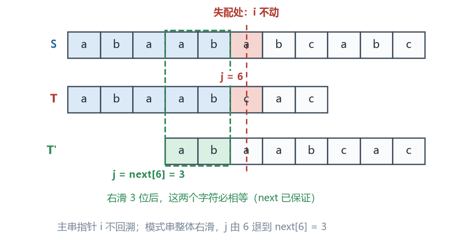

例如模式串 `"abaabcac"` 的 $next$ 数组中 $next[6] = 3$：在 $j=6$ 处失配时把模式串右滑，让 $j=3$ 去对齐失配位置，前面部分必然是相同的，于是不必重新比较。

**手工求 next**。以 $T = \text{"abaabcac"}$ 为例，逐个位置列表：

| $j$ | 前 $j-1$ 个字符 | 最长相等子串 | $k$ 值（0 起点） | $next[j]$（1 起点） |
| --- | --- | --- | --- | --- |
| 1 | 无定义 | 无定义 | $-1$（固定值） | 0 |
| 2 | a | 空串 | 0 | 1 |
| 3 | ab | 空串 | 0 | 1 |
| 4 | aba | a | 1 | 2 |
| 5 | abaa | a | 1 | 2 |
| 6 | abaab | ab | 2 | 3 |
| 7 | abaabc | 空串 | 0 | 1 |
| 8 | abaabca | a | 1 | 2 |

再以 $T = \text{"aaaab"}$ 为例体会**重叠**：

| $j$ | 前 $j-1$ 个字符 | 最长相等子串 | $k$ 值（0 起点） | $next[j]$（1 起点） |
| --- | --- | --- | --- | --- |
| 1 | 无定义 | 无定义 | $-1$ | 0 |
| 2 | a | 空串 | 0 | 1 |
| 3 | aa | a（取 `"aa"` 就完全重叠了） | 1 | 2 |
| 4 | aaa | aa（取 `"aaa"` 就完全重叠了） | 2 | 3 |
| 5 | aaaa | aaa | 3 | 4 |

这个例子专门用来体会"不能完全重叠"：不是"有几个相同字符就取几"，而要留出不完全重叠的部分。规律是：**第一个 $next$ 值不用求（固定），第二个也基本固定 —— 前两个可以直接写死，从第三个开始算。**

> [!warning] 先看清下标是 0 起点还是 1 起点
> 上表的 $k$ 值按 **0 起点**（内容从下标 0 开始存，如 C 语言）算；课本用的是 **1 起点**（SString，下标 0 存串长），两者正好**相差 1**。以 `"abaabcac"` 为例：
> - 0 起点：$-1,\ 0,\ 0,\ 1,\ 1,\ 2,\ 0,\ 1$
> - 1 起点：$0,\ 1,\ 1,\ 2,\ 2,\ 3,\ 1,\ 2$
>
> 做题、考试时**一定要先看清起点**，再决定要不要整体加 1。

##### KMP 匹配过程

有了 $next$ 数组，匹配过程是这样的：若 $s_i = t_j$，则 $i$、$j$ 各自加 1；否则 $i$ 不变，$j$ 退回到 $j = next[j]$ 的位置再比较；若相等则指针各自加 1，否则 $j$ 再退……如此反复，直到下列两种可能之一：

1. $j$ 退到某个值时 $s_i = t_j$ 成立，则指针各自加 1，继续匹配
2. $j$ 退到 0，此时把 $i$、$j$ 各自加 1，即从主串的下一个字符 $s_{i+1}$ 与模式串的 $t_1$ 重新开始比较

以模式串 $T = \text{"abcac"}$（$next$ 数组为 $0,1,1,1,2$）为例：前三位依次对上，到某处**第一次失配**时 $i$ 不动、查 $next[3]=1$、$j$ 回到 1（相当于把 T 整体右滑两位）；继续比又对上，直到 $i=7$、$j=5$ 时再次失配，$i$ 仍不动、查 $next[5]=2$、$j$ 回到 2。注意 $j=1$ 对应的那个字符是**天然配上**的、并没有参与比较 —— 这个结论由 next 数组的求解方式保证。

算法与暴力匹配只有一处本质差别：

```c
int Index_KMP(SString S, SString T, int pos) {
    i = pos; j = 1;
    while (i <= S[0] && j <= T[0]) {
        if (j == 0 || S[i] == T[j]) { ++i; ++j; }   /* 继续比较后续字符 */
        else { j = next[j]; }                       /* i 不动，j 回退到 next[j] */
    }
    if (j > T[0]) return i - T[0];
    else return 0;
} //Index_KMP
```

`else` 分支由 `i = i - j + 2; j = 1;` 换成了 `j = next[j];`，并在 `if` 条件里多了 `j == 0 ||` —— 因为 $j$ 一直回退最终会退到 0，此时转入 `if` 分支执行（$i$、$j$ 各自加 1）。

**KMP 为什么快**：

- **$i$ 一路向右，从不回退**。如果主串存在磁带这类只能单向卷的外设上，$i$ 不回溯就非常有价值 —— 暂停磁带、把模式串拿过来再比就行
- **模式串是跳跃式前进的**。暴力匹配每失败一次只前进一格，KMP 可能一次跳过好几格，串越长跳得越远，优势越明显

##### next 数组的递推求法

求 $next[j]$ 只与模式串 $t$ 本身的构成有关、与主串 $s$ 无关，因此可以把这件事看成**模式串自己跟自己匹配** —— 主串和模式串都是 $t$。

起点是 $next[1] = 0$，固定值。设已经求出 $next[j] = k$，即在模式串中存在

$$t_1t_2\ldots t_{k-1} = t_{j-(k-1)}t_{j-k}\ldots t_{j-1}$$

（$k$ 是满足 $1 < k < j$ 的某个最大值），现在求 $next[j+1]$，有两种可能：

**(1) 若 $t_k = t_j$**：说明相等子串还能再拼一位，模式串中有 $t_1t_2\ldots t_{k-1}t_k = t_{j-(k-1)}t_{j-k}\ldots t_{j-1}t_j$，且不存在更大的 $k'$，于是

$$next[j+1] = next[j] + 1 = k + 1$$

**(2) 若 $t_k \ne t_j$**：说明 $next[j+1]$ 取不到 $k+1$ 这么大，只能**改小**。怎么改？把模式串向右滑动，滑到 $next[k]$ 处再和 $t_j$ 比 —— 因为求 next 的本质是在模式串自己的范围内找自己的相等串，所以可以直接套用 next 的概念。改完继续判断：相等就按 (1) 处理；还不等就再改小……最坏情况一路退到 0，此时不再退，直接 `++i; ++j; next[i] = j;`。

举个例：$T = \text{"abaabcac"}$ 已求出 $next[6]=3$，说明 $t_1t_2 = t_4t_5 = \text{"ab"}$。求 $next[7]$ 时发现 $t_3 \ne t_6$，无法直接取 $next[6]+1$，只能先尝试 $j = next[3] = 1$；若仍不等就继续改小：

```text
j    1 2 3 4 5 6
t    a b a a b c
k=3    a b a a b c      t[3] != t[6]，尝试 3 失败
k=1      a b a a b c    t[1] != t[6]，尝试 1 失败
k=0                  不再右滑，执行 ++i; ++j; next[i] = j;
```

**代码写法**（书上那个不太直观的写法是怎么来的）：

第 1 步，写死起点：`next[1] = 0`。

第 2 步，处理 $i \ge 1$，分两种情况：
- **相等**：`++i; ++j; next[i] = j;` —— 本质就是长度加一，$i$ 后移准备下一次
- **不等**：`j = next[j];` —— 把 $j$ 改小，然后回头再比一次

第 3 步，合并重复代码。两条路径里 `++i; ++j; next[i] = j;` 都要执行，只是 $j$ 的值不同；既然一样，就可以把这句提出来，判断里只剩下"要不要先把 $j$ 改小"：

```c
while (T[i] != T[j] && j != 0) { j = next[j]; }   /* 反复改小，直到相等或退到 0 */
++i; ++j; next[i] = j;
```

第 4 步，套循环。上面只能求出一个 $next[i+1]$，而 $i$ 是要递增的，整个逻辑得包进 while；再把两个分支的条件对调，就得到与书上完全一样的写法：

```c
void get_next(SString T, int next[]) {
    i = 1; next[1] = 0; j = 0;
    while (i < T[0]) {
        if (j == 0 || T[i] == T[j]) {
            ++i; ++j; next[i] = j;      /* 无法滑动或无需滑动，可以赋值 */
        }
        else j = next[j];               /* 向右滑动 next[j] */
    }
} //get_next
```

核心就一句：**字符相等就长度加一；不等就把 $j$ 改小，反复改到相等或退到 0。**

##### nextval 数组

$next$ 数组已经能让 $i$ 不回溯了，但还有可以再省的地方。看一个例子：模式串 $T = \text{"aaaab"}$，主串 $S = \text{"aaabaaaab"}$。按 $next$ 数组（$0,1,2,3,4$）匹配，$i=4$、$j=4$ 时失配：

```text
i        4
S   a a a b a a a a b
T   a a a a b
j   1 2 3 4 5
```

此时 $S[4] = \text{b}$、$T[4] = \text{a}$，不等 → $j = next[4] = 3$；$T[3] = \text{a}$，还是不等 → $j = next[3] = 2$；$T[2] = \text{a}$，仍不等 → $j = next[2] = 1$；$T[1] = \text{a}$，依然不等 → $j = next[1] = 0$。

**这三次退回全是白费力气** —— 因为 $T[4]=T[3]=T[2]=T[1]=\text{a}$ 都等于 $T[4]$，既然在 $T[4]$ 处和 $\text{b}$ 失配了，那退到 3、2、1 也必然和 $\text{b}$ 失配。问题的根源是：$S[i]$ 已经知道不等于 $T[j]$，如果 $T[next[j]] = T[j]$，那 $j$ 退到 $next[j]$ 依然不等 —— 这一步可以提前跳过。

> [!definition] nextval 数组
> $$nextval[j] = \begin{cases} 0 & j = 1 \\[2pt] nextval[next[j]] & T[j] = T[next[j]] \\[2pt] next[j] & T[j] \ne T[next[j]] \end{cases}$$
>
> 也就是：退到的那个位置**字符和当前一样**，就继续往前退到它的 $nextval$（一步退到位）；**不一样**才保留 $next$ 值。

求 $nextval$ 的递推写法（在 $get\_next$ 上改一句）：

```c
void get_nextval(SString T, int nextval[]) {
    i = 1; nextval[1] = 0; j = 0;
    while (i < T[0]) {
        if (j == 0 || T[i] == T[j]) {
            ++i; ++j;
            if (T[i] != T[j]) nextval[i] = j;   /* 字符不同，保持原 next 值 */
            else nextval[i] = nextval[j];       /* 字符相同，往前取 */
        }
        else j = nextval[j];                    /* 注意这里也换成了 nextval */
    }
} //get_nextval
```

还是以 $T = \text{"abaabcac"}$ 为例，逐位对比：

| $j$          | 1   | 2   | 3   | 4   | 5   | 6   | 7   | 8   |
| ------------ | --- | --- | --- | --- | --- | --- | --- | --- |
| $T[j]$       | a   | b   | a   | a   | b   | c   | a   | c   |
| $next[j]$    | 0   | 1   | 1   | 2   | 2   | 3   | 1   | 2   |
| $T[next[j]]$ | —   | a   | a   | b   | b   | a   | a   | b   |
| 比较           | —   | a≠b | a=a | b≠a | b≠a | a≠c | a=a | b≠c |
| $nextval[j]$ | 0   | 1   | 0   | 2   | 2   | 3   | 0   | 2   |

- $j=3$：$next[3]=1$，$T[1]=T[3]=\text{a}$ 相同 → $nextval[3] = nextval[1] = 0$
- $j=7$：$next[7]=1$，$T[1]=T[7]=\text{a}$ 相同 → $nextval[7] = nextval[1] = 0$
- 其余位置字符不同，$nextval$ 与 $next$ 保持一致

多数教材不区分、直接把 $nextval$ 也叫 $next$，代码里 `get_next` 和 `get_nextval` 只差那一句判断。

> [!warning] $nextval$ 的两个容易写错的地方
> 1. **不等分支也要改**：递推时 `else` 分支必须写成 `j = nextval[j]`，而不是 `j = next[j]`；求 $next$ 时用 $next$ 值，求 $nextval$ 时一路用 $nextval$ 值。
> 2. **$j$ 已经加过 1 了**：`++i; ++j;` 之后比较的是 $T[i]$ 与 $T[j]$（此时 $j$ 就是新的 $next[i]$ 候选），别再用 $T[i-1]$。

### 第4章 要点

> [!summary] 本章要点
> - 串是零个或多个字符组成的有限序列；注意**空串 `""`（长 0）与空格串 `" "`（长 1）不同**，比较串必须比内容而非存储位置
> - 三种存储：**定长顺序存储**（`SString[0]` 存串长，空间编译时定死）、**堆分配存储**（`HString`，运行时按实际长度动态分配）、**块链存储**（每结点放若干字符，末块填特殊字符表示终结）
> - 时间效率与空间效率往往相互矛盾，存储方式要按将要对串进行的操作来选
> - Brute-Force 匹配每次失配两个下标都要回退，$O(n \times m)$；其"部分匹配"的结论正是 KMP 改进的出发点
> - **KMP**：失配时主串指针 $i$ 不回溯，模式串指针 $j$ 退到 $next[j]$；$next[j]$ 只与模式串自身有关，是"前缀 = 后缀"的最长不重叠子串长度
> - $next[1]=0$ 固定；递推时**字符相等则 $next[j+1] = next[j]+1$，不等则把 $j$ 改小为 $next[j]$ 再比**。注意 0 起点与 1 起点**相差 1**，做题先看起点
> - **$nextval$**：若 $T[j] = T[next[j]]$ 则 $nextval[j] = nextval[next[j]]$（往前取），否则保留 $next[j]$；目的是省掉"退过去仍然失配"的空转

## 第5章 数组和广义表

数组可以看成是**线性表的推广**：一维数组就是一个线性表，$n$ 维数组的每个元素又是一个定长的线性表。科学计算中大量涉及矩阵问题，当矩阵规模很大且具有特殊结构（对称、三角、对角、稀疏）时，用常规二维数组存会浪费大量空间，于是采用**压缩存储**；广义表则是另一种推广形式的线性表，是一种递归、多层次的结构。

### 5.1 数组的定义

数组是一组**偶对**（下标值，数据元素值）的集合：对一组有意义的下标，都存在一个与之对应的值。一维数组对应一个下标值，二维数组对应两个下标值，以此类推。

数组由 $n\,(n \ge 1)$ 个具有**相同数据类型**的数据元素 $a_1, a_2, \ldots, a_n$ 组成的有序序列，且该序列必须存储在一块**地址连续**的存储单元中。

- 数组中的数据元素具有相同数据类型
- 数组是一种**随机存取**结构：给定一组下标，就能访问对应的数据元素
- 数组中的数据元素个数是**固定的**

> [!definition] 数组的抽象数据类型
> ```
> ADT Array{
>   数据对象：ji = 0,1,…,bi-1 , i = 1,2, …,n ;
>     D = { aj1j2…jn | n>0 称为数组的维数，bi 是数组第 i 维的长度，
>           ji 是数组元素第 i 维的下标，aj1j2…jn ∈ ElemSet }
>   数据关系：R = {R1, R2, …, Rn}
>     Ri = {<aj1j2…ji…jn , aj1j2…ji+1…jn> | 0≤jk≤bk-1 ，1≤k≤n 且 k≠i，
>           0≤ji≤bi-2，aj1j2…ji+1…jn ∈ D }
>   基本操作：……
> } ADT Array
> ```
> $n$ 维数组中共有 $b_1 \times b_2 \times \cdots \times b_n$ 个数据元素，每个元素都受到 $n$ 维关系的约束。

**以二维数组为例**。设二维数组 $A = (a_{ij})_{m \times n}$，可以把二维数组看成是一个**定长的线性表**，其每个元素又是一个定长的线性表：

$$A = (\alpha_0, \alpha_1, \ldots, \alpha_{p}) \qquad (p = m-1 \text{ 或 } n-1)$$

其中每个 $\alpha_j$ 既可以是**列向量**（线性表）：

$$\alpha_j = (a_{0j}, a_{1j}, \ldots, a_{m-1,j}) \qquad 0 \le j \le n-1$$

也可以是**行向量**：

$$\alpha_i = (a_{i0}, a_{i1}, \ldots, a_{i,n-1}) \qquad 0 \le i \le m-1$$

即同一组数据，既可以按行拆成 $m$ 个行向量，也可以按列拆成 $n$ 个列向量 —— 两种拆法决定了下面两种存储次序。

### 5.2 数组的顺序表示和实现

数组一般**不做插入和删除**操作：数组一旦建立，元素个数和元素间的关系就不再变化。因此一般都采用**顺序存储**。

计算机内存是**一维（线性）地址结构**，把多维数组存放（映射）到内存一维结构时，就有一个**次序约定**问题：必须按某种次序把数组元素排成一列，再把这个线性序列存到内存中。

通常有两种顺序存储方式：

| 方式 | 排列规则 | 二维数组的线性序列 | 采用的语言 |
| --- | --- | --- | --- |
| **行优先顺序**（Row Major Order） | 按行排列，第 $i+1$ 个行向量紧接在第 $i$ 个行向量之后 | $a_{00},a_{01},\ldots,a_{0,n-1},\ a_{10},a_{11},\ldots,a_{1,n-1},\ \ldots,\ a_{m-1,0},a_{m-1,1},\ldots,a_{m-1,n-1}$ | PASCAL、**C** |
| **列优先顺序**（Column Major Order） | 按列向量排列，第 $j+1$ 个列向量紧接在第 $j$ 个列向量之后 | $a_{00},a_{10},\ldots,a_{m-1,0},\ a_{01},a_{11},\ldots,a_{m-1,1},\ \ldots$ | **FORTRAN** |

设有二维数组 $A = (a_{ij})_{b_1 \times b_2}$，每个元素占用 $L$ 个存储单元，$LOC(0,0)$ 表示元素 $a_{00}$ 的首地址（即数组首地址）。

**以行优先顺序存储**时，任一元素 $a_{ij}$ 的存储地址是

$$LOC(i,j) = LOC(0,0) + (b_2 \times i + j) \times L \qquad 0 \le i \le b_1-1,\ 0 \le j \le b_2-1 \tag{5-1}$$

推广到一般情况，$n$ 维数组中任一元素 $a_{j_1j_2\cdots j_n}$ 的存储地址是

$$LOC(j_1, j_2, \ldots, j_n) = LOC(0,0,\ldots,0) + \big(\,b_2 b_3 \cdots b_n \cdot j_1 + b_3 \cdots b_n \cdot j_2 + \cdots + b_n \cdot j_{n-1} + j_n\,\big) \times L \tag{5-2}$$

> [!important] 记法的关键
> 式 (5-1) 里 $b_2 \times i + j$ 的意义是「**前面完整跳过了 $i$ 行，每行 $b_2$ 个元素，再加上本行内的 $j$ 个**」。列优先顺序把 $i$、$j$ 换位、把 $b_2$ 换成 $b_1$ 即可，不要死记两套公式，**画一行格子数一数**更稳。

### 5.3 矩阵的压缩存储

在科学与工程计算中，矩阵常被描述为二维数组，这样能随机存取、各种矩阵运算也很简单。但对于高阶矩阵，若非零元素呈某种规律分布、或矩阵中有大量零元素，仍用常规方法存储就会**重复存储相同的非零元素或零元素**，造成空间大量浪费。压缩存储的原则是：

- **多个相同的非零元素只分配一个存储空间**
- **零元素不分配存储空间**

#### 5.3.1 特殊矩阵

特殊矩阵指**非零元素或零元素的分布有一定规律**的矩阵。

**1. 对称矩阵**

若 $n$ 阶方阵 $A = (a_{ij})_{n \times n}$ 中的元素满足 $a_{ij} = a_{ji}$（$1 \le i,j \le n$），则称 $A$ 为对称矩阵。对称矩阵中的元素关于主对角线对称，因此让**每一对对称元素 $a_{ij}$ 和 $a_{ji}$（$i \ne j$）只分配一个存储空间**，$n^2$ 个元素就可压缩存到 $n(n+1)/2$ 个空间中，节约近一半空间。

不失一般性，假设按**行优先顺序存储下三角形**（包括对角线）中的元素，用一维数组 $sa[0 \ldots n(n+1)/2]$ 存储这个 $n$ 阶对称矩阵：

$$sa = \underbrace{a_{11}}_{k=0},\ \underbrace{a_{21}, a_{22}}_{},\ \underbrace{a_{31}, a_{32}, a_{33}}_{},\ \ldots, a_{n1}, a_{n2}, \ldots, a_{nn}$$

为便于访问，必须找出矩阵元素下标 $(i,j)$ 与向量下标 $k$ 的对应关系。

- **若 $i \ge j$**：$a_{ij}$ 在下三角形中，直接保存在 $sa$ 中。$a_{ij}$ 之前的 $i-1$ 行共有元素 $1+2+\cdots+(i-1) = i(i-1)/2$ 个，第 $i$ 行上 $a_{ij}$ 之前恰有 $j-1$ 个元素，因此
  $$k = i(i-1)/2 + j - 1 \qquad i \ge j$$
- **若 $i < j$**：$a_{ij}$ 在上三角中，但 $a_{ij} = a_{ji}$，$sa$ 中保存的其实是 $a_{ji}$，代入上式得
  $$k = j(j-1)/2 + i - 1 \qquad i < j$$

> [!important] 对称矩阵的压缩存储
> 行优先存下三角（含对角线）时
> $$k = \begin{cases} i(i-1)/2 + j - 1 & i \ge j \\[2pt] j(j-1)/2 + i - 1 & i < j \end{cases}$$
> 推导思路只有一句：「**前面的整行有多少个 + 本行内前面有多少个**」。这里 $i$、$j$ 从 **1** 开始。

根据这个对应关系，对矩阵中任意元素 $a_{ij}$ 都可在 $sa$ 中唯一确定位置 $k$；反之对 $k = 0,1,2,\ldots,n(n+1)/2-1$ 也都能确定 $sa[k]$ 在矩阵中的位置 $(i,j)$。称 $sa[n(n+1)/2]$ 为 $n$ 阶对称矩阵 $A$ 的压缩存储。

**2. 三角矩阵**

以主对角线划分，三角矩阵有上三角和下三角两种。**上三角矩阵**的下三角（不包括主对角线）中的元素均为常数 $c$（一般为 0）；**下三角矩阵**正好相反，它的主对角线上方均为常数 $c$。三角矩阵中的重复元素 $c$ 可**共享一个存储空间**，其余元素正好有 $n(n+1)/2$ 个，因此可压缩存到向量 $sa[n(n+1)/2]$ 中，其中 $c$ 存放在向量的**第 1 个分量**中：

$$\text{下三角矩阵：} \quad k = \begin{cases} i(i-1)/2 + j - 1 & i \ge j \\[2pt] n(n+1)/2 & i < j \end{cases}$$

$$\text{上三角矩阵：} \quad k = \begin{cases} j(j-1)/2 + i - 1 & i \le j \\[2pt] n(n+1)/2 & i > j \end{cases}$$

（$1 \le i, j \le n$。常数 $c$ 统一放在向量末尾那个位置，下标即 $n(n+1)/2$。）

**3. 对角矩阵**

矩阵中除了主对角线和主对角线上、下方若干条对角线上的元素外，其余元素皆为零 —— 所有非零元素集中在以主对角线为中心的**带状区域**中。以**三对角矩阵**为例，非零元素仅出现在主对角线（$a_{ii}$）、主对角线上方那条对角线（$a_{i,i+1}$）、主对角线下方那条对角线（$a_{i+1,i}$）上，显然当 $|i-j| > 1$ 时 $a_{ij} = 0$。

由此可知，一个 $k$ 对角矩阵（$k$ 为奇数）满足

$$|i-j| > (k-1)/2 \ \Rightarrow\ a_{ij} = 0$$

三对角矩阵按行优先压缩存储时，$a_{ij}$ 之前共有 $2(i-1) + j - i = i + j - 3$ 个元素，所以

$$k = 2i + j - 3 \qquad |i - j| \le 1$$

一个 $k$ 对角矩阵可按行优先顺序或对角线顺序压缩存储到一个向量中，并且同样能找到每个非零元素与向量下标的对应关系。上述各种特殊矩阵的非零元素分布都是有规律的，因此总能找到方法把它们压缩存储到一个向量中，同时支持对矩阵元素的**随机存取**。

#### 5.3.2 稀疏矩阵

**稀疏矩阵（Sparse Matrix）**：目前还没有一个确切的定义。设矩阵 $A$ 是一个 $n \times m$ 的矩阵，其中有 $s$ 个非零元素，令 $\delta = s/(n \times m)$，称 $\delta$ 为**稀疏因子**；如果某矩阵的稀疏因子 $\delta \le 0.05$，就称它为稀疏矩阵。

对稀疏矩阵做压缩存储时**只存非零元素**。而为了唯一确定一个非零元素，必须存储它的**行下标、列下标、元素值** —— 这三者构成一个**三元组** $(i, j, a_{ij})$，唯一确定稀疏矩阵的一个非零元素。

**1. 三元组顺序表**

若以**行序为主序**，把稀疏矩阵中所有非零元素的三元组排成一个线性表，就得到该稀疏矩阵的一个三元组顺序表。

```c
#define MAXSIZE 12500
typedef struct {
    int i, j;          /* 非零元的行下标、列下标 */
    ElemType e;        /* 非零元的值 */
} Triple;

typedef struct {
    Triple data[MAXSIZE + 1];   /* 非零元三元组表，0 下标不用 */
    int mu, nu, tu;             /* 矩阵的行数、列数、非零元个数 */
} TSMatrix;
```

**转置**是矩阵中最简单的运算。对一个 $m \times n$ 的矩阵 $M$，它的转置矩阵 $T$ 是一个 $n \times m$ 矩阵，且

$$T(i,j) = M(j,i) \qquad 1 \le i \le n,\ 1 \le j \le m$$

如无特殊说明，均假定以**行序为主序**存储矩阵。求转置矩阵的基本算法思想只有两步：

1. **交换行列下标**：把三元组表中的行、列位置值 $i$、$j$ 相互交换
2. **重排元素顺序**：保证交换后仍然按**行序为主序**排序

**方法一（算法 5.1）**：按稀疏矩阵 $M$ 的三元组表 $M.data$ 中**列的次序**（先抄 $j=1$ 的元组，再抄 $j=2$ 的……）依次找到相应三元组存入 $T.data$ 中。每转置一列三元组，都需从头至尾扫描整个 $M.data$；找到之后自然就成为按行优先的转置矩阵的压缩存储表示。

```c
Status TransposeSMatrix(TSMatrix M, TSMatrix &T) {
    T.mu = M.nu; T.nu = M.mu; T.tu = M.tu;
    if (T.tu) {
        q = 1;                                  /* q 用于存储三元组的下标 */
        for (col = 1; col <= M.nu; ++col)       /* 每次只抄第 col 列的三元组 */
            for (p = 1; p <= M.tu; ++p)         /* 完整扫描一遍 M 的三元组 */
                if (M.data[p].j == col) {
                    T.data[q].i = M.data[p].j; T.data[q].j = M.data[p].i;
                    T.data[q].e = M.data[p].e; ++q;
                }
    }
    return OK;
} //TransposeSMatrix
```

算法的主要工作是在 $p$ 和 $col$ 两个循环中完成的，故时间复杂度为 $O(nu \times tu)$ —— 与**矩阵的列数和非零元素个数的乘积**成正比。

对比传统的按二维数组存储的转置算法：

```c
for (col = 1; col <= nu; ++col)
    for (row = 0; row <= mu; ++row)
        T[col][row] = M[row][col];
```

其时间复杂度为 $O(mu \times nu)$。当非零元素个数 $tu$ 和 $mu \times nu$ 同数量级时，算法 5.1 的时间复杂度退化为 $O(mu \times nu^2)$。可见虽然节省了存储空间，时间复杂度却大大增加 —— **所以算法 5.1 只适合非零元个数 $tu$ 远远小于 $mu \times nu$ 的情况**。

> [!warning] 算法 5.1 里最容易绕晕的一处
> 外层循环 `col` 扫的是 **$M$ 的列**（`col <= M.nu`），但 $M$ 的列恰是转置矩阵 $T$ 的行 —— 也就是说：**"按列抄 $M$" 就是 "按行填 $T$"**，最终得到的三元组天然按 $T$ 的行序排列，这才满足了第 2 步「重排」的要求。

**方法二（算法 5.2，快速转置）**：直接按 $M.data$ 的次序**依次顺序转换**，把转换后的三元组**直接填入** $T.data$ 的恰当位置。前提是能**预先确定**原矩阵 $M$ 中每一列（即 $T$ 中每一行）的第一个非零元素在 $T.data$ 中的存储位置（相当于本列的存储起点），则转置时就可直接放到恰当位置。因此应先求得 $M$ 中每一列的非零元素个数。为此附设两个辅助向量 $num[\ ]$ 和 $cpot[\ ]$：

- $num[col]$：统计 $M$ 中第 $col$ 列非零元素的个数
- $cpot[col]$：指示 $M$ 中第 $col$ 列第一个非零元素在 $T.data$ 中的恰当位置

位置对应关系：

$$cpot[1] = 1, \qquad cpot[col] = cpot[col-1] + num[col-1] \qquad 2 \le col \le M.nu$$

以课件中的矩阵 $M$ 为例：

| $col$ | 1 | 2 | 3 | 4 | 5 | 6 | 7 |
| --- | --- | --- | --- | --- | --- | --- | --- |
| $num[col]$ | 2 | 2 | 2 | 1 | 0 | 1 | 0 |
| $cpot[col]$ | 1 | 3 | 5 | 7 | 8 | 8 | 9 |

```c
Status FastTransposeSMatrix(TSMatrix M, TSMatrix &T) {
    T.mu = M.nu; T.nu = M.mu; T.tu = M.tu;
    if (T.tu) {
        for (col = 1; col <= M.nu; ++col) num[col] = 0;
        for (t = 1; t <= M.tu; ++t) ++num[M.data[t].j];        /* 统计各列非零元个数 */
        cpot[1] = 1;
        for (col = 2; col <= M.nu; ++col)
            cpot[col] = cpot[col-1] + num[col-1];              /* 每列的起始位置，后续要自增 */
        for (p = 1; p <= M.tu; ++p) {
            col = M.data[p].j;                                 /* 取对应列号 */
            q = cpot[col];                                     /* 取当前列的目标位置 */
            T.data[q].i = M.data[p].j;
            T.data[q].j = M.data[p].i;
            T.data[q].e = M.data[p].e;
            ++cpot[col];                                       /* 又填入一个元素，当前列目标位置 +1 */
        }
    }
    return OK;
} //FastTransposeSMatrix
```

算法的时间复杂度为 $O(nu + tu)$。即使非零元素个数 $tu$ 与 $mu \times nu$ 相当，其时间复杂度也与经典算法相同 —— **用两个 $O(nu)$ 量级的辅助数组换掉了算法 5.1 里那个 $O(nu \times tu)$ 的嵌套扫描**。

> [!important] 快速转置的两个关键点
> 1. $num[col]$ 统计的是 **$M$ 的每列**（不是行！）非零元个数 —— 因为 $M$ 的列就是 $T$ 的行，而 $T$ 是行优先存储的
> 2. $cpot[col]$ 求出来只是**起始位置**，每填入一个元素必须 `++cpot[col]`，否则同一列的多个元素会互相覆盖

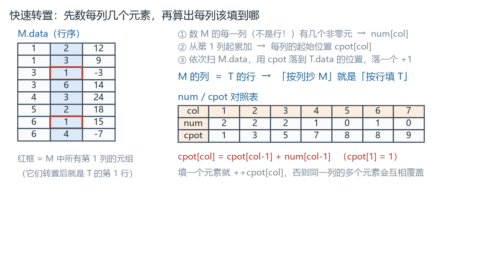

**2. 行逻辑链接的三元组顺序表**

把上述方法二中的辅助向量 $cpot[\ ]$ 固定在稀疏矩阵的三元组表中，用来指示「行」的信息，就得到另一种顺序存储结构：**行逻辑链接的三元组顺序表**。

```c
#define MAXRC 100
typedef struct {
    Triple data[MAXSIZE + 1];
    int rpos[MAXRC + 1];       /* 各行第一个非零元的位置表 */
    int mu, nu, tu;
} RLSMatrix;
```

它的意义是：**用 $rpos[row]$ 可以在 $O(1)$ 时间内定位到第 $row$ 行的第一个非零元**，从而使"按行"操作的矩阵运算（如矩阵乘法）不必再从头扫描三元组表。

**稀疏矩阵的乘法**

设有两个矩阵 $M = (M_{ij})_{m_1 \times n_1}$、$N = (N_{ij})_{m_2 \times n_2}$，当 $n_1 = m_2$ 时，可以计算 $Q = M \times N$，$Q = (Q_{ij})_{m_1 \times n_2}$。经典算法是三重循环：

```c
for (i = 1; i <= m1; ++i)
    for (j = 1; j <= n2; ++j) {
        Q[i][j] = 0;
        for (k = 1; k <= n1; ++k)
            Q[i][j] += M[i][k] * N[k][j];
    }
```

此算法的复杂度为 $O(m_1 \times n_1 \times n_2)$。当矩阵采用行逻辑链接的三元组顺序表存储时，**乘法就不能沿用经典算法了**。

> [!question] 为什么经典算法用不了？
> 为了求 $Q(2,2)$ 的值，需要 $M$ 的第 2 行 $\times$ $N$ 的第 2 列。$M$ 的第 2 行确实可以用一个 `for` 取到（同一行的三元组是连续存储的），但 **$N$ 的第 2 列三元组是不连续的，用一个 `for` 取不出来** —— 这就是经典三重循环失效的原因。
>
> **换个角度**：思考 $M(2,1)$ 这个元素。它在完整的乘法过程中需要分别同 $N$ 的**第 1 行**元素相乘，而 $M(2,1)$ 也只需要做这些乘法。$N$ 的第 1 行很容易用一个 `for` 取出来 —— 那就在取出 $M(2,1)$ 时**一次性取出 $N$ 的第 1 行**，先乘出来，结果分别累加到不同的**列累加器**即可。等 $M$ 第 2 行的元素都照此处理完毕，就一次性得到了 $Q$ 第 2 行的结果。

算法思想：

1. 为得到非零的乘积，只需对 $M.data[1 \ldots M.tu]$ 中每个元素 $(i, k, M_{ik})$，找到 $N.data$ 中所有相应的元素 $(k, j, N_{kj})$ 相乘即可
2. $N.rpos[row]$ 指示矩阵 $N$ 第 $row$ 行第一个非零元在 $N.data[\ ]$ 中的位置，$N.rpos[row+1] - 1$ 指示该行最后一个非零元的位置
3. 对 $M$ 中每个元素 $M.data[p]$，找到 $N$ 中所有满足 $M.data[p].j = N.data[q].i$ 的元素 $N.data[q]$，求得 $M.data[p].e \times N.data[q].e$ —— 该乘积是 $Q_{ij}$ 的一部分，把这样的乘积全部求得并累加就得到 $Q_{ij}$

**算法要点**（逐行处理 $M$，$Q$ 一行的结果同时算出）：

1. 对 $M$ **逐行处理**，处理结果对应到 $Q$ 的同一行；由于 $Q$ 同样是稀疏矩阵，一行的结果计算完毕后需**筛选出非零元素**再存入 $Q$
2. 取 $M$ 的第 $arow$ 行分析：
   - $M.rpos[arow] \le$ 该行元素下标范围 $p < M.rpos[arow+1]$ 或 $M.tu+1$
   - 对应 $N$ 的行号这样取：$brow = M.data[p].j$（**$M$ 的列就是 $N$ 的行**）
   - $N.rpos[brow] \le$ 该行元素下标范围 $q < N.rpos[brow+1]$ 或 $N.tu+1$
   - 上述每一对都要相乘，但累计的目标列不同，目标列是 $N.data[q].j$
   - 由于目标列同时求和，需要一个 $ctemp[\ ]$ 数组分别存储**各列之和**

```c
Status MultSMatrix(RLSMatrix M, RLSMatrix N, RLSMatrix &Q) {
    if (M.nu != N.mu) return ERROR;
    Q.mu = M.mu; Q.nu = N.nu; Q.tu = 0;
    if (M.tu * N.tu != 0) {                              /* Q 是非零矩阵 */
        for (arow = 1; arow <= M.mu; ++arow) {           /* 逐行处理 */
            ctemp[] = 0;                                 /* 当前行各列元素累加器清零 */
            Q.rpos[arow] = Q.tu + 1;
            /* tp 表示 M 当前行的下一行的起始位置（用作循环终点） */
            if (arow < M.mu) tp = M.rpos[arow + 1];
            else tp = M.tu + 1;

            for (p = M.rpos[arow]; p < tp; ++p) {
                brow = M.data[p].j;                      /* 找到对应元在 N 中的行号 */
                /* t 表示 N 当前行的下一行的起始位置（用作循环终点） */
                if (brow < N.mu) t = N.rpos[brow + 1];
                else t = N.tu + 1;
                for (q = N.rpos[brow]; q < t; ++q) {
                    ccol = N.data[q].j;                  /* 乘积元素在 Q 中的列号 */
                    ctemp[ccol] += M.data[p].e * N.data[q].e;
                }
            }

            /* 压缩存储该行非零元 */
            for (ccol = 1; ccol <= Q.nu; ++ccol)
                if (ctemp[ccol]) {                       /* 非零元添加到 Q，否则跳过 */
                    if (++Q.tu > MAXSIZE) return ERROR;
                    Q.data[Q.tu] = (arow, ccol, ctemp[ccol]);
                }
        }
    }
    return OK;
} //MultSMatrix
```

时间复杂度分析：累加器为 $O(M.mu \times N.nu)$，求 $Q$ 的非零元为 $O(M.tu \times N.tu / N.mu)$，压缩存储为 $O(M.mu \times N.nu)$，因此总的时间复杂度是

$$O\big(M.mu \times N.nu + M.tu \times N.tu / N.mu\big)$$

其中 $N.tu / N.mu$ 表示矩阵 $N$ **平均每行的非零元数量**。

> [!important] 为什么乘法不用十字链表，加法却要用
> 关键在于 **$A = A + B$ 的时候，元素数量会剧烈变化**：
> - 极端情况：$A$ 是下三角、$B$ 是上三角，两个一加，非零元几乎**膨胀一倍** → 要做大量的**元素插入**
> - 反过来，如果 $A$、$B$ 在某些位置刚好抵消，又得做大量的**元素删除**
>
> 三元组表为什么不适合？因为**三元组表本质上是一个数组** —— 数组这东西，元素数量剧烈变动时增删都很痛苦。
>
> 那乘法呢？乘法虽然元素也在变，但它是**按行出结果**的：$Q$ 的元素是**递增生成**的，下标一路往上走，不存在插入和删除的问题。
>
> 结论：**只做乘法 → 三元组表就够用；怕的是加法 → 才考虑十字链表。**

为什么叫"十字"？因为每个非零元素都被**两条链**串着：一条**纵向的链**方便**按列**抽元素，一条**横向的链**方便**按行**抽元素。访问快，在某一行里做元素的增和删也快；代价是操作麻烦 —— 每次都要**同时动两条链**。

**3. 十字链表**

对于稀疏矩阵，当非零元素的个数和位置在操作过程中变化较大时（比如执行 $A = A + B$），采用**链式存储结构**比三元组的线性表更方便。矩阵中非零元素的结点所含的域有：行、列、值、行指针（指向同一行的下一个非零元）、列指针（指向同一列的下一个非零元）。此外十字交叉链表还有一个**头结点**：

```c
/* 十字链表结点定义 */
typedef struct OLNode {
    int i, j;
    ElemType e;
    struct OLNode *right, *down;      /* 行后继、列后继 */
} OLNode, *OLink;

/* 头结点定义 */
typedef struct {
    OLink *rhead, *chead;             /* 行链表头指针数组、列链表头指针数组 */
    int mu, nu, tu;
} CrossList;
```

**为什么 $rhead$、$chead$ 是二级指针**

这里的 $rhead$ 和 $chead$ 都是作为**数组首地址**的，长度分别为 $mu+1$ 和 $nu+1$。每个数组元素都是一级指针 $OLink$，分别指向一条行链表或列链表 —— 所以指向它们的是二级指针，相当于 `**OLNode`。

稀疏矩阵中同一行的非零元素由 $right$ 指针域链接成一个**行链表**，由 $down$ 指针域链接成一个**列链表**；所有非零元素构成一个十字交叉的链表，称为**十字链表**。两个一维数组分别存储行链表与列链表的头指针。

```c
Status CreateSMatrix_OL(CrossList &M) {
    if (M) free(M);
    scanf(&m, &n, &t);
    M.mu = m; M.nu = n; M.tu = t;
    if (!(M.rhead = (OLink*)malloc((m+1) * sizeof(OLink)))) exit(OVERFLOW);
    if (!(M.chead = (OLink*)malloc((n+1) * sizeof(OLink)))) exit(OVERFLOW);
    M.rhead[] = M.chead[] = NULL;
    for (scanf(&i,&j,&e); i != 0; scanf(&i,&j,&e)) {
        if (!(p = (OLNode*)malloc(sizeof(OLNode)))) exit(OVERFLOW);
        p->i = i; p->j = j; p->e = e;          /* 新结点 p 将被插入到两条链表中 */

        /* 插入行链表：按列号 j 递增有序 */
        if (M.rhead[i] == NULL || M.rhead[i]->j > j) {
            p->right = M.rhead[i];
            M.rhead[i] = p;
        } else {
            for (q = M.rhead[i]; q->right && q->right->j < j; q = q->right);
            p->right = q->right;
            q->right = p;
        }
        /* 插入列链表：按行号 i 递增有序 */
        if (M.chead[j] == NULL || M.chead[j]->i > i) {
            p->down = M.chead[j];
            M.chead[j] = p;
        } else {
            for (q = M.chead[j]; q->down && q->down->i < i; q = q->down);
            p->down = q->down;
            q->down = p;
        }
    }
    return OK;
} //CreateSMatrix_OL
```

**每一段插入都对应三种情况**（行链表、列链表完全对称）：

1. 头指针为空 —— 说明之前该行（列）无元素，直接挂上并修改头指针
2. 新结点的列号（行号）最小 —— 插到头指针前面，并修改头指针
3. 其余情况 —— 定位到尾结点，或某个结点 $q$ 的右侧（下方）结点的列号（行号）刚好超过 $j$（$i$）处，插到 $q$ 之后

**那几个 `if` 为什么看着别扭**

这里的行链、列链**都没有头结点** —— 第 2 章线性表为了插入删除方便，会专门设一个占位的**头结点**，这里没有。所以插入时如果生成了一个**更小的列号**，它就得挂在最左边，那就必须**改行头指针** `rhead[p->i] = p`；纵向插入同理，若生成的元素**行号最小**，就得改列头指针 `chead[p->j] = p`。

如果仿照第 2 章的做法**多留一个头结点**，那每次只要处理"其余情况"那一个分支就够了（头不会变），代码会简单不少 —— 代价是多花一个结点的空间。

**十字链表相加**（$A = A + B$）：针对矩阵 $B$ 中每一个非零元素，需判断它在 $A$ 相应位置上是否有非零元素、相加是否为 0，共三种情况：

1. $A$ 中没有非零元素 —— 直接把 $B$ 的结点加到 $A$ 该行链表的对应位置
2. $A$ 中有非零元素，且相加**不为 0** —— 只需更改 $A$ 中对应位置上三元组的值
3. $A$ 中有非零元素，但相加**为 0** —— 需从 $A$ 中**删除**对应结点

设指针 $pa$、$pb$ 分别表示矩阵 $A$、$B$ 中同一行中的结点（都从各自第一行的第一个非零元开始遍历），上述 3 种情况可细分为 4 个场景：

| 情形 | 处理 |
| --- | --- |
| $pa = \text{NULL}$ 或 $pa \to j > pb \to j$ | 把 $pb$ 结点插入到当前行（列），同时修改 $right$ 和 $down$ 指针 |
| $pa \to j < pb \to j$ | 只需把 $pa$ 指针向右推进一步 |
| $pa \to j = pb \to j$，值相加**不为 0** | 只需更改 $pa$ 指向结点的值 |
| $pa \to j = pb \to j$，值相加**为 0** | 从 $A$ 的十字链表中**删除** $pa$ 指向的结点 |

### 5.4 广义表的定义

广义表是线性表的推广和扩充，在人工智能领域中应用十分广泛。第 2 章把线性表定义为 $n\,(n \ge 0)$ 个元素 $a_1, a_2, \ldots, a_n$ 的有穷序列，该序列中所有元素都具有相同数据类型且只能是**原子项（Atom）** —— 原子项可以是一个数或一个结构，指结构上不可再分的。**若放松对元素的这种限制，容许它们具有其自身结构，就产生了广义表的概念。**

> [!definition] 广义表
> **广义表**（Lists，又称列表）是由 $n\,(n \ge 0)$ 个元素组成的有穷序列
> $$LS = (a_1, a_2, \ldots, a_n)$$
> 其中 $a_i$ 或者是**原子项**，或者是一个**广义表**。$LS$ 是广义表的名字，$n$ 为它的**长度**；若 $a_i$ 是广义表，则称为 $LS$ 的**子表**。习惯上，原子用小写字母、子表用大写字母表示。

若广义表 $LS$ 非空，则：

- $a_1$（表中第一个元素）称为**表头 Head**
- 其余元素组成的子表 $(a_2, a_3, \ldots, a_n)$ 称为**表尾 Tail**
- 广义表中所包含的元素（包括原子和子表）的个数称为表的**长度**
- 广义表中括号的最大层数称为**表深（度）**

| 广义表 | 表长 | 表深 |
| --- | --- | --- |
| $A = (\ )$ | 0 | 0 |
| $B = (e)$ | 1 | 1 |
| $C = (a, (b, c, d))$ | 2 | 2 |
| $D = (A, B, C)$ | 3 | 3 |
| $E = (a, E)$ | 2 | $\infty$ |
| $F = ((\ ))$ | 1 | 2 |

关于广义表有几个重要结论：

1. 广义表的元素可以是原子也可以是子表，子表的元素又可以是子表…… 即广义表是一个**多层次的结构**
2. 广义表可以被其它广义表**共享**，也可以共享其它广义表；共享其它广义表时**通过表名引用**
3. 广义表本身可以是一个**递归表**（如 $E = (a, E)$，表深为 $\infty$）
4. 根据对表头、表尾的定义，任何一个非空广义表的**表头可以是原子也可以是子表，而表尾必定是广义表**

> [!important] 表尾为什么一定是广义表
> 表尾定义为"其余元素**组成的子表**"—— 即使只剩一个原子 $a_n$，表尾也是 $(a_n)$ 而不是 $a_n$。这个细节决定了头尾链表的存储结构：**每一个原子对应两层结点**（外面还包着一层表结点）。

> [!warning] 考试最容易丢分的两条
> | 概念 | 写法 | 注意点 |
> | --- | --- | --- |
> | **表头** | $a_1$ | 是**元素**，**不能加括号**，加了括号就错 |
> | **表尾** | $(a_2, a_3, \ldots, a_n)$ | 是**子表**，括号**必须写**，而且必须是**小括号**，写方括号、大括号都错 |

**表长只数顶层**：$C = (a, (b, c, d))$ 的表长是 **2** 而不是 4 —— 顶层只有 `a` 和 `(b,c,d)` 两个元素，只数最外层那一层。

> [!warning] 表深的陷阱
> $D = (A, B, C)$ 的深度是 **3** 而不是 2：这里的 $A$、$B$、$C$ 要把**整个表代进来**算，别只盯着三个字母以为是两层。

另外两个容易考的结论：$E = (a, E)$ 是**无穷深**（自己跟自己反复套）；空表按约定算深度 **1**（有一对括号）。长度和深度基本属于**送分必考题**，概念一定要拿准。

### 5.5 广义表的存储结构

由于广义表中的数据元素具有不同的结构，通常用**链式存储结构**表示，每个数据元素用一个结点表示。因此广义表中有两类结点：

- **表结点**：用来表示广义表项，由标志域、表头指针域、表尾指针域组成
- **原子结点**：用来表示原子项，由标志域、原子的值域组成

只要广义表非空，都是由表头和表尾组成 —— 即一个确定的表头和表尾就唯一确定一个广义表。这种存储结构叫**头尾链表**，它总是尝试把广义表拆成两部分存储：**表头 + 表尾**。

```c
typedef enum {ATOM, LIST} ElemTag;
typedef struct GLNode {
    ElemTag tag;                    /* tag = 0 原子结点，tag = 1 表结点 */
    union {
        AtomType atom;              /* 原子结点的值域 */
        struct { struct GLNode *hp, *tp; } ptr;   /* 表结点：hp 表头指针，tp 表尾指针 */
    };
} *GList;
```

其中 $hp$ 是 head pointer（指向表头），$tp$ 是 tail pointer（指向表尾）。

对 $A = (\ )$、$B = (e)$、$C = (a, (b, c, d))$、$D = (A, B, C)$、$E = (a, E)$ 这几个广义表：

- **同层结点通过 $tp$ 链接**（例如 $D$ 中 $A$、$B$、$C$ 是同层的）
- **内层结点（包括原子结点）通过 $hp$ 链接**

头尾链表存储结构的特点：

1. 若广义表为空，表头指针为空；否则表头指针总是指向一个**表结点**，其中 $hp$ 指向广义表的表头结点（或为原子结点，或为表结点），$tp$ 指向广义表的表尾（表尾为空时指针为空，否则必为表结点）
2. 这种结构**求广义表的长度、深度、表头、表尾的操作十分方便**
3. **最高层的表结点个数即为列表的长度**

也可用**同层结点链表**存储广义表，其结点结构只需把 $tp$ 放在 union 之外：

```c
typedef struct GLNode {
    ElemTag tag;
    union {
        AtomType atom;
        struct GLNode *hp;          /* 表结点的表头指针 */
    };
    struct GLNode *tp;              /* 相当于线性链表的 next，指向下一个元素的结点 */
} *GList;
```

> [!important] 同层结点链表与头尾链表的区别与共同点
> **区别**：
> 1. **多了头结点**
> 2. **原子结点的值填写到中间域**（原子结点与表结点一样都带 $tp$）
>
> **共同点**：$tp$ 链接同层结点；$hp$ 链接内层结点。

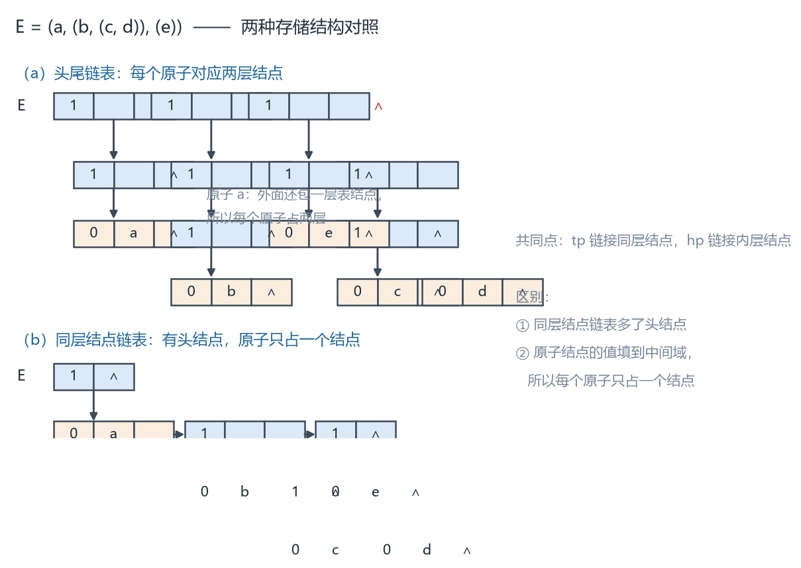

以 $E = (a, (b, (c, d)), (e))$ 为例，画存储结构图可以分三步：

1. **先消第一层括号**，将 $E$ 拆分为 3 个子表：`a`、`(b,(c,d))`、`(e)`
2. **再消第二层括号**，将后两个结点拆分子表：`(b,(c,d))` → `b`、`(c,d)`；`(e)` → `e`
3. **再消第三层括号**，将 `(c,d)` → `c`、`d`
4. **合并**以上结果，得到逻辑结构图（熟练后可直接得到这一步）
5. 注意**向右的箭头是 $tp$，向下的是 $hp$**，再根据选用的存储结构（头尾链表或同层结点链表）把结点存进结构体

两种结构画出来的图差别是：

- **头尾链表**：有单独的原子结点，**每一个原子对应两层结点**（参考结点 $d$ 的存储）
- **同层结点链表**：有头结点，原子结点和表结点一样，**每一个原子只对应一个结点**（实际使用中每一层都会设置头结点，此处为了简化只绘制了 $E$ 指向的那个头结点，具体实例参考 $m$ 元多项式）

> [!important] 为什么要用 union
> 因为原子结点和表结点会**同时出现在一个表里** —— 比如 $C = (a, (b, c, d))$，第一个结点是单元素 `a`，第二个就是子表。用一条链串起来时，上一个结点是原子、下一个可能就换成表结点了。
>
> 如果定义成两种类型，代码根本没法写 —— 最早学链表时就要求**每种结点的结构一样**。于是用 `union`（共用体）把两者包起来：一个结点不可能**既是原子又是表**，两者共用一块空间完全没问题，靠 $tag$ 的取值区分即可。
>
> 这也正是后面递归算法能写得下去的前提 —— 结点类型统一了，`hp`/`tp` 才敢递归。

**另一个名字**：这套结构有的教材叫**扩展线性链表**，本课件叫**同层结点链表**，指的是同一个东西。考试时先看清题目用的是**哪一种**，再画存储结构图。

### 5.6 m 元多项式的表示

广义表很适合用来表示 $m$ 元多项式。例如三元多项式

$$P(x,y,z) = x^{10}y^3z^2 + 2x^6y^3z^2 + 3x^5y^2z^2 + x^4y^4z + 6x^3y^4z + 2yz + 15$$

对它进行变形：

$$P(x,y,z) = \big((x^{10} + 2x^6)y^3 + 3x^5y^2\big)z^2 + \big((x^4 + 6x^3)y^4 + 2y\big)z + 15$$

上式可以看成是 $z$ 的一元多项式，即 $P(x,y,z) = Az^2 + Bz^1 + Cz^0$，其中 $A = (x^{10} + 2x^6)y^3 + 3x^5y^2$、$B = (x^4 + 6x^3)y^4 + 2y$、$C = 15$。然后二元多项式 $A(x,y)$ 又可以看成是关于 $y$ 的一元多项式，$B$ 也是如此：

$$A(x,y) = (x^{10} + 2x^6)y^3 + 3x^5y^2 = Cy^3 + Dy^2$$

其中 $C = x^{10} + 2x^6$、$D = 3x^5$，它们又是关于 $x$ 的一元多项式。这种嵌套结构可以把 $m$ 元多项式**层层分解**，技巧是**每次分解出一个主变元**。

各层公式对应的广义表：

| 公式 | 对应的广义表 |
| --- | --- |
| $P(x,y,z) = Az^2 + Bz^1 + Cz^0$ | $P = z((A, 2), (B, 1), (15, 0))$ |
| $A = (x^{10} + 2x^6)y^3 + 3x^5y^2$ | $A = y((C, 3), (D, 2))$ |
| $B = (x^4 + 6x^3)y^4 + 2y$ | $B = y((E, 4), (F, 1))$ |
| $C = x^{10} + 2x^6$ | $C = x((1, 10), (2, 6))$ |
| $D = 3x^5$ | $D = x((3, 5))$ |
| $E = x^4 + 6x^3$ | $E = x((1, 4), (6, 3))$ |
| $F = 2$ | $F = x((2, 0))$ |

（每对里的第二个分量是指数，$F = x((2,0))$ 即 $2x^0 = 2$。）

$m$ 元多项式的结点定义如下，这是典型的**同层结点链表**：

```c
typedef struct MPNode {
    ElemTag tag;              /* 区分原子结点、表结点 */
    int exp;                  /* 指数域 */
    union {
        float coef;           /* 原子结点：系数域 */
        struct MPNode *hp;    /* 表结点：表头指针 */
    };
    struct MPNode *tp;        /* 相当于线性链表的 next，指向下一个元素的结点 */
} *MPList;
```

即：**表结点**为 `tag=1 | exp | hp | tp`，**原子结点**为 `tag=0 | exp | coef | tp`。

上面定义的广义表存储结构中，头指针 $p$ 设置了**头结点**，借助 $exp$ 域存储**变元数量**（符号表长度）；此外**每一层也都设置了头结点**，借助 $exp$ 域存储对应的**变元符号下标**（左下角为符号表 $z\,y\,x$）。

### 5.7 广义表的递归算法

对一些可以用递归算法解决的问题，通常可以先写出问题求解的**递归定义**。和数学归纳类似，递归定义由**基本项**和**归纳项**两部分组成。

- **基本项**描述一个或几个递归过程的**终结状态**。虽然一个有限的递归可以描述一个无限的计算过程，但任何实际应用的递归过程（除错误情况外）必定能经过有限层次的递归而终止
- **归纳项**描述如何实现从当前状态到终结状态的**转化**。递归设计的实质是：当一个复杂问题可以分解成若干子问题来处理时，其中某些子问题与原问题具有相同特征属性，则可以利用与原问题相同的分析处理方法；反之这些子问题解决了，原问题也就迎刃而解了

递归函数的设计用的是**归纳思维**的方法，设计时应注意：**严格定义函数的功能和接口；切忌想得太深太远；用归纳假设进行归纳证明时，决不能怀疑归纳假设是否正确。** 以下针对广义表的操作，约定广义表**非递归且无共享子表**。

#### 5.7.1 求广义表的深度

广义表的深度指的是广义表中**括弧的重数**：空表的深度为 1（因为有一对括弧），原子的深度为 0。

解题思路：

1. 遍历该广义表各个数据元素，求该元素的深度。如果该元素是原子，则返回深度 0；如果该元素是子表，则遍历该子表的深度
2. 递归的出口状态（终结状态）：遍历数据元素为原子时返回 0，遍历数据元素为空表时返回 1
3. 设置一个变量 $max$ 记录数据元素中最长的深度，初始化为 0；遍历过程中 $max$ 与返回的整型值比较，取较大者。直到程序结束，$max + 1$ 就是广义表的深度

```c
int GListDepth(GList L) {
    if (!L) return 1;                              /* 空表深度为 1 */
    if (L->tag == ATOM) return 0;                  /* 原子深度为 0 */
    for (int max = 0, pp = L; pp; pp = pp->ptr.tp) {
        dep = GetGListDepth(pp->ptr.hp);
        if (dep > max) max = dep;
    }
    return max + 1;    /* 非空表的深度是各元素深度最大值加 1 */
} //GListDepth
```

以 $D = ((\ ), (e), (a, (b, c, d)))$ 为例求深度：先沿 $tp$ 链遍历最高层各元素，分别求深度 —— 空表 $(\ )$ 返回 1，$(e)$ 的元素 $e$ 是原子返回 0 再加 1 得 1，$(a,(b,c,d))$ 中 $(b,c,d)$ 又递归下去…… 最终取各元素深度的最大值再加 1，得 $D$ 的深度为 **3**。

注意写递归函数的标准写法：**递归终点写在前头**。这里有两个终点 —— 空表和原子，所以函数一开头先连着判两次。

#### 5.7.2 复制广义表

任何一个非空的广义表均可分解成表头和表尾；反之，一对确定的表头和表尾可唯一确定一个广义表。由此，**复制一个广义表只要分别复制其表头和表尾，然后合成即可**。所以复制广义表的过程，其实就是不断递归、复制广义表表头和表尾的过程。

递归的出口条件：

- 如果当前遍历的数据元素为**空表**，直接返回空表
- 如果当前遍历的数据元素为该表的**一个原子**，那么直接复制返回即可

```c
Status CopyGList(GList &T, GList L) {
    if (!L) T = NULL;                              /* 直接返回空表 */
    else {
        if (!(T = (GList)malloc(sizeof(GLNode)))) exit(OVERFLOW);
        T->tag = L->tag;
        if (L->tag == ATOM) T->atom = L->atom;     /* 原子：直接复制 */
        else {
            CopyGList(T->ptr.hp, L->ptr.hp);       /* 复制表头 */
            CopyGList(T->ptr.tp, L->ptr.tp);       /* 复制表尾 */
        }
    }
    return OK;
}
```

**注意这里传的是 $T \to ptr.hp$ 本身（引用），而不是它的地址** —— 这样才能在递归里把新分配的结点直接挂到父结点上。

**这段代码为什么能工作？** 关键是：不管走 $hp$ 还是走 $tp$，**都能让表变小** ——

- 走 $hp$：要么摘出一个原子，要么摘出一个子表，总之尺寸缩了
- 走 $tp$：起码头被砍掉了，也缩了

多递归几次，一定会缩到两种极端：要么缩没了（空表终点），要么缩到原子（原子终点）。所以递归能停下来，返回的时候自然就复制完了。

回头看 5.5 节那个问题 —— **为什么要把所有结点做成同一个类型（用 union）**？好处就在这里：不然这段递归代码根本写不下去。

#### 5.7.3 建立广义表的存储结构

前面的两个操作都是按（表头，表尾）的方式将一个大广义表递归拆分成小广义表。其实还有一种拆分方式：把广义表拆分成 **$n$ 个并列子表**，同样能达到目的。下面以这种思路创建广义表。

假设要创建广义表 $((\ ), (e), (a, (b, c, d)))$：

- 首先，如果脱去最外层 `()`，它就是 3 个子表，可以逐个创建，然后再用 $tp$ 指针串起来
- 继续上述过程：如果脱去括号后**为空**，或者剩下**单一元素**（例如 `e`），那么就可以创建原子结点，**结束递归**

```c
Status CreateGList(GList &L, SString S) {
    if (StrCompare(S, emp)) L = NULL;              /* 创建空表 */
    else {
        if (!(L = (GList)malloc(sizeof(GLNode)))) exit(OVERFLOW);
        if (StrLength(S) == 1) {
            L->tag = ATOM; L->atom = S;            /* 创建单原子广义表 */
        } else {
            L->tag = LIST;
            p = L;
            SubString(sub, S, 2, StrLength(s) - 2); /* 脱外层 () */

            do {                                    /* 重复建 n 个子表 */
                sever(sub, hsub);                   /* 从 sub 中分离出表头串 hsub */
                CreateGList(p->ptr.hp, hsub); q = p;
                if (!StrEmpty(sub)) {               /* 表尾不空 */
                    if (!(p = (GLNode *)malloc(sizeof(GLNode)))) exit(OVERFLOW);
                    p->tag = LIST; q->ptr.tp = p;
                }
            } while (!StrEmpty(sub));
            q->ptr.tp = NULL;
        }
    }
    return OK;
} //CreateGList
```

这里用到的 `sever` 负责**切割字符串**：$hstr$ 为第一个逗号前的子串，$str$ 为之后的：

```c
Status sever(SString &str, SString &hstr) {
    n = StrLength(str); i = 0; k = 0;              /* k 记尚未配对的左括号个数 */
    do {
        ++i;                                        /* 搜索最外层的第一个逗号 */
        SubString(ch, str, i, 1);
        if (ch == '(') ++k;
        else if (ch == ')') --k;
    } while (i < n && (ch != ',' || k != 0));

    if (i < n) {                                    /* 找到最外层逗号 */
        SubString(hstr, str, 1, i - 1);
        SubString(str, str, i + 1, n - i);
    } else {                                        /* 没有逗号：整串作为表头 */
        StrCopy(hstr, str); ClearString(str);
    }
    return OK;
} //sever
```

> [!warning] sever 里 $k$ 的作用
> $k$ 记录**尚未配对的左括号个数**。循环条件是 `ch != ',' || k != 0`：只有 **在 $k = 0$（括号全部配对完）且当前字符是逗号**时才停止。这样才不会把子表内部的逗号（如 `(a,(b,c,d))` 中 `b,c` 之间的逗号）误当成外层分隔符 —— 这是整章最容易写错的一处判断。

几个容易忽略的点：

1. **`StrCompare(S, emp) == 0`**：书上写的是 `compare` 判等，最好补上 `== 0`。`compare` 本来是**比大小**的，能给出大于 / 等于 / 小于三种结果；这里明显是判等，补个 `== 0` 更规范，或者干脆换成 `equals`
2. **空表 `emp` 是 `"()"`** —— 一对括号中间没东西，**不是空串**。空串啥都没有，那不是个表
3. **必须用尾插法，不能头插**：`a, b, c` 三个字母肯定得先挂 `a`、再挂 `b`、再挂 `c`，顺序要跟输入一致
4. **为什么用 `q`**：$q$ 用来记住当前这条同层链的**最后一个结点**，慢慢往尾巴跑，最后 `q->ptr.tp = NULL` 收尾
5. **为什么一头操作 $hp$、一头操作 $tp$**：$hp$ 是**往下一层钻**（子表里面还有括号），$tp$ 是把**同层兄弟**串成一条链

### 第5章 要点

> [!summary] 本章要点
> - 数组是**线性表的推广**：给定一组下标就能随机存取对应元素，元素数据类型相同、个数固定、地址连续
> - 多维数组映射到一维内存时要约定次序：**行优先**（PASCAL、C）与**列优先**（FORTRAN）。地址公式 $LOC(i,j) = LOC(0,0) + (b_2 \times i + j) \times L$，别死记，数格子
> - 压缩存储的原则：**相同的非零元素只分配一个空间，零元素不分配空间**
> - **对称矩阵**按行优先存下三角：$i \ge j$ 时 $k = i(i-1)/2+j-1$，$i<j$ 时用 $a_{ji}$ 代入即 $k = j(j-1)/2+i-1$（$i,j$ 从 1 开始）
> - **三角矩阵**除 $n(n+1)/2$ 个元素外，常数 $c$ 共享一个空间放在向量末尾；**三对角矩阵** $|i-j| \le 1$ 时 $k = 2i+j-3$
> - **稀疏矩阵**（$\delta \le 0.05$）用**三元组** $(i, j, a_{ij})$ 唯一确定一个非零元，按行序排列得三元组顺序表 `Triple`/`TSMatrix`
> - **转置** = 交换行列 + 重排。算法 5.1「按 $M$ 的列找」是 $O(nu \times tu)$，只适合 $tu \ll mu \times nu$
> - **快速转置**（算法 5.2）预求 $num[\ ]$（$M$ 各列非零元个数）与 $cpot[\ ]$（各列在 $T.data$ 中的起始位置），一遍扫完即得，$O(nu + tu)$；注意 $cpot$ 求完要 `++` 自增
> - **行逻辑链接**把 $cpot$ 固定为 $rpos[\ ]$，可在 $O(1)$ 定位某行首个非零元（`RLSMatrix`）
> - **稀疏矩阵乘法**（算法 5.3）：逐行处理 $M$，对 $M.data[p]$ 找 $N$ 中 $row = M.data[p].j$ 的整行相乘，累加到列累加器 $ctemp[\ ]$，本行处理完再筛出非零元写入 $Q$
> - **十字链表**（`OLNode`/`CrossList`）适合非零元位置频繁变化的场合（如 $A = A+B$）：结点带 $right$/$down$ 双指针，行、列链表均按序插入
> - **广义表** $LS = (a_1, \ldots, a_n)$：$a_1$ 是表头，其余是表尾；**表尾必定是广义表**，表头可以是原子。表长是元素个数，表深是括号最大层数
> - 存储结构分**头尾链表**（每个原子对应两层结点）与**同层结点链表**（有头结点，原子占一个结点）；共同点是 $tp$ 连同层、$hp$ 连内层
> - $m$ 元多项式用广义表表示：**每次分解出一个主变元**，$P = z((A,2),(B,1),(15,0))$，结点为 `tag|exp|coef/hp|tp`
> - 广义表的递归算法（深度 / 复制 / 创建）都遵守「基本项 + 归纳项」：**严格定义功能接口，切忌想得太深太远**

---

## 第6章 树和二叉树

树型结构是一类非常重要的**非线性结构** —— 直观地看，它是以**分支关系**定义的**层次结构**。树在计算机领域有广泛应用：编译程序中用树表示源程序的语法结构，数据库系统中用树组织信息，分析算法行为时用树描述其执行过程等。

### 6.1 树的定义和基本术语

> [!definition] 树（Tree）
> 树是 $n\,(n \ge 0)$ 个结点的有限集合 $T$。若 $n = 0$ 称为**空树**，否则：
> ① 有且只有一个特定的称为**根**（Root）的结点；
> ② 若 $n > 1$，其余的结点被分为 $m\,(m > 0)$ 个**互不相交**的子集 $T_1, T_2, \ldots, T_m$，其中每个子集本身又是一棵树，称其为根的**子树**（SubTree）。

这是树的**递归定义** —— 用树来定义树。而只有一个结点的树必定仅由根组成。

> [!important] 树也是递归定义：砍树根
> 缩小一棵树的方法就是**砍树根**：把根一切，剩下的就变成几棵子树，又回到原始定义，一直切到只剩一个孤零零的结点为止 —— 递归有终点。
> 空树的概念之所以要保留，是因为结点本来就有增有减，删到最后就空了，概念上要完整。

基本术语先对照下图过一遍：

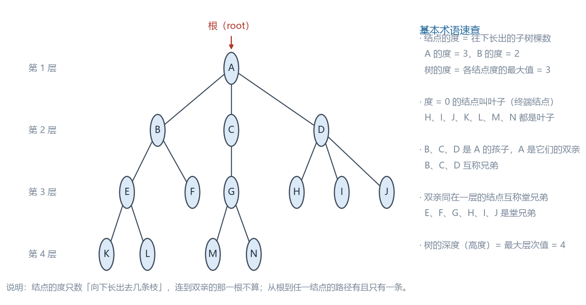

| 术语 | 含义 | 要点 |
| --- | --- | --- |
| **结点**（node） | 包含一个数据元素及若干指向其子树的分支 | |
| **结点的度**（degree） | 结点所拥有的**子树棵数** | 只往**下**数长出去几条枝，别把连到双亲的那根算进去 |
| **树的度** | 树中**各结点度的最大值** | 取最大 |
| **叶子**（Leaf）结点 | 度为 0 的结点，又叫**终端结点** | 度不为 0 的叫非叶子 / 非终端 / **分支结点**；除根外，分支结点又称**内部结点** |
| **孩子 / 双亲** | 结点的子树的根叫该结点的孩子（child）；该结点是孩子的双亲（parent） | 隔代的不叫孩子，叫**子孙** |
| **兄弟** | 同一双亲的所有子结点互称兄弟 | |
| **堂兄弟** | 双亲在同一层上的结点互称堂兄弟 | 层次相同、**双亲不同** |
| **层次** | 根为第 1 层，其余结点层次 = 双亲层次 + 1 | 某结点在第 $L$ 层，则其子结点在第 $L+1$ 层 |
| **层次路径** | 从根结点到某结点 $p$ 所经过的所有结点 | **有且只有一条** |
| **祖先 / 子孙** | 层次路径上除 $p$ 外的所有结点是 $p$ 的**祖先**（ancestor）；以某结点为根的子树中的任意结点是该结点的**子孙**（descent） | |
| **树的深度**（depth） | 树中结点的**最大层次值**，又叫树的**高度** | |
| **有序树 / 无序树** | 每个结点的子树（若有）有一定的次序 → 有序树；否则 → 无序树 | |
| **森林**（forest） | $m\,(m \ge 0)$ 棵**互不相交**的树的集合 | 把一棵树的根删掉，剩下的子树就构成森林 |

以课件那棵树为例：结点 $A$ 的度是 3、$B$ 的度是 2、$M$ 的度是 0，**树的度是 3**；$H、I、J、K、L、M、N$ 是叶子结点，其余都是分支结点；$E、F、G、H、I、J$ 互称堂兄弟，树的高度是 4。

**几个容易混的点**：

- **度只看向下**：结点的度是它长出去几棵子树，向上连双亲的那一根**不算**
- **孩子 ≠ 子孙**：孩子是**直接**长出来的那一层，隔代的一律叫子孙
- **路径唯一**：从根到任一结点**有且只有一条**路径 —— 否则就成环了
- **路径唯一的价值**：这正是后面**赫夫曼编码**能拿来做译码的原因 —— 没有二义性，一个结点只有一种走法

用二元组表示：任何树是一个二元组 $Tree = (root, F)$，其中 $root$ 是根结点，$F$ 是 $m$ 棵树的森林 $F = (T_1, T_2, \ldots, T_m)$，$T_i = (r_i, F_i)$ 叫做根 $root$ 的第 $i$ 棵子树；当 $m \ne 0$ 时，树根和子树森林之间存在关系

$$RF = \{\langle root, r_i \rangle \mid i = 1, 2, \ldots, m,\ m > 0\}$$

树的表示形式有四种：

| 形式 | 说明 |
| --- | --- |
| **倒悬树** | 最常用，也**最方便化成代码** |
| **嵌套集合** | 大圈套小圈，逻辑表示，代码没法搞 |
| **广义表形式** | 广义表天生有层次，可用来表示树，如 $A(B(E(K,L),F),C(G(M,N)),D(H,I,J))$ |
| **凹入法表示** | 画示意图好用 |

真正落实到代码层面的，主要就是第一种（倒悬树）。树的抽象数据类型定义 `ADT Tree` 详见教材。

### 6.2 二叉树

#### 6.2.1 二叉树的定义

> [!definition] 二叉树（Binary Tree）
> 二叉树是 $n\,(n \ge 0)$ 个结点的有限集合。若 $n = 0$ 称为空树，否则：
> ① 有且只有一个特殊的称为**根**（root）的结点；
> ② 若 $n > 1$，其余的结点被分成**两个互不相交**的子集 $T_1$、$T_2$，分别称之为**左、右子树**，并且左、右子树又都是二叉树。

由此可知，二叉树的定义也**是递归的**。

> [!important] 为什么要专门研究二叉树
> 因为**任何一棵树都可以唯一对应到一棵二叉树**，反过来也能把二叉树化成树、甚至森林 —— 这个映射是**一一对应**的。
> 所以尽管只研究二叉树，实际上它能处理任意的树；而二叉树**分叉固定最多两个**，代码好写 —— 不然每一叉都要一个指针域，很麻烦。

**二叉树有 5 种基本形态**：

1. 空二叉树
2. 单结点二叉树（只有根）
3. 右子树为空（只有左叉）
4. 左子树为空（只有右叉）
5. 左、右子树都不空（两叉都有）

> [!warning] 二叉树的左右是严格区分的
> 左就是左、右就是右，**不能反过来** —— 反过来我们认为是**不同的树**。
> 为什么要有这个约定？因为后面要严格限制大小（小的放左边、大的放右边），所以定义时就把这个漏洞堵死了：**靠位置区分，而不是靠数量区分**。因此"只有左叉"和"只有右叉"是两种不同的形态。

#### 6.2.2 二叉树的性质

**性质 1**：在非空二叉树的第 $i$ 层上至多有 $2^{i-1}$ 个结点（$i \ge 1$）。

**证明**（数学归纳法）：$i = 1$ 时只有一个根结点，$2^{1-1} = 2^0 = 1$，命题成立。假设第 $i-1$ 层上至多有 $2^{i-2}$ 个结点；由于二叉树每个结点的度最大为 2，第 $i$ 层的最大结点数是第 $i-1$ 层的 2 倍，即 $2 \times 2^{i-2} = 2^{i-1}$。证毕。

**性质 2**：深度为 $k$ 的二叉树至多有 $2^k - 1$ 个结点（$k \ge 1$）。

**证明**：深度为 $k$ 的最大结点数 = 各层最大结点数之和。由性质 1，第 $1, 2, \ldots, k$ 层至多有 $2^0, 2^1, \ldots, 2^{k-1}$ 个结点，故总数为

$$2^0 + 2^1 + \cdots + 2^{k-1} = 2^k - 1$$

顺带补个**下限**：深度为 $k$ 的二叉树**至少有 $k$ 个结点** —— 就是一路单传的长条树，再少就凑不出 $k$ 层了。

**性质 3**：对任何一棵二叉树，若叶子结点数为 $n_0$、度为 2 的结点数为 $n_2$，则 $n_0 = n_2 + 1$。

这条**不太直观但严格成立**：随便画一棵二叉树，不管几层、长什么样，数一下零度结点和二度结点，这个式子一定成立；一度结点有多少个都不影响，挺神奇的。

**证明**（记三个式子就够）：设度为 1 的结点数为 $n_1$、总结点数为 $n$、分支（树枝）总数为 $B$。

$$n = n_0 + n_1 + n_2 \tag{①}$$

$$n = B + 1 \tag{②}$$

$$B = n_1 + 2n_2 \tag{③}$$

- ①：结点只有零度、一度、二度三种
- ②：除根以外，每个结点都被唯一一根枝条挂住
- ③：一度结点长 1 条枝，二度结点长 2 条枝

由 ②③ 得 $n = n_1 + 2n_2 + 1$，代入 ①：$n_0 + n_1 + n_2 = n_1 + 2n_2 + 1$，消元即得 $n_0 = n_2 + 1$。证毕。

性质 1–3 对任何二叉树都成立；性质 4、5 则专门针对**完全二叉树**，先把这两类特殊的树定清楚。

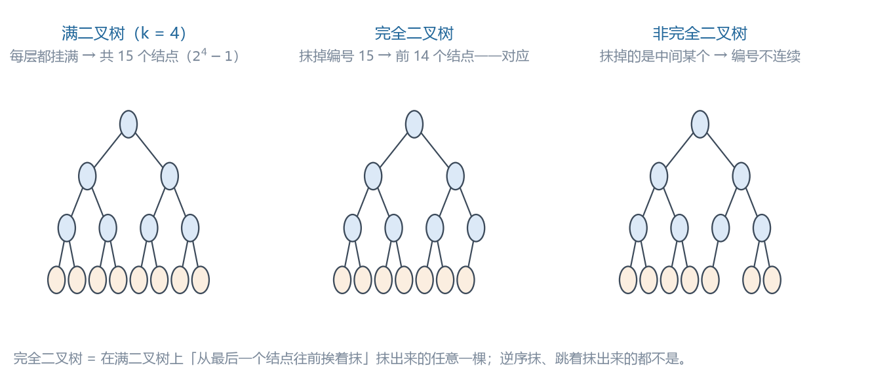

> [!definition] 满二叉树（Full Binary Tree）
> 一棵深度为 $k$ 且有 $2^k - 1$ 个结点的二叉树。

满二叉树的特点：

- 每一层上的结点数总是**最大结点数**
- 所有的分支结点都有左、右子树
- 可对其结点**连续编号**：从根结点开始，按"自上而下、自左至右"的原则进行

> [!definition] 完全二叉树（Complete Binary Tree）
> 深度为 $k$、有 $n$ 个结点的二叉树，当且仅当其**每一个结点都与深度为 $k$ 的满二叉树中编号从 1 到 $n$ 的结点一一对应**时，称为完全二叉树。
> 换个角度说：深度为 $k$ 的满二叉树中，**编号从 1 到 $n$ 的前 $n$ 个结点**构成一棵深度为 $k$ 的完全二叉树，其中 $2^{k-1} \le n \le 2^k - 1$（$n$ 的取值保证第 $k$ 层至少还剩下最左边的那个叶子结点）。

**完全二叉树的特点**：若深度为 $k$，则**所有叶子结点都出现在第 $k$ 层或 $k-1$ 层**；对任一结点，如果其**右子树**的最大层次为 $L$，则其**左子树**的最大层次为 $L$ 或 $L+1$。

**怎么快速判断**：在满二叉树的基础上，**从最后一个结点往前挨着抹** —— 抹出来的任何一棵都叫完全二叉树；**不是**逆序往前抹、随便挑中间某个抹掉的 → 那就是**非完全二叉树**。

**为什么要引出完全二叉树**：主要是为了方便后面的计算 —— **完全二叉树和满二叉树在数组里的存储顺序是完全一致的**（因为都是从后往前抹的，数组前面那部分是重叠的）。这个特点后面在**堆**那边会用到。

> [!important] 性质 4（完全二叉树的深度）
> $n$ 个结点的完全二叉树的深度为 $\lfloor \log_2 n \rfloor + 1$。

**证明**：设深度为 $k$，由性质 2 及完全二叉树的定义有 $2^{k-1} - 1 < n \le 2^k - 1$，即 $2^{k-1} \le n < 2^k$。两边取以 2 为底的对数得 $k - 1 \le \log_2 n < k$；$k$ 是整数，所以 $k = \lfloor \log_2 n \rfloor + 1$。证毕。

**含义**：**结点数一旦给定，深度就定死了**，不用去数层数。比如 $n = 1000$，深度 $= \lfloor \log_2 1000 \rfloor + 1 = 9 + 1 = 10$ 层。

> [!important] 性质 5（编号规律）
> 对 $n$ 个结点的完全二叉树，按"自上而下、自左至右"从 **1** 开始编号，则编号为 $i$ 的结点（$1 \le i \le n$）满足：
> 1. $i = 1$：是根，**无双亲**；$i > 1$：双亲编号为 $\lfloor i/2 \rfloor$
> 2. 若 $2i > n$：**无左孩子**；否则左孩子编号为 $2i$
> 3. 若 $2i + 1 > n$：**无右孩子**；否则右孩子编号为 $2i + 1$

**这是全章最实用的结论**：给一个编号，双亲和孩子都能**一步算出来**，不用顺着指针去找。它同时也是下面"顺序存储"能成立的根本原因 —— 编号就是数组位置，父子关系直接变成了下标算术。

注意条件里的 $2i > n$：它同时覆盖了"左孩子不存在"和"$i$ 本身是叶子"两种情况。**$2i \le n$ 才是有左孩子的充要条件**，别只看 $i$ 的奇偶。

> [!warning] 编号（从 1 起）与下标（从 0 起）差 1
> 教材讲性质 5 时用的是**编号**，$i$ 从 **1** 开始；落到数组存储里就变成**下标**，从 **0** 开始。同一棵树两套数字，考试最容易在这里下意识套错公式：
>
> | | 编号（1 起） | 下标（0 起） |
> | --- | --- | --- |
> | 根 | $1$ | $0$ |
> | 左孩子 | $2i$ | $2i + 1$ |
> | 右孩子 | $2i + 1$ | $2i + 2$ |
> | 双亲 | $\lfloor i/2 \rfloor$ | $\lfloor (i-1)/2 \rfloor$ |
>
> 先看清题目给的是**编号**还是**下标**再代公式 —— 和 KMP 求 next 时先确认"从 0 起还是从 1 起"是同一个坑。

#### 6.2.3 二叉树的存储结构

二叉树有两种存法：**顺序存储**（数组）和**链式存储**（链表）。前者靠编号规律换算，挑树的形态；后者不挑形态，是通用做法。

**顺序存储**的类型定义：

```c
#define MAX_TREE_SIZE 100
typedef TElemType SqBiTree[MAX_TREE_SIZE];
```

用一组**地址连续**的单元，按"自上而下、自左至右"存放。**编号为 `i` 的结点存在下标 `i-1` 的分量里** —— 编号 1 起、下标 0 起，正好差 1。

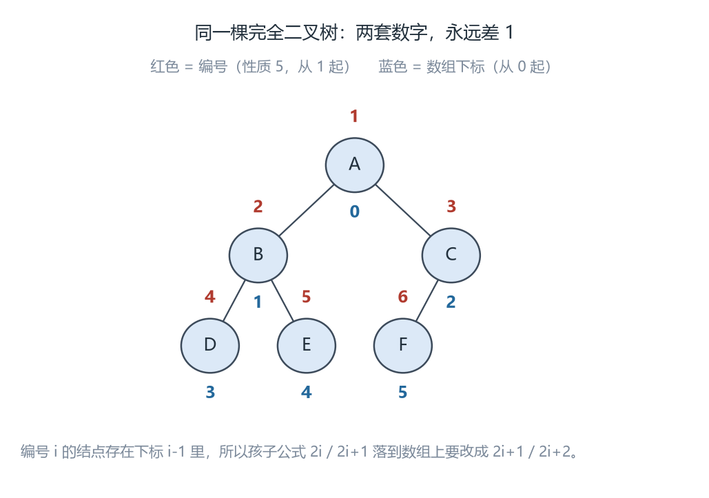

**完全二叉树**可以直接按层序丢进数组，一个空位都不用留，这就是性质 5 的用处。

**一般二叉树**则必须先"当成完全二叉树"来编号：缺孩子的位置**留空占位**，填一个约定的特殊值（教材用 `Ø`，写代码时常写 `-1` 或 `NULL`）。

**为什么非占位不可**：父子关系全靠**下标算术**推出来。空位一省，后面所有结点的下标全乱，`2i+1` 就不再是左孩子了 —— 所以"位置可以空，但不能省"。

> [!warning] 顺序存储的最坏情况
> 深度为 $k$ 的**单支树**（只有 $k$ 个结点，每层一个）也要占满 $2^k - 1$ 个位置 —— 为存 $k$ 个数据浪费 $2^k - 1 - k$ 个单元，深度一大就彻底不可用。
> 所以顺序存储**只适合完全二叉树**（典型场景：堆）。

**链式存储**不挑树的形态。

**二叉链表**：数据域 + 左孩子指针 + 右孩子指针。

```c
typedef struct BiTNode {
    TElemType data;
    struct BiTNode *lchild, *rchild;
} BiTNode, *BiTree;
```

**三叉链表**：在二叉链表基础上再加一个 `parent` 域，直接指出双亲。

```c
typedef struct BiTNode_3 {
    TElemType data;
    struct BiTNode_3 *lchild, *rchild, *parent;
} BiTNode_3;
```

**为什么三叉链用得少**：找双亲的需求确实存在，但代价是每个结点多一个指针域（浪费空间），而且**插入、删除要从改两条链变成改三条链**，实现更麻烦。双亲信息在很多场合可以靠"从根往下找"或遍历时的栈顺带拿到，不一定值得专门开一个域。

> [!important] 本课只研究二叉链表
> 后面的遍历、线索化全部基于 `lchild / rchild` 两个指针域的二叉链表。

**顺带记一句区别**（后面别再混）：二叉链表不知道双亲是谁 → **三叉链表补的是"双亲"**；而**线索补的是"遍历序列里的前驱 / 后继"**，两者解决的不是同一个问题。

### 6.3 遍历二叉树及其应用
#### 6.3.1 遍历二叉树

**遍历（Traversing）**：按某条搜索路径，对树中每个结点**访问一次且仅一次**。

> [!warning] "访问"不等于"经过"
> 这是最容易含糊的一点：**经过可以很多次，访问只能一次**。
> 沿着树爬上爬下，同一个结点会被路过好几遍（后序遍历里根结点要被弹栈两次、经过三次），但只要不"处理"它，就不算访问。所谓访问，是**对结点做的那件事** —— 打印它的值、改它的值、计数等等。
> 所以写遍历算法时真正要盯的是**输出的时机**：每个结点只能输出一次。

**二叉树是递归结构**：二叉树 = **根结点 + 左子树 + 右子树**，而左、右子树**本身又是二叉树**（可以为空）。

这条定义直接决定了：**任何结点都可以当成一棵树的根来看**。哪怕到了叶子，它也是一棵"左右子树都为空"的树。所以"在树上做某件事"的代码，在子树上完全适用 —— 这是后面所有递归算法和"爬树框架"的共同依据。

**三种遍历顺序**：约定**先左后右**（人为约定，因为习惯从左往右）。用 $L$、$D$、$R$ 分别表示遍历左子树、访问根、遍历右子树，于是只剩三种：

| 名称 | 顺序 | 记忆 |
| --- | --- | --- |
| 先序遍历（DLR） | 根 → 左 → 右 | 根在**最前** |
| 中序遍历（LDR） | 左 → 根 → 右 | 根在**中间** |
| 后序遍历（LRD） | 左 → 右 → 根 | 根在**最后** |

**"先、中、后"说的是根的访问时机**，左右次序永远不变。不约定先左后右的话有 $A_3^3 = 6$ 种，加上约定就只剩这 3 种。

**递归算法**：三种序的代码只差一行 `visit` 的位置。

```c
// 先序：根左右
void PreOrder(BiTree T, void (*visit)(TElemType e)) {
    if (T) {
        visit(T->data);              // 根
        PreOrder(T->lchild, visit);  // 左
        PreOrder(T->rchild, visit);  // 右
    }
}

// 中序：左根右
void InOrder(BiTree T, void (*visit)(TElemType e)) {
    if (T) {
        InOrder(T->lchild, visit);   // 左
        visit(T->data);              // 根
        InOrder(T->rchild, visit);   // 右
    }
}

// 后序：左右根
void PostOrder(BiTree T, void (*visit)(TElemType e)) {
    if (T) {
        PostOrder(T->lchild, visit); // 左
        PostOrder(T->rchild, visit); // 右
        visit(T->data);              // 根
    }
}
```

**第二个参数是函数指针**：`void (*visit)(TElemType e)`。为什么不直接写 `printf`？因为遍历框架**不知道你要拿结点做什么** —— 打印、计数、改值、建副本都有可能。于是把这件事交给调用者：你写好一个处理函数，把函数名传进来，遍历过程负责在正确时机调用它。教材的 `Status (*Visit)(TElemType e)` 版本还会检查返回值，返回 `ERROR` 就中断遍历。

**递归为什么一定停**：每次递归传的是 `T->lchild` 或 `T->rchild`，子树**严格变小**（少一层），一路走下去必然到叶子，再走一步就是 `NULL` —— `if (T)` 挡住，递归返回。所以二叉树的递归只要**终点写对**就不会写错，这也是它比一般递归好写的原因。

**手算序列：逆时针画包络线**。考试常给一棵树要三种序列。熟练后能直接看出来，但更稳的办法是教材这个"笨办法"：

**第一步**，按要考的序给每个结点画一根**标记线**（三选一，一次只画一种）：

| 要考的序 | 标记线方向 |
| --- | --- |
| 先序 | 结点**左**侧画横线 |
| 中序 | 结点**下**方画竖线 |
| 后序 | 结点**右**侧画横线 |

**第二步**，从根出发，沿树的外围**逆时针**画一条包络线，把整棵树圈起来。

**第三步**，**包络线每与一根标记线相交，就记下该结点**。走完一圈，记下的顺序就是所求序列。

> [!warning] 三个易错点
> 1. **一次只画一种线** —— 三种线同时画必乱，要考三种就画三遍。
> 2. 只记**相交**，不记"路过" —— 同一个结点会被包络线经过多次，但只在它那根标记线处被记一次（这正好对应"访问一次"）。
> 3. 包络线**画在草稿纸上就行**，答题只写序列。

**原理**：包络线在结点**左侧、下方、右侧**各经过一次，分别对应"第一次到达该结点""从左子树回来""从右子树回来"这三个时机 —— 正好就是 DLR / LDR / LRD 里访问根的时刻。

**非递归：爬树框架**。它有两个前提：

1. **向下**：只要反复执行 `p = p->lchild` / `p = p->rchild`，从根出发能到达任何结点（树是连通的）。
2. **回退**：下去了上不来 —— 所以要在**下去之前记住来路**，回退用**栈**（后进先出）。**不能用队列**。

**核心想法**：`p` 走到哪儿，就把 `p` 当成那棵子树的根。视角一换，"根、左、右"的讨论在任何位置都成立。

```c
p = T;
while (p || !StackEmpty(S)) {   // p 不空：还能往下；栈不空：还有来路可退
    if (p) {
        /* 输出位置之一 —— 由具体的序决定 */
        Push(S, p);             // 下去之前，先留后路
        p = p->lchild;          // 先走左边（先左后右的约定）
    } else {
        Pop(S, p);              // 爬不动了，退一步
        /* 输出位置之二 —— 由具体的序决定 */
        p = p->rchild;          // 换右边的路
    }
}
```

**两个分支各自固定**：

- `p` 非空 → **先 `Push` 再往左走**（这两句是骨架，三种遍历都不变）
- `p` 为空 → **先 `Pop` 再往右走**（"左边这条路走到底了，退回去换右路"）

**三种遍历的差别只在 `visit` 放哪**：

| 遍历 | `visit` 位置 | 理由 |
| --- | --- | --- |
| 先序 | `if` 分支，`Push` **之前** | 一进结点它就是根，马上输出 |
| 中序 | `else` 分支，`Pop` **之后** | 左子树走空了才能输出根 |
| 后序 | `else` 分支，**还要判断从哪边回来** | 左右都走完才能输出根 |

**先序与中序**：

```c
// 先序：一进结点就输出
p = T;
while (p || !StackEmpty(S)) {
    if (p) {
        visit(p->data);        // 根 —— 立刻输出
        Push(S, p);
        p = p->lchild;
    } else {
        Pop(S, p);
        p = p->rchild;
    }
}

// 中序：左子树走空了才输出
p = T;
while (p || !StackEmpty(S)) {
    if (p) {
        Push(S, p);
        p = p->lchild;         // 左边没走完，根不能输出
    } else {
        Pop(S, p);
        visit(p->data);        // 此时左子树已空，输出根
        p = p->rchild;         // 左、根都完了，转右
    }
}
```

> [!warning] 中序的两行不能调换
> `visit(p->data)` **必须**在 `p = p->rchild` 之前 —— "左根右"要求根在右子树之前输出。写反了就变成"左、右、根"，那是后序。

**教材算法 6.2 是另一种中序写法**（利用中序特性，不是通用框架）：

```c
Status InOrderTraverse(BiTree T, Status (*Visit)(TElemType e)) {
    InitStack(S);  Push(S, T);
    while (!StackEmpty(S)) {
        while (GetTop(S, p) && p) Push(S, p->lchild);  // 一路向左走到底
        Pop(S, p);                                      // 弹出跑出叶子的那个空指针
        if (!StackEmpty(S)) {
            Pop(S, p);
            if (!Visit(p->data)) return ERROR;          // 访问结点
            Push(S, p->rchild);                         // 向右一步
        }
    }
    return OK;
}
```

它的思路是"向左走到底 → 回退一层输出 → 右子树入栈"，一路都用"左根右"的特点，**换不成先序或后序** —— 这就是它不如统一框架通用的原因。**考试写代码优先用上面的框架版**，这个看得懂即可。

**后序：难点在"判断从哪边回来"**。它是三种里最难的，原因很直接：**找到结点的顺序永远是"先根后子"**，而后序要求**根最后输出** —— 先碰到的反而最后处理。

根在左右子树都走完之前不能输出，于是一个结点会被**弹栈两次**：

- 第一次弹出（左子树走完）→ 不能输出，转右子树
- 第二次弹出（右子树走完）→ 才能输出

**所以必须记录"这次是从左边回来的还是从右边回来的"**。两种实现：

**方法一：双栈法**（主栈 `S` + 同步的标记栈 `S2`，`0` 表示从左下去、`1` 表示从右下去）

```c
p = T;
while (p || !StackEmpty(S)) {
    if (p) {
        Push(S, p);  Push(S2, 0);       // 0：从左边下去的
        p = p->lchild;
    } else {
        Pop(S, p);   Pop(S2, tag);      // 两个栈同步弹出
        if (tag == 1) {                 // 从右边回来 → 左右都完了
            visit(p->data);
            p = NULL;                   // ★ 关键
        } else {                        // 从左边回来 → 还不能输出
            Push(S, p);  Push(S2, 1);   // 重新压回，标记改成"从右边"
            p = p->rchild;
        }
    }
}
```

> [!warning] `p = NULL` 不能漏
> 输出根之后，以它为根的子树的活**已经全部干完**了。此时若不把 `p` 置空，下一轮 `if (p)` 又会把它当成新根重新压栈、往左子树跑一遍 —— 死循环。

**方法二：`last` 指针法**（不额外开栈，记"最近一次访问完的结点"）

```c
p = T;  last = NULL;
while (p || !StackEmpty(S)) {
    if (p) {
        Push(S, p);
        p = p->lchild;
    } else {
        GetTop(S, p);                          // 只看栈顶，先别弹
        if (p->rchild && p->rchild != last) {  // 右子树还没走过
            p = p->rchild;
        } else {                               // 右子树为空或刚走完 → 可以输出
            Pop(S, p);
            visit(p->data);
            last = p;                          // 记下刚访问完的结点
            p = NULL;
        }
    }
}
```

`last` 的作用：如果 `p->rchild == last`，说明**刚访问完的正是它的右子树**，也就是"从右边回来的"，可以输出 `p` 了。这比双栈省一个栈，但判断条件更难想到。

**`GetTop` 和 `Pop` 的区别是这段的关键**：这里只能先看、不能先弹 —— 因为可能还要往右走，弹掉就丢了。

**层次遍历：用队列**。层次遍历**没有回退问题**：一层访问完就不需要回去了。但同一层要**从左往右**，所以需要一个能保证"先进先出"的结构 —— **队列**。

**做法**：

1. 根入队
2. 队头出队、访问
3. 把它的**左、右孩子依次入队**
4. 队列不空就重复

```c
InitQueue(Q);
EnQueue(Q, T);
while (!QueueEmpty(Q)) {
    DeQueue(Q, p);
    visit(p->data);
    if (p->lchild) EnQueue(Q, p->lchild);
    if (p->rchild) EnQueue(Q, p->rchild);
}
```

**为什么一定是逐层的**：每出队一个结点，就把它下一层的两个孩子排到队尾。所以**第 $k$ 层的所有结点一定排在 $k+1$ 层之前** —— 队列天然保证了这次序。

**队列 vs 栈 = 广度 vs 深度**：先序、中序、后序本质是**深度优先**（一路往下，走不通才退），所以要**栈**；层次遍历本质是**广度优先**（一层层铺开），所以要**队列**。这也是层次遍历一般不写递归的原因 —— 递归擅长的是"退回来"，而这里根本不用退。

**遍历算法的应用**：遍历是二叉树一切操作的基础，下面三个都是"改一下访问动作"就得到。

**1. 按先序序列创建二叉树**

只给一个先序序列**建不出树** —— 因为分不清哪个结点是叶子、在哪里切。所以要先**扩充**：把每个空孩子位置也标出来（用 `#`、`?` 之类的特殊符号），得到"扩充二叉树"的先序序列，再拿它去建。

```c
void CreateBiTree(BiTree &T) {
    scanf(&ch);
    if (ch == '#') {
        T = NULL;                       // 空位置 → 递归终点
    } else {
        T = (BiTNode *)malloc(sizeof(BiTNode));
        T->data = ch;                   // 根
        CreateBiTree(T->lchild);        // 左
        CreateBiTree(T->rchild);        // 右
    }
}
```

> [!warning] 是"补全"不是"补满"
> **补全** = 把空孩子位置标出来（每个结点最多补两个空位）；**补满** = 补成满二叉树。两者完全不同。
> 而且：**不补全就会无穷递归** —— `scanf` 永远读不完，`T` 永远不为空，递归没有终点。

**2. 求叶子结点数**

访问动作从"打印"改成"判断是不是叶子，是就计数"：

```c
void CountLeaf(BiTree T, int &count) {
    if (T) {
        if (!T->lchild && !T->rchild) count++;   // 左右都空 → 叶子
        CountLeaf(T->lchild, count);
        CountLeaf(T->rchild, count);
    }
}
```

**这跟用哪种序无关** —— 反正每个结点都要过一遍，逮到叶子就数。

**3. 求二叉树的深度**

这个更简单，连"访问"都不需要，纯递归：

```c
int Depth(BiTree T) {
    if (!T) return 0;                                   // 空树深度 0
    int l = Depth(T->lchild), r = Depth(T->rchild);
    return (l > r ? l : r) + 1;                         // 较深的子树 + 根这一层
}
```

**思路**：砍掉根，树就变成两棵子树；整棵树的深度 = **两棵子树里较深的那棵 + 1**。每次砍一层，递归必然收敛到空。

**由遍历序列确定二叉树**：给两种序列能不能唯一还原出一棵树？

| 组合 | 能否唯一确定 | 原因 |
| --- | --- | --- |
| 先序 + 中序 | 能 | 先序定根，中序分左右 |
| 后序 + 中序 | 能 | 后序定根（最后一个），中序分左右 |
| 先序 + 后序 | **不能** | 只定得出根，分不清左右子树 |

**做法**（以先序 + 中序为例）：

1. 先序的**第一个元素**就是根
2. 拿这个根去中序里找，把中序**切成两段**：左边是左子树，右边是右子树
3. 对切出来的左、右子树递归重复

**为什么非得有中序**：中序的作用是"报出左右各几个"。先序、后序都只报根不报界，两个凑一起也分不清"左子树为空"还是"右子树为空"，所以还原不唯一。

**例**：先序 `ABDFCEGH`、中序 `BFDAGEHC`

- 先序首元素 $A$ 是根；中序里 $A$ 左边 `BFD` → 左子树，右边 `GEHC` → 右子树
- 左子树：先序 `BDF`、中序 `BFD` → 根 $B$；$B$ 在中序最前，左空，右子树为 `FD`
  - 先序 `DF`、中序 `FD` → 根 $D$；$D$ 在中序最后，左孩子 $F$
- 右子树：先序 `CEGH`、中序 `GEHC` → 根 $C$；$C$ 在中序最后，左子树为 `GEH`
  - 先序 `EGH`、中序 `GEH` → 根 $E$；$E$ 左边 $G$、右边 $H$

还原结果：$A$ 的左孩子 $B$，$B$ 的右孩子 $D$，$D$ 的左孩子 $F$；$A$ 的右孩子 $C$，$C$ 的左孩子 $E$，$E$ 的左、右孩子分别是 $G$、$H$。可以回代验证：这棵树的先序正是 `ABDFCEGH`，中序正是 `BFDAGEHC`。

#### 6.3.2 线索二叉树

**为什么需要线索二叉树**：遍历这件事有两个反复出现的痛点：

1. **递归耗栈**。递归每层都要压系统栈。嵌入式系统的栈常以 **K** 为单位（不是兆），树一高就可能爆栈。
2. **非递归是重复劳动**。同一棵树，每次要序列都得从头跑一遍算法 —— 而结果**每次都一样**。

于是自然想到：**只遍历一次，把结果存下来**。这就是线索二叉树的本意 —— **它存的就是遍历序列**。

**空指针有多少：$n + 1$ 个**。一棵有 $n$ 个结点的二叉树，共有 $2n$ 个指针域（每个结点 `lchild`、`rchild` 各一个），而实际用到的分支只有 $n - 1$ 条（除根外每个结点被一条边挂住）。

$$\text{空闲指针域} = 2n - (n - 1) = n + 1$$

**这 $n+1$ 个空指针不存东西就浪费了** —— 正好拿来存"遍历序列里这个结点的前一个、后一个"。

> [!definition] 线索（Thread）
> 结点**没有左孩子**时，让 `lchild` 指向遍历序列中的**直接前驱**；
> 结点**没有右孩子**时，让 `rchild` 指向遍历序列中的**直接后继**。
> 这样改过的指针叫**线索**，加过线索的二叉树叫**线索二叉树**，它对应的链表叫**线索链表**。

**结点结构：加两个标志位**。问题来了：指针里存的到底是"孩子"还是"前驱 / 后继"？必须能区分，否则没法用。所以每个结点加两个标志域：

| 标志 | 值 | 含义 |
| --- | --- | --- |
| `LTag` | 0（`Link`） | `lchild` 指向**左孩子** |
| `LTag` | 1（`Thread`） | `lchild` 指向**前驱** |
| `RTag` | 0（`Link`） | `rchild` 指向**右孩子** |
| `RTag` | 1（`Thread`） | `rchild` 指向**后继** |

```c
typedef enum { Link, Thread } PointerTag;   // Link = 0，Thread = 1

typedef struct BiThrNode {
    TElemType        data;
    struct BiThrNode *lchild, *rchild;
    PointerTag       LTag, RTag;
} BiThrNode, *BiThrTree;
```

用枚举而不是直接写 0/1，是为了可读性 —— `p->LTag == Thread` 比 `== 1` 一眼能懂。

**有了线索之后**，遍历既不需要栈也不需要递归：顺着线索就能一个接一个找到后继。

**线索树怎么画**：先确定是哪种序 —— 先序、中序、后序的遍历序列不同，线索指向也就不同，三种线索树互不相同。题目一定会说明"画出中序线索树"之类。

**线型规则**（考试就这么画）：

- **实线**箭头 = 原来的孩子指针（`Tag = 0`）
- **虚线**箭头 = 线索（`Tag = 1`），指向**前驱或后继**
- **左侧**虚线 = 前驱，**右侧**虚线 = 后继

**注意"只补空指针"**：只有原来为空的 `lchild` / `rchild` 才会变成线索，有孩子的指针**永远不动**。所以画之前先看每个结点的哪一边是空的。

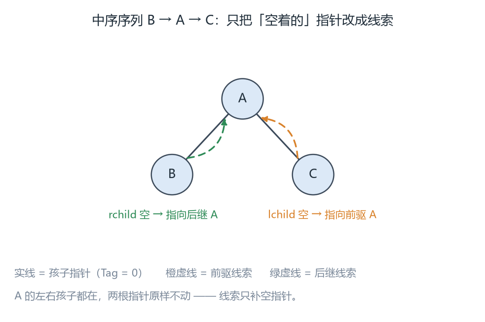

**手搓线索树的步骤**：

1. **先画原树**（实线）
2. **把遍历序列写出来** —— 这一步必须对，序列错了线索必错
3. 逐个结点看：哪边的指针是空的？
   - 空的 `lchild` → 虚线指向前驱；没有前驱（序列第一个结点）→ 指向 `NULL`
   - 空的 `rchild` → 虚线指向后继；没有后继（序列最后一个结点）→ 指向 `NULL`
4. 题目要求标 `Tag` 的话，再补上 0 / 1

> [!warning] 序列必须先算对
> 线索树画错的绝大多数原因不是"不会画虚线"，而是**遍历序列算错了**。序列一错，所有虚线的终点全错，而且错得很像对的。这一步宁可慢：先用包络线法把序列核一遍。

**线索化的代码思路**：线索化 = **一边遍历、一边把空指针改成线索**。所以它不需要单独的算法，直接在遍历过程里做。

难点是：要知道"前驱是谁"，就得记住**上一个访问过的结点**。所以用**双指针**：

- `p`：当前结点（遍历本来就有的）
- `pre`：上一个访问过的结点，**始终慢 `p` 一步**

```c
// 中序线索化：写在遍历的"访问"位置
if (!p->lchild) {           // p 的左孩子空 → 拿来存前驱
    p->LTag = Thread;
    p->lchild = pre;
}
if (pre && !pre->rchild) {  // pre 的右孩子空 → 拿来存后继
    pre->RTag = Thread;
    pre->rchild = p;        // pre 的后继就是当前的 p
}
pre = p;                    // pre 跟上，继续保持慢一步
```

**为什么两段要成对写**：`p` 的前驱和 `pre` 的后继其实是**同一对关系**的两个方向。处理 `p` 的时候顺手把 `pre` 的后继补上，一次遍历就能把两个方向都串好。

> [!warning] 三个易错点
> 1. `pre` 初值为 `NULL`，所以判断里必须写 `pre &&` —— 否则第一个结点就去访问 `pre->rchild`，直接崩。
> 2. `pre = p` 要放在**最后**，不能夹在中间，否则"慢一步"就失效了。
> 3. 这段代码放的位置决定**是哪种线索化**：放在中序的访问处就是中序线索化，放在先序处就是先序线索化。

**线索树上找前驱 / 后继**（以中序为例）：有了线索，就不用再跑一遍遍历了。

| 要找 | 该方向有子树 | 该方向没有子树 |
| --- | --- | --- |
| 后继 | **右子树的最左下**结点 | 直接读 `rchild`（已经是线索） |
| 前驱 | **左子树的最右下**结点 | 直接读 `lchild`（已经是线索） |

- "最左下" = 从右孩子出发，一路往左走到底
- "最右下" = 从左孩子出发，一路往右走到底

**后序线索树找后继要分情况** —— 教材归了三种。不用背：画一棵树，把每个结点手工找一遍，自然就分出几类；考试现场推得出来。

**头结点（`thrt`）**：线索化之后还剩两处悬空 —— **第一个结点没有前驱**、**最后一个结点没有后继**。加一个头结点把它们接住：

- `thrt->lchild` 指向**根**（`LTag = Link`）
- `thrt->rchild` 指向**中序遍历的最后一个结点**（`RTag = Link`）
- 中序第一个结点的 `lchild`、最后一个结点的 `rchild` 都指回 `thrt`

这样整棵树**一个空指针都没有**，所有线索都落在有效结点上。

> [!tip] 头结点的额外好处：能倒着遍历
> `thrt->rchild` 指向最后一个结点，从这儿进去、反复找**前驱**，就能逆着中序走一遍 —— 这正是左右两个指针都要设的原因。

**线索树的遍历**（中序，不用栈也不用递归）：

1. 从**第一个结点**开始：根一路向左走到底
2. 有右孩子（`RTag == Link`）→ 走右孩子，再一路向左走到底
3. 没有右孩子（`RTag == Thread`）→ 沿 `rchild` 线索直接跳到后继
4. 重复，直到转回头结点

```c
// 中序线索树的遍历（带头结点 thrt）
p = thrt->lchild;                              // 从根出发
while (p != thrt) {
    while (p->LTag == Link) p = p->lchild;     // 一路向左到底 = 中序第一个
    visit(p->data);
    while (p->RTag == Thread && p->rchild != thrt) {
        p = p->rchild;                         // 后继是线索 → 直接跳
        visit(p->data);
    }
    p = p->rchild;                             // 有右孩子 → 进右子树
}
```

### 6.4 树和森林

树的存储结构**随应用而变**：常找双亲就存双亲，常找孩子就存孩子，要和二叉树统一就存"孩子兄弟"。

#### 6.4.1 树的存储结构

**双亲表示法**（顺序存储）：一组连续单元存结点，每个结点多一个 `parent` 域记双亲的**下标**。

```c
#define MAX_TREE_SIZE 100
typedef struct PTNode {
    ElemType data;
    int parent;              // 双亲下标，根记 -1
} PTNode;

typedef struct {
    PTNode nodes[MAX_TREE_SIZE];
    int root, num;           // 根的位置、结点数
} PTree;
```

- **优点**：找双亲 $O(1)$；求层次、求祖先一路往上爬就行
- **缺点**：找孩子要**扫整个数组**

**孩子表示法**：每个结点挂一条孩子链表。

- **定长结点**：指针域个数 = 树的度。结构简单，但空指针很多 —— $n$ 个结点、度为 $k$ 的树必有 $n(k-1)+1$ 个空指针域
- **不定长结点**：按结点自己的度分配。不浪费，但操作不便
- 常用的是**数组 + 孩子链表**：顺序存结点，每个结点挂一条单链表，链表里存孩子下标
- **缺点**：看不出谁是根，要另设一个根指针

**孩子兄弟表示法**（二叉链表）：每个结点两个指针 —— `firstchild` 指第一个孩子，`nextsibling` 指下一个兄弟。

```c
typedef struct CSNode {
    ElemType data;
    struct CSNode *firstchild, *nextsibling;
} CSNode, *CSTree;
```

**关键结论**：不管树有多少个孩子，用这种存法**物理上都是一棵二叉树** —— 长子挂左边，其余兄弟沿右链排下去。

> [!tip] 找第 $i$ 个孩子
> 从 `firstchild` 找到第 1 个孩子，再沿 `nextsibling` 走 $i-1$ 步。想同时方便找双亲，就再加一个 `parent` 域。

#### 6.4.2 森林与二叉树的转换

**树 → 二叉树**（四步）：

1. **加虚线**：同一层相邻兄弟之间连线
2. **去连线**：只保留每个结点的**第一个孩子**，其余父子连线删掉
3. **旋转**：顺时针转 45°，原来的实线变成左斜
4. **整型**：虚线改实线、向右斜

口诀：**左孩子、右兄弟**。

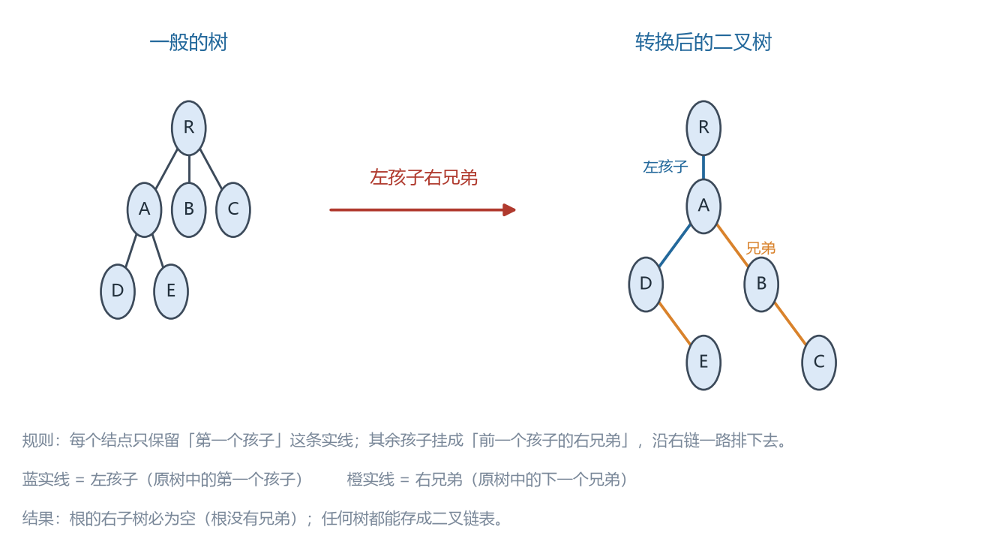

转换后二叉树的特点：

- **根没有右子树**（根没有兄弟）
- 左孩子还是原来的第一个孩子；沿右链下去的，全是原树里的**兄弟**

**二叉树 → 树**：反过来做 —— 把所有右子树"抬"到兄弟那一层，再重新连线。

**森林 → 二叉树**：每棵树先各自转成二叉树，再按次序把第 2 棵挂到第 1 棵根的**右子树**上，第 3 棵挂到第 2 棵的右子树上……

**二叉树 → 森林**：从根开始把**右链全部断开**，得到若干棵二叉树，再各自还原成树。

> [!important] 为什么要转
> 树和森林的算法不用另写一套 —— 转成二叉树，直接套二叉树的存储和遍历。这也是"只研究二叉树"的底气。考试里这是**送分题**，规则机械，必须能上手画。

### 6.6 赫夫曼树及其应用

赫夫曼（Huffman）树又叫**最优树**：一类**带权路径长度最短**的二叉树。用在无损压缩、编码和判定树优化里。

#### 6.6.1 最优二叉树（赫夫曼树）

**几个概念**（"树的路径长度"和"带权路径长度"不是一回事）：

| 概念 | 定义 |
| --- | --- |
| 结点路径 | 从一个结点到另一个结点经过的分支 |
| 路径长度 | 路径上的**分支数** |
| 树的路径长度 | 根到**每一个结点**的路径长度之和 |
| 结点的带权路径长度 | 根到该结点的路径长度 × 该结点的权 |
| **树的带权路径长度 WPL** | **所有叶子结点**的带权路径长度之和，$\mathrm{WPL}=\sum w_i l_i$ |

**WPL 只算叶子**，中间结点不参与 —— 这是最容易错的地方。

**例**：四个叶子权值 $2、3、6、7$，三棵不同的二叉树：

| 树形 | WPL |
| --- | --- |
| (a) 四个都在第 2 层 | $(2+3+6+7)\times 2 = 36$ |
| (b) 2 在第 1 层，3 在第 2 层，6、7 在第 3 层 | $2\times1+3\times2+6\times3+7\times3 = 47$ |
| (c) 7 在第 1 层，6 在第 2 层，2、3 在第 3 层 | $7\times1+6\times2+2\times3+3\times3 = 34$ |

(c) 的 WPL 最小 → 它就是赫夫曼树。**权大的离根近**，总代价就小。

**应用：判定树优化**。把百分制转五分制，顺序写 `if-else`：

```c
if (score < 60)      grade = 1;
else if (score < 70) grade = 2;
else if (score < 80) grade = 3;
else if (score < 90) grade = 4;
else                 grade = 5;
```

各分数段比例为 $0.05、0.15、0.4、0.3、0.1$。这棵判定树的平均判断次数：

$$0.05\times1 + 0.15\times2 + 0.4\times3 + 0.3\times4 + 0.1\times4 = 3.15$$

把**占比最大的 70~80 段提到最前面**判断，树就变矮：

$$0.05\times3 + 0.15\times3 + 0.4\times2 + 0.3\times2 + 0.1\times2 = 2.2$$

平均少判断将近一次；考生几十万时，省下的判断次数很可观。

**构造方法**（每次取两个最小的合并）：

1. 把 $n$ 个权值各看成一棵单结点树，放进集合 $F$
2. 从 $F$ 取**根权值最小**的两棵，作为左右子树合成一棵新树，新根权值 = 两者之和
3. 从 $F$ 删掉这两棵，把新树加回去
4. 重复 $n-1$ 次，直到 $F$ 只剩一棵 —— 那就是根

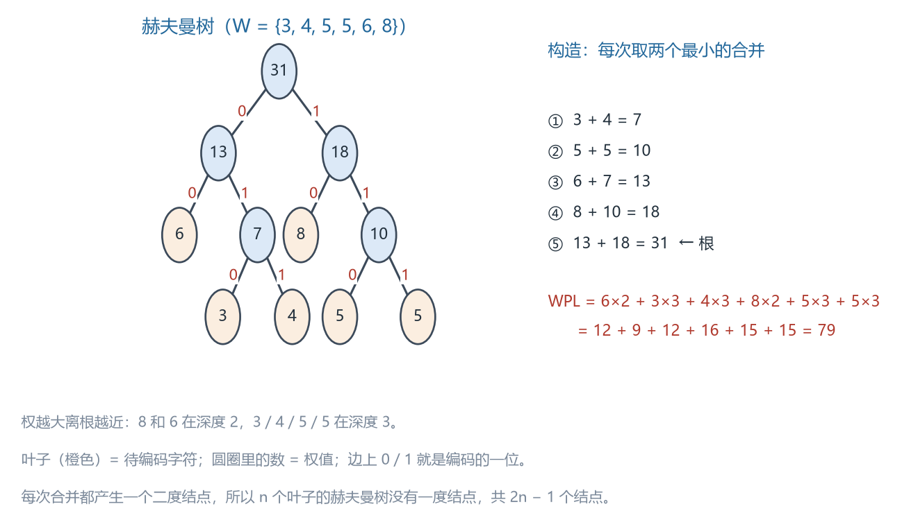

**例**：$W=\{3,4,5,5,6,8\}$

- $3+4=7$ → $5+5=10$ → $6+7=13$ → $8+10=18$ → $13+18=31$
- $\mathrm{WPL}=6\times2+3\times3+4\times3+8\times2+5\times3+5\times3=79$

**赫夫曼树不唯一**：挑两个最小时如果权值相同，挑法可以不同。附加"编号小的放左边"之类的约束才唯一。但 **WPL 一定相同**。

#### 6.6.2 赫夫曼编码及其算法

**要解决什么**：电文里各字符出现的频率不同，用**不等长编码**让高频字符短、低频字符长，总长度最短。

**前缀编码**：任何一个字符的编码都**不是另一个字符编码的前缀**。否则译码时分不清边界（比如 `0` 和 `01`），会产生二义性。

**赫夫曼编码的构造**：

1. 字符集作**叶子**，出现次数 / 频率作**权值**，建赫夫曼树
2. 约定**左分支 0、右分支 1**
3. 从根走到叶子的路径上的 0/1 串，就是该字符的编码

**为什么天然是前缀码**：每个字符都在**叶子**上，一个叶子不可能是另一个叶子的祖先，所以谁的编码也不会是别人的前缀。

**例**：$C=\{a,b,c,d\}$，$W=\{7,5,2,4\}$ → $a=0$、$b=10$、$c=110$、$d=111$。
验算：$7\times1+5\times2+2\times3+4\times3=35$。

**存储结构**：赫夫曼树没有度为 1 的结点，$n$ 个叶子共 **$2n-1$** 个结点，**用数组存**就够（0 下标不用）：

```c
typedef struct {
    unsigned int weight;
    unsigned int parent, lchild, rchild;   // 存下标，0 表示空
} HTNode, *HuffmanTree;
```

带 `parent` 是为了**求编码时能从叶子往上爬**。

**求编码的两种方式**：

1. **从叶子往根（逆向）**：反复 `c = parent`，每爬一层看是左孩子还是右孩子，记 0 / 1。因为是倒着爬的，编码要**从后往前填**（`cd[--start]`），最后整串复制出来
2. **从根往叶子（正向）**：边走边记 0 / 1，走到叶子就输出；回退时把最后一位删掉（`cdlen--`），再走另一支

> [!warning] 两个易错点
> - 建树时挑最小的范围要**包含刚生成的新结点**（`HT[1..i-1]`），而且只能挑 `parent == 0` 的
> - 逆向求编码要从后往前填，正向顺着填会得到反串

> [!warning] 课程事务与考试范围
> 课堂讨论与开题安排在**周四**，老师提醒提前准备。
>
> 本次课划的考点：
> - **6.5 树与等价问题不考**（课件里有，有余力可自学）
> - 线索二叉树重点掌握**中序**：建树思路 + 遍历
> - **树和森林的转换**是送分题，必须会画
> - **赫夫曼树必考 WPL**：构造过程、两种求编码方式都要理解
> - **两种序列还原二叉树**必会：先序 + 中序、后序 + 中序

### 第6章 要点

> [!summary] 本章要点
> - **树是递归定义**：$n$ 个结点的有限集合（$n=0$ 为空树），否则 = 根 + $m$ 棵**互不相交**的子树；缩小一棵树就是**砍树根**
> - **结点的度只往下数**（连双亲那根不算），树的度 = 各结点度的**最大值**；叶 = 度 0 的结点；层次从根记 1，深度 = 最大层次值
> - 从根到任一结点的**路径唯一** —— 这正是后面**赫夫曼编码**没有二义性的根据
> - **二叉树**：每个结点**至多两棵子树**且**有左右之分**（有序）。性质 1：第 $i$ 层至多 $2^{i-1}$ 个结点；性质 2：深度 $k$ 至多 $2^k-1$ 个结点（至少 $k$ 个）；性质 3：$n_0 = n_2 + 1$
> - **满二叉树** = 深度 $k$ 且有 $2^k-1$ 个结点；**完全二叉树** = 与深度 $k$ 的满二叉树**编号 $1 \sim n$ 一一对应**（速判：从最后一个结点往前挨着抹）
> - **完全二叉树两条最实用的性质**：深度 $= \lfloor \log_2 n \rfloor + 1$；编号 $i$ 的双亲 $\lfloor i/2 \rfloor$、左孩子 $2i$、右孩子 $2i + 1$（**编号从 1 起、下标从 0 起，差 1**）
> - **存储**：顺序存储靠下标算术，只适合完全二叉树（单支树要 $2^k - 1$ 个位置）；通用做法是**二叉链表**（三叉链表多一个 `parent`，少用）
> - **遍历**：`DLR` / `LDR` / `LRD` 只差**访问根的时机**；非递归统一用**栈 + 爬树框架**（`Push` 后往左、`Pop` 后往右），后序要多判断"从哪边回来"（双栈或 `last` 指针）；层次遍历用**队列**
> - **线索二叉树**：把 $n+1$ 个空指针用来存**前驱 / 后继**，`LTag` / `RTag` 区分孩子与线索；线索化用 `p` / `pre` 双指针，`pre` 慢一步
> - **由遍历序列还原**：先序 + 中序、后序 + 中序可以；先序 + 后序不行（分不清左右子树）
> - **线索树找前驱 / 后继**：中序后继 = 右子树**最左下**，前驱 = 左子树**最右下**；头结点把首尾两处空指针接住，还能倒着遍历
> - **树的存储**：双亲表示法好往上（找双亲 $O(1)$、找孩子扫全表）；孩子表示法好往下；孩子兄弟表示法 = **左孩子右兄弟**，物理上就是二叉树
> - **树 / 森林 ↔ 二叉树**：核心是"左孩子右兄弟"；森林转换就是把后一棵树挂到前一棵根的右链上，**根无右子树**
> - **赫夫曼树**：WPL **只算叶子**，$\mathrm{WPL}=\sum w_i l_i$；每次取两个最小的合并，$n$ 个叶子共 $2n-1$ 个结点；编码是**前缀码**，左 0 右 1

---

## 第7章 图

> [!info] 本章范围
> 按课件《第7章 图》（130 页）整理：7.1–7.6 全部；7.4.2 强连通分量、7.4.4 关节点课堂明确不考，只在章末考点里标注

### 7.1 图的定义和基本术语

**图为什么比树难**：线性结构研究一对一关系（除首尾外每个元素只有唯一前驱和后继）；树研究一对多（每个元素对下可以连 0 个或多个，对上只有唯一一个）；而图研究的是**多对多**——任意两个元素之间都可能存在关系。树其实是在线性表的基础上加了一条链，二叉树是双链；到图这里，双链也不够了，这就是图复杂的原因。

**顶点与弧**：画成图上一个个圈的就是**顶点**。描述有向关系用**有序对** `$\langle v, w\rangle$`——**尖括号**表示有序、从 v 到 w、**不能颠倒**。v 是箭头的尾巴，叫**弧尾**；w 是箭头指向的地方，叫**弧头**。带箭头的图就是**有向图（Digraph）**。

**无向图**：如果存在 `$\langle v, w\rangle$` 就一定存在 `$\langle w, v\rangle$`（双向），那箭头左右各画一个太烦，干脆**简化成无序对** `$ (v, w)$`——**小括号**表示无序，这条连线叫**边（Edge）**，此时的图叫**无向图（Undigraph）**。可以把无向图理解成有向图的特例：双向箭头省略不画。所以**看符号就能判断有向还是无向**。

**一张图怎么描述**：分两部分——先给**顶点集**（数据），再给**弧集/边集**（结构）。例如有向图 `V1 = {a,b,c,d,e}` + 弧 `$\langle a,b\rangle$`、`$\langle a,c\rangle$`……；无向图 `V2 = {a,b,c,d}` + 边 `$ (a,b)$`……。写程序时必须先让用户声明图的**类别**（有向/无向），因为无向图的一条边只需**输入半条**——输入 `$ (a,b)$` 后要默认补上 `$ (b,a)$`（矩阵里对称位置），有向图则只能单向。

**完全图**：能画的边都画上了。任意两个顶点间一定有边相连：无向完全图有 `$n(n-1)/2$` 条边；有向完全图因为有向要一来一回，有 `$n(n-1)$` 条弧。

**稀疏图与稠密图**：形容**边的数量**——顶点数给定时边多不多。没有严格定义，通常估量级：边数 e 比 `$n^2$` 小得多就叫稀疏，反之叫稠密图（Dense graph）。

**权与网**：权是跟**边或弧**相关的数（不是跟顶点），典型的如路的公里数。带权的图叫**网**。

**子图**：从原图挖掉一些顶点或一些边得到的图都是子图（不挖也行，原图也是自己的子图）。本质和子集一样：顶点集、边集**两部分都得是子集**。

**邻接点**：两点之间**有线直接相连**才叫邻接点——绕一圈（a→c→b）不算。

**度**：无向图里顶点连出去的边数就是它的度；有向图分**出度**（打出去的）和**入度**（打进来的）。

**路径与长度**：路径是从一个顶点到另一个顶点所经过的**点集**；点集上经过的**边数**叫路径的**长度**。

**连通图与连通分量**：随便抓两个顶点都互通的图叫**连通图**；达不到就叫非连通图。非连通图的局部可能还是连通的，把**局部的极大连通子图**叫**连通分量**——再非连通的图也总能切出几个连通分量，最坏一个点一个点地切总能切出来。

**生成树**：**极小连通子图**，包含全部 n 个顶点、但只有足以构成一棵树的 **n−1 条边**。它是实际问题（比如几个地点之间修路）的抽象：把 n 个顶点连起来最少 n−1 条边，多了有环、少了不连通。三个结论：

- 有 n 个顶点的生成树**有且仅有 n−1 条边**；
- 再少一条必非连通；再多一条必有环（树不能有圈）；
- 反过来**有 n−1 条边的图不一定是生成树**——比如 3 条边自己围成三角形、第 4 个顶点孤立着，边数够了但位置不对。

生成树**不唯一**——同样的顶点可以有好几种连法，所以后面还会研究"代价最小的那种"，即**最小生成树**。

**有向树与生成森林**：有向树首先没有环，且只有一个顶点入度为 0、其余顶点入度均为 1。提出它是因为**有向图的生成森林**就是由若干棵有向树构成的，而生成森林本身就是遍历的一种结果。

### 7.2 图的存储结构

图的存储分两部分：**顶点好存**（拿个数组通吃，属性多就做成结构体），**难在边**。常用四种存边的结构：邻接矩阵、邻接表、十字链表、邻接多重表。

#### 7.2.1 数组表示法（邻接矩阵）

最朴素的想法：直接拿**二维数组**存所有边。n 个顶点就用 `$n \times n$` 矩阵，约定 `a[i][j]` 表示从 i 到 j 的有序对。哪怕是完全图，边数也不超过 `$n^2$`，所以**肯定能存**——这是数组法的优越性；缺点是边少顶点多时矩阵很空（比如 1 万个顶点只有 20 条边）。

**几个预备定义**：

- **正无穷**：计算机里没法存"无穷"，约定用一个特别大的数，一般取 `INT_MAX`（`limits.h` 里的宏，int 的最大值）；
- **最大顶点数上限**：方便定义数组；
- **图的类型枚举**：共四种——`DG` 有向图、`DN` 有向网、`UDG` 无向图、`UDN` 无向网。`D` = direction（有向）、`G` = graph（图）、`N` = network（带权的叫**网**）、`U` = undirected（无向）。一维是有向/无向，另一维是有权/无权：有些场景只有"认识/不认识"这种 0/1 关系，就只能用无权图。

**结构体成员**：顶点数组（存顶点集）+ 邻接矩阵（存边集）+ 顶点数 + 弧数 + 图的类型。`info` 域是存附加信息的，课本例题用不到，不用管。顶点数组在实际编程里**不一定需要**——如果顶点只有从 0 起编的数字编号，下标直接对上就行；但表示路网时顶点要对应城市名，顶点数组就跑不掉了。

**四种图的矩阵对比**（重点看对角线）：

| 图类型 | 对角线 | 矩阵特点 |
| --- | --- | --- |
| 无向、无权 | 0 | 元素只有 0/1，**一定对称**（输入半条即可） |
| 无向、带权 | **无穷大** | 对称，有边处填权值 |
| 有向、无权 | 0 | 一般**非对称**（有弧处为 1） |
| 有向、带权 | **无穷大** | 一般非对称，有弧处填权，无边处为无穷 |

> [!warning] 对角线别乱刷
> 无权图对角线置 0（自己跟自己不连）；**带权图对角线一律置无穷大**。因为带权图上的权是**代价**，算法都在追求代价最小——若对角线是 0，"自己连自己"的代价永远最小，算法就全跑到自己身上去了。置成无穷直接杜绝这种可能。考试很多人对角线乱刷 0 或乱刷无穷，都是没理解这个含义。

**创建图代码怎么读**：步骤是 ① 输入顶点数和弧数 → ② 第一个 for 输入顶点信息 → ③ 两个 for 把整个矩阵**初始化**（带权图初始化为无穷大，无权图初始化为 0，这是分图类型的原因）→ ④ 按弧数一条条输入边。每条边用户只需给三个数：起点、终点、权值。因为用户输的是 `v1`、`v2` 这类顶点名而不是下标，所以要先 `Locate` 一下找到**存储位置**（若顶点按数字编号则可省）。输入边后修改矩阵对应位置；**无向图还要补一句 `a[j][i] = a[i][j]`**，把对称位置填上——用户只输入了一条边，另一条是程序自己补的。书上只给了无向网这一个函数，其他三种图只需微调：初值换不换成无穷、要不要补对称。

#### 7.2.2 邻接表

邻接矩阵两个劣势：**空间大**（顶点多时矩阵巨大），且**顶点增删很痛苦**（删掉几个顶点矩阵就得重建，动态调整太麻烦——比如路网某地因地质灾害不通了、或新增一个中转点）。所以有了邻接表。

做法：在顶点数组的基础上改造——**表头结点做成链表的头节点**，另设**链表结点**存边。顶点 v 连出去几条边，它的链表就挂几个结点，**来一条挂一条**。

**优点**：

- 边稀疏时**省空间**（路网是典型：城市两两互联根本修不起，边远少于 `$n^2$`）；
- **很方便取到某个顶点的全部邻接点**——从它的链表头进去遍历一遍就行，连判断过程都没有（邻接矩阵还得扫整行判断非零，这就是"邻接表"名字的由来）；
- 无向图里顶点的**度 = 链表长**，甚至可以扩一个域直接存下来。

**缺点**：

- **无向图里同一条边会出现两次**（v1 的链挂一次、v2 的链又挂一次），删边得跑两条链才能删干净；
- **判断任意两点是否相邻/可达比较麻烦**：v3 的链上没挂 v4，只能说明没有直接边；实际可达（v3→v1→v4）得从链出发继续发散搜索。而邻接矩阵查 `a[i][j]` 一步就出结果。所以算**最短路径**这类算法一般不用邻接表。

**有向图的两种取法**：

- **邻接表**：只挂**出去的**边。链表多长，出度就是多少，方便算**出度**；
- **逆邻接表**：只挂**进来的**边，方便算**入度**。

一般习惯关心"从这出去"，所以邻接表占绝大多数应用场合。如果两个都关心，理论上有十字链表（见下），但实际更常用"邻接表 + 逆邻接表"两张表分开建。

**头插法与逆序**：建邻接表用的是最简单的链表插入——**头插法**（每个新结点固定插在头之后，不用维持尾指针）。副作用：**同一顶点的边链表顺序与输入顺序相反**。后面画 DFS 生成树时读取的就是这张表，搜索顺序完全由它决定。

#### 7.2.3 十字链表

把有向图的**出边表和入边表合并**：每个顶点既挂 `firstout`（出去的链）又挂 `firstin`（进来的链），同一个边结点**混在两条链里**。创建时每输入一条边 `<v1,v2>`，要**同时插入两条链**（v1 的出链加一个结点、v2 的入链也加同一个结点），用的还是**头插法**。

问题在于每个顶点分属两条链，**删除顶点得改两条甚至更多链**，操作过于复杂。所以十字链表**优点不明显、缺点一大堆，一般不用**——顶点稳定时宁愿拆成邻接表 + 逆邻接表两张表，操作快得多。

#### 7.2.4 邻接多重表

针对邻接表"**无向图一条边存两处**"的缺陷改进：**一条边只存一处**，把原来分挂两条链的两个结点**合并**成一个边结点（域多了好几个，记下两端的顶点）。删边时不用再跑两条链；找邻接点的操作方式和邻接表没什么区别。

它毕竟是链表，**不好排序**，所以做 Kruskkal 这类要排序的算法时，用它的**数组形式**——一般叫**边表**：每个边元素至少由"两个顶点 + 权值"组成，顺序存储方便排序。

**存储结构到底怎么选——看算法**：

| 存储结构 | 擅长 | 适合的算法 |
| --- | --- | --- |
| 邻接矩阵 | 判断两点有无边极快（直接读下标）；适合稠密图、顶点数少（如 20 顶点才 400 格） | 最短路径、传递闭包、矩阵乘法 |
| 邻接表（链式） | 省空间、增删顶点方便、遍历邻接点最方便；适合稀疏图 | DFS/BFS 遍历、拓扑排序、Prim |
| 邻接多重表/边表 | 一条边存一处、数组形式好排序 | **以边为核心**的算法，典型是 Kruskal |

有向图在邻接表和十字链表之间选：一般用不到十字链表，太复杂。无向图在邻接表和邻接多重表之间选：**以顶点为核心**的算法选邻接表，**以边为核心**的算法选邻接多重表。空间现在不太值钱，**换一种结构算法可能真就跑不动了**——这才是选择的主要依据。

### 7.3 图的遍历

图的遍历 = 把所有顶点跑一遍，且每个**只访问一次**（经过可以多次，但不重复访问）。遍历要反复找"某顶点的所有邻接点"，所以**不用看算法就该知道用邻接表**——这是选数据结构的先验。

#### 7.3.1 深度优先搜索算法

**思想**：从某顶点出发（起点题目会给），有路就一直往下走——**一条路走到黑**；走到没路了就**回退**，编程术语叫**回溯**。

**回溯用递归还是栈**：两种能力等价，但**首选递归**——递归返回自动回溯，天生自带；用栈就是手动回溯（像之前走迷宫那样前进 `push`、走不通 `pop`），代码要自己写。

**`visited[]` 全局数组**：顶点会被反复经过，为防止二次访问，用一个全局布尔（或整数）数组做标记，第一次访问时置 `true`。

**DFS 代码框架**：

```c
void DFS(Graph G, int v) {          // 从 v 出发遍历
    visited[v] = TRUE;  Visit(v);   // 首次访问，先标记再输出
    for (w = FirstAdjVex(G, v);  w >= 0;  w = NextAdjVex(G, v, w))
        if (!visited[w])  DFS(w);   // 邻接点没走过就走过去——递归即"走一步"
}                                   // 走不动了递归自动返回 = 回溯
```

for 看着复杂，意思就是**把 v 的所有邻接点循环一遍**：`FirstAdjVex` 取第一个邻接点、`NextAdjVex` 取下一个、`w >= 0` 表示还没取完（链表走到头返回 −1）。

**外面那层 for 是干嘛的**：先把 `visited[]` 全部清 0；再**对每个顶点都尝试调用一次 DFS**。原因：题目没保证图是连通图——比如就给两个没有边的顶点，从一个顶点出发永远到不了另一个。所以每个顶点都试一遍，防的是**多个连通分量**；但每个连通分量只要一次 DFS 就能走完，多调的会立刻被 `visited` 挡住。

**手搓访问顺序（考试一定会考）**：以经典八顶点图为例，从 v1 出发：

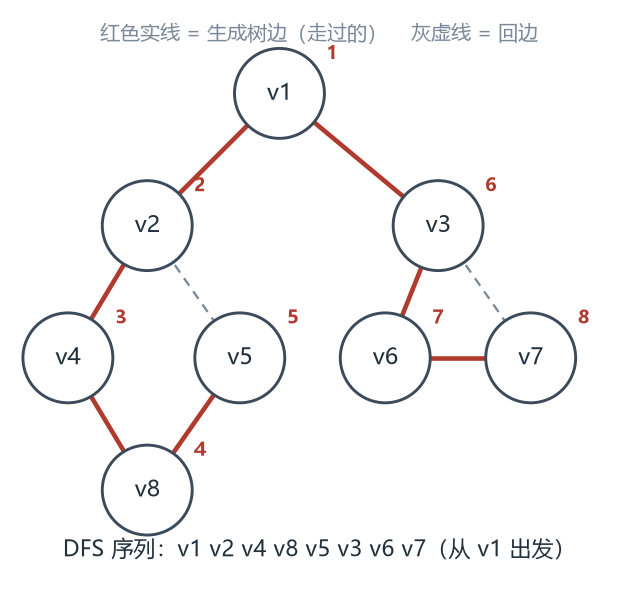

v1 的第一个邻接点是 v2 → 进去；v2 的第一个邻接点是 v4 → 进去；v4 接 v8、v8 接 v5，一路走到黑；v5 的邻接点 v2、v8 都访问过了，**递归返回 = 回溯**，退到 v8、退到 v4、退到 v2、退到 v1；换下一个邻接点进 v3 → v3 接 v6、v6 接 v7。最终 DFS 序列：**v1 v2 v4 v8 v5 v3 v6 v7**。手搓口诀就一句：**能走就一直走，走不动再退**。

#### 7.3.2 广度优先搜索算法

BFS 像**水波扩散**：从起点出发，先访问它一圈邻接点（第一圈），再由这一圈各自往外扩一圈……每扩一圈相当于走一格。以同一个八顶点图、从 v1 出发：第 1 圈 v1，第 2 圈 v2、v3，第 3 圈 v4、v5、v6、v7，第 4 圈 v8。

**不需要递归**，用的是**队列**：把这一圈的元素入队，每次取队头元素、把它的所有邻接点**访问并入队**——这就是"扩一圈"。类比就是**二叉树的层次遍历**：那时每层只有左右两个孩子、分别入队；现在孩子多了，就把所有邻接点一个一个入队。

### 7.4 图的连通性问题

#### 7.4.1 无向图的连通分量与生成树

对无向图做遍历：**连通图**从一个顶点出发就能访问全部顶点，走出的生成树叫**生成树**；**非连通图**要多次调用 DFS，每次从一个新顶点出发访问到的顶点集恰好是一个连通分量，走出的若干棵树构成**生成森林**。

**画生成树/森林必须先给邻接表**——搜索顺序完全由它决定，题目也一定会给。

**为什么邻接表是逆序的**：建表用**头插法**（尾插还得先摸到尾巴，没有头插快），所以每个顶点的边链表与输入顺序相反。例如 0 号点在图上连了 4 条边，链上挂的却是逆序的下标。

**手搓生成森林**：起点任选（题目会指定）。从起点出发，**按邻接表逐个走邻接点**：第一个邻接点是链上的第一个结点；走到死路（邻接点全访问过）就**自动回溯**（递归返回），回到上一个岔口走下一个邻接点；一路退回起点后换起点还没访问的邻接点继续。例如课件 13 顶点例：从 a 出发，邻接表第一个是 l → 走到 l → 走到 m → m 的邻接点 l、a 都访问过，回溯到 m，走第二个邻接点 b → b 的邻接点全访问过，一路退回 a；再从 a 走 f、c。得到第一棵树 a(l(m(j), b), f, c)；起点剩余的邻接点 d、e 各自形成 d–e 一棵小树；g 引出第三棵树 g(k(h), i)。

**回边**：图上没被生成树走过的边，画图时用**虚线**标出（不是生成树的一部分）。画 DFS 生成森林时回边一般**不需要画**，直接把几棵树画出来就行。

**生成森林的代码**：树本身是递归结构，规模随递归增长逐渐降低（至少走一步就下一层），所以总能结束。要点：① `visited[]` 标记数组（后面很多算法都靠这一招）；② 对每个未访问顶点生成一个树结点——第一个挂在森林的左子树（`if (first)` 分支），后续的树**挂在第一棵树的右子树**上（正是前面"森林 ↔ 二叉树"转换的做法）。

#### 7.4.3 最小生成树

带权连通图的生成树也带权，所有边权之和叫生成树的**代价**；代价最小的生成树叫**最小代价生成树**，简称**最小生成树（MST）**。典型应用：n 个城市之间最多可建 `$n(n-1)/2$` 条通信线路，如何选 n−1 条使总费用最低。

> [!important] 最小生成树不唯一
> 做出来的树跟别人不一样**不代表错**——先算代价，代价一样就没问题。

**MST 性质**（算法的基本原则）：把顶点集 V 任意划分成非空的两部分，**跨接两部分的权值最小的边一定属于某棵最小生成树**。课本用反证法证明：假设它不在任何 MST 里，把它加进生成树必构成回路，回路上必有一条跨接同一划分的边，删掉它换上这条更小的边，代价不增，矛盾。

**普里姆（Prim）算法——一个劲地加点**。思想是：先选一个起点，然后**每次扩充一个顶点**，直到所有顶点都扩进来。所有顶点分属两个集合：`U`（已并入的，初始只有起点）和 `V−U`；每次从**跨接两集合的边里挑最小**的一条，把对应的 `V−U` 顶点移进 `U`。

**closedge 数组**：为每个 `V−U` 顶点保存"它跨接到 U 的最小代价边"，有两个成员：

- `adjvex`：这条候选边另一端在 U 里的顶点（直连目标）；
- `lowcost`：该边的权值。

**`lowcost` 有两种用途**（同一个域干两件事，可读性确实不好，但要看懂）：① 存权重，供挑最小值；② **`lowcost` 为 0 表示该顶点已并入 U**。

**算法步骤**：

1. **初始化**：起点自身 `lowcost = 0`（并入 U）；其余每个顶点初始化为"直连起点"的代价——有边填权值，没边填无穷大；
2. **挑最小**：在 `lowcost` 里挑最小者 k——注意要挑**非零最小值**，零的都属于 U 了（书上的 `minimum()` 没给代码，但这一点必须知道）；
3. **并入**：把 `closedge[k].lowcost` 置 0，输出这条边；
4. **更新**（关键）：U 里多了 k，`V−U` 的每个顶点多了一个候选——**看看从 k 直连过去会不会更省**：若 `arcs[k][j] < closedge[j].lowcost`，则更新 `closedge[j] = (k, arcs[k][j])`（不连原来的点了，改连 k）。以后每加一个顶点，这一步都要再跑一遍。

循环 `$n-1$` 次（从 `i = 1` 开始——第一个顶点已经加完了，从 0 开始会多加一个）。

**手算例题（考试基本上必考，不用写代码）**：

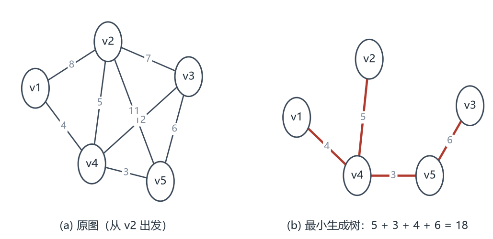

从 v2 出发，目标是扩充 v2 所在的集合：

1. v2 往外连四条边，最小的是 **v2–v4（5）** → 扩进 v4；
2. 多了 v4 这个出发点，跨接边变成 7 条（原来 4 条 + v1–v4、v3–v4、v4–v5），其中最小的是 **v4–v5（3）** → 扩进 v5；
3. 又多了 v5 的出边，比较后发现最小的是 **v4–v1（4）** → 扩进 v1；
4. 最后跨接边里只剩 **v5–v3（6）** 最小 → 扩进 v3，共 n−1 = 4 条边，总代价 5+3+4+6 = 18。

人算时容易眼花，抓住思想就不难：**每次加一个顶点，候选边每加一个点都要重新比一遍**，加到为止。

**克鲁斯卡尔（Kruskal）算法——直接挑边**。Prim 的原理是加点，Kruskal 换个角度——**不管点，直接挑边**：把所有边从小到大排序，依次挑最小的 n−1 条。

讲究只有一个：**不能形成回路**（挑出来的边数够 n−1 条时若不构成回路，一定是一棵树）。判断回路的巧妙做法是给所有顶点**分组（分连通分量）**：

- 挑一条边时，若**两端属于同一组**，加上必成回路，舍弃；
- 若**两端属于不同组**（跨接），可以加；加完后**把两组并成一组**（把一组的组号全部改成另一组的值）。

**三大步**（课本没给算法，课件配套代码有，写出来其实很短）：

1. 每个顶点各自成一类：`vset[i] = i`；
2. 所有边按权值**排序**（复杂度主要在这，O(e log e)），从头往后挑，这次不要的边将来也不会再要；
3. 从头挑边：两端 `vset` 不同（跨接）才要；挑中后合并两类。合并还可以更高效——用课本 6.5 节的 **Union-Find**（并查集）算法。

**例题**（课件六顶点 v1–v6）：按从小到大挑边 1 → 2 → 3 → 4 → 5，每条都跨接不同组，全部要上，恰好 n−1 = 5 条，最小生成树就出来了（1: v1–v3，2: v4–v6，3: v2–v5，4: v3–v6，5: v2–v3）。

> [!tip] Kruskal 用什么存储
> 算法要用 `sort`，链表不好排序，所以用**数组形式的邻接多重表**——**边表**（顺序存储，元素 = 两顶点 + 权值）。

**两种算法对比**：Prim 适合边密的图（靠顶点扩充），Kruskal 复杂度 O(e log e)、适合**边少顶点多**的图。

### 7.5 有向无环图及其应用

先分清三个概念：

- **有向树**：本质是树（无环）的有向图；
- **DAG（有向无环图）**：没有环，但一个结点可以有多个"父结点"，所以不是树——像课程先修关系图，最下面汇出去就出去了，跑不了圈；
- **普通有向图**：有环。

#### 7.5.1 拓扑排序

拓扑排序由某个集合上的一个**偏序**得到一个**全序**：偏序 = 集合中仅部分元素之间可比较；全序 = 任意两个元素之间都可比较。在偏序图上人为补上缺失的优先关系，就得到**拓扑有序**序列。

**应用**：给出一个**可行序列**——典型如**学习路线**（先修课关系：没学 C 语言，数据结构就不用学了；两门课互为先修是不允许的，所以先修关系图必然无环，是 DAG）或施工工序路线。直观上"从最左边出发"，潜意识里就是因为最左边的点**没有前置条件**——图上的前置条件就是**入度**。

> [!important] 拓扑排序的核心
> **每次挑一个入度为 0 的顶点输出**，然后把它射出去的边删掉（它指向的顶点入度减一）。若同时有多个入度为 0 的顶点，**随便挑**——它们互不相关（比如先学 C1 还是先学 C9 没有区别）。

**手算例**：

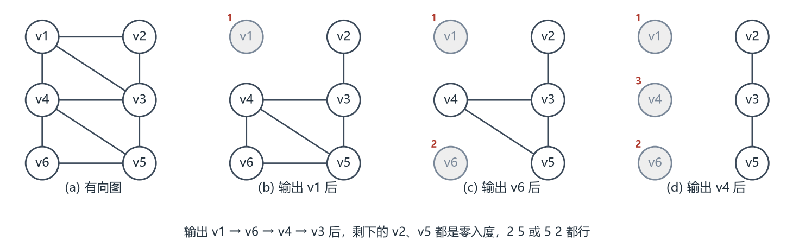

全图过一遍找零入度顶点（代码也没招，也只能全扫，找到一个就停），输出 **v1** → v1 的三条出边删掉（它的后继 v2、v3、v4 入度减一），多出几个零入度 → 输出 **v6** → v4、v5 入度减一 → 输出 **v4** → 输出 **v3** → 剩 v2、v5 都是零入度，**2 5 或 5 2 都行**。序列：**v1 v6 v4 v3 v2 v5**（或 v1 v6 v4 v3 v5 v2）。

**AOV 网与判环**：顶点表示活动、弧表示优先关系的有向图叫 **AOV 网**（Activity On Vertex）。AOV 网中**不能有环**——有环意味着某项活动以自身的完成作为前提。检查方法：跑拓扑排序，若**所有顶点都进了拓扑序列则无环**，否则有环。

**代码要点**（`//算法7.12 拓扑排序`）：

1. 先把**所有顶点的入度**算一遍（`FindInDegree`，具体算法取决于存储方式）；
2. 开一个**栈**，把零入度顶点全部进栈；出栈的一定是零入度，直接输出；
3. 输出后把它的出边目标顶点**入度通通减一**，减到 0 的进栈；
4. 用 `count` **计数**：图可能非连通或**有环**，若 `count < vexnum`（没能把所有顶点排出来）就**报错**。

> [!tip] 为什么用栈
> 本算法用队列、栈都行；用栈是因为**后面的关键路径算法要用拓扑序列的逆序**——压栈再弹出来正好反过去。

#### 7.5.2 关键路径

关键路径跑在 **AOE 网**（Activity On Edge）上——与 AOV 的区别就在这俩字母：**V 是顶点，E 是边**。AOE 网中**顶点表示事件**（其前所有活动已完成、其后活动可以开始），**弧表示活动**，**弧上的权值表示活动所需的时间或费用**——它**边有权重**，而拓扑排序的 AOV 网没权。

**研究的问题**：整个工程至少需要多少时间？哪些活动是影响工程进度的关键？答案：从起点到终点**最长**的那条路径——所有前置条件都得完成，事件最早发生时间只能取最长路线，所以**工程最短完成时间 = 最长路径的长度**，这条最长的路径就叫**关键路径**（听起来吓人，其实就是挑最长的）。

**四个量**（命名规律：带 v 的一定是顶点的）：

| 量 | 含义 | 取值 |
| --- | --- | --- |
| `e(i)` | **活动**最早开始时间 | = 弧尾的 `ve` |
| `l(i)` | **活动**最晚开始时间 | = 弧头的 `vl` − 弧的权 |
| `ve(j)` | **事件**（顶点）最早发生时间 | 从起点到 j 的**最长**路径长度 |
| `vl(j)` | **事件**（顶点）最晚发生时间 | 终点时间倒着往回扣 |

`l(i) − e(i)` 是**时间余量**（有些地方可以拖），`l(i) − e(i) = 0` 的活动叫**关键活动**——一点都拖不得。

**算法骨架（本质就是拓扑排序）**：公式 7-1、7-3 都依赖 `ve`，所以**先算 `ve`**——把拓扑排序稍微改一下，**在拓扑排序的过程中顺便算 `ve`**：

- 拓扑排序里，输出 j 后要更新 j 的各后继 k 的入度；这里**顺便比较**：若 `ve[j] + dut(<j,k>) > ve[k]`，则 `ve[k] = ve[j] + dut`。
- 含义：j 能连到 k，说明 j 是 k 的**前置条件**；每发现一条到 k 的路，看看它够不够长——**留最长的**。初值 0，每发现一条更长的路就更新一次。

`vl` 要**逆拓扑序**算（从终点往回扣），这就是拓扑排序用**栈**的理由——弹出即逆序。算出 `ve`、`vl` 后，`e` 取弧尾 `ve`、`l` 取弧头 `vl` 减权，一减就出 `l − e`。

**手搓那张表（可以偷懒）**：考试有时不考代码，考**表怎么填**。手算不必严格按代码一步步来，可以目测：

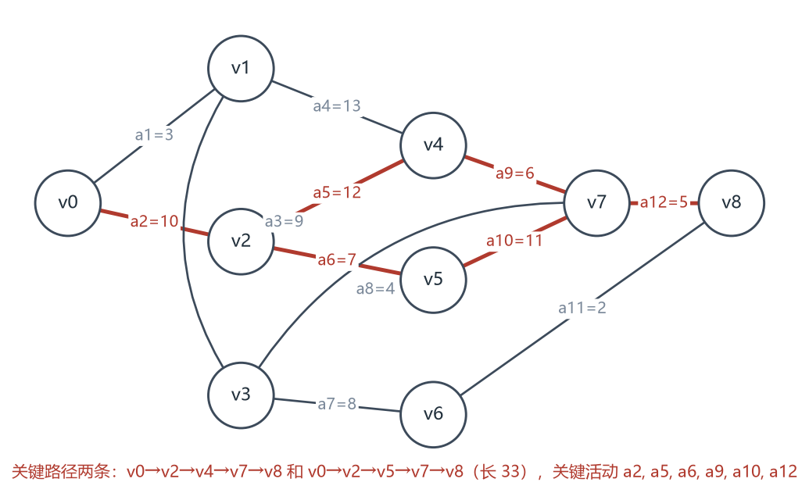

以课件 v0–v8 的 AOE 网为例（活动 a1=3、a2=10、a3=9、a4=13、a5=12、a6=7、a7=8、a8=4、a9=6、a10=11、a11=2、a12=5）：

1. **随便找一条关键路径**（比如 v0→v2→v4→v7→v8，长 33）——这条路上 `ve = vl`，**八个点里的五个一下就填完了**；
2. 其余顶点的 `ve` = 从 v0 到它的**最长**权重和；`vl` = 33 减去它到 v8 的最长路径（后半段）。得到：

| 顶点 | v0 | v1 | v2 | v3 | v4 | v5 | v6 | v7 | v8 |
| --- | --- | --- | --- | --- | --- | --- | --- | --- | --- |
| ve | 0 | 3 | 10 | 12 | 22 | 17 | 20 | 28 | 33 |
| vl | 0 | 9 | 10 | 23 | 22 | 17 | 31 | 28 | 33 |

3. **边表**：`e` 直接取**弧尾的 ve**；`l` 取**弧头的 vl − 权**；`l − e` 点一下：

| 弧 | a1 | a2 | a3 | a4 | a5 | a6 | a7 | a8 | a9 | a10 | a11 | a12 |
| --- | --- | --- | --- | --- | --- | --- | --- | --- | --- | --- | --- | --- |
| e | 0 | 0 | 3 | 3 | 10 | 10 | 12 | 12 | 22 | 17 | 20 | 28 |
| l | 6 | 0 | 14 | 9 | 10 | 10 | 23 | 24 | 22 | 17 | 31 | 28 |
| l−e | 6 | 0 | 11 | 6 | 0 | 0 | 11 | 12 | 0 | 0 | 11 | 0 |

关键活动为 **a2, a5, a6, a9, a10, a12**，构成**两条关键路径**：v0→v2→v4→v7→v8 与 v0→v2→v5→v7→v8。

算法复杂度：拓扑排序 O(n+e)、求 ve/vl O(n+e)、找关键活动 O(n+e)，整体 **O(n+e)**。

### 7.6 最短路径

#### 7.6.1 单源点最短路径（Dijkstra 算法）

给定有向图 G 和单个源点 Vs，求 Vs 到其余各顶点的最短路径。算法按**路径长度递增**的次序逐个产生最短路径。

> [!warning] Dijkstra 无法处理负权边
> 这是它天生的缺陷，没有补救。

**和 Prim 像到什么程度**：同样是**逐步加点**、同样**挑权值最小**、同样维护两个集合（这里叫 S 和 V−S，参考 Prim 的 U 和 V−U）。**最大区别只在更新操作**：Prim 更新的是集合 U 到 V−U 之间的距离；Dijkstra 更新的是**源点到 V−S** 的距离。配套代码里有"迪杰斯特拉改写成普里姆"的对照版，二者互改只需换更新那句。

**D 数组（距离数组）**：`D[i]` = 从源点出发**中间只经过 S 中顶点**到达 i 的最短路径长度。初始化：

- `D[s] = 0`（自己到自己）；
- 有边 `<s, i>` 的填权值；没边的填无穷大——初始化的实际就是源点的邻接点。

**算法步骤**（重复 n−1 次）：

1. **挑最小**：从 `V−S` 里挑 `D[k]` 最小的顶点 k，并入 S（`final[k] = TRUE`，final 数组就是区分顶点是否已加入的布尔数组）；
2. **更新**：对 `V−S` 中每个顶点 w，若 `D[k] + w(k,w) < D[w]`，则 `D[w] = D[k] + w(k,w)`。含义：k 并入意味着"源点到 k 的最小值已确定"，k 若能连到 w，就多了一条"经 k 到 w"的候选路，更短就刷掉旧值。`D[w]` 之后还会不断更新，不用担心现在刷小了。

时间复杂度 **O(n²)**（二重循环）；只想到某个特定终点的最短路径，复杂度还是 O(n²)。

**路径别用课本的二维 P，用一维来源点**：课本算法 7.15 用二维数组 P 记路径，两个毛病——夸张（其实一维就够）且**记下的顶点没有顺序**。更好的做法：在更新距离那句后面**顺便记一句 `P[w] = k`**——k 是到达 w 的**前一个点（来源点）**。要还原路径时，从终点出发**沿 P 反向追踪**（`P[w] → P[P[w]] → …` 直到源点）即可；也可以用栈：一站一站往前追，再弹出来就是正序路径。现在的地图软件就是这么记路径的。

**手算例**（课件 p115，无向带权图：1–2=1、1–3=12、2–3=9、2–4=3、3–4=4、3–5=5、4–5=13、4–6=14、5–6=15，从 1 出发）：

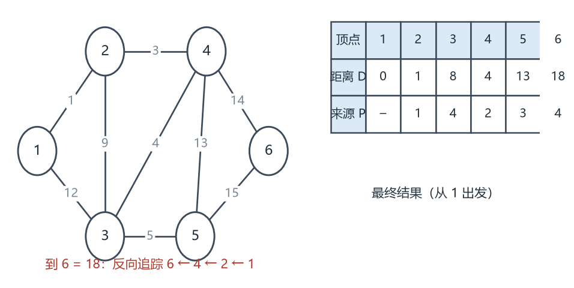

| 轮次 | 动作 | 距离 D | 来源 P |
| --- | --- | --- | --- |
| 用 1 更新 | 2 = 1、3 = 12 | –, 1, 12, ∞, ∞, ∞ | –, 1, 1 |
| 选入 2 | 经 2 到 3：1+9=10 更小；到 4 = 1+3=4 | 1, **10**, 4, ∞, ∞ | 1, **2**, 2 |
| 选入 4 | 经 4 到 3：4+4=8 更小；到 5 = 4+13=17、6 = 4+14=18 | 1, **8**, 4, 17, 18 | 1, **4**, 2, 4, 4 |
| 选入 3 | 经 3 到 5：8+5=13 更小 | 1, 8, 4, **13**, 18 | 1, 4, 2, **3**, 4 |
| 选入 5 | 经 5 到 6：13+15=28 > 18，不更新 | 1, 8, 4, 13, 18 | — |
| 选入 6 | 结束 | 1, 8, 4, 13, **18** | — |

注意**只需要更新未选入的顶点**（已选入的 D 已确定）。最终：到 6 的最短距离 18、来源是 4；反向追踪 **6 ← 4 ← 2 ← 1**，路径还原完成；到 5 的距离 13，来源是 3。

#### 7.6.2 每一对顶点间的最短路径（Floyd 算法）

Dijkstra 也可以对每个顶点当一次源点来求"每对顶点"，而 **Floyd 一次求出每一对顶点**的最短路径：

- **优点一**：能**处理带负权边**（Dijkstra 不行）；
- **优点二**：代码**特别短**；
- **缺点**：时间复杂度 **O(n³)**——求的太多了。实际（导航）里极少见负权，一般还是用 Dijkstra；真遇到负权边，才老老实实用 Floyd。

**距离矩阵 ≠ 邻接矩阵**（书上多处搞混，务必分清）：

| | 对角线 | 含义 |
| --- | --- | --- |
| 邻接矩阵 | **无穷大**（带权图） | 存"有没有边" |
| 距离矩阵 D | **0** | 存"当前 i 到 j 的最短距离" |

D 初始时：对角线 0、有边填权、无边填无穷；之后从 `$D^{(-1)}$` 依次算 `$D^{(0)}, D^{(1)}, \ldots, D^{(n-1)}$`。

**三重循环 = 不断插中转点**：核心更新式

`$D^{(k)}[i][j] = \min\{ D^{(k-1)}[i][j],\; D^{(k-1)}[i][k] + D^{(k-1)}[k][j] \}$`

`D[i][j]` 是 i 直达 j；`D[i][k] + D[k][j]` 是**经 k 中转**。第一重循环把每个顶点 k 轮流当中转点插进去试一遍，另两重循环扫全部格子更新。代码核心就一个判断：`if (D[v][u] + D[u][w] < D[v][w]) D[v][w] = D[v][u] + D[u][w];`（配套代码里还加了对角线清零）。

**手算怎么一格一格更新——画十字线**：轮到中转点 u 时，把 u 所在的**行和列画成十字线**（十字线与对角线上的格子不更新），其余格子逐个看：把该格子**投影到十字线上**——横投影 `D[i][u]`、竖投影 `D[u][j]`，若两投影之和小于原值就更新。例（无向图 1–2=1、1–3=12、2–3=9、2–4=3…）：轮到 2 时，`D[1][3] = 12` 投影得 `1 + 9 = 10` → 改成 10；`D[1][4] = ∞` 投影得 `1 + 3 = 4` → 改成 4；`D[1][5]`、`D[1][6]` 投影过来是无穷，更新不了。**无向图距离矩阵对称，只需更新一半**，另一半照抄。

**路径矩阵 P**：课本记路径的方式同样不好（只记经过的顶点、没有顺序）。实用做法：`P` 与 D 等大、初始全 −1；更新 D 成功时**记下中转点 `P[i][j] = u`**。含义是 i 到 j 这条路径**经过 u**——但**不代表 i 直达 u、u 直达 j**（前后半段以后还可能再插进别的点）。还原路径用**递归拆开**：查 `P[i][j]` 得 u → 把 i→j 拆成 i→u 和 u→j → 对两半分别再查 P → 直到查到 −1（直达）为止。例如查得 1→5 经过 4、1→4 经过 2、2→4 和 4→5 都是 −1，路径就是 1, 2, 4, 5。

有向图例（课件 p123）：邻接矩阵 `$\begin{pmatrix} 0&4&11 \\ 6&0&2 \\ 3&\infty&0 \end{pmatrix}$`。`$D^{(0)}$`（试插 v0）把 `D[2][1]` 的 ∞ 更新为 `3+4=7`；`$D^{(1)}$`（试插 v1）把 `D[0][2]` 的 11 更新为 `4+2=6`、`D[1][0]` 的 6 更新为 `2+3=5`；`$D^{(2)}$` 无更新。路径矩阵同步记下 `P[2][1]=0`、`P[0][2]=1`、`P[1][0]=2`。

### 第7章 要点

> [!warning] 考试提醒（课堂原话）
> - **DFS 手搓访问顺序一定会考**：能走就走、走不动再退
> - **Prim 手算基本必考**：每次加一个点，候选边重新比一遍
> - **拓扑排序手算**：每次挑入度为 0 的
> - **关键路径考填表**：先随便找一条关键路径把 ve = vl 的先填上，再补其余
> - **Floyd 考 D 矩阵**（画十字线投影更新）和三重循环代码
> - 7.4.2 强连通分量、7.4.4 关节点与重连通分量**不考**

> [!summary] 本章要点
> - 图 = **多对多**；`$\langle v,w\rangle$` 尖括号有序 = 弧 = 有向（v 弧尾、w 弧头），`$(v,w)$` 小括号无序 = 边 = 无向（双向箭头省略）
> - 描述一张图 = **顶点集（数据）+ 边/弧集（结构）**；无向图输入半条边、程序自动补对称
> - **邻接矩阵对角线**：无权置 0、**带权一律置 ∞**（防算法"自己连自己"）；无向 → 对称阵
> - 四种类型：DG / DN / UDG / UDN（N = network = 带权 = 网）
> - **生成树**：n 顶点、n−1 条边、极小连通；**不唯一** → 最小生成树；n−1 条边的图不一定是生成树
> - **邻接表**：省空间、找邻接点最方便、顶点好增删；**头插法 → 链表逆序**；无向图一条边存两次；判两点可达麻烦（最短路径不用它）；有向图另有**逆邻接表**（挂进来的，算入度）
> - **十字链表** = 出边表 + 入边表合并（`firstin` / `firstout`，头插法同插两条链），太复杂一般不用；**邻接多重表** = 一条边只存一处，适合以边为核心的算法（Kruskal 用它的数组形式——**边表**）
> - **选存储看算法**：最短路径/传递闭包 → 矩阵；遍历/拓扑/Prim → 邻接表；Kruskal → 边表
> - **DFS**：递归**天然回溯**（栈是手动回溯）；`visited[]` 去重；外层 for 防多个连通分量；**BFS**：队列、水波一圈圈扩（类比二叉树层序遍历）
> - **Prim（加点）**：`closedge` 的 `lowcost` 双用途——存权 + **为 0 表示已并入 U**；挑**非零**最小值；每次并入后用新点更新全部候选边
> - **Kruskal（挑边）**：边排序后从小到大挑，**两端不同组才要**（`vset` 分组 / 并查集），要上后并组
> - **拓扑排序**：每次挑**入度为 0** 的顶点输出，删它的出边（后继入度减一）；`count < n` 报错（有环）；用**栈**因为关键路径要逆序
> - **关键路径（AOE 网）**：顶点 = 事件、弧 = 活动、权 = 时间；**最长路径 = 最短工期**；`e` = 弧尾 ve、`l` = 弧头 vl − 权、`l − e = 0` 为关键活动；拓扑序算 `ve`（留最长），逆拓扑序算 `vl`
> - **Dijkstra（单源）**：不能带负权；挑 D 最小 + 更新 `D[k]+w < D[w]`；与 Prim 的区别只在**更新的是源点距离**；路径记**一维来源点** `P[w]=k`，反向追踪还原
> - **Floyd（每对顶点）**：能带负权、O(n³)、代码短；**距离矩阵对角线是 0**（不是邻接矩阵！）；三重循环**插中转点** `min(D[i][j], D[i][k]+D[k][j])`；手算画**十字线**投影更新；路径矩阵记中转点、**递归拆开**还原

---

## 第9章 查找

> [!info] 本章范围
> 按课件《第9章 查找》（131 页）整理到 9.2.1 二叉排序树与平衡二叉树；9.2.2 B-树与 B+树、9.3 哈希表录音尚未讲到

### 9.1 静态查找表

**几个术语**：

- **关键字**：一般用 `key` 或 `k` 表示。它不一定是"一个词"，也可能两个字合起来做一个关键字——本书不考虑这种复杂情况，认为**关键字是唯一的**（像身份证号，不重复）；
- **静态查找**：只查、不改表。典型：成绩填进教务系统后大家去查，表不怎么改；
- **动态查找**：查找过程中表本身动态生成——查到了直接返回，**没查到就把关键字插进去**（下次再查就有、就能很快找到）。典型：数据库，反反复复增删查，查找时还兼做插入。

静态和动态的操作方式不一样，**适用的算法也不一样**：静态比较简单，动态比较复杂。

**ASL（平均查找长度）**：衡量"找到一条记录平均要找多少次"，是考试经常考的计算量：

`$ASL = \sum_{i=1}^{n} P_i C_i$`

`$C_i$` = 找到第 i 个元素需要查的次数（**至少 1**，一次都不找就谈不上找到）；`$P_i$` = 查找它的概率——有的题目等概率、有的不等概率，两者**乘起来**才是正儿八经的 ASL。

#### 9.1.1 顺序表的查找

对无序的静态表，暴力搜索没有太好的办法，只能从头到尾。

**哨兵**：可以取巧的地方——**0 号下标空出来不存数据**，用来放哨兵：把要找的 `key` 填到 0 号位，然后**倒过来查**，循环里**不用再做越界判断**。因为就算表里没有，最坏也会在 0 号位"找到"哨兵停下来，`i >= 0` 这个判断永远成立，可以省掉。代价是 0 号位浪费一格、方向倒着；如果从 0 号下标就起存数据，就得在循环里多一个 `i >= 0` 的越界判断。速度差别微小，但这招追求极限速度时会用。

**ASL 要分清"成功"还是"失败"**：一个 key 丢进去，可能搜到、也可能没搜到。等概率下查找成功的 `ASL = (n+1)/2`；考题要你看清考的是**成功**、**失败**还是**平均**——算平均就得成功失败都算（通常认为成功失败各占一半）。

#### 9.1.2 折半查找

前提：表**有序**、且**顺序存储**。维护三个下标 `low`、`high`、`mid`：先跟 `mid` 比，相等就找到；没找到看去左半边还是右半边，不断缩小区间，直到找到或区间空。

```c
low = 1;  high = length;              // 从 1 起存
while (low <= high) {
    mid = (low + high) / 2;
    if (key == ST[mid].key)       return mid;   // 找到
    else if (key < ST[mid].key)   high = mid - 1;  // 去左半边
    else                          low  = mid + 1;  // 去右半边
}
```

**一定要 +1、一定要 −1**，不能直接取成 `mid`——`mid` 已经比过了。

效率：每次把区间**除以二**，速度非常快，总体是**对数级 O(log n)**，结论记住即可。

#### 9.1.3 静态树表的查找

前面的顺序、折半查找都默认**各关键字查找概率相同**。概率不同时，折半的判定树**不一定最优**。例如 5 个关键字概率分别为 0.1、0.2、0.1、0.4、0.2：按折半建的判定树 `ASL = 0.1×1 + 0.1×2 + 0.4×2 + 0.2×3 + 0.2×3 = 2.3`；把概率大的（0.4）提到根上重排后 `ASL = 0.4×1 + 0.2×2 + 0.2×2 + 0.1×3 + 0.1×3 = 1.8`，明显更好。

**静态最优查找树**：只考虑查找成功时，判定树**带权路径长度之和 `PH` 最小**的树，`$PH = \sum_{i=1}^{n} w_i h_i$`（`$w_i = c \cdot p_i$` 为权重，`$h_i$` 为结点层次）。思想：**权值大的往上提**。

> [!important] 最优难做，退而求其次
> 构造真正的静态最优查找树**代价太高**（且"最优"与"次优"差不太多）。实际转而构造**次优查找树（Nearly Optimal Search Tree）**：构造快、简单，效率只差 1%–2%，实用价值高。

**大思路：左右尽量等重**。树越高查找次数越多；若左右权重差很多，必有一侧较高、PH 偏高。所以每次选根都争取**左右子树权重接近**，而且这个想法是**递归**的——每一层都把握"左右等重"。

**`ΔP` 定义**：在序列 `$ (r_l, \ldots, r_h)$`（递增有序，权 `$ (w_l, \ldots, w_h)$`）里取一个点 i 做分界，把左右两半的权值各加一下看差多少：

`$\Delta P_i = \Big| \sum_{j=i+1}^{h} w_j - \sum_{j=l}^{i-1} w_j \Big|$`

**取 ΔP 最小的那个点做根**。穷举当然可以但效率低，取巧之处：公式里**左右都是两个和**，于是引入**累计和（前缀和）** `sw`，把公式改写成

`$\Delta P_i = \big| (sw_h - sw_i) - (sw_{i-1} - sw_{l-1}) \big|$`

原理没变，但**所有 Σ 都没了**——前缀和一次性算好，后面全靠减，避免每次重复求和。

**代码（`//算法9.3 SecondOptimal`）怎么读**：前三行就是**找一个最小值**（平衡点 i）；以 i 做根后左右递归。两个极端判断：i 可能取到最左侧（比如只剩两个数，一边必空）——`if (i == low) T->lchild = NULL`，否则才递归左子树；右侧同理。

**手搓例题（考试题型）**：手搓比填代码还简单，画图题不必默代码，发挥的是**思想**——每次取根尽量左右平衡。

- **9 个关键字**例（权值 A=1, B=1, C=2, D=5, E=3, F, G=4, H=3, I=5）：A 做根显然不平衡（左空右一大坨），根一般取中间；算得 **F** 的 `$\Delta P = |(4+3+5) - (1+1+2+5+3)| = 0$`，根定 F；对左子表 A–E 继续，取到 **D** 时两边基本平衡……如此递归到整棵树构造完成。
- **5 个关键字**例（A=1, B=30, C=2, D=29, E=3）：算法做出 (a)：根 C，PH = 1×2 + 2×30 + 2×29 + 3×1 + 3×3 = **132**；把根调成 B 的 (b)：PH = 1×30 + 2×1 + 2×29 + 3×2 + 3×3 = **105**，反而更小。

> [!warning] 次优真的有"次"
> (a) 那个例子说明：数值太少时构造结果可能是特例，"次优"居然不是最优。补救办法很简单——选平衡点 i 后，**比较 i−1、i、i+1 三者的权值，取最大的做根**，做出来的树会更优一点点。但课本和网上的资料都没把这个调整写进代码（差得不多），实际关键字几百个起步时基本不会出现这种情况。知道一下即可。

只有两个数时取谁也**不能目测**——越往下要多查一次，同样走这个流程：选权重大的往上提，小的挂下面。

#### 9.1.4 索引顺序表的查找

**分块查找（Blocking Search）**，又称索引顺序查找，是顺序和折半的综合：

- **查找表的组织**：① 把表分成几块，**块间有序**（第 i+1 块的所有关键字均大于第 i 块的）、**块内无序**；② 附加一张**索引表**（按关键字有序），每条索引项记录**最大关键字 + 起始指针**。
- **查找过程**：先查索引表定块，再在块内**顺序查找**。例：表 `22 12 13 8 9 20 | 33 42 44 38 24 48 | 60 58 74 57 86 53`，索引表 (22, 1)、(48, 7)、(86, 13)。找 38：22 < 38 < 48 → 若存在必在**第二块** → 到区间 [7,13) 顺序扫，找到或找不到为止。

**ASL**：表长 n、均分 b 块、每块 s 条（`$b = \lceil n/s \rceil$`），等概率下

`$ASL_{bs} = L_b + L_w = \frac{1}{b}\sum_{j=1}^{b} j + \frac{1}{s}\sum_{i=1}^{s} i = \frac{b+1}{2} + \frac{s+1}{2} = \frac{1}{2}\left(\frac{n}{s} + s\right) + 1 \approx \log_2\left(\frac{n}{s} + 1\right) + \frac{s}{2}$`

（后者是 s 取最优 `$\sqrt{n}$` 时的近似；用折半查找确定块时索引部分改为 `$\log_2(b+1)$`。）

**三种静态查找方法小结**（对比表直接背）：

| | 顺序查找 | 折半查找 | 分块查找 |
| --- | --- | --- | --- |
| ASL | 最大 | 最小 | 两者之间 |
| 表结构 | 有序、无序都行 | **一定有序** | 块间有序、块内无序 |
| 存储结构 | 顺序存储、线性链表都行 | **必须顺序存储**（链表定位不了中间） | 都行 |

**索引查找与数据库索引**：在数据库里找一条原始记录，不建索引就是暴力搜索，非常慢。通常做法：数据表（可能非常大，存在**外存/硬盘**上）原样不动，把**关键字 + 存储地址**抽出来单独做一张**索引表**——相当于给原表生成摘要。索引表比数据表小得多，若足够小可以**启动时直接加载进内存**，搜索速度大大提高。大型数据库的索引表本身也非常大，进不了内存——找数据就变成**要找两次甚至更多**：先在索引表里找，再按它指示的地址去硬盘找数据；索引表太大时还要再载入第二张索引表。

索引表的组织有两种：**线性结构**（顺序索引表，适用于小型数据库或磁盘文件——比如 Windows 搜文件时建的索引）和**树状结构**（下一节的 BST / B-树这类）。

- 优点：可用**折半查找**（快）；插入删除记录时**不用移动数据**（只维护索引表）；
- 缺点：索引项数目与记录数相同，索引表很大时检索要**多次访问外存**；索引表项的插入删除是**线性表的插入删除**，**维护代价高**（注意是索引表项的维护，不是记录的挪动）。

### 9.2 动态查找表

#### 9.2.1 二叉排序树和平衡二叉树

**二叉排序树**（BST）的定义三条就够：

1. 左子树不空时，左子树上**所有**结点值**小于**根；
2. 右子树不空时，右子树上**所有**结点值**大于**根；
3. 左右子树各自也仍是 BST。

按**中序遍历** BST 得到的一定是**递增序列**——所以构造 BST 的过程本身也是一个排序的过程。验证一棵树是不是 BST 也很容易：每个结点都复核一遍"左子树没有比它大的、右子树没有比它小的"。

**查找**：`k` 跟根比——相等最好，直接找到；小了去左子树、大了去右子树，过程与在整棵树上查没区别（树变小了），照样能甩出去一个子树。

```c
// 递归版：第一个 if 合并了两种情况，最好拆开理解
if (T == NULL || key == T->key)  return T;
//   T 为空 → 返回空 = 查找失败；相等 → 返回非空 = 找着了
else if (key < T->key)  return SearchBST(T->lchild, key);
else                    return SearchBST(T->rchild, key);
```

非递归版就是 `while` 往下爬：`while (p && p->key != key) p = (key < p->key) ? p->lchild : p->rchild;`——每循环一次爬一层，要么爬到底、要么找到。

**插入**：动态过程，先搜再决定——**搜到就不插**（关键字唯一，像身份证号，重了就不叫 key 了），**搜不到才插**。把查找的递归函数**扩充两个参数**：不管最终插不插都得搜一遍；找不到时一定是爬到了**最后一片叶子**之下，参数 p 的作用就是**记住这片叶子**，新结点插在它下面——新 key 比叶子大插右边，否则插左边。

**创建**：按输入顺序逐个走"查找 + 插入"。经典例 `{45, 24, 53, 45, 12, 24, 90}`：

> [!warning] 45 出现两次，树上只画一个圈
> 最后的树只有 5 个结点，但输入序列有 7 个数。**关键字具有唯一性**：第二次出现只是"又找了一遍"，**不需要再创建**。考试特别容易错——给的数有几个就死活画几个圈、弄出两个 45 来，必错。树生成后自己手工复核一遍即可。

**删除**：删除会破坏树结构和有序性，**分四种情况**（代码只有三个分支——空子树可归并）：

1. **p 是叶子**：直接删，不影响排序结果；
2. **p 只有左子树 / 只有右子树（单子树）**：把孩子直接提上去，f 的指针挂过去即可，代码各三行；
3. **p 左右都有（最麻烦）**：不能直接删，树会散。找它的**直接前驱 s**（或直接后继）当"替身"。

**为什么替身一定好删**：把 BST 的中序序列展开，p 的直接前驱 s 紧挨在 p 前面；s 是 p 左子树里最右下的结点，**s 一定属于最好删的情况**（纯叶子或单子树）。所以思路换成：**不删 p，把 s 的值复制刷到 p 上，再把 s 删掉**——间接达到删除 p 的目的，课本叫**逻辑删除**。往左找前驱、往右找后继本质一样，教材代码用前驱，例题两种都演示了。

**手算例**（课件 p46，原树 12(8(6, 10(9,)), 15(13(,14), 19))）：

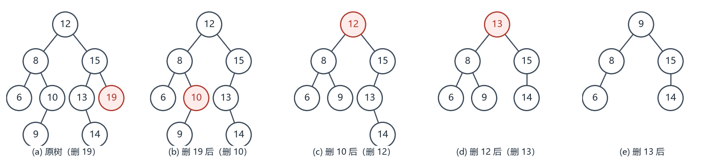

- 删 **19**：光叶子，直接删；
- 删 **10**：单子树，把下面的 **9** 往上提一层；
- 删 **12**：左右都有 → 找**后继 13**（右子树最左下），把 13 复制上去填到根，再把原来 13 那个结点删掉；
- 删 **13**：左右都有 → 找**前驱 9**（左子树最右下），复制上去，删原来的 9。

**代码框架**：`DeleteBST` 还是**搜索框架**（先 `if (!T) return FALSE` 把查找失败单独抽出来，equal 时调 `Delete(T)`，否则看去左边删还是去右边删——甚至算个先序遍历）。`Delete` 里前两个 if 处理单子树，最后的 else 最复杂：**找到 → 复制 → 删掉前驱**三步，对着示意图看懂顶替方向即可。

**查找分析：树形跟输入顺序有关**。BST 是在搜索过程中创建的，**同一批关键字**、不同插入顺序，形态差得特别多——均匀的形态 A 好查，拉成链的形态 B 效率糟糕。用户的搜索顺序不由我们控制，那就**在内部自己平衡**——这就是平衡二叉树的动机。

**平衡二叉树（AVL）**：左子树和右子树的**深度之差的绝对值不大于 1**（左右等高最好，差一层也行，差两层就要调），并且左右子树也各自是平衡二叉树。

**平衡因子** = 左子树深度 − 右子树深度，AVL 上每个结点的平衡因子只可能是 **−1、0、1**；只要有一个结点 |因子| > 1（比如 −2：左子树深度 0、右子树 2），树就**失去平衡**。既是 BST 又是 AVL 的树叫**平衡二叉排序树**。

思路：不限定用户输入（也没法限定），而是在**插入过程中随时检查**：发现失衡就调一下，最后生成的树所有点都平衡、形态接近完美——比如插入序列 13, 24, 37, 90, 53，调完之后**最多查三次**就能找到任何结点；不调就是一条链。

##### 平衡化旋转：LL / RR / LR / RL

**LL 型**：第一个 L 指**左孩子**、第二个 L 指**左子树**——在"左孩子的左子树"上插入使 A 失衡（插入前 A 的因子是 1，插入后变 2）。调整：**把 B 做根、把 A 压下来**，B 原来的右子树改挂为 A 的左子树。这个操作叫**右旋**——"旋"其实是**压低**的形象说法：一个下来、一个上去，最后都要**改树根**。代码就四件事：改根、把 `lc` 的右孩子转给 A 的左孩子、A 挂下去、改父指针。

**RR 型**：与 LL 完全**对称**——在"右孩子的右子树"插入，**左旋**一次。

**LR 型**：在"左孩子的右子树"插入，要**转两次**：① 先以左孩子 B 为根**左旋**一次（B 压下来、C 提上去）；② 再以 A 为根**右旋**一次（C 上去、A 压下来）。RL 型完全对称：先右旋、再左旋，书本没给 RL 的代码，把 LR 那段左右反过来抄就能用。

**插入算法：先插，再决定要不要调**。`if (!T)` 结点不存在就先插进去；插入返回"已存在"说明没生成新结点、树高没变，直接过；否则看**有没有长高**，再 switch 看**插入之前**的平衡因子：

- 本来就**左高**、又在左边长高一层 → **要调整**；
- 本来等高（EH）、插完变左高 → 没关系，只是高一层；
- 本来**右高**、左边长高 → 刚好**均衡**了，直接过。

所以真正要调的只有「**本已偏高 + 同侧又长高一层**」这一种；不是一插左边就得调。

**构造例（什么时候转一次、什么时候转两次——一定要会）**：

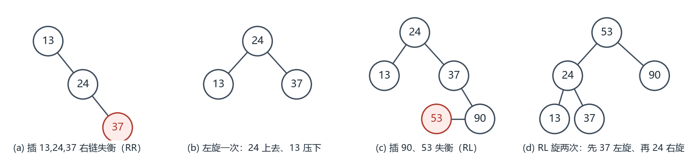

插入 13、24、37 时成一条右链，失衡，属 **RR 型 → 左旋一次**：把 24 提上来、13 压下去，成 24(13, 37)；再插 90（37 的右孩子）还平衡；插 53（37 的右孩子的左子树）失衡，属 **RL 型 → 旋两次**：第一次对 37 **左旋**（90 压下来、53 抬上去），第二次对 24 **右旋**（53 上去、24 压下来），最终 53(24(13, 37), 90)。

**时间复杂度**：平衡化后树高可控（基本等高、最多差一），查找 **O(log n)**。

### 第9章 要点（截至 9.2.1）

> [!warning] 考试提醒（课堂原话）
> - **次优查找树**：有时考代码填空、有时直接给权值让你**手搓一棵树**——手搓考的是"每次取根左右尽量平衡"这个思想
> - **BST**：代码一般不会全让写，通常抽几行填空；**重复关键字不要再挂上去**
> - **AVL**：会判断**什么时候转一次、什么时候转两次**，转两次的自己转一转
> - **ASL 计算看清是"成功""失败"还是"平均"**

> [!summary] 本章要点（截至 9.2.1）
> - **静态查找**只查不改（教务系统），**动态查找**查不到就插入（数据库）
> - `$ASL = \sum P_i C_i$`：`$C_i \ge 1$`，概率要乘上；分清成功 / 失败 / 平均
> - **顺序查找**用**哨兵**：0 号位放 key、倒着查、免越界判断；成功 ASL = (n+1)/2
> - **折半**：有序 + 顺序存储；`low = mid + 1`、`high = mid - 1` **不能省**（mid 已比过）；O(log n)
> - **次优查找树**：`$\Delta P_i$` 取最小做根、左右尽量等重；前缀和消掉所有 Σ；极端情况 `i == low` / `i == high` 判空；**"次"是真的次**——i−1、i、i+1 三者权值大者做根更优
> - **分块查找**：块间有序、块内无序；索引表记"最大关键字 + 起始指针"；`$ASL = \frac{b+1}{2} + \frac{s+1}{2}$`
> - 三种静态查找对比：ASL 顺序最大、折半最小、分块居中；折半**必须顺序存储**
> - **BST**：左 < 根 < 右，中序遍历 = 递增序列；删除四情况——叶子直接删、单子树上提、双子树找**前驱/后继当替身**（逻辑删除：复制值 + 删替身），替身必然好删（中序紧邻、只可能是叶子或单子树）
> - **AVL**：平衡因子 = 左深 − 右深 ∈ {−1, 0, 1}；**LL/RR 转一次**（右旋/左旋），**LR/RL 转两次**（先小后大）；真正要调的是"本已偏高 + 同侧又长高"；平衡后查找 O(log n)

---

## 相关链接

- [[数据结构实验题]] · #数据结构 · #线性表 · #课程笔记
- [[数据结构与算法]]（专题笔记）
- [[链表相关]]（链表专题）
